# NanoScope — User Manual

*NanoScope build 40.15.59. Manual edition 2026-09-29. The incubation-study workflow is updated against this build. Other main-analysis chapters retain their 2026-09-11 source review (revision 703a96a), unless a later date is stated; this edition does not claim a new audit of every feature or a recapture of every illustration. Historical apo-ferritin results retain their original recipes and are not detector-performance or calibration guarantees.*

> Images live in `images/`. `manual.html` beside this file is the same text as a single self-contained page; open it in a browser and print to PDF, or run `docs/gen_page.py --pdf` to rebuild both. (Do not use `pandoc` — it is not installed on this bench, and the page's own print stylesheet is what makes the PDF readable.)

---

User manual · edition 2026-09-29 · build 40.15.59

# NanoScope

Open a nanopore recording, calibrate it, find translocation events, curate them by hand, and fit
what is left — without ever losing track of which number was measured and which was assumed.

- maintained specialist control reference
- ABF · HDF5 · TDMS · CSV
- unified incubation studies + 5 historical walkthroughs
- real apo-ferritin data

## Contents

1. [What NanoScope is](#what-nanoscope-is)
2. [The window](#the-window)
3. [Automatic baseline assessment](#do-this-first-measure-the-open-pore-baseline)
4. [The six steps](#the-six-steps)
5. [Analysis and plotting: navigation guide](#analysis-and-plotting-navigation-guide)
6. [Your first plot: a worked histogram](#your-first-plot-a-worked-histogram)
7. [Recording-specific references](#recording-specific-references)
8. [Editable amplitude and event characterization](#current-event-characterization-and-editable-amplitude)
9. [Current population plots: step-by-step recipes](#current-population-plots-recipes-and-interpretation)
10. [Figure Library and publication export](#figure-library-and-publication-export)
11. [Plotting problems: where to look](#plotting-problems-where-to-look)
12. [Projects, recovery and verification](#projects-recovery-and-verification)
13. [Incubation studies: one entry and shared curation](#incubation-studies-one-entry-and-shared-curation)
14. [Historical walkthrough 1: one recording](#walkthrough-1-one-recording-end-to-end)
15. [Historical walkthrough 2: merging](#walkthrough-2-merging-fragmented-events)
16. [Historical walkthrough 3: three recordings](#walkthrough-3-comparing-three-recordings)
17. [Historical walkthrough 4: clustering](#walkthrough-4-clustering-and-reading-it-honestly)
18. [Historical walkthrough 5: ML](#walkthrough-5-ml-detection-replicated-step-by-step)
19. [Reconciliation and training labels](#reconciling-detectors-preparing-training-labels)
20. [Control reference](#control-reference)
21. [Refusals](#what-the-app-refuses-to-do)
22. [Known limits](#known-limits)

---

## What NanoScope is

NanoScope is a desktop application for solid-state nanopore electrophysiology. It reads a current
trace, finds the brief excursions where something passed through the pore, and gives you the tools to
decide which of those are real before you fit anything to them.

It can also serve as an **annotation and provenance-preserving export front end** for supervised
learning: reconcile several detectors, add misses, record human positive/negative decisions, apply
structured labels, and export regions for an external trainer. It is **not an in-app model trainer**.

The design assumption running through the whole app is that **a measurement you cannot
qualify is worse than no measurement**. So the app tells you when the current gain is
uncalibrated and refuses to report conductance in nanosiemens; it warns when a distribution fit is
truncated by your own curation; it names the estimator its baseline came from; and it stamps every
result with the calibration and baseline it was computed under, so a stale number cannot quietly
pass for a fresh one.

**Getting a copy**

This page is a single self-contained file — every screenshot is embedded, nothing is loaded
from the network, and it works offline. Save it anywhere and open it in any browser.

For a PDF: open it and print (`Cmd+P` / `Ctrl+P`) →
**Save as PDF**. The page carries print styles — the contents rail is dropped, each
section starts on a new page, screenshots and tables are kept whole, and the palette switches to
black on white.

**There is also a longer written guide**

`docs/USER_GUIDE.md` in the repository covers the same ground in prose, with more depth
on the baseline estimator, undo behaviour and project reopening. This page is the illustrated
companion: it documents every control by label and works through complete analyses on real data.
Both documents are maintained together. This edition adds the unified General, Zn, Cu and Acid
incubation entry and the complete main-workspace curation handoff. Earlier chapters cover the
Analysis Explorer, Figure Library and composition, publication export, optional amplitudes,
recording-specific open-pore references, and analytical-project recovery. The numbered historical
walkthroughs retain their measured results and illustrations with an explicit date and scope;
they are not claims that the current app will reproduce those counts under different settings.

**Reading this manual**

**For Analysis and plotting, read the navigation guide and worked histogram first.** Then use
the numbered current-population recipes and the Figure Library/export instructions. These
chapters follow the actual controls in their on-screen order. The historical walkthroughs
later in the manual preserve earlier examples; they are not the best place to learn today's
navigation. In the PDF, open the bookmarks panel to jump directly to a tool recipe.

Current menu paths are written `Analysis › Event gallery…`. Code formatting also identifies
filenames, columns and example values. Historical screenshots may show older labels; use the
current navigation map below. The manual is a maintained reference checked against source and
tests, not an automatically exhaustive inventory of every runtime control.

## The window

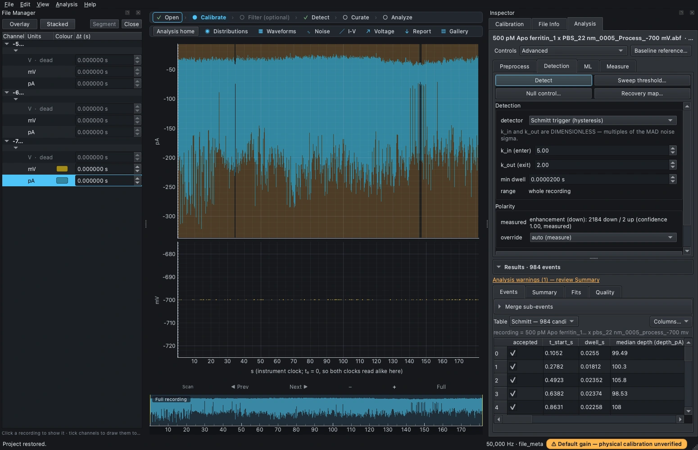

*Dated source capture, 2026-09-11; retained in this edition. File Manager selects the recording/channel, the centre shows the trace and navigation, and Inspector holds analysis controls and Results. Saved scientific results were loaded, not redetected for this illustration.*

Four principal regions (dock layout can be changed):

- **File Manager** (left) — every open recording and its channels. Tick a
channel to draw it. Ticking channels from more than one recording overlays them, which is how you
compare runs. Pane order is normalised regardless of the file's channel order:
current on top, then conductance, voltage, raw voltage — so the signal being
analysed is always in the same place. What counts as the current follows the
file's own declaration *unless you have corrected it* — the Calibration tab's
"Treat this channel as" override moves the pane rank and the overlay grouping
with it, so a channel the file mislabelled lands in the right pane once
corrected.
- **Workflow strip** (top centre) — `Open`, `Calibrate`,
`Filter (optional)`, `Detect`, `Curate`, `Analyze`. It
tracks where you are; a tick means that step is satisfied for the current recording.
- **Analysis launcher** (below it) starts with `Analysis home`, followed by
`Distributions`, `Event waveforms`, `Noise spectrum`, `I-V / conductance`,
`Voltage dependence`, `Report figures` and `Event gallery`. It abbreviates at narrow widths;
hover for the full name and requirements. Most numerical tools share the **Analysis Explorer**.
Use Analysis home to find Distribution summaries, Comparison figures, Subpopulations and Figure
Library as well; the shortcut row is not the complete capability list.
- **Inspector** (right) — tabs for `Calibration`,
`File Info` and `Analysis`.

Two linked strips sit directly under the trace. The **Adaptive Navigator** is the coarse map: at
broad zoom it says `Full recording` and shows the whole selected recording; at event scale it
switches automatically to `Local context · 9× view`, keeping the shaded main-view region wide
enough to grab even in a long recording. Drag the shaded body's middle to pan without changing
scale, or drag an edge to zoom. When `Measure event` is on, a separate blue band mirrors the live
event cursors; it is read-only, while the shaded region remains the navigation control.

The **Scan** strip is the repeatable event-scale control. `◀ Prev` and `Next ▶` move by 90% of the
visible window, preserving the zoom and leaving 10% overlap so an event on a boundary is seen in
both views. Active Measure cursors move by the same clamped distance, ready to bracket the next
event. The `−` / `+` buttons zoom out / in one incremental step around the centre, `Full` returns to
the complete trace, and the horizontal handle provides fine panning while zoomed in. With focus on the trace, `Shift+Left` / `Shift+Right`
scan backward / forward and `Shift+Down` / `Shift+Up` zoom out / in. These shortcuts are deliberately
trace-scoped, so the same keys keep their normal selection behaviour in tables and editors.
The mouse wheel does not change time scale: it moves the waveform vertically, up for wheel-up and
down for wheel-down. Double-clicking the trace places a Measure mask at that time, no wider than
20% of the visible view; its circular edge handles resize it and its shaded body moves it.

The work itself happens in the Inspector's `Analysis` tab, on the **right**. That panel carries
its own tab strip of four: `Preprocess`, `Detection`, `ML` and
`Measure`. `Controls › Essential / Advanced` changes visibility, not scientific settings.
Every path in this manual that begins “the `Preprocess` tab” or
“the `Detection` tab” means that strip; the screenshot above shows it docked on the right, and
`View` will hide or show the whole dock.

Below those tabs, expand `Results` and choose `Events`, `Summary`, `Fits` or `Quality`.
The Events page has a `Table` result selector near `Merge sub-events`. If one recording has Schmitt, CUSUM, ML, and
Reconciled results, the selector moves between their separately stored tables; switching it changes
only the view and never replaces or silently pools them.


*The Preprocess tab on the −600 mV recording, straight after `Measure this recording`: the proposal (rough 2 s / base 500 ms) and the nine health checks that judge it, every one prefixed `• PASS` and carrying its own pass criterion. The block is drawn **before** anything has been applied — the panel captions it “This is the evidence for the Apply click.”*

## Do this first: measure the open-pore baseline

**Choose the reference before interpreting an event.** The Automatic-window workflow below is
one route, not a requirement to replace independent open-pore evidence. The current app also
accepts a signed known current and selected open-pore intervals for this recording/channel.
See [Recording-specific references](#recording-specific-references). No method can certify an
open pore from a quiet plateau alone. Window-health checks and a low event count are not ground truth.

Every depth in NanoScope is measured against an estimate of **I₀(t)**, the current the pore
carries with nothing in it. That estimate also feeds the detector's thresholds, so it decides where
events *start and stop*, not just how deep they are. It is controlled by two windows on the
`Preprocess` tab, and **the right values are a property of your pore, not of the
app**.

The app ships a default of 0.5 s / 0.1 s. Across the reference recordings on this bench the probe
proposes rough 1 s to 2 s and base 300 ms to 500 ms — three to five times the default base window,
and not the same answer for every file — and all nine health checks read `PASS` on each of those
proposals. The app cannot choose for you; it can only measure and propose.


*The same panel, same estimator, on the −700 mV recording: it proposes **rough 1 s / base 300 ms**, where the −600 mV file got **2 s / 500 ms** — 2× the rough window and 1.7× the base, between two files recorded five minutes apart on the same pore. All nine checks read `PASS` in both. (Earlier printings of this manual showed **0.1 s / 30 ms** here, which is what the 4:1 rule alone derives; the proposer now floors `base_s` at three times this recording's 21.7 ms median state and the intrusion ranking then moves it to 1 s / 300 ms. The reason line prints that derivation in full.) The estimator can tell you what this recording's timescales are; it cannot tell you that the other file's answer is wrong for it. (On all three reference recordings every check passed, so nobody on this bench has yet seen one go red.)*

- Open the `Preprocess` tab and find `Open-pore baseline`.
- Press `Measure this recording`. It proposes a rough and a base window from the recording's own
timescales. *Nothing is applied yet.* The probe reads the whole recording, so the wait scales with
the file: about 2 s on the 60 s / 3 M-sample −600 mV file and 6.6 s on the 181 s / 9 M-sample
−700 mV one (2026-09-01, medians of three presses each); 6.7 s was measured earlier on the 250 s
one. The button's own tooltip says the same, in its own words and its own punctuation:
*“Usually a few seconds -- measured 2 s on a 3 M-sample recording and 6 s on 9 M samples (the
button says Measuring... meanwhile; it has not missed the click).”* The button's label really does
change to “Measuring…” while the probe runs. (The probe's *internal*
`elapsed_s`, 343 ms on the 3 M-sample file, is the probe stage alone, not the wait: conditioning,
the window ranking and the health second pass are the rest of it.)
- Read the proposal **and the nine health checks under it**. They are drawn before anything is
applied, captioned *“These 9 checks were run on the windows PROPOSED above, before anything was
measured with them. This is the evidence for the Apply click.”* The count is filled in from the
rows actually drawn, so a recording that gives the two state-timescale checks nothing to read
shows fewer.
- Press `Use these values`. The app never applies a measured parameter on its own.

`Back to default` returns to 0.5 s / 0.1 s.

**What the proposal is ranked on.** The probe does not offer the rule's window directly. It walks
a ladder of candidate windows, estimates each one, and prints a `Ranked: <rough> / <base>` row per
window estimated, with `— CHOSEN` on the winner. Every row carries **two** numbers, because the
ranking decides on two: the *median* share of each state's own depth the tracked baseline follows
— the same statistic the `baseline vs the open pore beside each state` check condemns above 3% —
and the **worst single state**, where a window whose baseline followed more than 50% of any one
state's excursion has *ridden into* that state and loses to any window that stays out, whatever
the medians read.

The second criterion is there because a median over hundreds of states cannot see one catastrophe.
On the −600 mV file at 1 s / 300 ms the median reads exactly **0.0** while that window's baseline
rides into the 521 ms partial clog at t = 37.13 s. Run through detection, that window does not
detect the clog **at all** — at 2 s / 500 ms it is one 519.5 ms event, depth 28.9 pA — and invents
about thirty shallow events on the collapsed local baseline instead, with every health check green
either way. That is why both numbers are printed on every row: a row showing only the median would
show a shorter, cleaner-looking window losing to a longer one for no visible reason. Ties go to the
**shorter** window, because a longer one tracks slower drift less well. The reason paragraph names
the objective, the tie-break, and exactly which rungs of the grid were never estimated — and it is
explicit that a stop rule is not a measurement of them.

The ranking can also supersede the rule's own derived window, and says so in capitals before any of
the evidence: *“THE … DERIVED ABOVE IS THE RULE'S WINDOW AND NOT WHAT THE APP OFFERS: every sentence
up to here explains how the rule reaches it, and the ranking that follows SUPERSEDES it with …”*.
The two windows named in the derivation are therefore not always the two on offer.

**The ninth check is the one that is not read through a frame.** `tracked level vs the recording's
own histogram` (`level_occupancy`) compares the tracked level against the recording's own amplitude
histogram, measured on |current − baseline| — two-sided, so a polarity measured from an already
inverted trace cannot cancel it the way it cancels `overshoot`. Its criterion reads *“>= 50% of the
recording, and >= 2x the next level's share; under 80%, also held for >= 1 tracking window”*, and it
warns on three different things, with a different paragraph for each:

| What fired | What it means | What to do |
|---|---|---|
| Occupancy under 50% | The baseline is at no level of this recording. A −300 pA baseline over a −100 pA trace reads `0.0000` here — this is what a baseline restored, or carried over, from a *different* recording looks like, and every depth is then measured from a current this trace never visits. | Re-measure the baseline on this recording before reading anything off it. |
| A majority, but the second level holds at least half of it | The majority rule ran without a majority worth the name. Which of the two levels is the open pore is not in these samples. | Analyse a stretch where the pore is open, or set the baseline from the open-pore current you know for this pore. |
| Under 80%, and the pore never rests at the tracked level for one tracking window | *“THIS IS WHAT A BASELINE THAT HAS SETTLED ON THE BLOCKADE READS LIKE”* — the check says it in those words, and in the next sentence says it is not a proof of that reading either, because the same numbers are what a pore genuinely off-level that often gives. | Narrow the tracking window until the pore holds the level across it, analyse a stretch where the pore is open, or set the baseline from the open-pore current you know. |

A `PASS` on this row is a decisive majority for the level that was tracked. It is **not** a
verification that that level is the open pore, and the row's own message says so in its last four
lines — they are quoted verbatim in the health block printed in Walkthrough 1, Step 2.

**The open pore is chosen, not certified.** Every detection carries a standing advisory saying so,
and after a detection the `Detection` tab renders it under the `Summary` table in an amber block
headed `⚠ About these numbers`. It opens *“The open pore here is NOT CERTIFIED, only chosen”*, names
both candidate currents and how much of the recording each holds, and prints ΔI/I₀ **both ways** —
against the tracked baseline and against the other level. It fires whenever the trace holds a second
conductance level for at least 2.5% of the recording, which is true of all four of the reference apo
files (their other level holds 0.054 / 0.099 / 0.087 / 0.077), or whenever the tracked level holds
under 80%. **It is not a report about your data being unusual.** It is the app saying that a
question was decided by a rule and answered by no measurement.

The rule is that the open pore is the level the pore is at most of the time, and nothing in the
health block checks that this is physically the open pore. Measured on a synthetic pore blocked 81%
of the time (open 100 pA, blocked 60 pA), the baseline lands at 60.04 pA, median ΔI/I₀ reads 0.665
against a true 0.400, the events are reported as *enhancement* — and every check reads `ok`,
overshoot included. At 90% and 95% blocked the same fixture reads the same way. So the advisory
ends with the one thing that does separate the two readings, and it is not in the file:
**compare the baseline against the open-pore current you know for this pore** — the current just
after the voltage step, or an unclogged stretch — and analyse that stretch instead if the two
disagree.

Read current qualifications in the Results summary/quality readouts and expandable Details.
Choosing windows does not make a physical-reference ambiguity disappear. A new detector run
produces a new warning set; retained figures keep their own saved qualifications.

**Measured on the −600 mV apo-ferritin file**

The proposal is **2 s / 0.5 s**, four and five times the defaults. Re-detecting with it:

| Baseline windows | Events, detected / accepted | Median dwell | Median depth | Median ΔI/I₀ | Median I₀, stamped |
|---|---|---|---|---|---|
| default 0.5 / 0.1 s | 317 / 316 | 17.54 ms | 85.68 pA | 2.423 ⚠ >1 | −35.75 pA |
| measured 2 / 0.5 s | 276 / 275 | 18.16 ms | 87.59 pA | 2.523 ⚠ >1 | −34.79 pA |

Both counts are in the `Summary` table, on separate rows — quote the one you mean. (Earlier
printings of this manual gave 316 and 275, which are the *accepted* counts, against a Summary that
reads 317 and 276.) The whole top row was re-taken through the GUI on 2026-08-20, and every cell
in it is legible in the screenshot immediately below. Read the dwell cell carefully: the Summary
prints `median dwell (µs) 1.754e+04` — **microseconds, in scientific notation** — while the
histogram axis, the fit readouts and the gallery captions all speak milliseconds. `1.754e+04` is
17.54 ms, not 17,540 ms, and nothing on the row guards against the thousandfold reading.


*The Summary panel after detecting the −600 mV recording at the default 0.5 / 0.1 s baseline: 317 events, 316 accepted. `median dI/I0` prints as `2.423  ⚠ >1` — above 1 the current magnitude **grew**, so this is not a blockade fraction. The panel also stamps the window it measured under (`rough 0.5 s / base 0.1 s`) and its `baseline fingerprint` (`sha256:8e331d27a59a`), which is what the voltage-dependence guard later reads. The last line reports the null control as a lower bound: 31 detections on the recording's own event-free noise.*

**The historical count changed by 41 events, about 13%, when the reference windows changed.**
This demonstrates sensitivity to reference choice; without ground truth it does not establish that
all 41 were false positives, or that every remaining event is correct. The median depth changed
about 2%, which also does not prove the distribution's full shape was preserved. Consult each
walkthrough's settings and pre/post-merge population rather than applying one universal correction.
Current Results and Details retain the result's qualifications and provenance.

## The six steps

### 1 · Open

`File › Open…` (`Ctrl+O`), or drag files onto the window.
Formats: Axon `.abf`, HDF5, TDMS, and text `.csv`/`.txt`. A file
larger than the 15,000,000-sample working ceiling raises a dialog offering
`Load first 15,000,000`,
`Load a range…` or `Load all anyway`.

### 2 · Calibrate

The `Calibration` tab converts raw units into physical ones.
`Gain`, `Offset` and `Target units` are **text fields you
type into**, not drop-downs; press Enter or `Apply` to commit. The panel shows raw
against calibrated side by side so you can see what the conversion did.

**If you skip this**

An uncalibrated recording can still be explored, but physical magnitudes and conductance must
not be presented as verified. Review calibration and comparability warnings in Details; warnings
are not printed inside publication plot artwork. Fractional depth ΔI/I₀ cancels only a shared
multiplicative gain, not an additive offset or an incorrectly identified I₀. It is not automatically
a valid blockade fraction or a comparable axis across recordings.

**If you change it later**

Nothing already measured is rescaled. A detection made under the old gain is marked stale, and the
event-table columns that depend on it are marked stale until you deliberately re-run detection.
Analytical pages expose freshness and qualifications separately from clean plot artwork.

Hand measurements are stamped the same way. Every row of the `Manual measurement` list saves the
calibration it was taken under — `units`, `cal_gain`, `cal_offset`, alongside `t0_s`, its
recording's instrument-clock origin — and those stamps travel in the CSV export, because a
measurement list is the one table people pool across recordings and across calibration edits, and
pA rows and nA rows can legitimately sit in it together. Change the gain and the older rows are
**marked, never rescaled**: the saved numbers are the record of what was measured. The mark has
three states, and the third is the one nobody guesses:

| Row mark | What it means |
|---|---|
| *(none)* | Checked against the live calibration, and current. |
| `⚠` amber | Measured under a calibration that has since changed. Double-click the row to return to its span, then `Add to list` for a row under the current one. |
| `?` | No verdict at all — the row's recording is not open (or the row predates the stamp columns), so nothing could be compared. It is **not** known to match. |

A row that was already `⚠` when you closed its recording keeps the `⚠`, and its tooltip then says
the check can no longer be repeated. The numbers did not change when the document closed, so
neither does what was true about them.

### 3 · Filter (optional)

In the **Signal Conditioning** window: `Analysis › Signal conditioning…` (`Ctrl+Shift+F`), the
`Open Signal Conditioning…` button pinned on `Preprocess › Signal chain`, or the `Filter` step of
the workflow strip. Its `Stages, in execution order` list holds the eight stages — notch, median,
high-pass, baseline drift, running mean, Savitzky-Golay, normalize, then the low-pass applied inside
detection; tick a stage to enable it and select it to edit it below. Leave the chain off unless you
know why you are turning it on: filtering changes the dwell times you are about to measure, and
the app reports the resulting rise time so you can see the cost. The chain feeds Schmitt/CUSUM
detection, Measure ‘Processed signal’ and Export processed trace — not the ML detector, which has
its own model preprocessing.

The stages can be saved as a named **protocol** (`Protocol: Save as…` at the top of the window):
one pick sets every stage — enable flags and parameters, notch lines included, and any stage the
protocol does not use is turned off. The combo shows the name only while the form still equals
that protocol; once a setting differs (an edit, or a value this recording cannot hold, such as a
cutoff above its Nyquist limit) it reads `— manual —`. `Export protocols…` / `Import protocols…`
exchange protocols as a `.json` file, and import never overwrites one you have. `Copy as Python`
copies a script that rebuilds the processed trace with
`nanoscope.analysis.conditioning.conditioned_trace`.

The `Time`, `Spectrum` and `Response` tabs preview the chain on the window the main trace shows
(`Follow main trace`; panning a preview previews that range instead). `Time` draws raw against
processed (`Overlay`, `Split`, `Raw − processed`), on separate axes when Normalize or a high-pass
changes the unit or removes DC. The status line says whether the preview is exact for these stages
or a `Window estimate` (baseline drift and Normalize use whole-recording statistics); `Compute
exact` runs the whole recording on demand. `Spectrum` compares the window's spectra before and
after the chain and lists narrow lines; `Send to notch` adds the ticked ones to the notch's line
list. `Response` adds `Phase`, `Group delay` and `Step` to the magnitude: solid as applied
(zero-phase), dashed as the same design run once, causally.

If you change the chain after a Schmitt or CUSUM run, `⚠ Chain changed` appears in the event
table's toolbar and `Revert to detection's chain` puts the run's chain back; the rows themselves are
unchanged until you detect again.

### 4 · Detect

Choose a detector in `Detection`, then press `Detect`. **Schmitt trigger (hysteresis)** uses
`k_in (enter)` and `k_out (exit)` are thresholds in noise multiples, with the
exit lower than the entry so a noisy event is less readily chopped into fragments. **Sequential
CUSUM** is also available, with different parameters and defaults; it is not the same operation as
fitting sub-state levels inside already detected events. The `ML` tab runs a compatible loaded model.

![The Detection tab on real data, with the event table docked beneath it. Polarity is measured, not assumed — here, on the −700 mV recording at that file's then-proposed 0.1 s / 30 ms baseline, enhancement (down): 1969 down / 0 up, confidence 1.00, meaning these events increase the current magnitude rather than block it. The vote is taken against the baseline in force: the same recording reads 2047 down / 1 up at the app default and 2184 down / 2 up at the 1 s / 300 ms window now proposed for it. Note the read-only `range` row: the Schmitt detector always runs over the whole recording.](images/panel_detection.webp)

*The Detection tab on real data, with the event table docked beneath it. Polarity is measured, not assumed — here, on the −700 mV recording at that file's then-proposed 0.1 s / 30 ms baseline, enhancement (down): 1969 down / 0 up, confidence 1.00, meaning these events increase the current magnitude rather than block it. The vote is taken against the baseline in force: the same recording reads 2047 down / 1 up at the app default and 2184 down / 2 up at the 1 s / 300 ms window now proposed for it. Note the read-only `range` row: the Schmitt detector always runs over the whole recording.*

**Read Results and expandable Details.** Qualifications include unconfirmed windows, baseline
health, physical-reference ambiguity, filter-limited events and polarity. Historical screenshots
show the earlier long amber warning block. Current plotting pages keep a warning summary and
expandable methods/provenance, separate from exported artwork. Never hide a scientific issue by
changing presentation or discard a valid warning just to match a screenshot.

**When the polarity vote is close, the app says how it broke the tie.** Direction is measured by
counting coherent runs each way. If that vote is ambiguous the app decides on the coherent signal
*mass* instead and reports both readings, in the form *“polarity run vote was ambiguous (25 down / 22 up
coherent runs) and the direction was taken from the coherent signal mass instead (18400 down vs
3120 up samples, confidence 0.71)”*. A second note fires when the run vote was low-confidence and
the sample mass did not corroborate it either, and names the polarity it proceeded with. Neither
appears when you set the polarity override by hand: that is your instruction, not a vote.

Both notes name the usual cause, which is worth knowing because the obvious response is the wrong
one: many brief counter-runs flanking larger excursions are the signature of a **smoothing filter's
edge lobes** (Savitzky-Golay in particular). If the direction is wrong, set the polarity override or
disable the filter — re-tuning thresholds will not fix it, because a wrong polarity does not degrade
an event count, it replaces it.

#### Reconcile detector and manual candidates

NanoScope keeps Schmitt, CUSUM and ML detections as separate source tables. Normally run at least
two detector types on the same recording and channel. Detector agreement (`support > 1`) requires
the same analysed range; a union (`support = 1`) may use compatible tables with different complete
coverage, but an unknown or non-comparable exposure suppresses the event rate rather than inventing
one. One mixed source is also
eligible when it contains both automatic candidates and `added=True` missed events, which lets a
manual mark converge with an overlapping detector candidate. Then choose
`Analysis › Reconcile detector results…`:

1. Tick the source detection(s). The originals are never edited or deleted.
2. Set **Minimum temporal overlap**. At the 50% default, two events match when their shared time is
   at least half the duration of the shorter event.
3. Set **Required detector support**. `1` is a union (highest recall, useful for building a
   labelling set); `2` keeps detector agreement; requiring every selected detector is an
   intersection. Leave **Keep manual-only events** on when hand-found misses are part of your truth.
4. Press **Preview**, read the input/output/converged/filtered/manual/conflict counts, then press
   **Create reconciled table**.

Use the result selector above the event table to switch among the stored source tables and
`Reconciled`. Its audit columns name the contributors, support, member count, canonical source and
unresolved label keys. Accept, reject and label it normally; projects, plots and exports retain it.
The Reconciled table is deliberately **curation-only**: switch to a source table to add a missed
event, merge or resize boundaries, or re-measure a baseline, then reconcile again. Recreating it
warns before replacing reviews, labels, notes or hand curation, and `Edit › Undo` restores the prior
table.

The standalone manual-measurement list is not a reconciliation source. To add a real detector miss,
make the trace selection while its detector table is selected and press **Mark selection as missed
event** / **Ctrl+Shift+M**. That writes a reviewed hand-added row to the source detector; **Ctrl+M**
instead saves an independent manual measurement and does not create a training candidate. If a
source is later rerun, edited or removed, the Reconciled snapshot stays available but a stale-lineage
banner tells you to review the sources and reconcile again. Run Fit sub-state levels and Event
subpopulations on a source table because they need one waveform; frozen-column plots and distribution
fits remain available on Reconciled tables.

### 5 · Curate

Two surfaces share one event table. The **Event inspector** steps through events
one at a time in full detail. The **Event gallery** shows them all at once as tiles, for
when there are too many to click through. Anything you accept or reject in either lands in the same
table, the same overlays and the same exports, and `Edit › Undo` (`Ctrl+Z`) reaches all
of it. The inspector's toolbar has explicit `Accept` and `Reject` buttons for the
displayed event (the same write as the `A`/`R` keys — neither advances), `⟵`/`⟶`
buttons that pan the view half a window sideways without touching the mask, and a
`Gallery…` button; the gallery's tiles answer with a right-click menu whose
`Open in Event Inspector` lands the inspector, the table row and the trace zoom on
that event together. Both surfaces also apply **event labels** — a `key=value` vocabulary you define in
`Analysis › Event labels…` and stamp with the number keys `1`–`9`. Labels ride in the
event table's existing `flag` column, so they survive a rebuild and an older project reads back
unchanged. Applying or clearing a structured label also records every targeted event as reviewed,
so a label-only decision is included in the recommended training export.

If contributors disagree on a structured label, `consensus_label_conflicts` keeps the conflicting
key. If their human accept/reject decisions disagree, `consensus_curation_conflict` reads
`accepted|rejected`; that row is withheld from Reviewed export until an explicit Accept or Reject
resolves it. Custom labels may use a unique single-character hotkey in both curation windows;
`A`, `R`, `T`, Space, duplicates and multi-character bindings are rejected, while digits `1`–`9`
continue to address palette positions.

When screening many events, setting `Fit` to `none` avoids unnecessary fitted-display work.
Older measured timings are workload-specific, not latency guarantees for the current build.

### 6 · Analyze

Histograms and scatter plots with fits, clustering, KDE density figures, power spectra, I–V
and voltage dependence. All reachable from the launcher strip or the `Analysis` menu.

## Analysis and plotting: navigation guide

**Start here if you can detect events but cannot find the plot you want.** You do not have to
repeat detection to plot an existing result. The main difficulty is that NanoScope has several
levels of navigation, and the names **Analysis**, **Data**, **Refresh**, and **Fit** recur at
different levels. This chapter separates them. The following worked histogram is the shortest
complete route from an existing event table to a saved figure.

### The four places you need to distinguish

| Place | What it is for | What it is not |
|---|---|---|
| Main-window Inspector: Analysis | Preprocessing, detection, ML and manual measurement controls beside the recording | The catalog of population-plot tools |
| Main-window Analysis menu | Opens tools such as Distributions, Comparison figures and Figure Library | A command to run every analysis |
| Analysis Explorer and its tool tabs | The window that hosts the analytical pages you have opened | A list of all saved figures |
| Section selector inside a tool | Shows Data, Analysis, Appearance or Export controls for that same tool | Four separate tool tabs, or an automatic analysis pipeline |

**Two choices, in order:** first choose the **tool**; then choose the **Section** within that
tool. For example: **Analysis menu > Comparison figures... > Section: Data**. Later choosing
**Section: Appearance** keeps the Comparison figures tool and its displayed result; it only
changes the visible controls. Do not return to the main Inspector to look for that figure's colors.

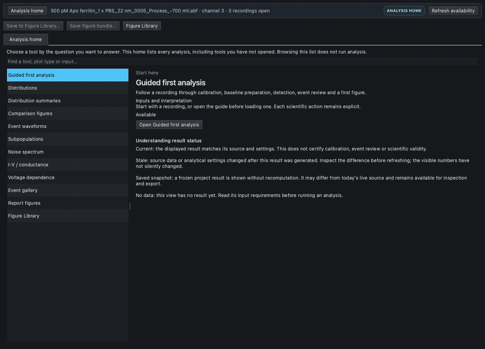

*Dated source capture, 2026-09-11; retained in this edition. Analysis home is the capability catalog, not an analysis result. Selecting a tool explains its requirements; opening a numerical page is a separate action.*

### Find a tool, even when its tab is missing

Start with `Analysis › Analysis home…`. Search by task, such as ECDF, current, conductance or
events. Read the selected tool's input requirements, then choose `Open…`. An unavailable tool
explains what is missing. Browsing the catalog does not run detection or fit anything.

Explorer tabs appear as tools are opened. A missing **Comparison figures** tab does not by itself
mean the feature is missing: use **Analysis > Comparison figures...**, or search for it in
**Analysis home** and open it. Return to an already opened tool using its Explorer tab.
The home catalog's **Refresh availability** only rechecks whether required inputs exist.

The **Guided first analysis** is optional navigation assistance, not a preset detector. It can
show Essential or Advanced controls without changing their values. Experienced users can go
directly to the appropriate page. Stages show workflow progress, not a scientific validation score.

| Task | Current surface | Required input and key distinction |
|---|---|---|
| Histograms, scatter, fitted distributions, clustering, PCA | Distributions | Stored per-event or manual-measurement tables; inspect selected sources and metric |
| ECDF, empirical survival, box, violin | Distribution summaries | Stored event measurements; descriptive summaries, not significance tests |
| Facets, pair matrices, individual-event overlays | Comparison figures | Explicitly selected event sources; separate-source comparison, not silent pooling |
| Event-count heatmap and aligned ensemble | Event waveforms | Accepted event intervals and waveform source; see current heatmap display limitation |
| PSD, frequency-band noise | Noise spectrum | Calibrated trace/range and sample rate; not an event-depth histogram |
| Current-voltage relation and conductance | I-V / conductance | Compatible calibrated current and voltage information; units alone do not certify calibration |
| Metrics versus applied voltage | Voltage dependence | Comparable sources and exposure; rate and amplitude have different comparability requirements |
| Waveform/feature population characterization | Subpopulations | Compatible event sources and explicit analytical choices; cluster is not molecular identity |
| Screen/curate individual events | Event gallery or Event inspector | Shared event table; decisions affect downstream populations |
| Preserve/export a finished figure | Figure Library | Frozen numbers, appearance and provenance; not an editable live analysis |

Use **Distributions** for a histogram, an overlaid scatter, a fitted distribution or PCA.
Use **Distribution summaries** for ECDF, survival, box or violin views.
Use **Comparison figures** for separate-source panels, a feature matrix or individual-event
strips. These are three distinct tools, not three tabs inside Distributions. In particular,
**Violin is not in the Distributions Plot list**.

### Select the actual data, not just the visible recording

1. Open the project or recording. If starting from a saved project, inspect its existing event
   table before deciding that another detection is necessary.
2. In the main window, verify the recording, channel and stored detector result. Schmitt,
   CUSUM, ML and Reconciled results can coexist; they are not interchangeable populations.
3. Open the plotting tool and choose **Section: Data**. Its source list is the authority for
   what will be plotted. **Tick the source checkbox**. A highlighted row alone is not a
   selection of analytical data, and highlighting a recording in File Manager does not tick
   that source in every plotting tool.
4. Read the full source identity: recording or segment, channel and detector result. Similar
   display names can refer to different tables. Untick unintended detectors or segments.
5. For one-source work, leave exactly one checkbox ticked. For a three-recording comparison,
   explicitly tick all three. A newly opened page normally starts with one source selected,
   not every available recording.
6. Keep **Use accepted events only** in Distributions, or **Accepted events only** in the
   newer pages, enabled when reproducing the curated gallery. Unticking it changes the
   population to include rejected rows; it is not a display preference.

If the source list is empty, first check that there is a stored, nonempty event result for the
intended channel. Loading a raw trace alone is not sufficient for an event-distribution plot.
Noise spectrum and I-V use other kinds of inputs; choose those tools when that is your question.

### Translate the measurement names between tools

The older Distributions pickers show **column names**. The newer pages show **measurement
labels**. This is a naming difference, not a request to recalculate amplitudes.

| Meaning | Distributions column | Newer pages |
|---|---|---|
| Event duration | dwell_s | Dwell (s) |
| Original median event depth | depth_pA | Median depth (source units), or Median depth (recorded units) |
| Explicitly chosen optional amplitude | amplitude_pA | Selected amplitude (recorded units) |
| Depth relative to the recorded reference | frac_depth | Fractional depth ΔI/I₀ |
| Integrated event area | ecd_pA_s | Event area (recorded units · s), in Comparison figures |
| Signal-to-noise ratio | snr | SNR, in Comparison figures |

For the current apo population examples, choose **depth_pA / Median depth**, not Selected
amplitude. The latter can be absent for events without an optional annotation, or contain
different chosen estimators. Read exclusions and amplitude provenance before comparing it.
The label “recorded units” is deliberate: a column name ending in pA is not proof that the
recording's gain or signal domain is correct.

Distributions has a **Time unit** selector: seconds, milliseconds or microseconds change the
display and relevant entry units, not the stored dwell values. The newer Dwell (s) recipes use
seconds. A value of 0.01 s and 10 ms represents the same duration.

### Understand which buttons calculate something

| Control | What it does | How to use it safely |
|---|---|---|
| Section: Data / Analysis / Appearance / Export | Shows another control group in the same tool | Use freely to find controls; it does not calculate |
| Analysis home: Refresh availability | Rechecks the catalog's input requirements | Use when a tool is listed as unavailable |
| Explorer: Refresh current | Refreshes the active analytical page; for summaries/comparisons this generates from current sources | Do not use as a harmless “show my saved picture” button |
| Distributions: Refresh, in Data sources | Pulls the offered sources again and can redraw/reset derived PCA or clustering state | Recheck source choices and any derived analysis afterward |
| Distributions: Plot, Plot / Apply, Apply fit | Commits the same pending source, plot and fit choices | Review all pending analytical choices, not only the field beside the button |
| Summaries/comparisons: Generate | Computes the selected descriptive figure from existing measurements | Use after configuring Data and Analysis; it does not detect new events |
| Run PCA / Run clustering | Performs the named feature analysis | Select only the intended source and feature set first |
| Fit canvas, in Comparison figures | Fits the drawn canvas into the viewer | It is magnification, not a statistical fit |
| Appearance controls | Restyle the committed picture | Do not press Plot / Apply merely to apply a font or color |
| Source names and colors: Apply to figure | Applies that editor's label/color choices to the current figure | This is a separate appearance action, not a distribution fit |

Do not assume all tools behave identically. **Distribution summaries and Comparison figures**
wait for explicit Generate. **Live Distributions can draw on opening or refresh**, and some
geometry controls, including bins, normalization and log axes, can redraw an already active
plot. Its source/type/column/fit proposals use the explicit commit controls. Save an important
result to Figure Library before experimenting with its live controls.

### Read the result state before saving

The visible plot and the controls beside it can describe **different moments**. A filled dot
on **Plot**, **Apply fit**, or **Generate**, or an unapplied-changes message, means a proposed
change has not yet replaced the previous result. On the newer pages, export can still export
that previous result. If you intend the new recipe, finish it and generate before saving.

| State | Meaning | Next decision |
|---|---|---|
| CURRENT | The displayed result agrees with the source lineage checks available to the app | Still inspect units, exclusions and method assumptions |
| STALE | Relevant sources/settings changed or the result needs regeneration | Keep it as a historical snapshot, or explicitly refresh/generate a replacement |
| SAVED SNAPSHOT | A stored result is being shown without a fresh calculation | Inspect/export as saved, or deliberately return to current sources to make a new version |

“Current” is not a scientific quality score. “Saved snapshot” is not a failure. Opening an
old project does not establish that its plots used today's detection, calibration or curation.
Read **Details** and provenance before choosing whether to regenerate.

### Data, analysis, appearance and export

1. Choose the recording/channel and saved result table. Switching between stored Schmitt, CUSUM
   and ML tables does not combine them or request a fresh detection.
2. Select each source checkbox inside the plotting page. Merely highlighting a recording in
   File Manager does not select it for every plot.
3. Set data/analytical controls and use the tool's calculation action as explained above.
   Read pending-change indicators before exporting; Distributions has some immediate redraw controls.
4. Change titles, typography, colors, legend and axis presentation under Appearance. These
   edits do not request a detector run or refit and should preserve a manually chosen zoom.
5. Inspect Details for exclusions, units, model diagnostics and provenance. Save the finished
   figure and the project, then export its picture and numerical context.

## Your first plot: a worked histogram

**Goal:** make one depth histogram, give it a readable presentation, save it for later and
export it. This exercise uses an **already detected** source. Do not change preprocessing,
open-pore reference, detection or event curation just to follow the plotting steps.

For the saved apo gallery, use the **-700 mV, IN15, Schmitt** result with **984 accepted events**.
For your own recording, use its accepted count as the checkpoint; 984 is not an expected count
for other data. The apo current gain remains unverified, so its amplitudes are illustrative.

### Step 1: open Distributions and show Data

1. From the main window choose **Analysis > Distributions...**. The Analysis Explorer opens or
   switches to its Distributions tab. An existing or initially generated picture may already be visible.
2. Find **Section** in the fixed toolbar and choose **Data**. If you were looking at fonts or
   export options, this brings back the source list and plotting recipe.
3. In **Data sources**, untick every row except the intended -700 mV / IN15 / Schmitt source.
   Keep **Use accepted events only** checked. Do not merely highlight its name.

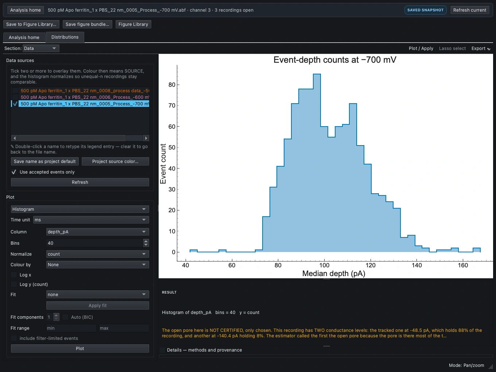

*Current-source capture of a restored apo figure. The Explorer toolbar belongs to the whole
analysis window; the Section selector and Plot / Apply belong to this tool. The source list,
not the File Manager selection, determines the plotted population.*

### Step 2: specify and commit the histogram

1. Set **Plot = Histogram**.
2. Set **Column = depth_pA**, the original median depth.
3. Enter **Bins = 40**, **Normalize = count**, and **Colour by = None**.
4. Turn **Log x** and **Log y** off for this reference example. Set **Fit = none**.
5. Press **Plot / Apply** in the fixed toolbar, or **Plot** beside the recipe. This commits
   the complete pending recipe. A former fit choice is not ignored simply because you pressed
   a button labeled Plot rather than Apply fit.
6. Choose **Section: Analysis > Axis range > Auto** to release any pinned axes left from an
   earlier figure. This ensures the full histogram is visible; it changes the view, not the bins.
7. Expand **Details - methods and provenance** below the figure. Check the source identity,
   accepted filter, metric, plotted count and exclusions. Warnings belong here, not inside
   the exported plot artwork.

**Checkpoint for the saved apo recipe:** the bin counts sum to 984; the tallest of these
40 bins contains 85 events near 96.76 on the retained instrument pA scale. A different source,
bin range, accepted filter or metric will change that check. Investigate a mismatch before styling.

### Step 3: style without applying a new analytical recipe

1. Choose **Section: Appearance**. Start with **Publication · light**.
2. Set **Title**, **X label** and **Y label**. Keep the measurement and units explicit, for
   example “Median event depth (instrument pA scale)” and “Event count” for this unverified example.
3. Adjust the font, title/axis/tick sizes, marker/line options where applicable, grid and legend.
   These are appearance edits. **Do not press Plot / Apply to apply the font**; that button can
   commit unrelated analytical changes waiting in the controls.
4. For a shorter source label in Distributions, return to Data and double-click that source's
   name. Enter a local alias such as “Apo -700 mV”; the underlying source identity is retained.
   Do not rename different detector results to the same ambiguous label.
5. Inspect the drawing. Switch sections as needed; section switching does not erase the result.

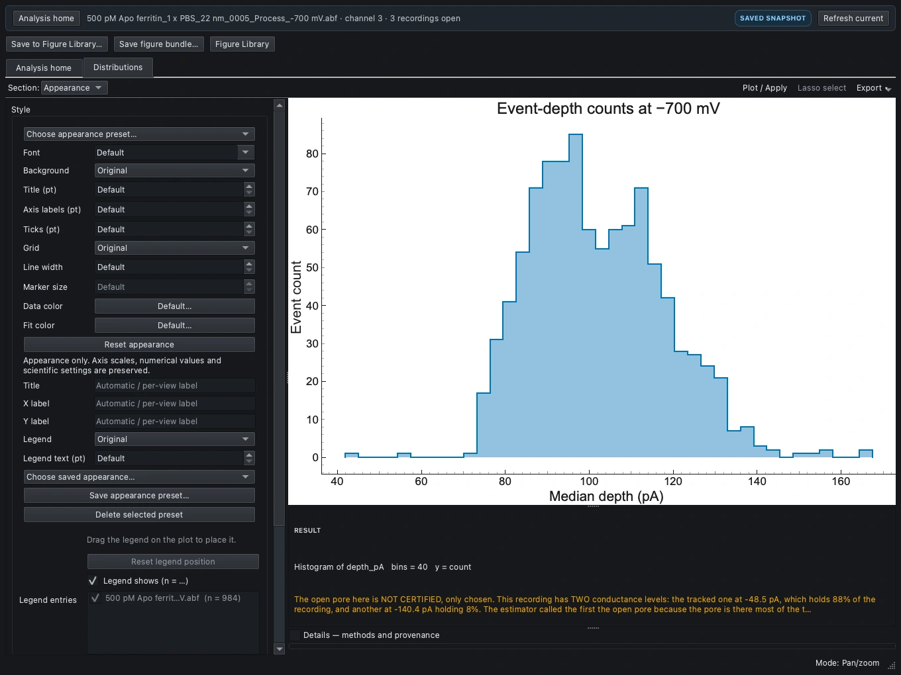

*Section: Appearance shows styling rather than another analysis. The persistent Plot / Apply
button remains visible, but is not needed for an appearance-only edit.*

### Step 4: save a figure, save the project, then export

1. Above the Explorer's tool tabs, choose **Save to Figure Library...**.
2. In **Save figure snapshot**, enter a meaningful **Figure name**, such as
   “Apo -700 mV | median depth | accepted | 40-bin count”, then **Save**.
3. The Library opens on the new entry. This saves a frozen figure into the current session.
   Return to the main window and choose **File > Save Project...** to persist it.
4. In the Library, select that entry and choose **Export saved figure...**. Choose PNG, PDF or
   SVG; use **Physical dimensions** if sizing it for a paper. The publication-export chapter
   explains the controls in order.
5. Later, open the project and choose **Analysis > Figure Library...** to retrieve this exact
   figure. Do not rerun detection just to see or export it.

You now have three different things: the **live tool** for making a new analytical version,
the **Library entry** for retaining the finished snapshot, and the **exported image** for slides
or a manuscript. One is not a substitute for the other two.

## Recording-specific references

The **open-pore reference** is the current against which events are detected and characterized.
The **event level** is the current inside one event. They are different quantities and must not
be edited interchangeably. Changing a reference can change noise, polarity, boundaries and counts;
changing an optional event amplitude does not redetect the recording.

| Reference mode | What supplies I₀ | Suitable evidence and important limit |
|---|---|---|
| Automatic (existing estimator) | Existing estimator and recording-specific rough/base windows | Inspect its proposal and overlay; a dominant blocked plateau can be mistaken for open pore |
| Known open-pore current | One signed current in pA | Independent measurement at the same recording conditions; constant throughout the recording |
| Selected open-pore intervals, constant | Median of all selected conditioned samples | Identified stable open-pore regions; longer intervals contribute more samples |
| Selected open-pore intervals, linear | Median-current anchors at sampled interval centres | Drift anchors across the recording; linear between centres and endpoint-held outside them |

### Supply a known current

1. Verify the correct recording/channel, gain, offset, sample rate and pA units. Relabeling a
   voltage channel as pA does not convert its samples or establish an amplifier gain.
2. Open `Inspector › Analysis › Preprocess`; choose `Preprocess section › Open-pore baseline`.
3. Select `Known open-pore current`. Enter the **signed** value in `Open-pore current (pA)`.
   For an actual negative open-pore current, enter the negative value, not its magnitude.
4. Explain its source in `Optional source / notes (saved with analysis)`. Do not transfer a
   value between voltages, pore states or recordings without evidence.
5. Keep or explicitly set the desired event polarity. A negative reference does not itself
   mean events must point downward; Auto measures direction relative to that reference.
6. Choose `Preview reference and detection…`. Inspect the trace, reference, event markers and
   `Details and warnings`. Preview uses a temporary detector result and does not replace the table.
7. Close the preview and deliberately press `Detect` to commit a new result. Review any
   replacement confirmation, then curate and save the project. Save As first to retain a comparison.

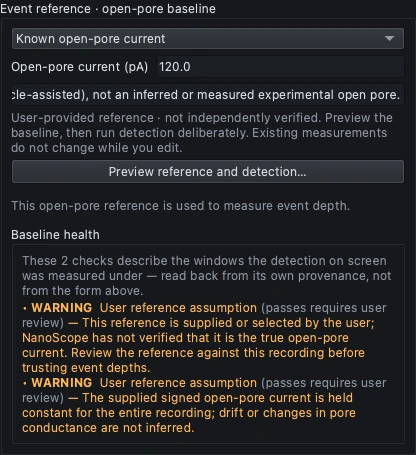

*Current-source offscreen capture. +120 pA is generator-known information for the synthetic majority-blocked fixture only. It is not a recommended open-pore current for the experimental apo-ferritin recordings.*

### Supply open-pore intervals

1. Select `Selected open-pore intervals` instead of known current.
2. Bracket an identified open-pore region with the trace Measure cursors and choose
   `Add current trace selection`, or use `Add interval` and double-click the start/end cells.
3. Enter seconds from this recording's start: start included, end excluded. These are not
   instrument-clock timestamps and not sample indices. Keep intervals ordered, non-overlapping
   and within the loaded recording; invalid entries are refused rather than silently clipped.
4. Choose `Constant reference (stable recording)` or `Linear between interval anchors (drift)`.
   Linear construction requires at least two intervals. Each interval needs at least five samples,
   which is only a numerical minimum, not evidence of adequate measurement precision.
5. State why these regions are believed to be open pore, preview, then Detect explicitly.
   A gap between anchors is an interpolation assumption, not observed open-pore evidence.

Supplied-reference modes currently support Schmitt and CUSUM on pA channels. Explicitly disable
incompatible high-pass, runtime baseline subtraction and normalization; NanoScope does not silently
change the signal chain to accommodate the mode. Batch detection, Automatic-window proposals,
randomized null controls, threshold sweeps, recovery studies and ML do not accept this reference
mode. Noise remains the existing whole-residual estimate, not a new selected-interval/local noise model.

A draft reference is saved separately from a detector result's applied recipe. Restoring a malformed,
missing or contradictory applied reference blocks analysis until an explicit decision; it does not
silently substitute Automatic. Retain the original table and investigate the reported problem.

### Baseline display, drift removal and smoothing are not the same operation

| Operation | Result | Scientific consequence |
|---|---|---|
| Subtract baseline (display only) | A residual trace for viewing | Does not change stored event measurements |
| Event reference | I₀ for detection/characterization | Changing it requires a deliberate fresh detection |
| Baseline drift removal | A conditioned signal with an estimated trend removed | Can change event detection and measured shape |
| Savitzky-Golay smoothing | Keeps the fitted polynomial signal | Smooths; it is not baseline subtraction |
| Savitzky-Golay baseline (subtract) | Keeps the residual after subtracting that polynomial | Detrends; it is not the smoothing stage |

The drift-removal method list includes **block median, percentile, ASLS, event-masked median,
robust median, and Savitzky-Golay baseline (subtract)**. These are alternative signal-processing
recipes, not six interchangeable estimates of verified physical open-pore current. Use the
comparison workspace to inspect the baseline and residual; document the chosen method and windows.
Keep preprocessing parameters consistent with any ML model's training recipe. A presentation preset
does not set this analytical chain, and an analytical protocol is not an appearance preset.

## Current event characterization and editable amplitude

The original event table retains its standard median-based `depth_pA`, `frac_depth` and `snr`.
Optional amplitude choices add a separate measurement, typically exposed as **Selected amplitude**
in plotting controls. Choosing a different estimator does not silently redefine the original columns.

1. Select a source detector result, then open `Analysis › Event inspector…`.
2. Select the event **after opening** the Inspector, or set its filtered-position spinner and
   verify the event ID and sample bounds. A first-time Inspector can open on the first event;
   spinner position and event ID are not the same number.
3. In the amplitude controls, choose a method and `Apply`. Check both optional amplitude and
   original median depth. The current optional value is replaced when another method is applied.
4. Use `Reset amplitude` to remove the optional annotation. Do not use `Revert mask` for this:
   that acts on event bounds. Undo/Redo and saved project provenance retain the distinction.

| Optional method | Measurement | When to be cautious |
|---|---|---|
| Mean depth (whole event) | Whole-event mean excursion | Spikes and unequal sub-state residence times affect the mean |
| Histogram mode (whole event) | Most populated histogram level | Bin choice and broad/multiple modes affect interpretation |
| Median of selected interval / state | Median over explicit absolute sample bounds | Selection is an analytical choice; record included/exclusive indices |
| Manual level | Supplied signed current level | This is an annotation supported by the user's evidence, not inferred ground truth |

For a manual value, choose `Manual level`, enter **Equivalent level** in signed current units,
and Apply. Alternatively enable `Edit red level`, drag and release the line. Typing is more
reproducible than dragging; the field keeps eight decimal places, not infinite precision.
`Apply to all…` is a broader batch operation, including rejected rows; it is not needed to edit one event.

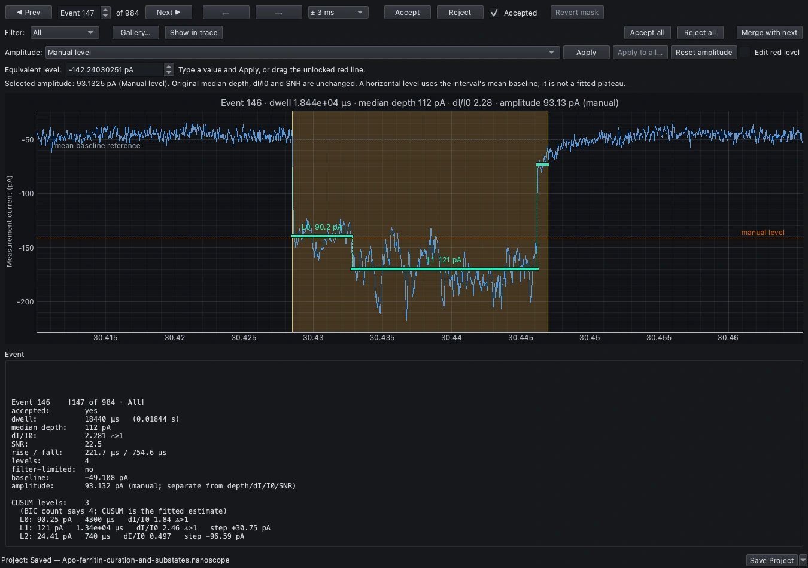

*Current-source offscreen capture of the saved apo-ferritin curation example. Event ID 146 is position 147 in the unchanged All filter. The optional manual level and fitted segments are distinct from the original median-based depth.*

### Worked checkpoint: one event, different legitimate definitions

For the −700 mV IN15 example, event 146 occupies samples **[1521425,1522347)** at approximately
50 kHz, or **30.428499-30.446939 s**, with dwell approximately 18.44 ms. Keep the boundaries,
reference and conditioning fixed when comparing the following definitions.

| Definition | Amplitude on retained instrument pA scale |
|---|---:|
| Original median depth | 111.99951172 |
| Whole-event mean | 109.92881791 |
| Whole-event histogram mode | 119.47631836 |
| Selected median, [1521655,1522117) | 120.23925781 |
| Manual level −142.24030251 pA | 93.13248821 |

The illustrative manual level was measured over samples [1521468,1521597), inside the first
fitted state. It is not a verified molecular-state assignment. The real apo current scale and
open-pore identity remain unverified; displayed precision is not calibration accuracy.

### Sub-state fitting versus detecting with CUSUM

`Analysis › Fit sub-state levels (CUSUM)…` fits levels **inside existing accepted events**.
It starts a cancellable background job using frozen inputs; it does not select Sequential CUSUM
as the event detector. Avoid changing curation or sources during the fit. If relevant inputs change,
the stale job is not installed; review the message and deliberately start another fit if appropriate.

The current example has **2,246 fitted segments across 984 accepted −700 mV events**, with three
segments in event 146. The original table's `n_levels` characterization is separate from this fitted
table and can disagree. Export with `Analysis › Export sub-state levels…` and retain its provenance.
Level counts depend on noise, correlation, bandwidth and model assumptions; they do not identify
conformations by themselves. Optional amplitude editing does not require a sub-state refit.

## Current population plots: recipes and interpretation

Use the completed saved apo project or reproduce the raw-data recipe below. Select all three
sources explicitly and retain accepted events only. The current population gallery uses
**Median depth**, not the separate Selected amplitude. Compact source labels are appearance aliases;
they do not rename files or combine measurements.

### Reproduce the current apo event population

The reference recordings are the 500 pM apo-ferritin ABFs with filename suffixes
`0008_process data_-500 mV.abf`, `0006_Process_-600 mV.abf` and
`0005_Process_-700 mV.abf`. Select **IN15**, the third channel (zero-based 2), approximately 50 kHz.
Their approximate full durations are 250.053, 59.876 and 181.481 s respectively. Use the exact original
files, not arbitrary recordings with similar voltage labels.

1. Open each full ABF and verify calibration, channel and duration. This example retains gain 1,
   offset 0 and the original instrument scale without treating it as independently calibrated.
2. Disable extra Signal chain stages. Choose Automatic reference, `Measure this recording`,
   inspect and explicitly accept `Use these values` for that recording.
3. Use Schmitt **k_in 5 / k_out 2**, **min dwell 0.0000200 s**, max dwell 0 off, detector merge gap 0 ms,
   and **auto (measure)** polarity. Detect separately on each recording.
4. In `Results › Events › Merge sub-events`, enter **Window 10.00 ms** and `Merge all`.
   This post-detection merge is different from the detector's merge-gap control.
5. Check both pre-merge and post-merge counts, then save the project before plotting.

| Bias | Rough/base window (s) | Before merge: candidates/accepted | After 10 ms: candidates/accepted |
|---|---|---|---|
| −500 mV | 1.0 /0.3 | 1196 /1196 | 881 /881 |
| −600 mV | 2.0 /0.5 | 276 /275 | 240 /239 |
| −700 mV | 1.0 /0.3 | 1179 /1179 | 984 /984 |

The total is **2,104 accepted events**. The −600 mV boundary-clipped rejection is retained; do
not accept it merely to make candidate and accepted counts equal. Acceptance is not expert review.
These checks were made with current NanoScope engines and offscreen renderers, not an interactive
desktop GUI replay or a blinded accuracy study.

### Before following the plot recipes

The exercises below use the same saved event population: **881 / 239 / 984 accepted events**
for -500 / -600 / -700 mV, respectively. Each plotting page has its **own source selection**.
Repeat the checkbox check when moving between tools. Do not assume that choosing three sources
in Distributions also chooses them in Comparison figures.

For each exercise: **configure Data, configure Analysis, generate, read Details, style, save
to Figure Library, then Save Project**. Save each completed version before changing the
figure type on that same page. The tab holds the current working view; it is not a gallery
of all previous choices.

### Recipe 1: separate dwell-depth panels for three recordings

**Use:** compare each source's dwell-depth cloud without hiding it behind overlaid points.

1. Open **Analysis > Comparison figures...**. Choose **Section: Data**.
2. Tick the three intended IN15 / Schmitt sources and retain **Accepted events only**.
3. Set **Figure = Faceted comparisons**. This figure-type selector is in **Data**, not Analysis.
4. Switch **Section** to **Analysis**. In the Facets controls choose **X = Dwell (s)**,
   **Y = Median depth (recorded units)**, and **Columns = 3**.
5. Check **Log x** and leave **Log y** unchecked. Nonpositive values cannot appear on a log
   axis; inspect any exclusions instead of treating missing points as zero.
6. Press **Generate**. Expect three source-separated scatter panels with common numerical
   ranges. Check 881 / 239 / 984 retained observations if all selected metrics are finite.
7. Choose **Fit canvas** if the whole figure is not visible. This changes viewer magnification,
   not the measurements, fit model or export dimensions. Use + / - and drag to inspect labels.
8. Read **Details - methods and provenance**; then style and save a figure named
   “Apo | dwell-depth facets | accepted”.

This view does not fit a regression or pool the three sources. Matching axes makes visual
comparison easier but does not establish common calibration or physical comparability.

### Recipe 2: a three-feature pair matrix

**Use:** inspect all pairwise relationships among dwell, median depth and SNR at once.

1. Stay in **Comparison figures**. Save the facets first.
2. Choose **Section: Data**, confirm the same three sources, and set **Figure = Pair-plot matrix**.
3. Choose **Section: Analysis**. In **Pair matrix**, check **only** Dwell (s),
   Median depth (recorded units), and SNR.
4. **Untick Event area** if it is selected: the default feature set includes it. Three selected
   features produce a 3-by-3 matrix; four produce a 4-by-4 matrix.
5. Set **Diagonal histogram bins = 35**, then **Generate**.
6. Check that diagonal panels are per-source count histograms and off-diagonal panels are
   scatter plots. These axes are linear; this is not a log-space KDE or a correlation matrix.
7. Inspect each panel's retained/excluded counts. Missing SNR can exclude an event from an
   SNR panel without removing it from the dwell-depth panel.
8. Use Fit canvas and inspect axis labels. Save “Apo | dwell-depth-SNR pair matrix”.

The feature list here uses **checkboxes**. The similarly named feature list for PCA in
Distributions uses highlighted multi-selection instead; do not transfer that interaction blindly.

### Recipe 3: individual depths with an optional box summary

**Use:** show the observations themselves, alongside a descriptive median/quartile summary.

1. In **Comparison figures > Section: Data**, keep the same sources and choose
   **Figure = Individual-event overlays**.
2. In **Section: Analysis**, set **Measurement = Median depth (recorded units)**.
3. Set **Points = Strip · deterministic horizontal spread**. Keep
   **Overlay box summary (linear quartiles; 1.5 IQR)** checked and **Log measurement axis** off.
4. Press **Generate**. Expect all 2,104 accepted observations for the current recipe, grouped
   by source. Horizontal spread is a layout aid: it is not time, voltage, another measurement
   or randomization of the scientific data.
5. Inspect Details and save the figure. In Appearance you can change marker size without
   recomputing the spread; larger markers can overlap.

**Swarm · non-overlapping layout** is an alternative for smaller datasets. It is limited to
500 rows per source and 2,000 overall, and can refuse crowded layouts. The current apo
population exceeds those limits, so use Strip rather than dropping events merely to obtain
a swarm. Box whiskers/outliers are descriptive, not confidence intervals or a hypothesis test.

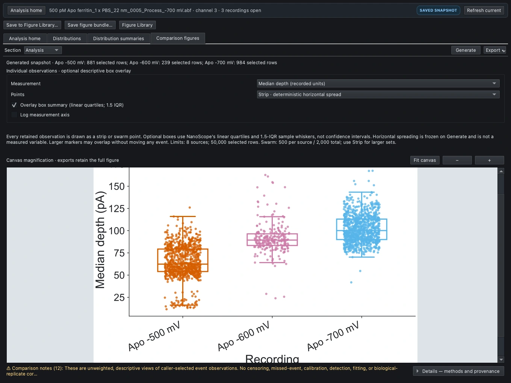

*Current-source capture of the restored individual-event overlay. Choose the Figure type in
Data; its detailed controls appear in Analysis. Generate creates the result. Fit canvas
only fits the picture into the viewer; export still retains the complete canvas.*

### Recipe 4: an ECDF of median depth

**Use:** compare cumulative distributions without choosing histogram bins or a fitted family.

1. Open **Analysis > Distribution summaries...**, a different Explorer tool.
2. Choose **Section: Data**. Explicitly tick the three sources, retain **Accepted events only**,
   and select **Measurement = Median depth (source units)**.
3. Choose **Section: Analysis**, then **Summary = ECDF**.
4. Press **Generate**. Each source should have its own curve and count; sources are not pooled.
5. Read a point as “the fraction of this source's retained events at or below this depth”.
   The vertical scale runs from 0 to 1; it is not an event count.
6. Inspect Full details for exclusions and calibration/baseline qualifications. Style and save
   “Apo | median-depth ECDF”.

### Recipe 5: an empirical dwell-survival curve

**Use:** display what fraction of the observed events lasts longer than a chosen dwell.

1. Save the ECDF, then in **Distribution summaries > Section: Data** set
   **Measurement = Dwell (s)**. Confirm the same source checkboxes.
2. In **Section: Analysis**, select **Summary = Empirical survival (uncensored)**.
3. Press **Generate**. Read the x axis in seconds: 0.01 s means 10 ms.
4. At a dwell x, read the y value as the fraction with **dwell strictly greater than x**.
   Repeated durations are handled as repeated observations, not fabricated intermediate events.
5. Save with a name that includes “empirical” and “uncensored”.

This is **not Kaplan-Meier**, a fitted lifetime model or a correction for short events missed
by detection. Comparing curves still requires attention to detection thresholds, time resolution,
curation and observation limits. Do not label the exported curve “corrected survival”.

### Recipe 6: dwell box plots

1. In **Distribution summaries > Data**, use **Dwell (s)** and the intended checked sources.
2. In **Analysis**, choose **Box (linear quartiles)**, then **Generate**.
3. Locate each source's median and quartile box. Whiskers end at observed values within
   1.5 interquartile ranges; observations outside the fences remain visible as outliers.
4. Inspect long-dwell observations rather than deleting them to improve the picture.
5. Style and save “Apo | dwell boxes”. This view reports distributions, not statistical
   significance between voltages, and events are not automatically independent experimental replicates.

### Recipe 7: depth violin plots

1. Save the boxes. In **Distribution summaries > Data**, choose **Median depth (source units)**.
2. In **Analysis**, select **Violin (Scott KDE)** and set **Violin grid points = 256**.
3. Press **Generate**. Each source has an equal maximum display width regardless of its event count.
4. Read the shape as a smoothed description of the retained depths, not a count-versus-width
   encoding. The grid changes the evaluation resolution, **not** the Scott bandwidth rule.
5. Inspect counts and sparse/constant-data messages in Full details. The page does not infer
   a violin from fewer than three observations or a constant set.
6. Style and save “Apo | median-depth violins”. Apparent multiple peaks are not evidence of
   molecular species without further analysis.

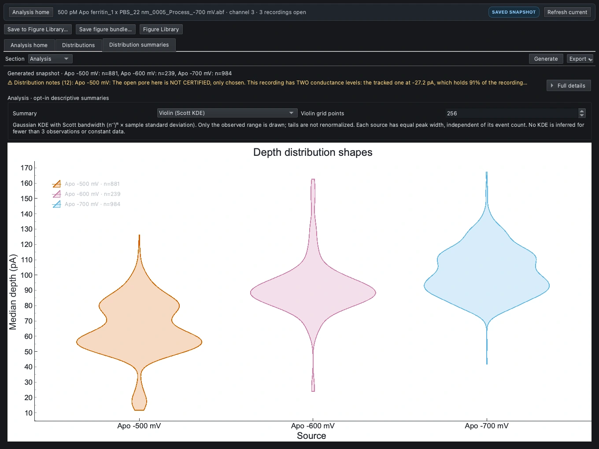

*Current-source capture of the restored violin example. Measurement and source checkboxes are
in Data; ECDF, survival, box and violin are selected in Analysis. A different Summary choice
remains a draft until Generate, even while the earlier curve remains visible.*

### Recipe 8: the single-source depth-count histogram

Follow **Your first plot: a worked histogram** earlier in this manual: only the -700 mV source,
Histogram, depth_pA, 40 bins, count normalization, no log axes, Fit none. Save this version
separately from multi-source overlays. Count normalization emphasizes sample size; density or
probability-per-bin answers a different question.

### Recipe 9: the four-panel overview

After saving the facets, individual depths, ECDF and violin as **four separate Library entries**,
follow the composition instructions in the next chapter. Use two columns, panel labels A-D,
and 1-by-1 panel spans. Begin with shared X/Y ranges and shared legend disabled because these
panels show different quantities/layouts. Save the composition and then the project.

### Additional recipe: overlay scatter, then inspect selected events

1. Open **Distributions > Section: Data**. Check the intended sources and accepted filter.
2. Choose **Plot = Scatter**, **X = dwell_s**, **Y = depth_pA**, **Fit = none**.
   Choose log axes deliberately, then **Plot / Apply**.
3. With several sources, colors identify sources. Inspect Details and the legend before
   interpreting overlapping clouds. Use facets instead when overlay hides one source.
4. Click a point to navigate to its source event. To select a region, enable **Lasso select**
   in the toolbar, drag an outline and release. If multiple sources are enclosed, choose
   which source to inspect in the offered dialog.
5. Ctrl/Cmd/Shift modifies selection; Esc or right-click cancels a gesture and returns to
   pan/zoom. Selection does not accept/reject, resize or remeasure an event.

### Additional recipe: KDE contours versus a count heatmap

1. In **Distributions**, choose **Plot = KDE (density)**, then explicitly set X and Y.
   For a dwell-depth example use dwell_s and depth_pA. Do not silently accept a fractional-depth
   default when the intended metric is median depth.
2. Set log axes and **Contours**, then **Plot / Apply**. Read Details for retained points and bandwidth.
3. Each source's contour levels refer to its **own peak density**, not common event-count
   thresholds. Equal contour shapes do not imply equal sample sizes.
4. Save the KDE as a distinct result. It is not the **Event waveforms** event-count heatmap.

The current Event waveforms heatmap has the coordinate-mapping defect described below and in
Known limits. Use verified scatter, histograms or KDE with their own qualifications; do not
use the heatmap's apparent hotspot coordinates as a measurement.

### Additional recipe: apply a fit without confusing fit range and zoom

1. In **Distributions**, choose the source and histogram/scatter recipe first. For a dwell
   histogram, choose dwell_s and verify Time unit and the detector's time resolution.
2. Choose a model suited to the question, not merely one that draws a smooth curve. A simple
   exponential has no interior mode in its linear dwell-time density. A peak in log-spaced-bin
   counts alone does not rule it out. Scatter offers linear or
   power law (log-log); its log-space exclusions must be read.
3. Set **Fit components**, **Fit range**, and **include filter-limited events** deliberately
   where available. **Fit range changes the analytical sample/likelihood. Axis range only
   changes the view.** Their entry units follow the displayed axis.
4. Press **Apply fit**. This commits the full pending recipe, just like Plot / Apply;
   inspect source and metric changes too.
5. Read fitted n, exclusions, parameters, uncertainty and model diagnostics in Details.
   If it says **Fit unavailable**, the histogram may still be present without a fitted curve.
6. If a residual panel is displayed and needed, include it when saving/exporting. A fit curve,
   high R² or lower BIC alone does not validate the physical interpretation.

### Additional recipe: PCA and clustering on one chosen source

1. Open **Distributions > Data** and **untick all but the intended source**. PCA and clustering
   use the first checked source, not the highlighted row.
2. Choose **Section: Analysis**, select **Plot = PCA**, then find **Features (clustering & PCA)**.
3. Click the feature rows to highlight at least two numeric columns. This is a multi-select
   list, **not a checkbox list**. Inspect which rows are highlighted before proceeding.
4. Choose **Run PCA**, not just Plot. Features are standardized; read explained variance,
   loadings and dropped-row counts. With only two features, two PCs necessarily account
   for 100% of retained variance; that is not biological validation.
5. For grouping, set **Method = GMM** with Auto (BIC) or Fixed k, or **k-means** with a fixed k;
   choose **Run clustering**. Document features, exclusions and settings.
6. Save the resulting figure. A subsequent source Refresh can clear PCA/clustering state;
   a frozen Library entry preserves the result you intended to keep.

### Compact gallery recipe checklist

| Figure | Page and controls | Check before saving |
|---|---|---|
| Dwell-depth facets | Comparison figures; Faceted comparisons; X Dwell (s), Y Median depth; 3 columns; Log x on, Log y off; Generate | Three source-separated panels, 881/239/984 events |
| Pair matrix | Comparison figures; Pair-plot matrix; only Dwell, Median depth, SNR; untick Event area; 35 diagonal bins; Generate | 3×3 matrix; linear axes and per-panel exclusion details |
| Individual depths | Comparison figures; Individual-event overlays; Median depth; Strip deterministic spread; Overlay box summary; Generate | All 2104 events; horizontal spacing is not measured data |
| Depth ECDF | Distribution summaries; Median depth; ECDF; Generate | Fraction at or below x, no bins or fitted family |
| Dwell survival | Distribution summaries; Dwell (s); Empirical survival (uncensored); Generate | P(dwell > x), not Kaplan-Meier or missed-event correction |
| Dwell boxes | Distribution summaries; Dwell (s); Box (linear quartiles); Generate | Preserve long events/outliers; not a significance test |
| Depth violins | Distribution summaries; Median depth; Violin (Scott KDE); 256 grid points; Generate | Equal peak width per source; width is not event count |
| −700 mV depth counts | Distributions; only −700 mV; Histogram; Column depth_pA; 40 bins; Normalize count; both log axes off; Fit none; Plot | Counts sum 984; tallest bin 85 events near 96.7576 pA |
| Four-panel overview | Figure Library composer; facets, individual depths, ECDF, violin; 2 columns; 1×1 spans | Labels A-D; shared X, shared Y and shared legend off; save each constituent first |

In Comparison figures and Distribution summaries, use `Appearance › Source names and colors`,
choose a source, edit `Display label`, and `Apply to figure`. In Distributions, double-click
the source name instead. A project source default affects future figures; it is not necessary for
a local presentation edit. Save each result before changing the view on the same page.

The current Event waveforms count heatmap has a confirmed image-orientation defect: displayed
coordinates can disagree with correctly indexed bins and marginals. **Do not use that heatmap to
assign dwell-depth coordinates** until a verified fix is installed. Use a scatter, the validated
histogram, or numerical tables. A KDE probability density is a different analysis, not another name
for the event-count heatmap. The manual documents this limitation; this documentation update does
not fix application code.

## Figure Library and publication export

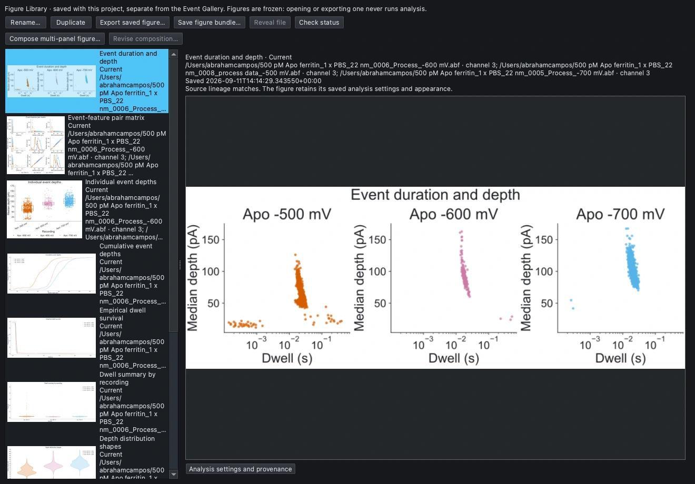

*Current-source offscreen capture. Entries preserve numerical snapshots, appearance and provenance. The library is separate from the Event gallery, which curates individual events.*

### Save, reopen and revise deliberately

1. Generate the live analytical figure. Inspect its metrics, sources, warnings and pending-change
   indicators; a draft control is not necessarily the rendered result.
2. Select **Save to Figure Library...** above the Explorer tabs. In **Save figure snapshot**,
   enter **Figure name**. If needed and offered, select **Include the displayed residual panel**,
   then **Save**. The Library opens on the new entry. Save the main project afterward:
   the entry initially exists in memory, not as an independently saved project file.
3. In `Analysis › Figure Library…`, inspect the name, thumbnail, sources, saved settings and status.
   Rename and Duplicate manage snapshots. **Duplicate does not reopen an editable analytical page.**
4. For a new analytical or styling variant, reopen the appropriate Analysis tool, generate from
   stored event data, edit appearance, and save a new entry. Exporting a frozen entry does not rerun it.
5. Reopen the project once to verify persistence. Keep the referenced raw recordings available.

### Find a saved figure and understand the Library buttons

Use **File > Open Project...**, then **Analysis > Figure Library...**. Select an entry by name
and thumbnail. Expand **Analysis settings and provenance** to inspect the captured sources and
recipe. The Library is separate from **Event gallery**, which displays event waveforms for curation.

| Library action | What changes | Common misunderstanding |
|---|---|---|
| Rename... | The entry's library name | It does not change the title drawn inside the plot |
| Duplicate | Creates another frozen copy | It does not open an editable analysis |
| Check status | Checks tracked source lineage | It does not regenerate the figure |
| Export saved figure... | Writes the selected frozen picture | It does not use today's uncommitted live controls |
| Reveal file | Shows an existing exported file | It is unavailable before an export, or if that file is gone |
| Revise composition... | Reopens a stored composition's layout | It is not a general editor for every saved plot |

Library statuses use **Current**, **Outdated**, and **Saved snapshot**. All three are still
frozen pictures. “Current” only means the available source-lineage checks match. “Outdated”
does not erase the old result; decide whether to retain it as a historical version or generate
a new one. A composition normally remains a saved snapshot of its components.

To change the contents or styling of an individual saved figure, open the appropriate live tool,
select/configure/generate the desired result, change its appearance, and save a **new** Library
entry. Give versions distinct names. Do not expect Rename or Duplicate to expose plotting controls.

### Compose panels

1. Save at least **two individual figures** to the Library. Choose **Compose multi-panel figure...**.
   Do not try to select several thumbnails in the Library itself; it is single-select.
2. In **Compose publication figure**, use the table's **Use** checkboxes to include 2-12 figures.
   Enter a **Figure name**.
3. For the four-panel example, choose **Columns = 2**. Edit the **Label** cells to A, B, C and D.
   Set each row's **Rows = 1** and **Cols = 1**. Those cells are panel spans in a grid, not
   counts of sources or events. Choose a row and use **Move up / Move down** to set reading order.
4. Adjust **Panel spacing** and **Panel labels** styling if needed. Start with **Share X range**,
   **Share Y range**, and **One shared legend** off.
5. Choose **Update preview**. Inspect all panels, labels and legends. If you change any layout
   or style control afterward, the preview becomes out of date and Save is disabled:
   choose **Update preview** again.
6. Choose **Save to Figure Library**, then return to the main window and **Save Project**.
   Each component is a frozen copy; later changes to live tools do not replace it.

**When sharing axes is appropriate:** compatible Cartesian panels must represent matching
units, labels, scale/log mode, direction and tick formatting. The shared range uses their
saved ranges by taking their union. A common legend requires matching labels, order, styles and
typography. If the app refuses, retain
independent axes or legends. Do not relabel incompatible quantities simply to pass the check.

**Revise the arrangement:** select a composition, choose **Revise composition...**, edit its
layout, **Update preview**, then **Save as new figure**. Revision uses the composition's
embedded original panels, not a newer similarly named Library entry. To replace a panel with
newly analyzed or styled content, save that individual figure and make a new composition.

### Appearance and selection

1. On the live tool, choose **Section: Appearance**. This is where to find typography and
   graphics controls; do not look in the main-window Inspector or Library Rename dialog.
2. Start with **Publication · light**, then inspect **Font**, **Title (pt)**, **Axis labels (pt)**,
   **Ticks (pt)**, background/grid, supported colors, line width, marker size and legend options.
   A disabled control often means that graphic has no corresponding element, not that its data is missing.
3. Keep scientific quantities and units in the axis labels. Appearance changes the displayed
   label; it does not convert a normalized signal into calibrated pA.
4. In **Comparison figures** or **Distribution summaries**, find **Source names and colors**.
   Choose **Source**, enter **Display label**, optionally **Choose color...**, then **Apply to figure**.
   This editor has its own explicit appearance commit. Use short, unambiguous source names.
5. **Use as project source default** is optional: it affects future generated figures for that
   exact recording/segment, channel and detector. It does not rewrite existing Library entries.
   In Distributions, double-click the source name for a local alias; its project-default actions
   are separate buttons.
6. Choose **Save appearance preset...** to store shared appearance in local app preferences.
   Reuse it with **Choose saved appearance...**. This does not save an analytical protocol,
   source selection, bins, fits or source aliases. Save each styled figure and the project as well.

Shared controls cover typography, titles/axis labels, legend, source colors, markers, lines and
axis presentation where each plot supports them. **Appearance-only presets** do not alter detector
settings, fitting choices, bins or numerical arrays. Start with Publication · light, inspect actual
contrast and clipping, and adapt typography to the intended print size rather than the monitor zoom.

Lasso selection on Distributions Scatter/PCA views is an event-selection tool. Check source
identity and selected event counts before any follow-on curation. Selection alone is not a new
population model, statistical test or independent replicate definition.

### Three different export intentions

| Intention | Action | What to retain |
|---|---|---|
| Export the figure currently shown | Current-figure export, or Export saved figure from the library | PNG for raster; SVG/PDF for vector where supported |
| Create a standard set of report outputs | Analysis › Generate Report figures… | Explicit report recipe; this can calculate new figures |
| Preserve the figure plus its numerical context | Save figure bundle… | Image, plotted data, configuration and provenance together |

For publication export choose **Physical dimensions**. A single- or double-column preset is
a starting size, not a journal requirement. The current examples use **180 mm width**, keep original
aspect ratio, and **300 DPI for PNG**. The four-panel overview uses 360 mm to retain each panel near its
individual width; recompose rather than blindly shrink it for a manuscript's narrower page.

Use **Approximate print-size preview…** and inspect **Print readability details and targets**.
The preview is not a calibrated physical ruler. `Enlarge to measured targets` can increase width;
if the journal width must stay fixed, adjust typography and layout instead. DPI does not change
scientific arrays and does not add resolution to vector paths.

If a fitted view already has a residual panel, explicitly include that displayed residual when
the export/save dialog offers the option. It copies existing residuals; it does not fit a missing
model. A plotted-data CSV may contain bins or vertices rather than one row per event; retain the
separate event-table CSV and provenance when event-level analysis is needed.

Warnings and scientific qualifications belong in persistent summaries, expandable Details,
methods and provenance, **not printed as warning blocks inside the plot**. Excluding warning text
from artwork does not justify excluding it from the paper's methods or the archived bundle.

### Publication-sized export, in dialog order

1. For the live figure choose **Export > Export current figure...**. For a saved figure,
   select it in **Figure Library** and choose **Export saved figure...**.
2. Choose **Format**: **PNG · raster image**, **PDF · vector document**, or **SVG · vector image**.
   SVG/PDF preserve vector paths where supported; a screenshot embedded in a figure remains raster.
3. Set **Size = Physical dimensions**, not Native size, when you need a known manuscript width.
4. Choose **Width preset = Single column · 85 mm**, **Double column · 180 mm**, or **Custom**.
   Verify the actual journal requirement; these presets are starting points.
5. Set **Units** and **Width × height**. Usually retain **Keep original plot aspect ratio**.
   If you need a different layout, recompose it; stretching does not improve panel organization.
6. For PNG, set **PNG resolution (DPI)**, for example 300. This changes raster sampling,
   not data precision or font size at a fixed physical width.
7. For a live fitted plot, select **Include residual panel below the main plot** if needed.
   A saved Library figure must already include its residual; export cannot add one omitted at capture.
8. Expand **Print readability details and targets**. The default 8 pt text and 0.5 pt line
   targets are editable checks, not journal approval.
9. Choose **Approximate print-size preview...** and inspect titles, ticks, units and legends.
   It is based on reported display resolution, not a calibrated ruler.
10. **Enlarge to measured targets** increases the physical canvas. If your journal width is
    fixed, return to the live tool, improve typography/layout, and capture a new figure instead.
11. Choose **Choose destination...**, save the file, and inspect the actual output at intended
    print size. Keep the matching project, figure version and exported numerical context.

**Bundle versus publication image:** **Save figure bundle...** retains the native frozen PNG
and SVG, numerical tables, configuration, provenance and resources. It does **not** adopt
physical-size settings from a preceding image export. Keep the publication-sized image and
its matching bundle together. **Generate Report figures...** makes a standardized report set;
it is not the way to export the figure you just styled in the Explorer.

## Plotting problems: where to look

Start with the smallest relevant check below. Do not rerun detection, reset calibration or
change the baseline merely to solve a navigation or presentation problem.

| What you see | Check this first | What to do |
|---|---|---|
| I cannot find a new plot type | Which tool is open? | ECDF/box/violin are in Distribution summaries; facets/pair matrix/strip are in Comparison figures. Open them from Analysis home or the main Analysis menu |
| The tool is not in the Explorer tabs | Has it been opened? | Use Analysis home search; tabs list opened tools, not the complete catalog |
| I only see fonts, not source controls | Section selector | Choose Data; the figure stays in the same tool |
| I cannot find facets or the pair-matrix selector | Comparison figures: Section Data | Choose Figure there, then change Section to Analysis for its settings |
| Only one recording appears | Source checkboxes inside this tool | Tick each intended source; highlighting a row or the Explorer header does not select every plot input |
| The source list is empty | Stored detector table and selected channel | Load/detect the intended source if no event result exists; plotting raw traces uses other tools |
| Unavailable source is listed | Saved source identity and raw/result availability | Restore the intended source or explicitly untick it; do not replace it with an unrelated similarly named recording |
| I changed a control but still see the old graph | Filled dot or unapplied-changes message | For the new recipe, use Generate or the Distributions commit action. Save the old snapshot first if needed |
| My graph changed before I pressed Plot | Live Distributions geometry controls | Bins, normalization and some log controls can redraw. Use Library snapshots to retain versions |
| My color or source alias did not change | Which appearance editor is being used? | In Source names and colors, choose the source and press Apply to figure. General typography updates directly |
| Library Rename did not change the plot title | Entry name versus artwork | Edit Title in the live tool's Appearance section, then save a new snapshot |
| The matrix has four rows instead of three | Pair-matrix feature checkboxes | Explicitly untick Event area and keep only the three desired features |
| PCA used the wrong recording | First checked source, not highlighted row | Untick every other source before Run PCA or Run clustering |
| PCA still has no new result | Its dedicated action and selected features | Select at least two highlighted feature rows and press Run PCA |
| A histogram is visible but the fit is missing | Details: Fit unavailable, pending fit or exclusions | Read the reason and sample count; a drawn histogram does not imply a fitted model |
| Changing Axis range did not refit the model | View range versus Fit range | Axis range is a view change. Use Fit range only when you intend to change the fitted analytical sample |
| The comparison is cropped on screen | Canvas magnification | Use Fit canvas or zoom out. Export retains the complete canvas, not the scrolled viewport |
| Swarm is refused | Selected counts and crowding limits | Use Strip for the full current apo population; do not silently discard events |
| I cannot compose multiple figures | Number of Library entries | Save at least two first, then use the composer dialog's Use checkboxes |
| Save composition is disabled | Preview freshness | Choose Update preview after the final layout or label change |
| Shared axes or legend are refused | Unit, scale, label and style compatibility | Keep independent axes/legends; do not falsify labels to force agreement |
| A revised composition has the old panel content | Embedded original panels | Save new individual figures and build a new composition to replace analytical content |
| The residual is missing from Library export | Whether it was captured | Save the live fitted figure again with its displayed residual included |
| The export is tiny or text is too small | Physical width and font size | Use physical dimensions and inspect print-size readability; DPI alone does not enlarge text |
| Reveal file is disabled | Whether an export exists | Export a file first; if it was moved/deleted, export again to a known location |
| Saved figures are missing after reopening | Was the main project saved? | A Library entry is initially in memory; use File > Save Project after adding it |

### A reliable final check before using a figure

1. **Which source?** Verify recording, channel and detector identities inside this tool.
2. **Which events?** Verify accepted-only status, plotted n and explicit exclusions.
3. **Which measurement?** Distinguish original median depth, optional selected amplitude,
   fractional depth, duration and area; check the units and signal domain.
4. **Which result?** Resolve pending changes and distinguish current data from a saved snapshot.
5. **Which interpretation?** Read Details for calibration, baseline, comparability, model and
   descriptive-statistic limitations. A clean plot does not mean the warnings were resolved.
6. **Which saved version?** Give it a meaningful Library name, save the project and export the
   matching figure/bundle. Reopen once to verify the version you intend to distribute.

If the interface no longer resembles the screenshots, check **Help > About NanoScope...** for
the running build and compare it with this manual's source revision. Historical screenshots
are labeled as such. If File Manager or Inspector was closed, restore it under **View > Panels**.
Using a legacy page's Close button can close the whole Explorer; reopening the tool is different
from selecting another tab.

## Projects, recovery and verification

Use `File › Open…` for raw recordings and `File › Open Project…` for a saved `.nanoscope`
analysis. Opening a project replaces the session rather than merging it. Save As before an
experiment that should not overwrite the reference analysis.

Projects preserve data-source paths, calibration, derived segments, separately stored detector
results, curation, optional amplitudes, fitted artifacts, analysis-page settings and snapshots,
Figure Library entries, and relevant workspace state. They do **not** embed the original raw
recordings. Preserve paths or deliberately resolve a missing source; do not substitute an unrelated
file with a similar name. A restored picture can remain visible even when its source is unavailable.

Saved analytical controls and stored results are separate. A draft reference or detector setting
does not imply the saved event table was calculated with it. Check freshness and provenance before
refreshing, especially after calibration/source changes. No analysis should silently turn a damaged
reference/filter recipe into a plausible result using different defaults; read refusals and correct
the underlying input rather than bypassing them.

Recovery checkpoints help after an unexpected exit but do not replace deliberate project saves.
Inspect a recovered session and save it to a chosen project path. Undo history is not a permanent
archive and does not survive every close/reopen boundary. Git tracks application source; it is not
an automatic backup of raw data, user projects or scientific exports.

For reproducibility, record the running build shown by **Help › About NanoScope…**, source identity,
dependencies, source-file hashes, calibration, exact preprocessing/reference/detector settings,
merge and curation decisions, metric definitions and exports. Diagnostics copying is an explicit
local action, not a support upload. A clean restore or matching picture does not prove a calibrated
measurement or a validated detector.

### Difficult-recording examples and honest checkpoints

The current development fixtures compare Automatic against generator-assisted references. Both
are 12 s at 50 kHz with all extra stages off. Schmitt uses 5/2 σ, min dwell 20 µs, merge gap 0 ms;
CUSUM uses k = 0.750 σ, h = 28 σ·samples, min dwell 1 ms, merge gap 0.5 ms. Use Auto polarity and max dwell 0 off.
Verify shared min-dwell/merge-gap fields after changing detectors. Do not apply the apo 10 ms merge.

| Fixture and detector | Automatic candidates/accepted | Assisted candidates/accepted |
|---|---|---|
| Majority-blocked, Schmitt | 11 /11 | 12 /11 |
| Majority-blocked, CUSUM | 160 /160 | 13 /12 |
| Smooth drift, Schmitt | 34 /34 | 34 /34 |
| Smooth drift, CUSUM | 310 /310 | 47 /47 |

Automatic uses default 0.5/0.1 s windows, not a measured proposal. Majority-blocked assistance is
known +120 pA. Drift assistance uses linear interval anchors at 0.06-0.14,1.96-2.04,3.96-4.04,
5.96-6.04,7.96-8.04,9.98-10.06 and 11.81-11.89 s. These are generator-informed examples, not
experimental advice or blinded estimates. In the drift fixture, assisted reference RMSE is actually
worse:2.417 pA versus 0.948 pA. Fewer CUSUM candidates do not demonstrate higher accuracy.

The 17-figure gallery contains nine native population figures, one native event-level plot, and
seven custom Matplotlib illustrations of NanoScope results. Numerical results can be recreated in
the app, but the seven custom layouts are not dedicated one-click app templates. Event Inspector
does not have the shared publication toolbar of the population pages. Do not infer an export
button from a supplied API-captured screenshot.

## Incubation studies: one entry and shared curation

This chapter describes **NanoScope build 40.15.59, 29 September 2026**. Use
**Analysis > Incubation study…** for a new study, an existing saved workspace, or
another sample or treatment in the future. The study organizes recordings and
analysis stages; event curation uses the main app's event table, Gallery and Inspector.

### Create a study or resume a saved one

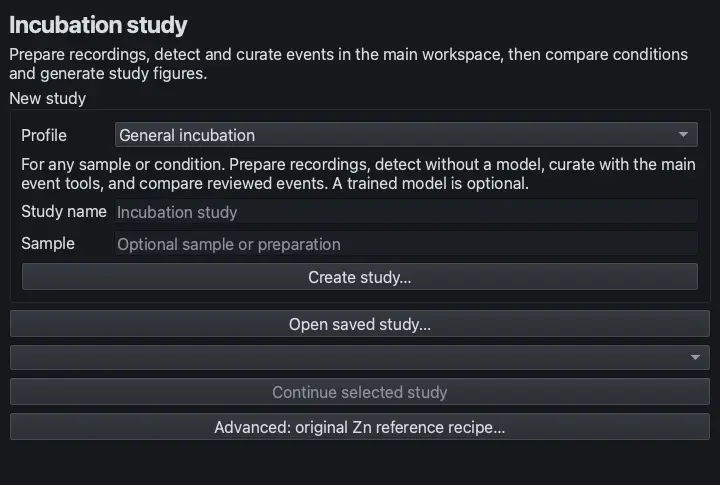

*Actual offscreen Qt interface capture, 2026-09-29, build 40.15.59 source. General is selected; Create, Open saved, Continue and the advanced original Zn recipe share this entry. No scientific calculation is shown.*

1. Open **Analysis > Incubation study…**. Select a **Profile**, enter a **Study name**
   and optional **Sample**, and choose **Create study…**. Select a new empty folder.
2. For an existing workspace, use **Open saved study…** and select the folder
   containing `workspace.json`. The saved method and scientific settings determine
   how it opens; the currently selected new-study profile does not convert it.
3. Use **Continue selected study** to return to an already open workspace. Opening
   another study keeps other open studies and their parameter drafts available.

| Profile | Starting workflow | What the choice does not establish |
|---|---|---|
| General incubation | Editable preparation, signal or main-workspace detection, review and comparison; reflected median-window edges initially | Sample chemistry, valid physical metadata or a validated detector recipe |
| Zn incubation | The general workflow with reflected median-window edges | A requirement to use ML, or automatic reproduction of the original Zn experiment |
| Cu incubation | The general workflow with shrinking median-window edges | Automatic channel selection, interval exclusion, polarity or notebook settings |
| Acid incubation | The calibrated Acid preparation, CUSUM, measurement and family-analysis method | A generic numerical substitute for the other profiles |

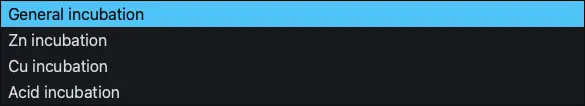

*Actual expanded profile menu, 2026-09-29, build 40.15.59 source. The profile is selected explicitly, not inferred from a filename.*

General is suitable for future incubation studies. Profiles are explicit choices;
the app does not identify chemistry from filenames. New-profile defaults do not
overwrite a saved study's settings. Older markerless Zn/Cu workspaces can display
the General profile while retaining their original reflected/shrinking preparation,
detector, measurements and review. General/Zn/Cu do not require a trained model.
Choose a model only when its actual training and preprocessing contract is appropriate.

### Prepare recordings and obtain candidates

In General/Zn/Cu, use **1 Sources** to apply the study name, sample and condition label
with **Apply study details**, then add recordings and **Apply recording details**.
Enter the actual incubation time, physical pore ID, nominal diameter, concentration,
voltage, current channel and event orientation. Inspect channel combinations and
retained/excluded intervals. A numerical default is not a measured pore diameter;
do not leave placeholder values as experimental facts.

In **2 Prepare**, set the preparation appropriate to that recording, choose
**Prepare selected recording**, and inspect raw, filtered/baseline and prepared
traces. In **3 Detect / review**, use the signal detector, an optional trained model,
or the main app's compatible detection tools. Preparation and detection are explicit
steps, not side effects of opening the launcher. Keep actual source-time exclusions
in the saved metadata so duration, rate and waveform context remain interpretable.

Acid uses **1 Sources**, **2 Prepare**, **3 Detect**, **4 Review**, **5 Analyze** and
**6 Figures**. Apply its stage settings, prepare each recording, then choose
**Calibrate and detect selected recording**. Inspect the calibration and candidate
tables. The Acid profile retains its calibrated numerical definitions and optional
family analysis; its settings should not be transplanted into another experiment
merely because the launcher is shared. Its source form permits an unresolved
nominal diameter to remain blank.

### Curate with the main event tools

The handoff has three checkpoints: save the edited events, confirm the selected
population, then recalculate. The main study bar shows which recording will receive
a curation save. Read that identity before acting on an event table.

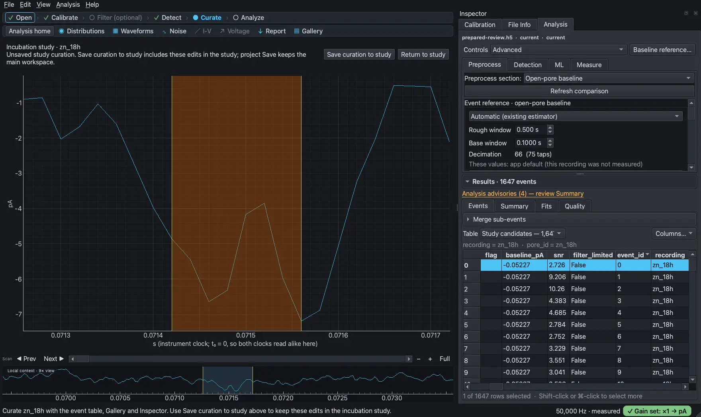

*Actual offscreen Qt capture, 2026-09-29, build 40.15.59 source. The saved Zn 18-hour recording supplies 1,647 candidates in an isolated review workspace; the original study is read only. The main bar identifies the study recording and separates Save curation to study from Return to study. This prepared-trace illustration is not a new detector run or calibration claim.*

1. Select the intended recording and choose **Curate in main workspace…** from
   **3 Detect / review** (General/Zn/Cu) or **4 Review** (Acid). The study opens its
   prepared trace and current candidates in the main workspace. Reentering the same
   current review returns to that workspace and retains pending edits.
2. Check the recording named in the **Incubation study** bar. Use **Show study
   events** if another recording is active. Inspect the event table,
   Event Gallery and Inspector before changing the selection.
3. Accept or reject candidates, edit bounds, add missed events, merge appropriate
   events, and apply annotations with the usual main tools. Undo/redo operates on
   that event table. Check the actual trace and original bounds; an automatic
   acceptance or a merge is not evidence of molecular identity.
4. Choose **Save curation to study** in the main workspace. Wait for the success
   message. This is the action that commits the edited catalog to the study.
   The study uses its committed measurement settings; values measured from the
   main prepared trace can differ from the study's calibrated measurements.
5. Choose **Return to study**. Returning changes the view; it does not save pending
   curation, confirm the selection, or rerun downstream calculations.
6. In General/Zn/Cu, choose **Use reviewed events for analysis** for every included
   recording. In Acid, choose **Confirm event selection for analysis** for every
   primary recording. These actions approve the current selection; they do not
   claim that every row was individually inspected or relabel every automatic
   decision as personal review.
7. Recompute the analyses and figures that depend on the changed selection.
   General/Zn/Cu provide **Compute recording comparisons**, **Extract reviewed-event
   waveform features**, **Run pooled exploratory clustering**, **Fit selected-recording
   mixture**, and **Generate selected figure group**. Run only the stages you need,
   with fresh features before a new clustering or mixture fit. Acid provides
   **Analyze confirmed event selections** and **Generate study figures**.

Saving the main project preserves the main workspace. **Save curation to study**
updates the incubation checkpoint. Neither replaces the other. A later main-table
edit needs another study save, selection confirmation and dependent recalculation.
Keep the whole study folder: the prepared review trace is stored there and a saved
main project can reference it. Undo history is not a durable study audit archive.

General/Zn/Cu also provide **Use existing main-workspace detections** to import a compatible
full-recording result from the original recording and channel. Schmitt, CUSUM, ML
and Reconciled sources are supported when their signal, calibration, range and
identity match the prepared study. An import is a snapshot; it does not create a
live link to every future edit. Partial, masked, changed or mismatched sources are
refused. Read the refusal instead of changing metadata to bypass it.

### Review groups and keep the measurements coherent

In General/Zn/Cu **5 Features / populations**, load or run clustering, inspect the
events in selected clusters, and accept/reject groups only after checking their
waveforms and recording domain. **Keep only selected clusters** also rejects the
other events in that saved domain, including unassigned events unless selected.
Use **Use cluster-reviewed events for analysis**, confirm any other pending
recordings, then recompute the comparisons or features and fits you intend to use.

Acid **4 Review** provides **Build event families for review** after selection
confirmation. Inspect and accept/reject families, confirm the revised selections,
then analyze. Acceptance-only review retains its frozen family assignments.
Boundary changes, additions, deletions or merges require appropriate remeasurement
and invalidate affected family analysis; rebuild before interpreting new results.
Family/cluster numbers identify groups in a method and run, not chemical species.

Figure styling changes appearance only. It does not perform detection, confirm an
event selection, update comparisons or fit populations. After recalculation,
regenerate affected figure groups; then inspect saved styling, titles and colors
against the new assignments. Save Figure Library entries in the main project
separately from study figure styling.

### Troubleshoot the handoff

| Situation | Next action |
|---|---|
| Main edits are visible but study counts are unchanged | Use **Save curation to study**, wait for completion, then return |
| The study says review is pending | Confirm the current selection for each included recording; save alone is not confirmation |
| The curation bar names the wrong recording | Use **Show study events** or return and open the intended recording's review |
| Save is blocked by running work, drafts or a changed source | Finish/cancel the operation, commit intended settings, and reopen current events after a study change |
| A study window was closed | **Return to study** reopens it; reopen its events before saving if the review recording was closed |
| A canceled/failed calculation leaves old results visible | Those are previous completed results, not evidence the new operation succeeded |
| Figures still describe the previous population | Recompute the dependent stages and generate their figure group again |

**Advanced: original Zn reference recipe…** in the launcher preserves the frozen
student notebook workflow and its completed result bundles. Its automated **Run
study** does not consume later main-workspace curation. Use the staged workflow
above to compare reviewed events. The written Zn and Cu guides retain the original
recording-specific scientific recipes; the incubation companion explains the
advanced path without treating it as the default for new studies.

## Walkthrough 1 — one recording, end to end

> **Historical worked example.** Screenshots, quoted readouts, event counts and timings in this walkthrough come from the original/2026-08-20 runs unless another date is stated. They preserve those settings and observations; they are not expected-output tests for the current build. The apo-ferritin gain/offset and physical open-pore identity remain unverified, so retained pA values are illustrative. Automatically accepted candidates are not necessarily human-reviewed events.

Goal: take a raw recording to a curated event population with fitted distributions, and know
at each step whether to trust what you are looking at.

Data: `500 pM Apo ferritin_1 x PBS_22 nm_0006_Process_-600 mV.abf` — 2,993,798 samples at
50 kHz, 59.876 s, recorded at −599.91 mV. Every number below is the app's own output on that
file, re-taken through the GUI on 2026-08-20. Earlier printings named a `.csv` export of the
same recording; the two agree on every count quoted here, but the ABF is what is on this bench
and what the screenshots are of, so it is what this walkthrough opens.

### Step 1 · Open the recording

`File › Open…` (`Ctrl+O`), or drag the file onto the window. The
trace draws immediately and the `Open` step of the workflow strip ticks.

Check the status bar. On this file it reads `50,000 Hz · file_meta` — the rate came from the
file's own header, not a guess. (A text export of the same trace reads `50,000 Hz · measured`
instead: the rate was recovered from the time column.) If it said `rate: unknown · x-axis in
samples` you would be working in samples, and every dwell in seconds would be unavailable.

**What you should see**

The historically estimated reference sits near −35 pA with dense downward excursions whose floor is −100 to −200 pA.
Those excursions are candidate events; neither their molecular identity nor the physical open pore is established by this picture. The trace's x axis names the clock it is drawn on —
`s (instrument clock — this recording starts at t₀ = 61.3034 s)` — while the event table's
`t_start_s (t₀=0)` column counts from the start of the recording. Two clocks in one window, and
the app labels both.

The status bar also carries `⚠ Current gain uncalibrated — magnitudes not physical`. Note what
that is *not* saying: this file declares its units as pA and the app reads them, which is why
every depth below is printed in pA. The warning is about the **gain**, which on this bench has
never been calibrated against a known current — so the pA are an instrument scale, and the flag
stays up whatever the file format. It is not a complaint about the file.

### Step 2 · Measure the baseline

`Preprocess` tab → `Open-pore baseline`. Press
`Measure this recording`, read the proposal, press `Use these values`.

| Control | Default → measured, and what it decides |
|---|---|
| Rough window | 0.5 s default → 2 s measured. Pass 1: decides which excursions count as events and get masked out before the baseline is measured. It must be several times the longest state you want treated as an event. |
| Base window | Historical 0.1 s default → 0.5 s measured. Pass 2 sets the tracking timescale. It must be long enough not to follow event interiors, while allowing genuine changes in the reference level to be tracked. These competing requirements are recording-specific; the proposal and health checks are aids, not proof of the physical open pore. |
| Decimation | `66  (75 taps)` at the default → `333` once the proposal is applied. Derived from the base window, shown, never set by hand. A cost throttle, not a quality knob — the tap count is held near 75 whatever the window, which is what the number is for. |

Below the windows, `Baseline health` prints what the estimator actually did — **nine checks, each
one stating its own criterion**, drawn as soon as the probe returns and *before* you have applied
anything. On this file, verbatim:

```
These 9 checks were run on the windows PROPOSED above, before anything was
measured with them. This is the evidence for the Apply click.

• PASS  recording vs tracking window (measured 119.8, passes >= 1.0 x 0.5 s)
        — 59.876 s of signal against a 0.5 s tracking window.
• PASS  recording vs rough window (measured 29.94, passes >= 1.0 x rough_s = 2 s)
        — 59.876 s of signal against a 2 s rough window.
• PASS  mask fraction (measured 0.1069, passes 0.025 .. 0.25)
        — 10.69% of samples masked (2.35% would be masked on an event-free trace).
• PASS  mask vs a wide-window mask (measured 0.9938, passes <= 2x)
        — the same 3.5-sigma mask finds 10.62% of the trace with a 5 s rough window
        against 10.69% at the configured 2 s -- 0.99x, i.e. the two windows agree
        about how occupied this recording is.
• PASS  base window vs state dwell (measured 24.13, passes >= 3 x the 20.7 ms state
        dwell) — base_s 0.5 s is 24.1x the 20.7 ms median state this recording spends
        below its open pore (10.6% of the trace, measured over a 5 s window wide
        enough to see over them).
• PASS  baseline vs the open pore beside each state (measured 0, passes <= 3% of the
        state depth) — across 240 states the tracked baseline sits 0.00 pA inside them
        -- 0.0% of their 87.4 pA excursion, taken against the open pore 5-55 ms either
        side of each one.
• PASS  rough-pass sigma vs final noise (measured 1, passes 0.33 .. 3.00)
        — rough-pass sigma 4.52 pA against a final noise of 4.52 pA (ratio 1.00);
        one-sided upper MAD 4.52 pA.
• PASS  tracked level vs the recording's own histogram (measured 0.8992, passes >= 50%
        of the recording, and >= 2x the next level's share; under 80%, also held for
        >= 1 tracking window) — 89.9% of this recording sits within 5 sigma (22.6 pA)
        of the tracked baseline and the other level this recording visits is -86.1 pA
        from the tracked one (-120.7 pA against -34.6 pA) and holds 5.4% of the
        recording -- a decisive majority for the level that was tracked, which is what
        this row can check, and NOT a verification that THAT level is the open pore.
        Nothing here can be: the same trace read the other way up is a pore BLOCKED
        89.9% of the time whose returns to the open pore are what got masked as events,
        and the two readings are the same samples. The result carries the advisory that
        spells both of them out; read it before reading a depth.
• PASS  overshoot (measured 0.0001675, passes <= 0.3)
        — overshoot 0.000 (46 samples above +4 sigma, 274707 below; healthy corpus
        values 0.09-0.11). Measured in the CANONICAL frame, which is chosen by the
        polarity (-1) -- so on a recording whose own polarity measurement has
        inverted, this scalar inverts with it and passes; the occupancy margin above
        is the row that is not read through that frame.
```

(Each bullet is one long line on screen; the wrapping here is this page's, and nothing else
has been changed. Earlier printings abridged the last four and printed `measured 1.00` where
the app prints `measured 1` — if you are comparing a screen against this block, compare the
numbers in the parentheses, which is where a check states its criterion.)

Every line names the criterion that would fail it, which is the only way a check can be read. The
sentence at the top changes with what the block is about: after a detection it reads instead
*"These 9 checks describe the windows the detection on screen was measured under — read back
from its own provenance, not from the form above."*

Green does **not** mean the window is right. On this file all nine pass at 0.5 s and at 2 s while
the event count differs by 13%. (The −700 mV file used to make the point harder: its 0.1 s / 30 ms
proposal stamped a baseline 7.2% out with every check green. That proposal is gone — the base
window is now floored at three times the median state — and the same window typed in by hand is
caught by `base window vs state dwell`, which reads `WARNING … measured 1.382, passes >= 3 x the
21.7 ms state dwell`.) Notice the overshoot line arguing with itself, too:
it passes at 0.0001675 while calling 0.09–0.11 the healthy range. That check is deliberately
one-sided — it flags *high* overshoot only — and its message never says so.

**Which window the rest of this walkthrough uses**

Everything from Step 3 on is quoted at the historical **untouched default** 0.5 / 0.1 s so the screenshots and settings can be compared. `Back to default` restores defaults, not a validated reference for your recording. Use these settings only to investigate the historical recipe, not as a recommended starting point for every analyte. Each step also gives the measured-window figure wherever the reference run has one. A fresh result may differ with the build, source format, conditioning, curation or merge rules.

### Step 3 · Detect

`Detection` tab. The defaults that produced the numbers below:

| Parameter | Default, and what it means |
|---|---|
| k_in (enter) | 5.00 — an excursion must exceed 5× the noise to start an event. Raise it to reject marginal events, lower it to catch shallow ones. |
| k_out (exit) | 2.00 — the excursion must fall back below 2× the noise to end the event. Deliberately lower than the entry, so a noisy event is not chopped into fragments. |
| min dwell | 0.0000200 s (20 µs = one sample at 50 kHz). Events shorter than this are not reported — and this value becomes the fits' truncation limit. |
| max dwell | 0.000000 s (0 = off). Set it and the fits model the right-hand cut too, rather than being biased short by it. |
| merge gap | 0.0000 ms (0 = off). Milliseconds, like the Merge panel's window — 15 ms is `15`. See walkthrough 2. |
| range | `whole recording` — read-only. The Schmitt detector always runs over the whole recording and records that in its provenance; to detect over less, cut a `Segment` and detect on that. |

Press `Detect`. On this recording it took 3.5 s; the two longer files in the reference set
(9.1 M and 12.5 M samples) took 11.4 s and 10.3 s. That is of order a second per million samples,
but it did not scale cleanly across the three, so treat any timing here as an order of magnitude. Before
reading the events, read the polarity line the app prints above the button:

```
measured   enhancement (down): 916 down / 2 up (confidence 1.00, measured)
override   auto (measure)
```

This is the app estimating excursion polarity relative to the reference in force. **Enhancement** means the measured current magnitude increases relative to that reference. It does not certify that the selected level is the physical open pore or establish a molecular mechanism. This interpretation is consistent with ΔI/I₀ above 1 here, but an incorrect reference can change the classification. The two counts are the *polarity vote* — candidate excursions, counted each way —
not an event count; do not read 916 as 916 events, against a detection of 317. One caveat: when
the run vote is ambiguous (a smoothing filter's edge lobes can outvote the events themselves) the
app decides on the coherent sample MASS instead, and then prints that vote's counts — samples, not
excursions. The run counts survive in the detection's provenance as `n_down_runs`/`n_up_runs`, and
a warning names the overruled vote.

The vote is taken against the baseline in force, so it moves with the window: this same
recording reads `3752 down / 0 up` once the probed 2 s / 0.5 s window is applied, and the
−700 mV and −500 mV files read `2184 down / 2 up` and `8461 down / 4 up` at the windows now
proposed for them (1 s / 300 ms each). What does not move is
the verdict — enhancement, at confidence 1.00, on all of them.

**Result**

317 events, 316 accepted, at the default baseline window
(**276 detected / 275 accepted** with the measured one — see *Do this first*). Median depth
85.68 pA; `median dI/I0` prints as `2.423 ⚠ >1`; median dwell 17.54 ms; stamped open pore
−35.75 pA. The thresholds it actually ran at were 22.623 pA in and 9.049 pA out, derived from a
robust noise σ of 4.5245 pA (upper MAD). None of those three is on any panel: they are stamped
into the detection's provenance and travel in the export sidecar, which is where to read them
back. Baseline method: `masked_median`.

Re-detecting at the measured 2 s / 0.5 s window gives 276 events, 275 accepted, and this is the
distribution the reference run measured in full:

| Metric | Median | IQR | Range |
|---|---|---|---|
| dwell | 18.16 ms | 16.61–19.49 ms | 0.08–519.5 ms |
| depth | 87.59 pA | 79.65–94.38 pA | — |
| ΔI/I₀ | 2.523 ⚠ >1 | 2.301–2.708 | — |

Hold on to that 0.08 ms minimum: walkthrough 2 investigates how short candidates change under merging.

That run's own accounting balances, and it is worth checking once so you know it does:

```
n_candidate_runs 18477 − n_rejected_below_enter 18201 − n_merged 0
                       − n_rejected_short 0 − n_rejected_excluded 0  =  n_events 276
```

Every candidate excursion is accounted for by name. One further event was flagged
`clipped_by_boundary` — still above threshold at the last analysed sample — and is therefore
detected but not accepted. That is the whole difference between 276 and 275.

Zero events were flagged `filter-limited` in that run. This means none triggered that diagnostic; it does not prove the recording bandwidth or conditioning left every measured depth unchanged.

### Step 4 · Scan every event at once

`Analysis › Event gallery…`. Set `Sort` to
`Depth (deepest first)` and leave `Same depth scale` ticked — without it
every tile is normalised to itself and a 15 pA event draws identically to a 45 pA one.

Three things worth knowing while you scan:

- **Right-click a tile** for the direct roads out: `Open in Event Inspector` lands
  the inspector, the table row and the trace zoom on that event together;
  `Go to event in trace` is the double-click; `Accept`/`Reject` curate just that tile.
  (The inspector has a `Gallery…` button for the road back.)
- **Half-strength shading** inside a tile is a *neighbouring* accepted event that
  falls in the same padded window — the same span the main trace shades. Your own
  event is the full-strength block. A fractured event therefore looks fractured
  here too, which is your cue for Walkthrough 2's merge.
- If the status line says **“page taller than the window — scroll for the rest”**, the
  fixed page size holds more tiles than one screenful (macOS scrollbars hide until you
  scroll). The `Fit` page size never overflows.


*The gallery sorted deepest-first, Same depth scale on. Caption under each tile is event id · depth. The spiky interiors are the reason the CUSUM step finds 3.1 levels per event.*

Read the grid, not individual tiles. What it shows here: the events have *spiky, multi-level
interiors* rather than clean square blockades. That is a finding, and it is why the CUSUM fit in
the next step reports 3.1 sub-states per event.

To cull: drag a rubber band over a run of bad tiles and press `R`, or double-click a
single tile to jump to it in the trace and judge it full size. Rejections land in the same event
table the Plots window and the exports read. Keys `1`–`9` write the first nine
entries of the label palette onto the selected tiles (`Analysis › Event labels…` defines it);
the `Label` combo with `Apply` and `Clear` beside it does the same by mouse. Those three sit in
the toolbar between `Tiles` and `Same depth scale`; they are newer than the screenshot above,
which is why it does not show them — the `Event gallery` figure in the *Control reference* does.

**Optional: curate with `Fit` set to `none`**

The historical Plots window redrew after accept/reject and recomputed fit advisories. Across all three reference recordings in that run, one reject click cost
**0.4–1.0 s with a fit drawn, against 68–93 ms with `Fit` = `none`** — a 7–9× penalty, and about
87% of it went on the rival-family and component-count scans. The notes are now
deferred 400 ms off the redraw path, so a burst of clicks never pays for them and the pane says
what is pending rather than going blank:

```
MODEL COMPARISON: still computing — it appears when you stop clicking. (Set Fit = none to curate without it.)
COMPONENT COUNT: still checking whether another number of components fits better — it appears when you stop clicking.
```

Those timings are historical, not a current-build benchmark. Turning off the fit remains an optional way to simplify review. Changes to the accepted population can require a new fit; presentation-only changes do not rerun analysis. Inspect the current fit/status after review before exporting it.

Everything you do here is undoable — `Edit › Undo` (`Ctrl+Z`) covers both the
event table and the manual-measurement table, with a separate stack for each, and the menu label
spells out which one a press will act on. The one thing undo cannot reach past is
`File › Close document`: closing a recording takes its detections, its curation and its undo
history with it, which is why closing one with events asks first and names the counts.

### Step 5 · Fit the sub-states

`Analysis › Fit sub-state levels (CUSUM)…` estimates piecewise-constant current levels inside accepted events. In the current build the initial fit runs in the background, supports cancellation, and installs only if its source recording, calibration, settings and event table still match. Cancellation preserves any existing result; a running or discarded fit is not a completed result.

The fitted levels draw in two places the moment the fit completes: as green
horizontal segments on the **main trace** (over every accepted event, at each
level's own mean current) and per event in the **Event Inspector**. On the
trace each segment is a bright green stroke over a dark casing and is kept at
least ~3 pixels long, so short levels stay visible even at full zoom-out. They retire
from both together — re-running detection invalidates the fit, and rejecting an
event takes its levels off the trace with its span.

**Result**

992 levels across 316 events in 2.6 s. 72.8% are multi-level; the mean is 3.14 levels per event.
(These three figures come from the original run on this file and were not re-measured in the
2026-08-20 reference pass; the level counts in particular are the one CUSUM output this manual asks
you not to trust — see *Known limits*.)

Open the `Event inspector` on an event with structure. The levels draw as flat green
segments over the trace and are listed underneath:


*Historical Event 1 Inspector. Green segments are fitted CUSUM levels; the grey dashed line is the estimated reference and the orange line is the historical in-event median.*

**Current amplitude curation:** in Event inspector → Amplitude, choose an estimator and Apply, or enable **Edit red level** to edit the in-event level. The selected/manual result is stored separately as **Selected amplitude**; it does not overwrite the detector's **Median depth** (`depth_pA`), repair missed events or change event boundaries. A selected interval must lie within that event. The red event level is not the recording's open-pore reference. Editing event bounds is a different action and remeasures the affected event; if saved conditioning cannot be reproduced, NanoScope refuses the edit and preserves the old values.

```
Event 1    [2 of 317 · All]
dwell:        25360 µs   (0.02536 s)
depth:        65.883
dI/I0:        1.777
SNR:          14.6
rise / fall:  76.98 µs / 4537 µs
levels:       4
baseline:     −37.083

CUSUM levels:  5
  (BIC count says 4; CUSUM is the fitted estimate)
  L0: 67.44   1.13e+04 µs   dI/I0 1.82
  L1: 119.9      660 µs   dI/I0 3.23   step +52.5
  L2: 72.63     4960 µs   dI/I0 1.96   step −47.31
  L3: 110.5      960 µs   dI/I0 2.98   step +37.84
  L4: 50.05     7480 µs   dI/I0 1.35   step −60.42
```

Two things to notice. The `step` column gives the signed jump into each level, so you
can see the event go down, up, down again. And the app reports its own disagreement:
`BIC count says 4; CUSUM is the fitted estimate` — two criteria differ on how many
levels there are, and rather than pick silently it shows both.

`Analysis › Export sub-state levels…` writes the long-form table (one row per
level) plus a sidecar recording the CUSUM parameters — 235 KB and 6 KB here (file sizes from the
original run; not re-measured).

### Step 6 · Fit the distributions

In the `Fits` box set both component counts to 2 and press `Fit`.

Dwell

```
exponential mixture (k=2, censored MLE)
  n = 316   loglik = 1040   AIC = −2074   BIC = −2062
  censoring: hard left-truncation at t_min=2e−05 s (eta == 1 above it) -- but the SAMPLE
    is also right-censored by curation (see the warning below); the model does not
    correct for that
  goodness of fit: KS D = 0.3873 against a 1% critical value of 0.0916 (n = 316). THE
    FITTED CURVE DOES NOT DESCRIBE THESE DATA — the largest gap between the model and
    the empirical distribution is far beyond chance. Its parameters should not be
    reported as measurements.
  param      estimate                      95% CI
  tau_1    0.00053266    [ 0.0003836,  0.0006636]  s
  tau_2      0.015928    [   0.01535,    0.01661]  s
  w_1        0.108022    [   0.06011,       0.16]
  w_2        0.891978    [      0.84,     0.9399]
  ! RIGHT CENSORING (curation): 1 rejected event(s) are longer than the longest event in
    this fit (0.07098 s), so the fitted sample is cut off on the right as well as the
    left. The likelihood models the LEFT truncation only, so tau is biased SHORT
    (measured −3.7% when the cut sits at 5 tau, −24% at 2.5 tau). Re-accept those
    events, or set max_dwell_s so the cut is a known number the fit can correct for.
```

Two lines here do different jobs. The **censoring warning** identifies a possible selection-induced tail cutoff; the quoted bias percentages are illustrative model calculations, not measured correction factors for this recording. Re-accept only events justified by review, and specify a right cutoff only if it represents the actual selection rule. Neither action guarantees removal of arbitrary curation bias. The **goodness-of-fit line above it is a rejection diagnostic**, not a blocked calculation, and it applies to this k = 2 fit
as much as to the single exponential of Step 7: `KS D = 0.3873` against a 1% critical value of
`0.0916` rejects the model outright. Read the four parameters below it as a description of the
histogram's shape — which is what the rest of this step uses them for — and not as measurements
of two escape processes. Step 7 shows what the app offers instead.

**A fast component is not automatically a population**

`tau_1` = 0.53 ms carrying 10.8% of events could look like a second, fast species. Fragmentation is a plausible competing explanation on this recording, and should be assessed against the trace. Merge the table at a 10 ms gap (walkthrough 2) and the
**shortest event in the whole table becomes 13.24 ms** — the sub-millisecond mode disappears
entirely. The same `exponential + gamma` fit that gave 25% fast on the unmerged table gives
**1.3%** on the merged one, and the slow lobe does not move (k = 71.5, mean 18.4 ms). Fit the merged
table only if the merge is justified by waveform review; record the settings and compare the unmerged result. A mode disappearing under merging is not by itself proof of fragmentation, because merging can also remove genuine short events. Do not identify a species from this fit alone.

Depth

```
Gaussian mixture on dI/I0 (k=2, EM)
  n = 316   loglik = −242.7   AIC = 495.4   BIC = 514.2
  goodness of fit: KS D = 0.1154 against a 1% critical value of 0.0916 (n = 316). THE
    FITTED CURVE DOES NOT DESCRIBE THESE DATA — the largest gap between the model and
    the empirical distribution is far beyond chance. Its parameters should not be
    reported as measurements.
  param        estimate                      95% CI
  mu_1         0.391328    [    0.3749,     0.4128]
  sigma_1     0.0741171    [   0.06042,    0.09591]
  w_1          0.250035    [    0.2025,     0.2975]
  mu_2          2.59027    [     2.538,      2.647]
  sigma_2      0.472505    [    0.3695,     0.5516]
  w_2          0.749965    [    0.7025,     0.7975]
```

Rejected again — `KS D = 0.1154` against the same 0.0916 — but the diagnostic does not identify the cause. Two fitted depth components put a quarter of events near ΔI/I₀ 0.39 and three quarters near 2.59. The historical interpretation linked the shallow component with short candidate fragments; that hypothesis requires waveform-level review, not just agreement between fitted component proportions. On the merged table the depth
mixture is two components at ΔI/I₀ 2.548 and 2.886, with no 0.39 lobe at all — and the merged
table's depth fit is the one that passes (Step 7).

Both fits were rejected on this historical unmerged table. That shows disagreement with those models, not the cause: fragments, multiple populations, nonstationarity and model misspecification can all contribute. Review suspected fragments and record any justified merge before fitting again.

### Step 7 · See the fit against the data

Open **Analysis → Distributions** (called `Plots` in historical screenshots), set `Column` to `dwell_s`, `Time unit` to `ms`, tick `Log x`, pick a `Fit`, then press **Apply fit**. Choosing a family is a draft until applied; it is not an appearance edit.

**A note on this figure's numbers.** The screenshot and the verdict quoted below are from the same
−600 mV recording, but at its *measured* baseline window and after a 10 ms merge, so n = 239 rather
than the 316 of Step 6. That is the table used for this historical fit; it is not proof that a 10 ms merge is correct for every event. Walkthrough 2 describes the fragmentation hypothesis and the merge's consequences. The exponential was rejected in the historical variants tested; assess a fresh result on its own population and settings.


*Dwell histogram in ms on a log x axis, single exponential fit, n = 239 (the merged −600 mV table). The Details pane below prints the parameters, the detection limit, and — this is new — a goodness-of-fit verdict and a ranked cross-family table naming a better model.*

**When the fit does not follow the data**

Here it does not. Supported one-dimensional distribution fits include a Kolmogorov–Smirnov diagnostic in Details; this is not a universal diagnostic for scatter, spectral or other analyses. The historical readout was:

> KS D = 0.4478 against a 1% critical value of 0.1053 (n = 239). THE FITTED CURVE DOES NOT
> DESCRIBE THESE DATA — the largest gap between the model and the empirical distribution is far
> beyond chance. Its parameters should not be reported as measurements.

and, under it, a ranked comparison the app fits for you across all four dwell families it offers:

```
MODEL COMPARISON (same events, same censoring; lower BIC is better):
    exponential + gamma (bimodal)          -2169.76  <- best
    inverse-gaussian (first passage)       -1568.36
    gamma (peaked)                         -1403.13
    exponential                            -1313.23  <- shown
    "exponential + gamma (bimodal)" fits these data better by 856.524 BIC. The model shown is
    not the best one this window can fit; choose it in the Fit box before reporting parameters.
NOTE: 2 components fit markedly better (BIC -1364.86 vs -1313.23); set Fit components = 2 to see it.
```


*The same fit's Details pane. `KS D = 0.4478 against a 1% critical value of 0.1053 (n = 239)` — the exponential is rejected, and the app says so in words. Under it, the cross-family table it computed for you: `exponential + gamma (bimodal) −2169.76 <- best`, against the `−1313.23` of the curve actually drawn. The pane scrolls; the shown model is the row cut off at the bottom.*

The exponential is rejected on **all three** reference recordings (KS D 0.4577 / 0.4478 / 0.6395
against critical values 0.0554 / 0.1053 / 0.0518), and `exponential + gamma (bimodal)` wins by
856–2729 BIC on each. Earlier printings of this manual built that comparison by hand from three
fits; the app now does the whole ladder, and it includes a family the hand-built table omitted —
`inverse-gaussian (first passage)`, which ranks second here.

Three things to carry away from it:

- **A single, left-truncated exponential has τ = mean − t_min.** This identity does not apply to a mixture component's τ or a right-truncated likelihood. The arithmetic alone does not establish an escape mechanism.
- **The winner returns no confidence intervals.** `exponential + gamma (bimodal)` prints
`--` for every parameter, noting *"no bootstrap CIs for this family: each replicate is a
12-start optimisation."* The app points you at the one model whose parameters you then cannot put
an uncertainty on. On the merged −600 mV table its parameters are w_exp 0.0133, τ 0.3878 s,
k 71.5, θ 2.579e−4 s — a tight ~18 ms gamma-shaped population plus a 1.3% long tail.
- **Retain the verdict separately from the artwork.** The historical title printed `τ = 23.31 ms (n = 239)` for a rejected fit. Current warning prose belongs in Details and provenance, not inside the exported plot. Read Details before selecting a model and carry relevant limitations into the manuscript or slide notes; an attractive curve is not a validity check.

Use `Fit range` only with a defensible, recorded selection rule. It changes the fitted sample and may impose truncation; it is not a way to hide model disagreement. Inspect the stated fit bounds and exclusions.

**The same test, passing**


*Depth in pA on the −600 mV recording with `Auto (BIC)` ticked. The app tried k = 1 to 4 and printed all four scores — `k=1: 2058.78  k=2: 1947.25  k=3: 1961.25  k=4: 1962.88` — before choosing 2, and this time the verdict line clears it: `KS D = 0.0321 against a 1% critical value of 0.1053 (n = 239). The fitted curve is consistent with these data.` Same machinery, opposite answer to the dwell fit. (This one is fitted on `depth_pA` rather than the `dI/I0` of Step 6; μ = 88.56 and 99.11 pA.)*

The diagnostic distinguished these historical fits. A non-rejection does not prove the model or identify a molecular population. Parameter estimation, selection of models/components and dependence between events affect interpretation of goodness-of-fit diagnostics.

### Step 8 · Check the noise

Open **Analysis → Noise spectrum** (formerly `Power spectrum (noise / PSD)`). The spectrum describes the selected signal segment, including any events or artifacts left in it; a carefully chosen quiet segment can inform noise/bandwidth assessment but cannot certify every detected event.

**Choose the segment first, or you will measure your events**

The group is called `Segment (quiet open-pore baseline)` and that is an instruction. Leave
translocations inside the `Start`/`End` window and the spectrum is the event train,
not the pore. On this recording the widest event-free gap is only 0.4983 s, so with a 20 ms guard
either side the segment is 0.0911–0.5494 s.

**And check which clock you are typing in.** The `Start` and `End` fields are in
seconds **from the start of this recording** — the same clock as the event table's
`t_start_s`, and *not* necessarily the clock the trace's x axis is drawn on. The panel says
so in the tooltip and states both clocks in its segment readout:
`0.0911–0.5494 s into the recording (= 61.3945–61.8528 s on the trace's instrument clock)`.
It matters: typing instrument-clock numbers into these fields on the −500 mV file analyses a
different 1.4 s and returns total RMS 22.66 pA and α 1.822 in place of 3.99 pA and 0.985 — a
5.7× error, from a slip the readout is there to catch. (At the dock's default width that readout
is clipped just before it names the second clock; widen the panel.)

Then set `Segment length` — it is the `Welch estimate` box's first field, and it starts at
`Auto`. On this segment `Auto` picks 2048, which leaves the α fit only 4 FFT bins and makes the
panel flag its own answer `← MARGINAL`. Typing 4096 is the finest setting that still averages at
least eight segments, which is also the fewest bins the α fit will accept without the flag. The
readout below calls the value `nperseg`, which is what it is called in the details pane and
nowhere else:

```
Total RMS noise:    3.682 pA
Band RMS:
   <1 kHz            1.603 pA
   1–10 kHz          3.174 pA
   10 kHz–Nyquist   0.9395 pA
White floor:       0.001529 pA²/Hz  (median 174.7–1747 Hz)
1/f exponent α:   1.266  (magnitude at 1 Hz: 0.7391 pA²/Hz, R²=0.896)
                   fit over 12.21–100 Hz on 8 FFT bins
fs = 50,000 Hz  ·  Nyquist = 25,000 Hz  ·  Δf = 12.21 Hz
Welch: nperseg = 4096, noverlap = 2048, segments ≈ 10, window = hann
```

**That is the selected quiet segment.** Historically its total RMS was 3.68 pA, with 1.60 pA below 1 kHz and a −3 dB roll-off near 3.44 kHz. These illustrative values inform noise and bandwidth assessment; minimum reliable event depth also depends on dwell, filtering, detector settings and the required error rate.


*The power spectrum, log-log — this one over the **full trace**, which is the contrast case quoted below rather than pore QC. The orange dashed line is the fitted 1/f slope and the readout quantifies it. The line under `Use full trace` states the analysed span on both clocks, and the `Style` box on the right controls the exported figure.*

**What the whole trace reads, and why you must not quote it**

Press `Use full trace` on the same recording and it reports:

```
Total RMS noise:   25.97 pA
Band RMS:
   <1 kHz            25.58 pA
   1–10 kHz          4.411 pA
   10 kHz–Nyquist     0.94 pA
White floor:       0.08168 pA²/Hz  (median 43.67–436.7 Hz)
1/f exponent α:   1.342  (magnitude at 1 Hz: 309.4 pA²/Hz, R²=0.684)
                   fit over 1–100 Hz on 130 FFT bins
fs = 50,000 Hz  ·  Nyquist = 25,000 Hz  ·  Δf = 0.7629 Hz
Welch: nperseg = 65536, noverlap = 32768, segments ≈ 90, window = hann
```

The whole-trace readout was about seven times the total RMS and sixteen times the sub-kilohertz value of the quiet segment. This contrast is consistent with substantial event-related power; it does not by itself partition noise sources or prove an exact percentage attributable to events. Whole-trace PSD is valid as a description of the whole signal, but must not be presented as quiet-pore noise.

The full trace also supports a mains-line check. Historically, at Δf = 0.7629 Hz, the 50, 60, 120, 180 and 240 Hz bins sat at 0.59–1.19× their local background: no prominent line was identified by that comparison. This does not rule out every electrical artifact or establish the origin of the ~18 ms population.

### Step 9 · Export

`Analysis › Export events…` writes two files together: the event table and a
`.meta.json` sidecar carrying the detector settings, the baseline estimator, the
calibration, the app version and the clock the table's `t_start_s` is on — the recording's
instrument-clock origin, so the CSV can be lined up with the `figs_trace.csv` the figure export
writes beside it. On this recording, 109.5 KB and 5.9 KB (sizes from the original run; not re-measured). Select the intended export population explicitly: accepted candidates are not necessarily reviewed positives, and reviewed decisions can include rejected examples. Read the export selection and sidecar rather than inferring it from the filename.

**Why the sidecar matters**

A CSV of dwell times with no record of the threshold,
the baseline window or the gain cannot be compared with one exported next month. The pair is written
all-or-nothing — you never get the table without its provenance.

`Analysis › Export events for training…` offers three row sets. **Reviewed decisions** is the
recommended default and includes human positives and negatives; untouched candidates and automatic
rejects are withheld. **Accepted candidates** may include rows nobody reviewed, while **All raw
candidates** also includes automatic rejects. If any selected row contains an unresolved label such
as `molecule=apo|holo`, NanoScope warns and defaults to Cancel before asking for a filename. Rows
with contradictory human accept/reject decisions are excluded from Reviewed export until an
explicit Accept or Reject clears the conflict. Resolve label conflicts in the Event gallery or
Event inspector, or use All raw candidates only when external cleanup is deliberate.

## Walkthrough 2 — merging fragmented events

> **Historical worked example.** Numerical results and screenshots retain the original/2026-08-20 detection and merge recipes. They are not current-build acceptance tests. The gap rule and occupancy guard below describe the operation, not proof that any proposed group represents one molecule. Review waveform continuity and retain an unmerged project/table before choosing a merge.

Goal: investigate whether nearby candidates are fragments of one event, and understand the measurements and risks of joining them.

### The problem

A Schmitt trigger ends an event when the signal returns above `k_out`. A noisy or
multi-level event can cross back over that line mid-passage and be recorded as two, three or six
separate rows — each with a fraction of the true dwell. Dwell histograms then grow a spurious
short-lived population, and the event count is simply wrong.

You can see it in the gallery: fragments appear as a run of adjacent tiles with nearly identical
depth and suspiciously short dwells.

### The rule

Merging is defined on the *gap*, not on total duration:

```
gap = next.start_idx − current.end_idx
merge if   gap ≤ round(window × sample_rate)
```

So “within 15 ms of each other” means the second event starts no more than
15 ms after the first one ends. Runs merge transitively: A–B and B–C within the window
makes one event spanning A to C.

### Doing it after detection

- Detect as usual.
- In the `Merge sub-events` panel set the window. **It is in milliseconds**, so 15 ms
is `15`. The field accepts 0.01–100 ms and starts at 0.15 ms — a few samples at 50 kHz,
a possible starting point for investigating brief threshold recrossings, not a guarantee that distinct events remain separate. There is no `0` here: the smallest window is `0.01`, which still stitches
fragments that touch exactly. `0` looked like the `0 = off` sentinel the `Detection` tab spells
out on `merge gap` and was never one — at `0` the window is 0 samples, exactly-touching rows
still satisfy the rule, and `Merge all` merged them — so the field now floors at a window that
is honestly a window. The button beside it only ever means merge; there is nothing for “off”
to mean on this panel.
- Press `Merge all`.

The status bar reports exactly what happened. On this recording at 15 ms:

```
Merged 74 fragment(s): 317 → 243 events.
```

On a large table the merge runs in the background and narrates itself first, and the
`Cancel` in the status bar stops it without changing anything. The reference run's 10 ms
merge on the same recording, verbatim:

```
Merging 276 events… (Cancel in the status bar stops it; nothing is changed until it finishes.)
Merged 36 fragment(s): 276 → 240 events.
```

(One rough edge: `Merge all` stays enabled while it runs, so a second click is accepted while
the first is still working. Nothing is merged twice — the second click is refused with
`Another analysis is still running — wait for it to finish, or cancel it.` — but click once
anyway.)

A merge is reversed by `Edit › Undo` (`Ctrl+Z`), which restores the exact table
including your curation — **not** by re-running detection, which replaces the whole table and
takes every accept/reject decision with it.

The merged events are re-characterised, not just concatenated — depth, dwell, ECD and SNR are
re-measured over the new span, including intervening gaps. Across that historical 10 ms merge total event time changed by +0.09%; a small aggregate change does not prove that every merge joined one physical passage.


*After `Merge all` at a **10 ms** window on the −600 mV recording — the figure is from the reference run, whose merge window is 10 ms where this walkthrough uses 15 ms, so its counts are 276 → 240 rather than 317 → 243. The status bar reads `Merged 36 fragment(s): 276 → 240 events.`, and the two rows that were `0 → 1173` and `1174 → 2902` are now one row spanning `0 → 3556`. Note the two clocks in one frame: the x axis is the instrument clock (`this recording starts at t₀ = 61.3034 s`) while the table's `t_start_s (t₀=0)` column counts from the start of the recording.*

**What the merge actually removed**

Almost nothing in the body of the distribution and everything in the left tail. Over that same
10 ms merge the median dwell moved 18.16 → 18.44 ms — but the **shortest event in the table went
from 0.08 ms to 13.24 ms**, and the 5% of events that had been under 0.8 ms vanished. Those rows
lay within 10 ms of another event. Fragmentation is a plausible explanation, but disappearance under merging is not independent evidence of event identity: a wide merge also removes genuine short events. Compare the raw waveforms and record the selection rule before drawing a population conclusion.

### When the merge refuses

Not every run the window catches is merged. Some are declined, and the status bar says so
rather than pretending there was nothing there. The two sentences it uses — with `N` standing
for however many runs were declined, not a count from this recording:

```
Nothing merged: N run(s) within 15 ms are mostly open pore between their events, so merging
them would make one long, shallow event. Try a smaller window.
```

When only part of the table is declined, the refusal rides along with the merge that did
happen:

```
Merged 74 fragment(s): 317 → 243 events. N further run(s) were left alone: they are mostly
open pore between their events.
```

**Why.** The gap rule is transitive and transitivity has no brake: every event within one
window of the next joins the same group, so a *regularly spaced* train of clean, well-separated
events collapses into a single row the moment the window exceeds the spacing. Reproduced on the
bench: 40 isolated 0.4 ms / 300 pA events spaced 8 ms apart, merged at a 10 ms window, became
**one** event of dwell 312.40 ms and depth 0.70 pA — accepted, with a blank flag. Nothing
downstream could see anything wrong with it: the depth is a median over a span that is 96% open
pore, so the true 300 pA blockade is simply out-voted, and every derived column is internally
consistent with the row it was measured from.

So grouping by the gap is necessary and not sufficient, and the app asks a second, physical
question of every run the rule proposes: **what fraction of the merged span do the fragments actually cover?** Its three-fragment test fixtures have occupancy 0.92–0.96; that is a fixture property, not a universal physical threshold. Below **50%**, inter-event gaps dominate the proposed span and can make its median depth misleading. The guard is a useful heuristic, not a molecular-identity test; the reference and event boundaries can themselves be wrong. That run is left as
separate events and counted as a refusal. Between 50% and 80% the merge is performed, but it is
recorded in the merge provenance as low-occupancy, so a marginal stitch can be audited
afterwards instead of being indistinguishable from a clean one.

**Read the two messages as different answers.** `No sub-events within 15 ms to merge.` means the
window caught nothing. The refusal means it caught something and the app declined it — which is
your cue that the window is too wide for this recording, not that the merge is broken. Try a
smaller one, or drag over exactly the fragments you mean and use `Merge events in selection`.

The check applies wherever a merge happens: `Merge all`, `Merge events in selection` — an
explicit drag overrides the *window*, not this check, and a selection that fails it says so
(*"That selection is mostly open pore between its events…"*) — `Merge with next` in the Event
inspector, and the detector's own `merge gap` during a detection run.

### Doing it at detection time

`merge gap` on the `Detection` tab does the same thing during detection, and it now reads
**milliseconds** too — 15 ms is `15`, over a 0–1000 ms range. Both routes give identical
results — verified on all three recordings — including the open-pore check: a run whose merged
span would be mostly open pore is left as separate events there as well.

This is the one merge control where `0` really does mean **off**, and the suffix says so
(`0 = off`): merging is an optional *step* inside a detection run, so "do not merge at all" is a
real thing to ask for. The `Merge sub-events` panel has no such state — its window sits beside a
button whose only meaning is merge — which is why that field floors at 0.01 ms instead.

**Which to use**

The `Merge sub-events` panel, when you want to try a window and
see the effect without re-running detection. `merge gap`, when you have settled on a value
and want it recorded in the detection provenance and re-applied on every re-run.

### What 15 ms did to these three recordings

| Recording | Length | Before | After | Merged away | Status line |
|---|---|---|---|---|---|
| −500 mV | 250.1 s | 1081 | 862 | 219 (20%) | Merged 219 fragment(s) |
| −600 mV | 59.9 s | 317 | 243 | 74 (23%) | Merged 74 fragment(s) |
| −700 mV | 181.5 s | 1164 | 984 | 180 (15%) | Merged 180 fragment(s) |

The −600 mV row was re-run through the GUI on 2026-08-20 and reproduces exactly, status line
included. The other two rows are from the original CSV pass and were **not** re-measured — the
2026-08-20 run merged the `.abf` originals at 10 ms, not 15, and detected 1196 and 1179 events
rather than 1081 and 1164, so its counts are not the same experiment. Take the −500 and −700
rows as the shape of the effect, not as figures to reproduce.

Those are row counts, not accepted counts — walkthrough 3 quotes the −600 mV recording as 242,
which is the same table with its one boundary-clipped event unaccepted, and which this run also
reproduced. As everywhere in this app:
the `Summary` carries `n events` and `n accepted` on separate rows, and they are different
questions.

### Choosing the window — and when not to merge

The window must be shorter than the shortest gap between two *genuinely different*
translocations, and longer than the longest excursion *within* one. Those two bounds are
properties of your experiment, not of the app.

**Merging is not free**

Too large a window fuses distinct translocations into one, which inflates dwell and destroys the
event rate. On the merged 243-event table above, the mean gap from one event's end to the next
one's start is 0.227 s and the median start-to-start interval is 0.230 s, so a 15 ms window is
**about 15× smaller** than the typical spacing. That ratio alone does not establish safety: mean/median spacing cannot bound the shortest gap between distinct events. (Both re-measured through
the GUI on 2026-08-20. The reference run's probed 276-event table gives a median interval of
0.2215 s, and 14.8×, which is the same answer from a different table. Earlier printings quoted
0.28 s and ~19×, which no table on this bench reproduces.) Review the short-gap distribution and representative proposed merges, not just their average spacing. A large count change is a reason for additional review, not a validated numerical cutoff — and the −500 mV recording illustrates the risk:
a 10 ms merge there stitched 301 events of a terminal burst into 26 pseudo-events of up to 397 ms.
(That measurement is from before the open-pore check existed. It is exactly the shape the check now
refuses — a burst whose events are spread thinly across the span they would make — so on a table
like that one you should expect to see some of those runs reported as left alone rather than merged.
The check is a floor, not a substitute for choosing the window: it only catches the spans that are
*mostly* open pore, and a window that fuses two genuinely separate translocations sitting close
together is well inside it.)

`Merge events in selection` is the manual override: turn on `Measure event`,
drag a region over exactly the fragments you mean, and press it. Every event overlapping the
selection becomes one, regardless of the window.

`Merge with next` in the Event inspector does the same for one event and its immediate
successor — the right tool when you are already looking at the fragment.

## Walkthrough 3 — comparing three recordings

> **Historical worked example.** Tables, screenshots and quoted warnings preserve the original/2026-08-20 recipes. They differ from the current gallery because settings, merge safeguards and some sources differ. Current warnings stay in Details/status/provenance rather than plot artwork. Unknown gain/offset, uncertain open-pore identity and acquisition-order confounding limit physical interpretation; neither normalization nor a warning-free plot resolves them.

Goal: put three bias voltages side by side and avoid the one mistake that makes the
comparison meaningless.

Data: one pore, one session, three bias voltages — recordings 0005 (−700 mV), 0006
(−600 mV) and 0008 (−500 mV), merged at 15 ms, 2,088 accepted events in total. Beware the
filenames: the CSV export of the −700 mV run is named `…_0006_Process_-700 mV.csv` on this
bench, but its 9,074,042 samples identify it as the **0005** ABF. The ABF headers settle it —
−700 mV at 16:32:30, −600 mV at 16:37:35, −500 mV at 16:41:14, the three spanning about nine
minutes. The confound in this series is not two pores; it is time. See Step 3.

### Step 1 · Load and detect all three

Open all three files. Then, for each: select it in the File Manager, set the baseline, detect,
merge. The app keeps the results separately, keyed by recording and channel — there is no
“current” result to overwrite.

| Bias | Events | Dwell, median [IQR] | Depth pA | ΔI/I₀ | \|I₀\| |
|---|---|---|---|---|---|
| −500 mV | 862 | 22.33 [19.86, 25.51] ms | 61.9 | 2.26 | 28.4 |
| −600 mV | 242 | 18.26 [17.03, 19.37] ms | 88.3 | 2.50 | 35.4 |
| −700 mV | 984 | 19.62 [17.74, 21.88] ms | 100.0 | 2.04 | 48.9 |

That table is from the CSV exports at the app's default baseline window and a 15 ms merge. The
2026-08-20 reference run did the same exercise on the `.abf` originals, at each recording's
*probed* window and a 10 ms merge, and got:

| Bias | Detected | Merged | Median dwell | Median depth | Median ΔI/I₀ | I₀ stamped |
|---|---|---|---|---|---|---|
| −500 mV | 1196 | 863 | 22.36 ms | 62.87 pA | 2.357 ⚠ >1 | −27.08 pA |
| −600 mV | 276 | 240 | 18.44 ms | 89.42 pA | 2.571 ⚠ >1 | −34.79 pA |
| −700 mV | 1179 | 986 | 19.36 ms | 97.00 pA | 1.900 ⚠ >1 | −51.66 pA |

Neither table is wrong; they are measured under different windows, which is exactly the point of
*Do this first*. The medians move a few percent, the counts move by tens of percent. If you are
going to quote either, quote the window with it. Note the −700 mV row: its stamped I₀ is 7.2%
biased by the window its own probe proposed, which is what makes its ΔI/I₀ the odd one out at
1.900 — corrected, the three read 2.382 / 2.586 / 2.103. *Known limits* has the evidence.

### Step 2 · Overlay them in Distributions

Open **Analysis → Distributions** (the historical `Plots` window). In `Data sources`, tick all three. Colour now means
*recording*, and the app switches `Normalize` to `density` by
itself, because 862 events and 242 events cannot be compared as raw counts.


*Dwell, all three overlaid, density-normalised so unequal event counts stay comparable.*

Read across the three: a dominant dwell population at 15–25 ms appears in all of them. That
reproducibility is the result; the exact heights are not.

The small fast lobe near 0.15 ms is sensitive to merging. At 10 ms the historical −600 mV table has no event shorter than 13.24 ms. This is consistent with fragmentation but is not proof: merging can remove genuine short events, and surviving a merge does not validate a population. Inspect raw waveforms before interpretation.


*The same three in ΔI/I₀. The distributions largely coincide — the recordings differ far less than the raw pA plot suggests.*

### Step 3 · The mistake, and the app catching it

Switch to `Scatter`, `X` = `dwell_s`, `Y` =
`depth_pA`, `Log x` on.


*Historical depth in pA against dwell. Source separation is visible, but reference, calibration and acquisition-order differences prevent a simple physical interpretation.*

The three separate by measured depth, but that alone does not identify the cause. Read the historical `Details` pane:

```
Scatter depth_pA vs dwell_s   n = 2088
colour = source
  …_0008_process data_−500 mV.csv: n = 862
  …_0006_Process_−600 mV.csv: n = 242
  …_0006_Process_−700 mV.csv: n = 984
NOT COMPARABLE: depth_pA is measured against each recording's own estimated baseline, and
these 3 sources were detected under 3 DIFFERENT baseline configurations:
    <−500 mV fingerprint> -- …_0008_process data_−500 mV.csv
    <−600 mV fingerprint> -- …_0006_Process_−600 mV.csv
    <−700 mV fingerprint> -- …_0006_Process_−700 mV.csv
  Re-detect them under ONE baseline window (Preprocess ▸ Baseline) before pooling these, or
  plot a baseline-independent metric (dwell_s, or a count).
CAUTION — comparing depth_pA across recordings: The current gain is UNCALIBRATED for
these recordings, so absolute pA is not comparable across them (each pore's raw scale is
its own). dwell_s IS comparable — plot that instead.
```

That historical screenshot carried a title warning. In the current build, review the warning summary and Details; export warnings/provenance with the figure bundle or retain them in separate figure notes, not inside the artwork. The quoted suggestion to force every recording to one baseline window is not a universal remedy: choose a defensible recording-specific reference and compare documented processing contracts.

Change `Y` to `frac_depth`:


*Historical ΔI/I₀ view. Greater overlap after normalization is a sensitivity result, not proof of common blockade physics.*

The separation decreases after division by the estimated references (28.4, 35.4, 48.9). This does not establish that reference differences, rather than physics, caused it. **ΔI/I₀ cancels only a shared multiplicative gain** applied to both numerator and denominator; an unknown additive offset, wrong reference or differing processing can still bias the ratio. Verify these assumptions before interpreting or pooling normalized amplitudes.

**`Plots` guards the axis it just recommended, too**

`frac_depth` is measured against *each recording's own estimated baseline*, so two recordings
detected under different baseline windows are not poolable on it either — and these three were:
the historical run used rough/base windows of 1.0/0.30 s, 2.0/0.50 s and 0.1/0.03 s for the three files, with three different `baseline_fingerprint`s. The 0.1/0.03 s proposal is obsolete and is not a current recommendation. At −700 mV that window biases the stamped open
pore by 7.2%, which moves that recording's ΔI/I₀ from 1.90 to 2.10 — enough to change which
recording is the outlier.

**Analysis → Distributions** and **Voltage dependence** share comparability checks covering merge state, baseline and gain. Switching to `frac_depth` does not escape reference checks. Read the warning summary and Details; current warning prose is not printed inside plot artwork. An overlay or trend may still be drawn despite a warning. Dwell/count formulas do not directly divide by I₀, but their input event populations and boundaries can still depend on the reference and detector; they are not automatically comparable.

**The confound the app cannot see**

It is not two pores. All three recordings are the same pore in one nine-minute session — but they
were acquired **−700, −600, −500 mV in that order**, so |V| falls monotonically with elapsed time
— and so does the open-pore conductance. A slow session drift explains the apparent voltage dependence exactly as well as voltage does, and nothing in
these three files can separate them. The fix is in the acquisition, not the analysis: re-run the
series **bracketed** — −700, −500, −600, −700 — so that a repeat of the first point at the end
measures the drift directly. As acquired, no I–V claim from these three files survives review.
Nothing in the app knows the acquisition order matters; that check is yours.

### Step 4 · The KDE

Two roads to the same figure:

**In Distributions** — set `Plot type` to `KDE (density)`. One contour set per
checked source in that source's colour, on shared axes, each contoured against its
own peak density so a rare population keeps its shape beside an abundant one.
Defaults are the signature axes — `dwell_s` (log x) against `frac_depth` — and the
`Contours` spinbox sets lines per source. It needs at least 5 usable points per
source; anything dropped is disclosed in Details, along with each source's KDE
bandwidth factor. Style, Save image and the fit-values box all apply as on any
other plot type.

**As a publication export** (with marginal distributions):

- Open `Analysis › Export density figure…`.
- Answer the amplitude question. `depth (pA)` is the absolute blockade;
`fractional ΔI/I₀` divides by each event's estimated open-pore current. Choose an amplitude only after evaluating the calibration/reference caveats above; fractional amplitude does not automatically make these recordings comparable.
- Choose a path. Three files land together: `.png`, `.pdf` and a
`.csv` of the exact points plotted.


*The exported KDE: one contour set per recording with marginals, labelled by applied voltage.*

Each recording gets its own contour set, normalised to itself so a sparse group stays visible next
to a dense one, with marginal distributions on both axes. The legend labels come from the applied
voltage — read from the file header or the filename when there is no voltage channel.

`Analysis › Density figure style…` controls contour levels, line width, font
scale, legend position and size, and whether counts appear in the legend. `none` removes
the legend entirely.

In the Plots window, the Style group now also carries **X label** / **Y label**
overrides (text only — tick scaling still applies), a **Show legend** toggle, and
the **Fit values on plot** box; the **Axis range** fields read in the unit the axis
displays, so a time axis follows the Time-unit combo and you type the number you
read off the ticks.

### Step 5 · I–V and voltage dependence

With several recordings open, `Analysis › I-V / Conductance…` fits open-pore
current against applied voltage.


*I–V over two recordings. Units are pA here, so the app does give a conductance: `G = 0.14347 nS`, slope 143.47 pA/V, leak 51.278 pA at 0 V, and both points tagged `[measured]` rather than `[nominal]`. `R² = 1.0000` because a line through two points is exact, not because the fit is good. Load a CSV with unknown units instead and the same window reports a raw slope and refuses the nS — that is the case quoted below.*

```
I–V over 3 recording(s), current in
Conductance (slope):  conductance not in nS (unknown current units)
                      slope = 105.29 (units unknown)/V
Leak (intercept):     25.838 (units unknown) at 0 V
Goodness of fit:      R² = 0.95808  ·  n = 3 recording(s)
Points:
  …_0008_process data_−500 mV.csv:  V = −500 mV,  I₀ = −28.08 (units unknown)   [nominal]
  …_0006_Process_−600 mV.csv:  V = −600 mV,  I₀ = −34.79 (units unknown)   [nominal]
  …_0006_Process_−700 mV.csv:  V = −700 mV,  I₀ = −49.13 (units unknown)   [nominal]
```

Three things to read here. The app refuses to call the slope a conductance in nS because the
current units are unknown — it gives the raw slope instead. Each voltage is tagged
`[nominal]`, meaning it came from the filename rather than a measured voltage channel; open the
`.abf` originals instead of these CSVs and every point reads `[measured]` off a live voltage
channel, at −499.91 / −599.91 / −699.89 mV. And the intercept is 25.8, not ~0: a straight line
through these three points does not pass through the origin, as it should for a clean resistive
pore. Treat it as a sanity check, not a conductance measurement. That goes double here, because all
three points come from one session with |V| falling monotonically in time (Step 3), and because the
open-pore conductance |I₀|/|V|, re-measured from event-excluded medians, rises 27% from −500 to
−700 mV. That is strongly superlinear, and no constant offset reconciles the middle point.

**Two open-pore currents, and they do not have to agree**

`I₀` here is not the `baseline_pA` column of the event table. The event table's value is the
per-event open pore stamped by the baseline estimator under that detection's
`baseline_fingerprint`, measured locally; the I–V window's is one value for the whole recording
from its own estimator. They answer different measurement questions and neither is certified as the physical open pore; historically they differed by up to 5.1% on these recordings — which
is why the table above reads 28.4 / 35.4 / 48.9 and the I–V readout reads −28.08 / −34.79 /
−49.13. Quote the I–V window's number beside a conductance; quote the table's beside a depth. The
app now says so in both places.

**Voltage dependence, and the refusal that matters**

`Analysis › Voltage dependence…` is the aggregate: one point per recording, an event metric
against applied voltage, with a linear or A·exp(V/V₀) trend. Like Distributions, it checks documented comparability contracts. Current warnings appear in the warning summary, Details and provenance rather than exported titles.


*Historical Voltage dependence warning: two baseline fingerprints, `sha256:b64a75ebdf29` and `sha256:ce8ae31f10bd`. The screenshot predates the separation of warnings from artwork. A drawn trend is not an endorsement of pooling; current Details and provenance retain the scientific cautions.*

Two comparability checks matter here. A **merge-state** mismatch is relevant because merging can change counts, rate, dwell and depth. A **`baseline_fingerprint`** mismatch is relevant for reference-derived amplitudes. The historical warning suggested one shared window; do not force an unsuitable window onto every recording just to remove a warning. Use defensible recording-specific references and document differences. Even metrics that do not directly read a baseline column can change when detection boundaries or the selected event population change.


*Historical capture-rate view with no baseline banner. The rate formula does not read the baseline column, but the detected population can still change with the reference, noise, thresholds or merging. No banner does not establish that pooling is scientifically justified.*

Distributions also uses shared comparability checks; this is not unique to Voltage dependence. In either view, inspect recording-specific reference, calibration, detection/merge settings, duration and acquisition design before comparing sources.

## Walkthrough 4 — clustering, and reading it honestly

> **Historical worked example.** Results and screenshots retain the original/2026-08-20 populations and settings. Current entry point: **Analysis → Distributions**. Cluster assignments are exploratory model outputs, not molecular identities; neither matching k across recordings nor a favorable BIC validates a species count.

Goal: ask whether the events fall into populations — and recognise when the
answer is “this tool cannot tell you”.

### Step 1 · Set it up

- Untick all but one recording. Colour means *source* while several are overlaid, so
cluster colouring is ignored until only one is left — the app says so in
`Details`.
- Pick `Scatter` and set `X` and `Y` to the features you want to
see.
- In the `Features (clustering & PCA)` box, select the feature columns to cluster *on* — these
are separate from the plotted axes. Here: `dwell_s` and `frac_depth`.
- Choose `Method`: `GMM` (elliptical clusters, gives a BIC) or
`k-means` (spherical, needs an explicit k).
- Choose `Auto (BIC)` or `Fixed k`.
- Press `Run clustering`. **Setting the options does nothing until you press
it.**
- Set `Colour by` to `Cluster`.

Features are standardised before fitting, so a feature in seconds and one that is dimensionless
carry equal weight rather than the larger-numbered one dominating.


*GMM with k pinned to 2 on the −500 mV recording, coloured by cluster.*

### Step 2 · Read the Details pane

```
Clustering: gmm, k = 2, n = 862 kept
sizes: 0:833, 1:29
means (original units):
         dwell_s  frac_depth
cluster
0         0.0228       2.271
1        0.07159      0.8259
```

Sizes first, means second. Cluster 1 here is 29 events at 72 ms and ΔI/I₀ 0.83
— the sparse long-dwell shallow population visible in the corner of the scatter. That is a
plausible finding.

### Step 3 · Distrust it

Auto-k on three different recordings from the same experimental session gave three different answers. These are not the same event rows or independent replicated conditions:

| Recording | Auto k | Cluster sizes | Smallest |
|---|---|---|---|
| −500 mV | 7 | 267, 9, 16, 319, 152, 3, 96 | 3 |
| −600 mV | 5 | 189, 1, 5, 28, 19 | 1 |
| −700 mV | 3 | 246, 734, 4 | 4 |

A cluster of one event is not a population. Pinning k = 2 did not rescue it: the
−600 mV recording still split off a single point, and −700 mV halved the main
cloud instead of isolating the sparse one. Re-running on log-dwell offline gave the same behaviour, so
it is not feature scaling.

The app now flags both failure modes itself:

```
! DEGENERATE CLUSTER(S): cluster 1 (n=1) — below 5 events (1% of 241, floor 5).
  A cluster this small is not a population: it is the model spending a component on
  outliers or on the tail of a skewed feature. Treat these labels as unassigned, pin k
  to the structure you can see, or cluster on a transformed feature.

! UNSTABLE k: BIC chose k=5 over k=4 by 6.5, inside the 10 margin at which this choice
  is not meaningful. Auto-k is reporting a preference the data does not support; pin k
  instead of reading the number of clusters as a result.
```

Both of those are the app's real output on the −600 mV recording. On −500 mV
it also reports both (k = 7 chosen over k = 5 by 7.0, and a cluster of 3); on
−700 mV the BIC margin is a healthy 30.8 and only the degenerate-cluster note fires. Three
recordings produced three different model-component choices — not three established counts of physical populations. Agreement between recordings would not prove that interpretation either.

**The honest conclusion on this data**

The histogram and KDE show distributional structure, while the historical GMM labels were sensitive to small groups and non-Gaussian tails. A model may use multiple components to approximate one skewed distribution; changing transformations or fixing k does not resolve that interpretation by itself. **Report the distributions and model assumptions, not cluster labels as identified molecular populations.** Validate any proposed classes against independent labels or experimental evidence.

### Also on this surface

`PCA` in the plot-type combo projects the same selected features onto two components,
which is worth a look when you have more than two features and want to know whether they carry
independent information. **Analysis → Event waveforms** (historically `Event plots (density / ensemble)`) includes an **event-count heatmap**, marginal histograms and an ensemble-average view. A count heatmap is not KDE probability density. **September 11 audit caveat:** the then-reviewed heatmap had a confirmed image-orientation/bin-coordinate defect; this unrelated behavior was not re-audited for the incubation update, so do not use its apparent hotspot coordinates as measurements or publish that view until corrected. The current example gallery substitutes a validated one-dimensional depth histogram; see Known limits.


*Historical Event plots count-heatmap interface. The Ensemble tab averages aligned waveforms. Do not interpret the heatmap hotspot coordinates as validated measurements; see Known limits.*

**A superseded calibration must be resolved before reporting amplitudes.** Change gain or offset after detection and the event table badges affected columns `⚠`. Current Distributions warning summaries, Details and provenance disclose the mismatch; warnings are kept outside the artwork. The `Details` pane names the exact columns, prefixed
with the source when more than one is drawn — *“SUPERSEDED CALIBRATION: depth_pA, frac_depth on this
plot were measured under a gain/offset that has since been changed, and they have NOT been
recomputed — the event table badges the same column(s) ⚠. The numbers drawn, and every fitted parameter printed from them, are in the OLD calibration.”*

Nothing is recalibrated by drawing or styling a plot. Save a figure bundle to retain numerical data, configuration and provenance together, and record relevant caveats separately in a caption or notes. Re-run the relevant analysis under verified calibration before reporting current amplitudes; a saved snapshot remains an explicit historical result rather than silently recomputing.

**An R² with nothing left over says so.** Both best fits the scatter draws — the straight line and
the log-log one — have exactly two free parameters, and so does each `Voltage dependence` trend. Fit
two points with either and R² is 1.000 by arithmetic: any two points whatsoever, noise included,
score identically. So the number is tagged where it is printed, `R² = 1.000 (exact by construction)`,
in the fit headline that becomes the plot title unless you pinned your own — and the `Details` pane
carries the sentence: *“no residual degrees of freedom remain and ANY 2 points whatsoever -- noise
included -- would score exactly the same. There is no goodness of fit to report here.”* Below the
parameter count the tag reads `(under-determined)` instead: R² is arithmetic, and the parameters are
not identified. `Voltage dependence` tags its own `R²` the same way and spells it out under
`Goodness of fit`. Current **I-V / conductance** also qualifies R² using the two-parameter fit's residual degrees of freedom. The unqualified two-point I–V screenshot in Walkthrough 3 is historical.

## Walkthrough 5 — ML detection, replicated step by step

> **Historical ML recipe.** Screenshots, timings, counts and fits below were generated with the model and processing used in that earlier run. They are not current-build expected outputs or an accuracy benchmark. Reproduction requires the same recording bytes, model-file hash, model/preprocessing/decode contracts, software environment and review decisions—not just the same filenames. Gain/offset and open-pore identity remain unverified.

Goal: reproduce a complete ML-detection analysis on the three apo-ferritin recordings —
preprocessing, detection with a Keras student model, gallery curation, and every population view —
as a first-time user workflow. The retained numbers are historical app outputs; use the steps to learn the controls, not as a promise that any model with the same filename reproduces them. The red arrows in
each figure are numbered by step: arrow **2a** is Step 2's first action, and so on.

Data: recordings 0005 (−700 mV, 9,074,042 samples), 0006 (−600 mV, 2,993,798) and 0008 (−500 mV,
12,502,631), all at 50 kHz, plus the RAW student model `student_unet_teacher_best.keras`
(input contract `(None, 2048, 1)` — the ML tab reads the window length off the file when you load it). The word `teacher` in this filename does not identify its architecture: this example used a one-channel RAW student. Current NanoScope refuses the 12-feature teacher contract. Verify the actual model contract and hash, not its filename.

### Step 1 · Open the recordings

**File ▸ Open…**, select all three ABFs. Each loads with its current channel auto-selected
(`IN15 · current · pA`). The status bar reads `50,000 Hz · file_meta`, and the calibration chip
warns that the gain is uncalibrated — remember that chip: it decides which columns are comparable
across recordings later.

### Step 2 · Set the automatic reference recipe — one recording at a time

**Current restriction:** ML uses **Automatic** reference mode. The optional known-current and selected-open-interval references are validated only for Schmitt/CUSUM and are refused for ML. If you need those references, run a supported detector separately; do not silently substitute them into a model's training recipe.

Select the −700 mV recording. On the Inspector's **Analysis ▸ Preprocess** tab press
**Measure this recording** (arrow 2a), *wait for the proposal to appear* (rough 1 s / base 300 ms
on this file — the grey source line under the form says when it was measured on this recording),
then press **Use these values** (arrow 2b).

Two traps this walkthrough exists to name:

- **Wait for the proposal.** In the current build, `Use these values` refuses while measuring or before a proposal exists. A clickable/dim button may explain its blocker rather than applying anything. Wait for the proposal, read its findings, then confirm it; check the source/readout before detection.
- **Detect before you switch recordings.** The Preprocess form re-seeds on every selection change
  (its rule: the settings on the tab are the settings that produced the table on screen), so an
  accepted proposal that never produced a detection is dropped when you click another recording.
  Measure → apply → detect, one recording at a time.


### Step 3 · Load the model and run ML detection

Switch to the **ML detector** tab. **Load model…** (arrow 3a), pick
`student_unet_teacher_best.keras` — the tab shows the model name and its window.
(Every model loaded this session also lands in the **loaded** combo below the
button, so comparing two students is a combo pick, not another file dialog.) Set **range** to
*Whole recording* (arrow 3b). Check that the model profile and preprocessing/decode settings match the documented training recipe, then press **Run ML detection** (arrow 3c). A window-length-based suggested preset is a convenience, not proof of model identity. Changing scientific preprocessing or decode controls can put the model outside its validated conditions; inspect customization warnings and the saved provenance.

The accepted open-pore windows travel into the run automatically and are stamped into provenance
(`baseline_param_source: proposed`). On this bench:

| Recording | Windows (proposed) | Events | Run time |
|---|---|---|---|
| −700 mV | 1.0 / 0.3 s | 982 | ~30 s |
| −600 mV | 2.0 / 0.5 s | 236 | ~13 s |
| −500 mV | 1.0 / 0.3 s | 870 | ~48 s |

Repeat Step 2 + Step 3 for −600 and −500. Then read the amber **⚠ About these numbers** block under
the Summary once per recording — on these files it reports two conductance levels and reminds you
the open pore was *chosen, not certified* (on −700: −48.5 pA holding 88 % against −140.4 pA holding
8 %). That is a statement about your pore, and only you can settle it.


### Step 4 · Review the detection in the event gallery

**Analysis ▸ Event gallery…** shows the whole detection as a grid of waveform tiles — the fastest
way to see what the model called an event and to curate in bulk.


What each arrow points at:

- **4a · Show** — filter the grid: *All*, *Accepted only*, *Rejected only* (and detector-refused
  tiles are labelled as such). The status line always says which subset you are looking at.
- **4b · Sort** — detection order, dwell, depth, … Sorting is numeric, and the j/k curation keys
  walk this same order.
- **4c · Accept selected / Reject selected** — act on the tiles you swept or clicked
  (click to select; `R` rejects; `1–9` label).
- **4d · Accept all 982 / Reject all 982** — bulk curation of every tile the current filter shows;
  the button names the count it will touch. One press is one undoable step, and rows the detector
  flagged unmeasurable stay rejected — the status line discloses "kept rejected" when that happens.
- **4e · Page controls** — first/prev/next/last with the page indicator; *Per page* sets the grid
  size (*Fit* fills the window).
- **4f · The status line** — the gallery's own ledger: "1–40 of 982 (all) · 982 of 982 accepted ·
  drawn from: calibrated (as recorded)", plus the interaction hints. Every count here agrees with
  the events table and the inspector — by construction.

Double-click any tile to open that event in the main trace view.

### Step 5 · Scatter — dwell vs amplitude, all three recordings

**Analysis → Distributions** (historically `Plots`). Tick all three sources (arrow 5a), Plot = *Scatter* (arrow 5b),
X = `dwell_s` (log), Y = `depth_pA` (arrow 5c). 2,088 events land in one cloud per recording — and
the panel immediately posts *⚠ NOT COMPARABLE across 3 sources: depth_pA*: the gain is
uncalibrated, so physical amplitude comparison is not established. `frac_depth` (ΔI/I₀) only cancels a common multiplicative gain; offset, reference identity, conditioning and selected event populations still require verification. It is not an automatic fix for unknown calibration.


### Step 6 · KDE — fractional blockade vs dwell, all three

**Analysis ▸ Export density figure…**, choose *fractional ΔI/I₀* at the amplitude prompt. The figure
overlays one KDE contour set per recording with marginals and n in the legend. Evaluate the fractional-amplitude caveats before comparing sources. The in-app KDE is **Analysis → Distributions → KDE (density)**. **Event waveforms** instead offers a binned event-count heatmap and ensemble view; it is not this KDE, and its current heatmap has the coordinate defect described in Known limits.


### Step 7 · Histograms — and reading a fit's verdict

Histogram of `depth_pA` over all three sources shows the per-source normalised amplitude
distributions. For dwell: select the −700 mV source alone, Column = `dwell_s`, Time unit = ms, and
pick a family in the Fit combo (arrow 7a), then press `Apply fit` beside it. Picking is only a
proposal — until you apply it the button carries a ●, and the plot still shows whatever was drawn
before — which is deliberate: walking the list to read the options used to run a fit per entry,
one of them a nine-second optimisation. With the curve on screen, **read the Details pane
(arrow 7b) before believing it**. Fit = *exponential* on this data earns, verbatim: *"KS D = 0.6354
… THE FITTED CURVE DOES NOT DESCRIBE THESE DATA … Its parameters should not be reported as
measurements"*, with the model comparison naming *inverse-gaussian (first passage)* best. Switch to
it — pick it, press `Apply fit` again — and you get μ = 19.14 ms, KS D = 0.048, *"The fitted curve
is consistent with these data."* That Details-pane habit — apply, read the verdict, switch models —
is the workflow lesson. A BIC winner or non-rejected curve is not a mechanistic identification, and comparing models on one sample does not provide independent validation.


### Step 8 · PSD

**Analysis → Noise spectrum** on the −700 mV recording: the Welch spectrum, total-RMS
readout and band breakdown. Quiet-segment discipline applies — leave translocations inside the
window and you are measuring events, not the pore.


### Step 9 · Substructure — PCA, then GMM with t-SNE and UMAP

In **Analysis → Distributions**, Plot = *PCA*: select the feature columns (dwell, depth, ΔI/I₀, ECD, rise,
fall, SNR), then press **Run PCA** (arrow 9b). The feature list is not visible in this historical crop; disregard arrow 9a. On −700 mV: PC1 47.8 %, PC2 19.8 % (cumulative 67.6 %),
n = 850 kept with 132 non-finite rows disclosed.


Then **Analysis → Subpopulations** runs the report. This historical run selected 8 GMM groups, each with a ledger row, caveats and analysed-span clock. That number is a model result for the specified feature/filter/seed settings, not a validated count of species:


t-SNE is the default embedding. The UMAP example below required the explicit **analysis-layer** option `SubpopConfig(with_umap=True)`; this is a programmatic extension, not a missing beginner GUI button. UMAP availability depends on the environment, and coordinates are not guaranteed bit-reproducible across library versions. Retain that caveat with the report; neither embedding geometry nor a colored cluster proves molecular identity.


### Step 10 · Save the project

**File ▸ Save Project…** preserves detections, curation, calibration and saved analysis state. Explicitly save each figure to **Figure Library** when you need its numerical snapshot, appearance and provenance, then save the project again. Keep the referenced raw recordings accessible; a project is not a self-contained raw-data archive. The historical views in Steps 5–9 were produced from a reopened project, but that does not mean every unsaved transient view or unavailable external model is embedded automatically.

## Reconciling detectors & preparing training labels

This workflow turns several detector proposals plus human review into a traceable annotation table.
It does not train a model inside NanoScope; the final CSV/Parquet and `.meta.json` sidecar are inputs
to the StudentModel notebook or another external training pipeline.

### 1 · Prepare comparable sources

Normally run at least two detector types on the **same recording, current channel and analysed
range** — for example Schmitt, CUSUM and ML. One detector table is also eligible when it contains
both automatic candidates and `added=True` missed events; that path deduplicates manual and detector
candidates but does not claim cross-detector agreement. Multiple sources must have compatible
calibration, baseline contract, units, sample rate, polarity and analysed range. Preview refuses a
mismatch rather than treating unlike measurements as votes.

Before reconciling, use the `Event table` selector to choose a **source detector table**. A beginner's
long-trace labeling loop is:

1. Zoom to an event-scale window with box zoom or `+`. The Navigator changes from
   `Full recording` to its `Local context · 9× view` lens, so you keep nearby context without
   returning to the full trace.
2. Double-click the missed event to activate and place the Measure mask (or turn on
   `Analysis › Measure event`). Drag a circular edge handle to resize it or its shaded body to move
   it. New masks are capped at 20% of the visible window. The blue
   Navigator band mirrors this working selection; the shaded Navigator region still controls the
   visible window.
3. Press `Mark selection as missed event` or `Ctrl+Shift+M`. This adds a reviewed, accepted,
   `added=True` row to the selected source detector table; it does not write to the separate manual
   measurement list. The shortcut stays enabled whenever a recording is selected; if no source
   result exists or Reconciled is selected, it refuses loudly and tells you to run or select a
   source detector rather than failing silently.
4. Press `Next ▶` or, with the trace focused, `Shift+Right`. The view advances by 90%, leaving 10%
   overlap, and the live cursors carry forward with it. Refine them around the next miss and repeat.
   `◀ Prev` / `Shift+Left` goes back; `+` / `−` or `Shift+Up` / `Shift+Down` adjusts the working zoom.

Without a source detection, use `Add to list` / `Ctrl+M` for standalone measurements instead; those
rows are useful for measurement and plotting but are not reconciliation sources. The derived
Reconciled table is curation-only: add, merge, resize/revert a mask, or re-measure a baseline in a
source, then reconcile again.

### 2 · Preview the matching rule

Choose `Analysis › Reconcile detector results…` and tick the source detections. Use two or more for
cross-detector consensus, or the one eligible mixed detector/manual table for deduplication.

- `Minimum temporal overlap` is the shared time as a percentage of the **shorter** candidate. At
  the 50% default, modest boundary disagreement can converge without joining events that merely
  touch.
- `Required detector support = 1` is the **union**: any selected detector may support the row. A
  middle value is **agreement**. Setting it to the number of selected sources is the
  **intersection**: every selected detector must support the row. It stays at `1` for the
  single-table manual/detector path.
- Keep `Keep manual-only events` ticked for a labeling dataset. It retains a real event you added
  by hand when no automatic detector found it.

Press `Preview`. Read the counts for input candidates, overlap groups, output candidates, rows
converged, groups filtered, manual-only events, and unresolved label conflicts. Nothing has been
stored yet. If the preview is right, press `Create reconciled table`.

The new table is named **Reconciled** and stored separately. All source tables and their curation
remain unchanged. Use the `Event table` selector to move among them. Each reconciled row keeps one
canonical contributor's measurements instead of averaging incompatible quantities, while its
provenance records all contributors and the matching rule. Since canonical rows can come from
different detector conditioning chains, change boundaries, add/merge events, resize/revert masks,
or re-measure a baseline in a source table and then create a new reconciliation.

### 3 · Make human decisions and labels

Use `Analysis › Event gallery…` for bulk review or `Analysis › Event inspector…` for close review.
Accept/reject writes a human positive or negative decision to the selected Reconciled table. Define
the label vocabulary with `Analysis › Event labels…`, then apply its `key=value` entries in either
window. Labels and review state are part of the event table; the palette is saved with the project.

When contributors disagree on one label key, Preview increments `Unresolved label conflicts`
instead of guessing. `consensus_label_conflicts` names the affected key, while `flag` keeps the
competing values with a vertical-bar marker such as `molecule=apo|holo`; that is a conflict, not a
combined class. Apply the correct value in the gallery or inspector before training. The export
warns again and defaults to `Cancel` if any selected row still has a conflict.

### 4 · Export the training regions

Choose `Analysis › Export events for training…`. Its first dialog offers three different datasets:

- `Reviewed decisions (recommended)` — human-reviewed positives **and negatives** only. Untouched
  candidates and automatic detector rejects are withheld. This is the supervised-learning-safe
  default.
- `Accepted candidates` — every accepted row, including rows nobody reviewed. These are candidates,
  **not curated truth**.
- `All raw candidates` — every row, including automatic detector rejects. Choose this only when a
  downstream triage or cleanup step is intentional.

The output contains the event regions, `accepted` / `added`, and one dynamic `label_*` column per
structured key. The sidecar records the selection, detector and preprocessing provenance; for a
Reconciled table it also carries exact reconciliation membership and the matching contract. Keep
the data file and sidecar together.

Finally, `File › Save Project…`. The project preserves every source detection, the separate
Reconciled result, its curation and labels, and the label palette. NanoScope is not an annotation
database: it currently has no dataset-split manager, annotation import/round-trip, reviewer
identity/timestamps or edit audit log, and no multi-reviewer/inter-annotator workflow. Use an
external dataset/versioning system for those stages.

## Control reference

The maintained control tables are generated from `docs/inventory.json` into the HTML and PDF.
This Markdown source does not retain a second stale copy of those rows. The inventory is included
in the manual ZIP. It covers reviewed specialist workflows rather than claiming an exhaustive
census of every dynamically created widget. Read a row's notes together with its action label.

The Distributions plot-type selector is one combo, not four separate controls; in source,
where _PLOT_TYPES = ("Histogram", "Scatter", "KDE (density)", "PCA"). Its analytical recipe
and the displayed result are separate until the relevant action is applied.

### Event gallery label-key reference

**What that hint says today.** The shot above is from before the hint was tied to the palette, and it shows the line as it then always read: `click to select, R to reject, 1–9 to label`. It now names only the digits the palette actually arms — measured on a 60-event detection: a two-entry palette gives `click to select, R to reject, 1–2 to label`, a nine-entry one gives `1–9 to label`, and a session with no palette (which is every session until you define one) drops the digits altogether and says where they come from: `no labels defined — define some under Analysis ▸ Event labels… to arm the digit keys`. Press a digit the palette does not arm and the line answers instead of doing nothing — `5 is not armed — the palette arms 1–2 only; Analysis ▸ Event labels… adds more`. The rest of that line has moved on from the shot too. The curation clause now says what the keys act on — `click to select, R to reject — each acts on every selected tile` — and it is preceded by the batch gestures the window had never named: `select in bulk: drag a box or shift-click for a run, ⌘-click to add or drop one, ⌘A all on the page, Esc none, ⌘I inverse`. It ends `double-click opens it in the Event Inspector · right-click for the inspector, the trace, or accept/reject`.

## What the app refuses to do

Current safeguards and disclosures worth knowing by name (some were introduced before this release):

- **A save that would overwrite newer work asks first.** If the project file changed on disk since this window last read or saved it (another NanoScope window, a sync tool), Save shows *"&lt;name&gt; has changed on disk since this window last read or saved it"* with the destructive choice spelled out and **Cancel as the default** — and suggests *Save Project As…* to keep both. It never silently reverts the newer file.
- **A damaged project is called damaged, not "not a project."** A `.nanoscope` whose bytes begin like a project but whose archive is cut off is refused as *"damaged or truncated (it begins like a NanoScope project but its archive is incomplete …) Restore it from a backup"*; in-place corruption caught mid-read is *"damaged: its contents failed the archive's integrity check"*. Only a file that never was a project keeps the wrong-file sentence.
- **A damaged preferences file costs you the layout, never the launch.** A truncated or foreign-typed value in the saved-preferences store is ignored and named in the info bar (*"The saved-preferences file is damaged and could not be fully read…"*); the window opens at defaults and the next quit writes a healthy file.
- **Out-of-file-descriptors is named as what it is.** A reader that fails because the *process* is out of descriptors (EMFILE/ENFILE) says so, instead of blaming the recording as damaged.
- **Crash leftovers are swept and disclosed.** Staging temp files orphaned by a killed process are removed at the next write to that folder, and the write's own dialog says what was removed — *"…nothing of yours was lost."*
- **The Edit menu never calls an evicted history "never edited."** At the per-table undo ceiling it says *"Undo history for “&lt;name&gt;” is at its 30-step ceiling — N of your steps have been evicted"* rather than pretending nothing happened.


These safeguards reduce specific failure modes; they do not certify that an analysis is scientifically valid.

- **Report conductance without units.** With the current or the voltage units undeclared the
readout shows `—` and names every unit that is blocking — `current units (unknown) -> conductance
not in nS`, or `current units (unknown) and voltage units (unknown) -> conductance not in nS` when
neither is declared (an ASCII arrow, verbatim).
- **Hide documented calibration/comparability concerns.** Supported analysis pages disclose them in warning summaries and Details. Figure bundles preserve provenance; exported artwork does not print warning prose. No warning means only that the implemented checks did not flag that case.
- **Fit fewer than 20 events with the distribution fitters.** A k-component mixture also requires 20 events per component. These are numerical guardrails, not a guarantee that larger samples resolve the parameters or justify the model.
- **Hide detected truncation risks.** Supported dwell fits disclose configured limits and possible curation-induced tail loss. Illustrative bias calculations are not exact corrections for the user's sample, and arbitrary selection bias may remain.
- **Silently refresh a saved scientific result.** Detection provenance records the calibration/reference/settings used. Supported views distinguish current, stale and saved-snapshot states. A 'current' status means the implemented source/settings checks match, not that calibration, curation or model validity is certified.
- **Silently drop work on save.** A project that cannot carry a segment warns first;
recordings that could not be loaded are written back out rather than dropped.
- **Pool a voltage trend *silently* across incomparable detections.** `Voltage dependence`
warns when the recordings are in different merge states, or — for any metric measured against a
baseline — when they carry different `baseline_fingerprint`s. It prints a full
`NOT COMPARABLE:` warning naming the groups in the summary/Details rather than plot artwork. A drawn trend is still possible; the disclosure does not validate pooling or make another metric automatically safe.
- **Omit supported distribution-fit diagnostics.** The Distributions page and Inspector's `Fits` box include goodness-of-fit information and supported BIC comparisons. KS diagnostics apply to supported one-dimensional distribution models, not every analysis in the app; scatter and spectral fits have other diagnostics. A rejection does not identify its cause, and non-rejection/BIC preference does not establish a physical mechanism.
- **Run CUSUM when every event is curated out.** *"Every event in this detection is curated
out, so there is nothing to fit."*
- **Accept an unmatched fit or metric name.** `set_fit` / `set_metric` raise and list the
options rather than falling back to a default.

## Known limits

#### Labeling stops at annotation and export

NanoScope can create and curate event regions, reconcile detector/manual candidates, attach
structured labels, preserve the work in a project, and export labelled tables with provenance. It
does not train or export a new model inside the app. It also has no dataset-split manager,
annotation import/round-trip, reviewer identity/timestamps or edit audit log, and no
multi-reviewer/inter-annotator workflow. Negative examples are reviewed detector candidates rather
than arbitrary background intervals. Use an external dataset/versioning and training pipeline for
those stages.

#### No global baseline or reference is correct for every recording

Historical window checks illustrate why: against an app default of 0.5 s / 0.1 s the
probe proposes 2 s / 500 ms for the −600 mV recording and 1 s / 300 ms for the −700 mV and −500 mV
ones — base windows three to five times the default — and all nine checks pass on each. (Earlier
printings put the spread at 0.03 s to 2.0 s, a factor of 67. The 0.03 s end was the −700 mV
proposal this entry is about; it is no longer offered, and typed in by hand it no longer passes.)

One historical failure led to a specific safeguard; it did not solve open-pore identification generally. On the
−700 mV recording the 4:1 rule alone derives a 30 ms base window against a 21.7 ms median state —
a baseline tracker whose window is the length of the states it is meant to exclude, which rode
into them and stamped an open pore 7.2% out with every check green. Two things changed. The
proposer now floors `base_s` at three times that median state, so the window is never offered:
the file is proposed at **1 s / 300 ms**. And `Baseline health` gained the check that sees it —
type 0.1 s / 30 ms in by hand and the block reads `WARNING  base window vs state dwell (measured
1.382, passes >= 3 x the 21.7 ms state dwell)`, beside `baseline vs the open pore beside each
state`, which measures how far the tracked baseline has followed each state. Nine checks now,
not six. What is still true is that a green block is a statement about the estimator, not about
your pore: `tracked level vs the recording's own histogram` says so in as many words — it can
check that one level holds a decisive majority, and it cannot check that THAT level is the open
pore.

Current Schmitt/CUSUM workflows also allow a signed known-current reference or user-selected open intervals (constant or interpolated anchors). These are explicit recording/channel-specific user assertions. Verify calibration, open-pore identity and interval choice. They are not ground truth, do not guarantee performance on low-SNR/overlapping events, and are not currently supported by ML, sweeps or surrogate/null workflows. A known reference can improve one failure mode while noise estimation, bandwidth or event boundaries remain limiting.

#### A pooled summary does not establish stationarity

A historical analysis of the −500 mV recording found a terminal ~10 s interval with 301 of 1196 candidates (25.2%), rate 29.9 Hz versus 3.73 Hz, median dwell 1.76 ms versus 21.84 ms and median ΔI/I₀ 0.693 versus 2.336. These recipe-specific observations suggest temporal heterogeneity; calling them physically blockading events requires a verified reference. A whole-recording histogram discards event order and can conceal a burst. Review the trace in chronological blocks and compare appropriately recorded segments before quoting pooled statistics. No displayed summary establishes stationarity automatically.

#### CUSUM level counts depend on τ

The number of sub-states CUSUM finds hinges on the autocorrelation time it assumes. Three
estimators gave 0.4%, 77% and 86% multi-level on the same historical file. **Counts, boundaries, amplitudes and dwells all depend on the fitted segmentation**, noise, reference and bandwidth; none is certified merely because the fit completed. Resolving the physical interpretation needs representative hand-annotated or otherwise independently supported ground truth, not tuning to a desired count. This is the limit behind the "3.14 levels per event" in
walkthrough 1 Step 5, and behind the app's own `BIC count says 4; CUSUM is the fitted estimate`
disagreement note.

#### Auto-k can over-segment skewed or unbalanced data

See walkthrough 4. Inspect transformations, component stability and warnings; fixing k is an explicit modeling choice, not validation. The same failure mode appears in the *amplitude*
mixture, and there it is easier to miss: on the −500 mV recording `Auto (BIC)` chose k = 4 and
the panel's own diagnostics immediately disowned it — *"COMPONENTS NOT SEPARATED: mu_3 = 78.42
and mu_4 = 80.58 pA differ by less than the narrower component's own sigma"*. Current scientific cautions belong in Details/provenance and figure notes, not warning blocks on the exported artwork. Do not infer four molecular populations from four reported means.

#### A fast dwell mode may be fragmentation, not a population

Before merging, 5% of the −600 mV events were under 0.8 ms and the shortest was 80 µs. After a
10 ms gap merge the shortest event in the whole table was 13.24 ms, and the `exponential + gamma`
fast weight collapsed from 25% to 1.3% while the slow lobe changed little. These are historical recipe-specific results, consistent with fragmentation but not proof of it. Merging can also erase genuine short events. Review waveforms and justify the merge before treating either population estimate as physical.

#### A favored dwell family is not a universal model

A mixture of simple exponentials cannot represent every sharply peaked dwell distribution, and fitting competing populations with one family can distort parameters. Compare supported families and their assumptions on the same selected sample; do not choose a model solely to achieve a non-rejection. Historically, on the merged
−600 mV table its ladder reads exponential −1313.23, gamma (peaked) −1403.13,
inverse-gaussian (first passage) −1568.36, **exponential + gamma −2169.76**, and it is the only
family that passes the KS test there. The unmerged table at the default window ranks them the same
way — re-measured on 2026-08-20 the ladder reads inverse-gaussian −1658.61, gamma −2040.41,
exponential −2045.86, **exponential + gamma −2681.94** (and a two-component exponential mixture
−2062.44, which the panel offers as a `NOTE` but which still loses to the bimodal family by
620 BIC). These historical comparisons do not establish a universal winner; the different ML-derived population in Walkthrough 5 favored inverse Gaussian.
Two caveats: this implementation's exponential-plus-gamma family returns **no bootstrap confidence intervals**, and its exponential-component τ is **not** the overall sample mean minus t_min. That identity holds for a single left-truncated exponential, not a mixture component or right-truncated fit.

#### α is printed to three decimals on very few FFT bins

The historical 1/f estimates below used 8–16 FFT bins with no parameter uncertainty printed.
Dropping the single lowest bin moves α from 0.969 to 1.138 and from 1.266 to 1.468; extending
the fit band to 200 Hz moves the −600 mV value to 0.788. All three recordings are consistent with
values around α ≈ 1 within these fit-band sensitivity checks; three time-confounded recordings do not establish an absence of voltage dependence. Read the bin count, fit band and diagnostics, and do not interpret display decimals as precision.

#### Compare matched spectral support, not just matching band names

Frequency resolution depends on sampling rate and the chosen Welch segment length; the quiet interval limits what can be supported. Historical runs used Δf = 6.10 Hz and 12.21 Hz, so identical-looking band labels did not imply identical spectral support. Check the actual integration limits, resolution, window and quiet-segment selection. The current custom-band readout explicitly labels empty support as `empty band, nothing integrated`; the older unqualified-zero report is not a current behavior claim.

#### The null control's number is a draw, not a count — but it now repeats

The generator used to be unseeded: four identical runs on the −600 mV recording returned 39, 20,
25 and 30 event-free detections. It is now seeded from the recording's own bytes and the settings
being measured, so pressing the button again reproduces the number (measured: two consecutive runs
on the −600 mV file both read 31), the seed is stamped into the result, and the readout carries the
range the surrogates spanned beside the mean. Reproducible is not the same as meaningful: it is
still one draw from a wide distribution, and the refusal wording and the lower-bound framing are
what to quote.

#### Inspect ticks and labels at final export size

The historical sub-decade blank-tick problem is addressed by the shared readable-log-axis implementation, which emits minor-tick labels rather than blanking them. Nevertheless, a final-size export may still be crowded or clipped after layout/font choices. Use the export preview and inspect the saved output; appearance controls and a publication preset are not a journal-compliance guarantee.

#### Check the displayed voltage scale

Older I–V/Voltage dependence screenshots combine a voltage-unit label and an SI multiplier in a potentially confusing way. That historical observation is not a fresh rendering test of every current export. Read the numeric scale and multiplier together, compare it with the source table, and make the caption unambiguous; editing an axis-label string does not convert the data.

#### No Windows build has been run

Windows-oriented source paths and a build spec exist (`packaging/NanoScope-win.spec`, `packaging/build_app.ps1`), but the current release has not been validated as a Windows build. Do not treat source compatibility as a completed platform test. Two differences: saving over a file that is open in another program fails rather than
succeeding, and the hard-link advisory never fires.

#### Event-count heatmap warning from the September 11 audit

This incubation-focused documentation update did not re-audit the heatmap in build 40.15.59. The September 11 gallery audit confirmed an image-orientation/bin-mapping defect in **Event waveforms → event-count heatmap**, including its saved-figure rendering path, on source/build `703a96a6a50a`. The count matrix and marginal histograms can be correct while the displayed hotspot is placed at the wrong x/y coordinates. In the audited −700 mV example the 34-event peak belongs near log₁₀(dwell/s) = −1.689 and depth = 90.48 pA, but the image displayed it near −2.780 and 156.42 pA. This is a presentation defect, not a changed event table, but it can cause a wrong scientific reading. Do not publish or infer hotspot coordinates from this heatmap until the app defect is fixed and asymmetric-bin mapping is tested. The refreshed gallery uses a separately verified 40-bin depth histogram whose counts sum to 984 instead; no application-code fix is claimed by this manual update.

NanoScope build 40.15.59 · Manual edition 2026-09-29. This manual distinguishes current source-verified workflows, historical real-recording walkthroughs, current native screenshots/exports and explicitly synthetic or programmatic illustrations. Historical numerical results retain their original settings and caveats; screenshots are not proof of calibration, accuracy or publication readiness. Check the installed build identity and each figure's provenance when reproducing an example.
