# NanoScope — User Manual

*Version 0.1.0. Generated from the application source; every control label is quoted verbatim. Screenshots are from real apo-ferritin recordings at −500, −600 and −700 mV. Text revised 2026-08-20 against a full GUI run on those three recordings; the figures are from that run.*

> Images live in `images/`. `manual.html` beside this file is the same text as a single self-contained page; open it in a browser and print to PDF, or run `docs/gen_page.py --pdf` to rebuild both. (Do not use `pandoc` — it is not installed on this bench, and the page's own print stylesheet is what makes the PDF readable.)

---

User manual · version 0.1.0

# NanoScope

Open a nanopore recording, calibrate it, find translocation events, curate them by hand, and fit
what is left — without ever losing track of which number was measured and which was assumed.

- every control documented
- ABF · HDF5 · TDMS · CSV
- 5 worked examples
- real apo-ferritin data

## Contents

1. [What NanoScope is](#what-nanoscope-is)
2. [The window](#the-window)
3. [Do this first: measure the open-pore baseline](#do-this-first-measure-the-open-pore-baseline)
4. [The six steps](#the-six-steps)
5. [Walkthrough 1 — one recording, end to end](#walkthrough-1-one-recording-end-to-end)
6. [Walkthrough 2 — merging fragmented events](#walkthrough-2-merging-fragmented-events)
7. [Walkthrough 3 — comparing three recordings](#walkthrough-3-comparing-three-recordings)
8. [Walkthrough 4 — clustering, and reading it honestly](#walkthrough-4-clustering-and-reading-it-honestly)
9. [Walkthrough 5 — ML detection, replicated step by step](#walkthrough-5-ml-detection-replicated-step-by-step)
10. [Reconciling detectors & preparing training labels](#reconciling-detectors-preparing-training-labels)
11. [Control reference](#control-reference)
12. [What the app refuses to do](#what-the-app-refuses-to-do)
13. [Known limits](#known-limits)

---

## What NanoScope is

NanoScope is a desktop application for solid-state nanopore electrophysiology. It reads a current
trace, finds the brief excursions where something passed through the pore, and gives you the tools to
decide which of those are real before you fit anything to them.

It can also serve as an **annotation and provenance-preserving export front end** for supervised
learning: reconcile several detectors, add misses, record human positive/negative decisions, apply
structured labels, and export regions for an external trainer. It is **not an in-app model trainer**.

The design assumption running through the whole app is that **a measurement you cannot
qualify is worse than no measurement**. So the app tells you when the current gain is
uncalibrated and refuses to report conductance in nanosiemens; it warns when a distribution fit is
truncated by your own curation; it names the estimator its baseline came from; and it stamps every
result with the calibration and baseline it was computed under, so a stale number cannot quietly
pass for a fresh one.

**Getting a copy**

This page is a single self-contained file — every screenshot is embedded, nothing is loaded
from the network, and it works offline. Save it anywhere and open it in any browser.

For a PDF: open it and print (`Cmd+P` / `Ctrl+P`) →
**Save as PDF**. The page carries print styles — the contents rail is dropped, each
section starts on a new page, screenshots and tables are kept whole, and the palette switches to
black on white.

**There is also a longer written guide**

`docs/USER_GUIDE.md` in the repository covers the same ground in prose, with more depth
on the baseline estimator, undo behaviour and project reopening. This page is the illustrated
companion: it documents every control by label and works through complete analyses on real data.
Where the two differ, the guide is older — it predates the event gallery, CUSUM level fitting,
the merge panel, the density figures, event labels, the goodness-of-fit verdict, the
cross-family model comparison and the baseline probe's health block.

**Reading this manual**

Everything in `this typeface` is a literal string on screen — a button, a menu
item, a field label — quoted verbatim from the app. Menu paths are written
`Analysis › Event gallery…`.

## The window


*The main window, one recording open and detected. Left: the File Manager, showing this ABF's `mV` and `pA` channels. Centre: the workflow strip, the analysis launcher, and the two channel panes — the trace's x axis names the clock it is drawn on, `instrument clock — this recording starts at t₀ = 10.2526 s`. Right: the Inspector. Bottom: the status bar, `50,000 Hz · file_meta`, carrying the calibration warning.*

Four regions, and they do not move:

- **File Manager** (left) — every open recording and its channels. Tick a
channel to draw it. Ticking channels from more than one recording overlays them, which is how you
compare runs. Pane order is normalised regardless of the file's channel order:
current on top, then conductance, voltage, raw voltage — so the signal being
analysed is always in the same place. What counts as the current follows the
file's own declaration *unless you have corrected it* — the Calibration tab's
"Treat this channel as" override moves the pane rank and the overlay grouping
with it, so a channel the file mislabelled lands in the right pane once
corrected.
- **Workflow strip** (top centre) — `Open`, `Calibrate`,
`Filter (optional)`, `Detect`, `Curate`, `Analyze`. It
tracks where you are; a tick means that step is satisfied for the current recording.
- **Analysis launcher** (below it) — `Populations`,
`Density / ensemble`, `Power spectrum`, `I-V / conductance`, `V-dependence`,
`Export figures`. The six analysis surfaces: always visible, and greyed until they have
something to show. Narrow the window and the strip abbreviates in place, to
`Density`, `Noise`, `I-V`, `V-dep`, `Figures`, and then to the glyphs alone with the names
in the tooltips — so the same button has three labels depending on how much room it has.
- **Inspector** (right) — tabs for `Calibration`,
`File Info` and `Analysis`.

Two linked strips sit directly under the trace. The **Adaptive Navigator** is the coarse map: at
broad zoom it says `Full recording` and shows the whole selected recording; at event scale it
switches automatically to `Local context · 9× view`, keeping the shaded main-view region wide
enough to grab even in a long recording. Drag the shaded body's middle to pan without changing
scale, or drag an edge to zoom. When `Measure event` is on, a separate blue band mirrors the live
event cursors; it is read-only, while the shaded region remains the navigation control.

The **Scan** strip is the repeatable event-scale control. `◀ Prev` and `Next ▶` move by 90% of the
visible window, preserving the zoom and leaving 10% overlap so an event on a boundary is seen in
both views. Active Measure cursors move by the same clamped distance, ready to bracket the next
event. The `−` / `+` buttons zoom out / in one incremental step around the centre, `Full` returns to
the complete trace, and the horizontal handle provides fine panning while zoomed in. With focus on the trace, `Shift+Left` / `Shift+Right`
scan backward / forward and `Shift+Down` / `Shift+Up` zoom out / in. These shortcuts are deliberately
trace-scoped, so the same keys keep their normal selection behaviour in tables and editors.
The mouse wheel does not change time scale: it moves the waveform vertically, up for wheel-up and
down for wheel-down. Double-clicking the trace places a Measure mask at that time, no wider than
20% of the visible view; its circular edge handles resize it and its shaded body moves it.

The work itself happens in the Inspector's `Analysis` tab, on the **right**. That panel carries
its own tab strip of four: `Preprocess`, `Detection`, `ML detector` and
`Manual measurement`. Every path in this manual that begins “the `Preprocess` tab” or
“the `Detection` tab” means that strip; the screenshot above shows it docked on the right, and
`View` will hide or show the whole dock.

Below those tabs, `Event table` has a result selector. If one recording has Schmitt, CUSUM, ML, and
Reconciled results, the selector moves between their separately stored tables; switching it changes
only the view and never replaces or silently pools them.


*The Preprocess tab on the −600 mV recording, straight after `Measure this recording`: the proposal (rough 2 s / base 500 ms) and the nine health checks that judge it, every one prefixed `• PASS` and carrying its own pass criterion. The block is drawn **before** anything has been applied — the panel captions it “This is the evidence for the Apply click.”*

## Do this first: measure the open-pore baseline

Every depth in NanoScope is measured against an estimate of **I₀(t)**, the current the pore
carries with nothing in it. That estimate also feeds the detector's thresholds, so it decides where
events *start and stop*, not just how deep they are. It is controlled by two windows on the
`Preprocess` tab, and **the right values are a property of your pore, not of the
app**.

The app ships a default of 0.5 s / 0.1 s. Across the reference recordings on this bench the probe
proposes rough 1 s to 2 s and base 300 ms to 500 ms — three to five times the default base window,
and not the same answer for every file — and all nine health checks read `PASS` on each of those
proposals. The app cannot choose for you; it can only measure and propose.

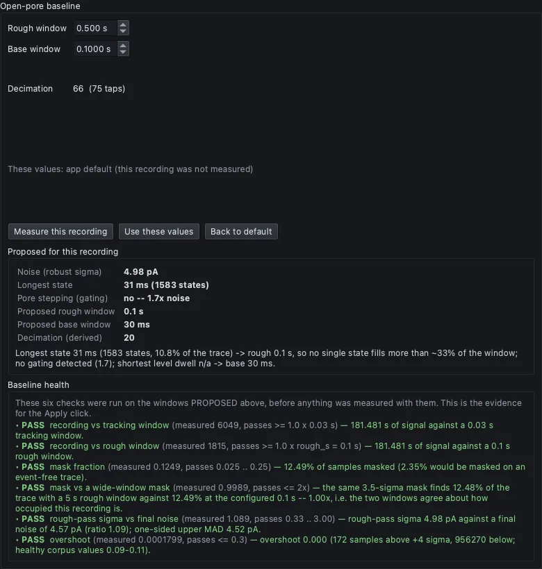

*The same panel, same estimator, on the −700 mV recording: it proposes **rough 1 s / base 300 ms**, where the −600 mV file got **2 s / 500 ms** — 2× the rough window and 1.7× the base, between two files recorded five minutes apart on the same pore. All nine checks read `PASS` in both. (Earlier printings of this manual showed **0.1 s / 30 ms** here, which is what the 4:1 rule alone derives; the proposer now floors `base_s` at three times this recording's 21.7 ms median state and the intrusion ranking then moves it to 1 s / 300 ms. The reason line prints that derivation in full.) The estimator can tell you what this recording's timescales are; it cannot tell you that the other file's answer is wrong for it. (On all three reference recordings every check passed, so nobody on this bench has yet seen one go red.)*

- Open the `Preprocess` tab and find `Open-pore baseline`.
- Press `Measure this recording`. It proposes a rough and a base window from the recording's own
timescales. *Nothing is applied yet.* The probe reads the whole recording, so the wait scales with
the file: about 2 s on the 60 s / 3 M-sample −600 mV file and 6.6 s on the 181 s / 9 M-sample
−700 mV one (2026-09-01, medians of three presses each); 6.7 s was measured earlier on the 250 s
one. The button's own tooltip says the same, in its own words and its own punctuation:
*“Usually a few seconds -- measured 2 s on a 3 M-sample recording and 6 s on 9 M samples (the
button says Measuring... meanwhile; it has not missed the click).”* The button's label really does
change to “Measuring…” while the probe runs. (The probe's *internal*
`elapsed_s`, 343 ms on the 3 M-sample file, is the probe stage alone, not the wait: conditioning,
the window ranking and the health second pass are the rest of it.)
- Read the proposal **and the nine health checks under it**. They are drawn before anything is
applied, captioned *“These 9 checks were run on the windows PROPOSED above, before anything was
measured with them. This is the evidence for the Apply click.”* The count is filled in from the
rows actually drawn, so a recording that gives the two state-timescale checks nothing to read
shows fewer.
- Press `Use these values`. The app never applies a measured parameter on its own.

`Back to default` returns to 0.5 s / 0.1 s.

**What the proposal is ranked on.** The probe does not offer the rule's window directly. It walks
a ladder of candidate windows, estimates each one, and prints a `Ranked: <rough> / <base>` row per
window estimated, with `— CHOSEN` on the winner. Every row carries **two** numbers, because the
ranking decides on two: the *median* share of each state's own depth the tracked baseline follows
— the same statistic the `baseline vs the open pore beside each state` check condemns above 3% —
and the **worst single state**, where a window whose baseline followed more than 50% of any one
state's excursion has *ridden into* that state and loses to any window that stays out, whatever
the medians read.

The second criterion is there because a median over hundreds of states cannot see one catastrophe.
On the −600 mV file at 1 s / 300 ms the median reads exactly **0.0** while that window's baseline
rides into the 521 ms partial clog at t = 37.13 s. Run through detection, that window does not
detect the clog **at all** — at 2 s / 500 ms it is one 519.5 ms event, depth 28.9 pA — and invents
about thirty shallow events on the collapsed local baseline instead, with every health check green
either way. That is why both numbers are printed on every row: a row showing only the median would
show a shorter, cleaner-looking window losing to a longer one for no visible reason. Ties go to the
**shorter** window, because a longer one tracks slower drift less well. The reason paragraph names
the objective, the tie-break, and exactly which rungs of the grid were never estimated — and it is
explicit that a stop rule is not a measurement of them.

The ranking can also supersede the rule's own derived window, and says so in capitals before any of
the evidence: *“THE … DERIVED ABOVE IS THE RULE'S WINDOW AND NOT WHAT THE APP OFFERS: every sentence
up to here explains how the rule reaches it, and the ranking that follows SUPERSEDES it with …”*.
The two windows named in the derivation are therefore not always the two on offer.

**The ninth check is the one that is not read through a frame.** `tracked level vs the recording's
own histogram` (`level_occupancy`) compares the tracked level against the recording's own amplitude
histogram, measured on |current − baseline| — two-sided, so a polarity measured from an already
inverted trace cannot cancel it the way it cancels `overshoot`. Its criterion reads *“>= 50% of the
recording, and >= 2x the next level's share; under 80%, also held for >= 1 tracking window”*, and it
warns on three different things, with a different paragraph for each:

| What fired | What it means | What to do |
|---|---|---|
| Occupancy under 50% | The baseline is at no level of this recording. A −300 pA baseline over a −100 pA trace reads `0.0000` here — this is what a baseline restored, or carried over, from a *different* recording looks like, and every depth is then measured from a current this trace never visits. | Re-measure the baseline on this recording before reading anything off it. |
| A majority, but the second level holds at least half of it | The majority rule ran without a majority worth the name. Which of the two levels is the open pore is not in these samples. | Analyse a stretch where the pore is open, or set the baseline from the open-pore current you know for this pore. |
| Under 80%, and the pore never rests at the tracked level for one tracking window | *“THIS IS WHAT A BASELINE THAT HAS SETTLED ON THE BLOCKADE READS LIKE”* — the check says it in those words, and in the next sentence says it is not a proof of that reading either, because the same numbers are what a pore genuinely off-level that often gives. | Narrow the tracking window until the pore holds the level across it, analyse a stretch where the pore is open, or set the baseline from the open-pore current you know. |

A `PASS` on this row is a decisive majority for the level that was tracked. It is **not** a
verification that that level is the open pore, and the row's own message says so in its last four
lines — they are quoted verbatim in the health block printed in Walkthrough 1, Step 2.

**The open pore is chosen, not certified.** Every detection carries a standing advisory saying so,
and after a detection the `Detection` tab renders it under the `Summary` table in an amber block
headed `⚠ About these numbers`. It opens *“The open pore here is NOT CERTIFIED, only chosen”*, names
both candidate currents and how much of the recording each holds, and prints ΔI/I₀ **both ways** —
against the tracked baseline and against the other level. It fires whenever the trace holds a second
conductance level for at least 2.5% of the recording, which is true of all four of the reference apo
files (their other level holds 0.054 / 0.099 / 0.087 / 0.077), or whenever the tracked level holds
under 80%. **It is not a report about your data being unusual.** It is the app saying that a
question was decided by a rule and answered by no measurement.

The rule is that the open pore is the level the pore is at most of the time, and nothing in the
health block checks that this is physically the open pore. Measured on a synthetic pore blocked 81%
of the time (open 100 pA, blocked 60 pA), the baseline lands at 60.04 pA, median ΔI/I₀ reads 0.665
against a true 0.400, the events are reported as *enhancement* — and every check reads `ok`,
overshoot included. At 90% and 95% blocked the same fixture reads the same way. So the advisory
ends with the one thing that does separate the two readings, and it is not in the file:
**compare the baseline against the open-pore current you know for this pore** — the current just
after the voltage step, or an unclogged stretch — and analyse that stretch instead if the two
disagree.

The block has no dismiss control, deliberately: it clears only when the condition is removed
(measure the recording, confirm the windows, detect again).

**Measured on the −600 mV apo-ferritin file**

The proposal is **2 s / 0.5 s**, four and five times the defaults. Re-detecting with it:

| Baseline windows | Events, detected / accepted | Median dwell | Median depth | Median ΔI/I₀ | Median I₀, stamped |
|---|---|---|---|---|---|
| default 0.5 / 0.1 s | 317 / 316 | 17.54 ms | 85.68 pA | 2.423 ⚠ >1 | −35.75 pA |
| measured 2 / 0.5 s | 276 / 275 | 18.16 ms | 87.59 pA | 2.523 ⚠ >1 | −34.79 pA |

Both counts are in the `Summary` table, on separate rows — quote the one you mean. (Earlier
printings of this manual gave 316 and 275, which are the *accepted* counts, against a Summary that
reads 317 and 276.) The whole top row was re-taken through the GUI on 2026-08-20, and every cell
in it is legible in the screenshot immediately below. Read the dwell cell carefully: the Summary
prints `median dwell (µs) 1.754e+04` — **microseconds, in scientific notation** — while the
histogram axis, the fit readouts and the gallery captions all speak milliseconds. `1.754e+04` is
17.54 ms, not 17,540 ms, and nothing on the row guards against the thousandfold reading.

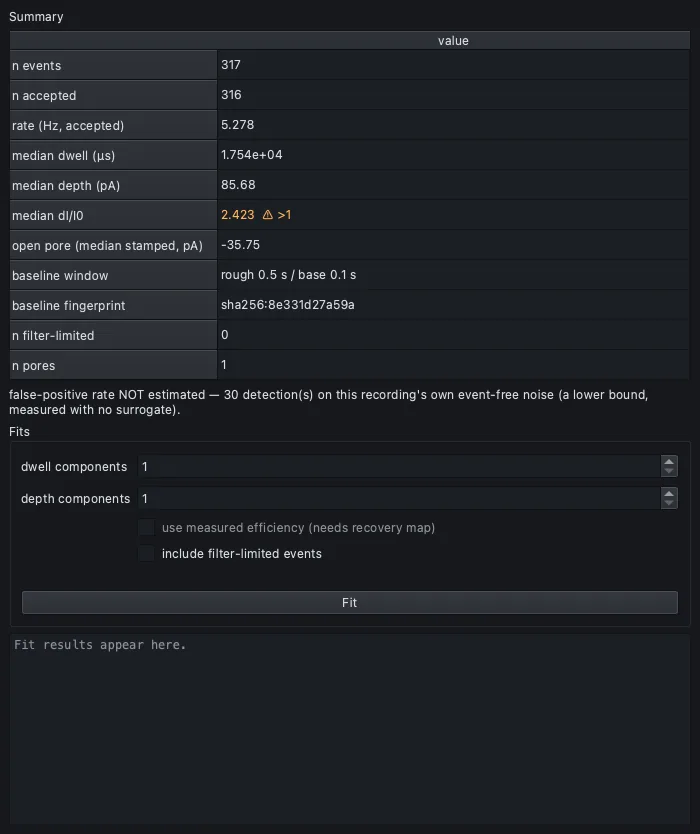

*The Summary panel after detecting the −600 mV recording at the default 0.5 / 0.1 s baseline: 317 events, 316 accepted. `median dI/I0` prints as `2.423  ⚠ >1` — above 1 the current magnitude **grew**, so this is not a blockade fraction. The panel also stamps the window it measured under (`rough 0.5 s / base 0.1 s`) and its `baseline fingerprint` (`sha256:8e331d27a59a`), which is what the voltage-dependence guard later reads. The last line reports the null control as a lower bound: 31 detections on the recording's own event-free noise.*

**41 events — 13% — existed only because the baseline window was too short.**
The depth median moves about 2%, so the shape of the distributions survives; the counts do
not. Every event count in the walkthroughs below was taken at the default window and is subject to
this correction. The app now says so on screen as well: the `UNPROBED_DEFAULT_WARNING` advisory
rides on the result object and in the export sidecar as it always did, and it is also rendered
under the `Summary` table in the `⚠ About these numbers` block, which draws the result's whole
warnings tuple unfiltered. Earlier printings of this manual said a sweep of every text-bearing
widget in the live window found it nowhere; that was true when they were printed.

## The six steps

### 1 · Open

`File › Open…` (`Ctrl+O`), or drag files onto the window.
Formats: Axon `.abf`, HDF5, TDMS, and text `.csv`/`.txt`. A file
larger than the 15,000,000-sample working ceiling raises a dialog offering
`Load first 15,000,000`,
`Load a range…` or `Load all anyway`.

### 2 · Calibrate

The `Calibration` tab converts raw units into physical ones.
`Gain`, `Offset` and `Target units` are **text fields you
type into**, not drop-downs; press Enter or `Apply` to commit. The panel shows raw
against calibrated side by side so you can see what the conversion did.

**If you skip this**

An uncalibrated recording still analyses, but the status bar carries
`⚠ Current gain uncalibrated — magnitudes not physical`, the conductance readout shows
`—` instead of a number, and any figure comparing depths across recordings prints a
caution. Fractional blockade ΔI/I₀ is unaffected — it divides by each recording's own
open-pore current, so it is the comparable axis when gain is unknown.

**If you change it later**

Nothing already measured is rescaled. A detection made under the old gain is marked stale, and the
event-table columns that depend on it wear a `⚠` until you re-run detection; the `Plots` window
carries the same mark into its titles and its `Details` pane.

Hand measurements are stamped the same way. Every row of the `Manual measurement` list saves the
calibration it was taken under — `units`, `cal_gain`, `cal_offset`, alongside `t0_s`, its
recording's instrument-clock origin — and those stamps travel in the CSV export, because a
measurement list is the one table people pool across recordings and across calibration edits, and
pA rows and nA rows can legitimately sit in it together. Change the gain and the older rows are
**marked, never rescaled**: the saved numbers are the record of what was measured. The mark has
three states, and the third is the one nobody guesses:

| Row mark | What it means |
|---|---|
| *(none)* | Checked against the live calibration, and current. |
| `⚠` amber | Measured under a calibration that has since changed. Double-click the row to return to its span, then `Add to list` for a row under the current one. |
| `?` | No verdict at all — the row's recording is not open (or the row predates the stamp columns), so nothing could be compared. It is **not** known to match. |

A row that was already `⚠` when you closed its recording keeps the `⚠`, and its tooltip then says
the check can no longer be repeated. The numbers did not change when the document closed, so
neither does what was true about them.

### 3 · Filter (optional)

The seven filter stages can be saved as a named **protocol** (`Protocol: Save as…`
at the top of the Signal filters box): one pick re-applies the whole chain —
enable flags and parameters, notch harmonics included — on any recording. Editing
any stage afterwards drops the name back to `— manual —`.

On the `Preprocess` tab. Low-pass, high-pass, notch, median and drift options. Leave it
off unless you know why you are turning it on: filtering changes the dwell times you are about to
measure, and the app reports the resulting rise time so you can see the cost.

### 4 · Detect

The `Detection` tab, then `Detect`. The detector is a Schmitt trigger:
`k_in (enter)` and `k_out (exit)` are thresholds in noise multiples, with the
exit lower than the entry so a noisy event is not chopped into fragments.

![The Detection tab on real data, with the event table docked beneath it. Polarity is measured, not assumed — here, on the −700 mV recording at that file's then-proposed 0.1 s / 30 ms baseline, enhancement (down): 1969 down / 0 up, confidence 1.00, meaning these events increase the current magnitude rather than block it. The vote is taken against the baseline in force: the same recording reads 2047 down / 1 up at the app default and 2184 down / 2 up at the 1 s / 300 ms window now proposed for it. Note the read-only `range` row: the Schmitt detector always runs over the whole recording.](images/panel_detection.webp)

*The Detection tab on real data, with the event table docked beneath it. Polarity is measured, not assumed — here, on the −700 mV recording at that file's then-proposed 0.1 s / 30 ms baseline, enhancement (down): 1969 down / 0 up, confidence 1.00, meaning these events increase the current magnitude rather than block it. The vote is taken against the baseline in force: the same recording reads 2047 down / 1 up at the app default and 2184 down / 2 up at the 1 s / 300 ms window now proposed for it. Note the read-only `range` row: the Schmitt detector always runs over the whole recording.*

**Read the amber block under the `Summary` table.** Everything the detection must be qualified by
lands there, under the heading `⚠ About these numbers`: a baseline window nobody chose, a health
check that fired, the standing *“the open pore was chosen, not certified”* advisory (see *Do this
first*), a filter-limited fraction, and the polarity notes below. The block renders the result's
warnings whole rather than one known string, it has no dismiss control, and it clears only when a
re-run no longer carries the sentence.

**When the polarity vote is close, the app says how it broke the tie.** Direction is measured by
counting coherent runs each way. If that vote is ambiguous the app decides on the coherent signal
*mass* instead and reports both readings, in the form *“polarity run vote was ambiguous (25 down / 22 up
coherent runs) and the direction was taken from the coherent signal mass instead (18400 down vs
3120 up samples, confidence 0.71)”*. A second note fires when the run vote was low-confidence and
the sample mass did not corroborate it either, and names the polarity it proceeded with. Neither
appears when you set the polarity override by hand: that is your instruction, not a vote.

Both notes name the usual cause, which is worth knowing because the obvious response is the wrong
one: many brief counter-runs flanking larger excursions are the signature of a **smoothing filter's
edge lobes** (Savitzky-Golay in particular). If the direction is wrong, set the polarity override or
disable the filter — re-tuning thresholds will not fix it, because a wrong polarity does not degrade
an event count, it replaces it.

#### Reconcile detector and manual candidates

NanoScope keeps Schmitt, CUSUM and ML detections as separate source tables. Normally run at least
two detector types on the same recording and channel. Detector agreement (`support > 1`) requires
the same analysed range; a union (`support = 1`) may use compatible tables with different complete
coverage, but an unknown or non-comparable exposure suppresses the event rate rather than inventing
one. One mixed source is also
eligible when it contains both automatic candidates and `added=True` missed events, which lets a
manual mark converge with an overlapping detector candidate. Then choose
`Analysis › Reconcile detector results…`:

1. Tick the source detection(s). The originals are never edited or deleted.
2. Set **Minimum temporal overlap**. At the 50% default, two events match when their shared time is
   at least half the duration of the shorter event.
3. Set **Required detector support**. `1` is a union (highest recall, useful for building a
   labelling set); `2` keeps detector agreement; requiring every selected detector is an
   intersection. Leave **Keep manual-only events** on when hand-found misses are part of your truth.
4. Press **Preview**, read the input/output/converged/filtered/manual/conflict counts, then press
   **Create reconciled table**.

Use the result selector above the event table to switch among the stored source tables and
`Reconciled`. Its audit columns name the contributors, support, member count, canonical source and
unresolved label keys. Accept, reject and label it normally; projects, plots and exports retain it.
The Reconciled table is deliberately **curation-only**: switch to a source table to add a missed
event, merge or resize boundaries, or re-measure a baseline, then reconcile again. Recreating it
warns before replacing reviews, labels, notes or hand curation, and `Edit › Undo` restores the prior
table.

The standalone manual-measurement list is not a reconciliation source. To add a real detector miss,
make the trace selection while its detector table is selected and press **Mark selection as missed
event** / **Ctrl+Shift+M**. That writes a reviewed hand-added row to the source detector; **Ctrl+M**
instead saves an independent manual measurement and does not create a training candidate. If a
source is later rerun, edited or removed, the Reconciled snapshot stays available but a stale-lineage
banner tells you to review the sources and reconcile again. Run Fit sub-state levels and Event
subpopulations on a source table because they need one waveform; frozen-column plots and distribution
fits remain available on Reconciled tables.

### 5 · Curate

Two surfaces share one event table. The **Event inspector** steps through events
one at a time in full detail. The **Event gallery** shows them all at once as tiles, for
when there are too many to click through. Anything you accept or reject in either lands in the same
table, the same overlays and the same exports, and `Edit › Undo` (`Ctrl+Z`) reaches all
of it. The inspector's toolbar has explicit `Accept` and `Reject` buttons for the
displayed event (the same write as the `A`/`R` keys — neither advances), `⟵`/`⟶`
buttons that pan the view half a window sideways without touching the mask, and a
`Gallery…` button; the gallery's tiles answer with a right-click menu whose
`Open in Event Inspector` lands the inspector, the table row and the trace zoom on
that event together. Both surfaces also apply **event labels** — a `key=value` vocabulary you define in
`Analysis › Event labels…` and stamp with the number keys `1`–`9`. Labels ride in the
event table's existing `flag` column, so they survive a rebuild and an older project reads back
unchanged. Applying or clearing a structured label also records every targeted event as reviewed,
so a label-only decision is included in the recommended training export.

If contributors disagree on a structured label, `consensus_label_conflicts` keeps the conflicting
key. If their human accept/reject decisions disagree, `consensus_curation_conflict` reads
`accepted|rejected`; that row is withheld from Reviewed export until an explicit Accept or Reject
resolves it. Custom labels may use a unique single-character hotkey in both curation windows;
`A`, `R`, `T`, Space, duplicates and multi-character bindings are rejected, while digits `1`–`9`
continue to address palette positions.

Curate with `Fit` set to `none`: with a fit on screen every accept/reject costs 0.4–1.0 s
against 68–93 ms without one.

### 6 · Analyze

Histograms and scatter plots with fits, clustering, KDE density figures, power spectra, I–V
and voltage dependence. All reachable from the launcher strip or the `Analysis` menu.

## Walkthrough 1 — one recording, end to end

Goal: take a raw CSV to a curated event population with fitted distributions, and know
at each step whether to trust what you are looking at.

Data: `500 pM Apo ferritin_1 x PBS_22 nm_0006_Process_-600 mV.abf` — 2,993,798 samples at
50 kHz, 59.876 s, recorded at −599.91 mV. Every number below is the app's own output on that
file, re-taken through the GUI on 2026-08-20. Earlier printings named a `.csv` export of the
same recording; the two agree on every count quoted here, but the ABF is what is on this bench
and what the screenshots are of, so it is what this walkthrough opens.

### Step 1 · Open the recording

`File › Open…` (`Ctrl+O`), or drag the file onto the window. The
trace draws immediately and the `Open` step of the workflow strip ticks.

Check the status bar. On this file it reads `50,000 Hz · file_meta` — the rate came from the
file's own header, not a guess. (A text export of the same trace reads `50,000 Hz · measured`
instead: the rate was recovered from the time column.) If it said `rate: unknown · x-axis in
samples` you would be working in samples, and every dwell in seconds would be unavailable.

**What you should see**

The open pore sits near −35 pA with dense downward excursions whose floor is −100 to −200 pA.
Those excursions are the events. The trace's x axis names the clock it is drawn on —
`s (instrument clock — this recording starts at t₀ = 61.3034 s)` — while the event table's
`t_start_s (t₀=0)` column counts from the start of the recording. Two clocks in one window, and
the app labels both.

The status bar also carries `⚠ Current gain uncalibrated — magnitudes not physical`. Note what
that is *not* saying: this file declares its units as pA and the app reads them, which is why
every depth below is printed in pA. The warning is about the **gain**, which on this bench has
never been calibrated against a known current — so the pA are an instrument scale, and the flag
stays up whatever the file format. It is not a complaint about the file.

### Step 2 · Measure the baseline

`Preprocess` tab → `Open-pore baseline`. Press
`Measure this recording`, read the proposal, press `Use these values`.

| Control | Default → measured, and what it decides |
|---|---|
| Rough window | 0.5 s default → 2 s measured. Pass 1: decides which excursions count as events and get masked out before the baseline is measured. It must be several times the longest state you want treated as an event. |
| Base window | 0.1 s default → 0.5 s measured. Pass 2: how fast the baseline may follow the trace. It must be shorter than the shortest genuine conductance level. |
| Decimation | `66  (75 taps)` at the default → `333` once the proposal is applied. Derived from the base window, shown, never set by hand. A cost throttle, not a quality knob — the tap count is held near 75 whatever the window, which is what the number is for. |

Below the windows, `Baseline health` prints what the estimator actually did — **nine checks, each
one stating its own criterion**, drawn as soon as the probe returns and *before* you have applied
anything. On this file, verbatim:

```
These 9 checks were run on the windows PROPOSED above, before anything was
measured with them. This is the evidence for the Apply click.

• PASS  recording vs tracking window (measured 119.8, passes >= 1.0 x 0.5 s)
        — 59.876 s of signal against a 0.5 s tracking window.
• PASS  recording vs rough window (measured 29.94, passes >= 1.0 x rough_s = 2 s)
        — 59.876 s of signal against a 2 s rough window.
• PASS  mask fraction (measured 0.1069, passes 0.025 .. 0.25)
        — 10.69% of samples masked (2.35% would be masked on an event-free trace).
• PASS  mask vs a wide-window mask (measured 0.9938, passes <= 2x)
        — the same 3.5-sigma mask finds 10.62% of the trace with a 5 s rough window
        against 10.69% at the configured 2 s -- 0.99x, i.e. the two windows agree
        about how occupied this recording is.
• PASS  base window vs state dwell (measured 24.13, passes >= 3 x the 20.7 ms state
        dwell) — base_s 0.5 s is 24.1x the 20.7 ms median state this recording spends
        below its open pore (10.6% of the trace, measured over a 5 s window wide
        enough to see over them).
• PASS  baseline vs the open pore beside each state (measured 0, passes <= 3% of the
        state depth) — across 240 states the tracked baseline sits 0.00 pA inside them
        -- 0.0% of their 87.4 pA excursion, taken against the open pore 5-55 ms either
        side of each one.
• PASS  rough-pass sigma vs final noise (measured 1, passes 0.33 .. 3.00)
        — rough-pass sigma 4.52 pA against a final noise of 4.52 pA (ratio 1.00);
        one-sided upper MAD 4.52 pA.
• PASS  tracked level vs the recording's own histogram (measured 0.8992, passes >= 50%
        of the recording, and >= 2x the next level's share; under 80%, also held for
        >= 1 tracking window) — 89.9% of this recording sits within 5 sigma (22.6 pA)
        of the tracked baseline and the other level this recording visits is -86.1 pA
        from the tracked one (-120.7 pA against -34.6 pA) and holds 5.4% of the
        recording -- a decisive majority for the level that was tracked, which is what
        this row can check, and NOT a verification that THAT level is the open pore.
        Nothing here can be: the same trace read the other way up is a pore BLOCKED
        89.9% of the time whose returns to the open pore are what got masked as events,
        and the two readings are the same samples. The result carries the advisory that
        spells both of them out; read it before reading a depth.
• PASS  overshoot (measured 0.0001675, passes <= 0.3)
        — overshoot 0.000 (46 samples above +4 sigma, 274707 below; healthy corpus
        values 0.09-0.11). Measured in the CANONICAL frame, which is chosen by the
        polarity (-1) -- so on a recording whose own polarity measurement has
        inverted, this scalar inverts with it and passes; the occupancy margin above
        is the row that is not read through that frame.
```

(Each bullet is one long line on screen; the wrapping here is this page's, and nothing else
has been changed. Earlier printings abridged the last four and printed `measured 1.00` where
the app prints `measured 1` — if you are comparing a screen against this block, compare the
numbers in the parentheses, which is where a check states its criterion.)

Every line names the criterion that would fail it, which is the only way a check can be read. The
sentence at the top changes with what the block is about: after a detection it reads instead
*"These 9 checks describe the windows the detection on screen was measured under — read back
from its own provenance, not from the form above."*

Green does **not** mean the window is right. On this file all nine pass at 0.5 s and at 2 s while
the event count differs by 13%. (The −700 mV file used to make the point harder: its 0.1 s / 30 ms
proposal stamped a baseline 7.2% out with every check green. That proposal is gone — the base
window is now floored at three times the median state — and the same window typed in by hand is
caught by `base window vs state dwell`, which reads `WARNING … measured 1.382, passes >= 3 x the
21.7 ms state dwell`.) Notice the overshoot line arguing with itself, too:
it passes at 0.0001675 while calling 0.09–0.11 the healthy range. That check is deliberately
one-sided — it flags *high* overshoot only — and its message never says so.

**Which window the rest of this walkthrough uses**

Everything from Step 3 on is quoted at the **untouched default** 0.5 / 0.1 s, so it can be read
against the 13% correction above and so the screenshots match what you see. Press
`Back to default` before Step 3 to reproduce it exactly; each step also gives the measured-window
figure wherever the reference run has one.

### Step 3 · Detect

`Detection` tab. The defaults that produced the numbers below:

| Parameter | Default, and what it means |
|---|---|
| k_in (enter) | 5.00 — an excursion must exceed 5× the noise to start an event. Raise it to reject marginal events, lower it to catch shallow ones. |
| k_out (exit) | 2.00 — the excursion must fall back below 2× the noise to end the event. Deliberately lower than the entry, so a noisy event is not chopped into fragments. |
| min dwell | 0.0000200 s (20 µs = one sample at 50 kHz). Events shorter than this are not reported — and this value becomes the fits' truncation limit. |
| max dwell | 0.000000 s (0 = off). Set it and the fits model the right-hand cut too, rather than being biased short by it. |
| merge gap | 0.0000 ms (0 = off). Milliseconds, like the Merge panel's window — 15 ms is `15`. See walkthrough 2. |
| range | `whole recording` — read-only. The Schmitt detector always runs over the whole recording and records that in its provenance; to detect over less, cut a `Segment` and detect on that. |

Press `Detect`. On this recording it took 3.5 s; the two longer files in the reference set
(9.1 M and 12.5 M samples) took 11.4 s and 10.3 s. That is of order a second per million samples,
but it did not scale cleanly across the three, so treat any timing here as an order of magnitude. Before
reading the events, read the polarity line the app prints above the button:

```
measured   enhancement (down): 916 down / 2 up (confidence 1.00, measured)
override   auto (measure)
```

This is the app deciding, from the data, which way an event goes. **Enhancement** means the
current magnitude *increases* during an event — these are conductive events, not
blockades. That single line explains why ΔI/I₀ comes out above 1 later, and it is measured,
not assumed. The two counts are the *polarity vote* — candidate excursions, counted each way —
not an event count; do not read 916 as 916 events, against a detection of 317. One caveat: when
the run vote is ambiguous (a smoothing filter's edge lobes can outvote the events themselves) the
app decides on the coherent sample MASS instead, and then prints that vote's counts — samples, not
excursions. The run counts survive in the detection's provenance as `n_down_runs`/`n_up_runs`, and
a warning names the overruled vote.

The vote is taken against the baseline in force, so it moves with the window: this same
recording reads `3752 down / 0 up` once the probed 2 s / 0.5 s window is applied, and the
−700 mV and −500 mV files read `2184 down / 2 up` and `8461 down / 4 up` at the windows now
proposed for them (1 s / 300 ms each). What does not move is
the verdict — enhancement, at confidence 1.00, on all of them.

**Result**

317 events, 316 accepted, at the default baseline window
(**276 detected / 275 accepted** with the measured one — see *Do this first*). Median depth
85.68 pA; `median dI/I0` prints as `2.423 ⚠ >1`; median dwell 17.54 ms; stamped open pore
−35.75 pA. The thresholds it actually ran at were 22.623 pA in and 9.049 pA out, derived from a
robust noise σ of 4.5245 pA (upper MAD). None of those three is on any panel: they are stamped
into the detection's provenance and travel in the export sidecar, which is where to read them
back. Baseline method: `masked_median`.

Re-detecting at the measured 2 s / 0.5 s window gives 276 events, 275 accepted, and this is the
distribution the reference run measured in full:

| Metric | Median | IQR | Range |
|---|---|---|---|
| dwell | 18.16 ms | 16.61–19.49 ms | 0.08–519.5 ms |
| depth | 87.59 pA | 79.65–94.38 pA | — |
| ΔI/I₀ | 2.523 ⚠ >1 | 2.301–2.708 | — |

Hold on to that 0.08 ms minimum: walkthrough 2 shows what it really is.

That run's own accounting balances, and it is worth checking once so you know it does:

```
n_candidate_runs 18477 − n_rejected_below_enter 18201 − n_merged 0
                       − n_rejected_short 0 − n_rejected_excluded 0  =  n_events 276
```

Every candidate excursion is accounted for by name. One further event was flagged
`clipped_by_boundary` — still above threshold at the last analysed sample — and is therefore
detected but not accepted. That is the whole difference between 276 and 275.

Zero events were flagged `filter-limited`, which is what you want — no event was so
short that the anti-alias filter shaped its measured depth.

### Step 4 · Scan every event at once

`Analysis › Event gallery…`. Set `Sort` to
`Depth (deepest first)` and leave `Same depth scale` ticked — without it
every tile is normalised to itself and a 15 pA event draws identically to a 45 pA one.

Three things worth knowing while you scan:

- **Right-click a tile** for the direct roads out: `Open in Event Inspector` lands
  the inspector, the table row and the trace zoom on that event together;
  `Go to event in trace` is the double-click; `Accept`/`Reject` curate just that tile.
  (The inspector has a `Gallery…` button for the road back.)
- **Half-strength shading** inside a tile is a *neighbouring* accepted event that
  falls in the same padded window — the same span the main trace shades. Your own
  event is the full-strength block. A fractured event therefore looks fractured
  here too, which is your cue for Walkthrough 2's merge.
- If the status line says **“page taller than the window — scroll for the rest”**, the
  fixed page size holds more tiles than one screenful (macOS scrollbars hide until you
  scroll). The `Fit` page size never overflows.

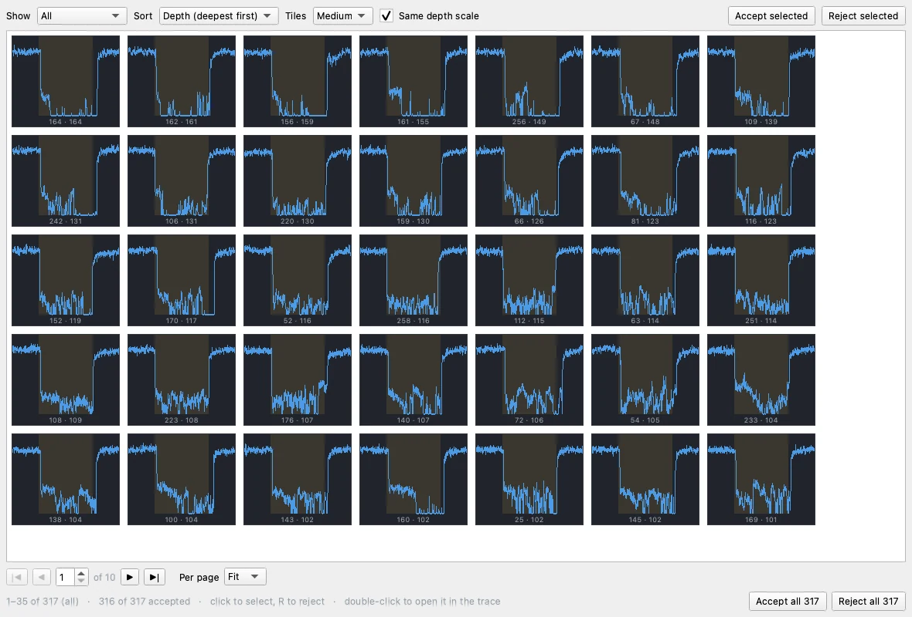

*The gallery sorted deepest-first, Same depth scale on. Caption under each tile is event id · depth. The spiky interiors are the reason the CUSUM step finds 3.1 levels per event.*

Read the grid, not individual tiles. What it shows here: the events have *spiky, multi-level
interiors* rather than clean square blockades. That is a finding, and it is why the CUSUM fit in
the next step reports 3.1 sub-states per event.

To cull: drag a rubber band over a run of bad tiles and press `R`, or double-click a
single tile to jump to it in the trace and judge it full size. Rejections land in the same event
table the Plots window and the exports read. Keys `1`–`9` write the first nine
entries of the label palette onto the selected tiles (`Analysis › Event labels…` defines it);
the `Label` combo with `Apply` and `Clear` beside it does the same by mouse. Those three sit in
the toolbar between `Tiles` and `Same depth scale`; they are newer than the screenshot above,
which is why it does not show them — the `Event gallery` figure in the *Control reference* does.

**Curate with `Fit` set to `none`**

Every accept or reject redraws the Plots window, and if a fit is on screen it also recomputes the
two advisory notes that explain the fit. Across all three reference recordings, one reject click cost
**0.4–1.0 s with a fit drawn, against 68–93 ms with `Fit` = `none`** — a 7–9× penalty, and about
87% of it went on the rival-family and component-count scans. The notes are now
deferred 400 ms off the redraw path, so a burst of clicks never pays for them and the pane says
what is pending rather than going blank:

```
MODEL COMPARISON: still computing — it appears when you stop clicking. (Set Fit = none to curate without it.)
COMPONENT COUNT: still checking whether another number of components fits better — it appears when you stop clicking.
```

Take the advice in the parenthesis. Nothing in a fit is worth watching while you cull.

Everything you do here is undoable — `Edit › Undo` (`Ctrl+Z`) covers both the
event table and the manual-measurement table, with a separate stack for each, and the menu label
spells out which one a press will act on. The one thing undo cannot reach past is
`File › Close document`: closing a recording takes its detections, its curation and its undo
history with it, which is why closing one with events asks first and names the counts.

### Step 5 · Fit the sub-states

`Analysis › Fit sub-state levels (CUSUM)…`. This runs a change-point fit
inside every accepted event, splitting it into flat conductance levels.

The fitted levels draw in two places the moment the fit completes: as green
horizontal segments on the **main trace** (over every accepted event, at each
level's own mean current) and per event in the **Event Inspector**. On the
trace each segment is a bright green stroke over a dark casing and is kept at
least ~3 pixels long, so short levels stay visible even at full zoom-out. They retire
from both together — re-running detection invalidates the fit, and rejecting an
event takes its levels off the trace with its span.

**Result**

992 levels across 316 events in 2.6 s. 72.8% are multi-level; the mean is 3.14 levels per event.
(These three figures come from the original run on this file and were not re-measured in the
2026-08-20 reference pass; the level counts in particular are the one CUSUM output this manual asks
you not to trust — see *Known limits*.)

Open the `Event inspector` on an event with structure. The levels draw as flat green
segments over the trace and are listed underneath:

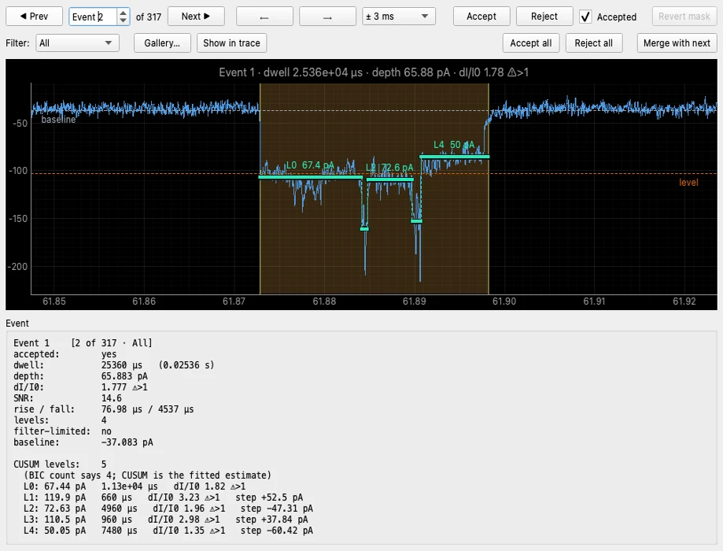

*Event 1 in the inspector. Green segments are the fitted CUSUM levels; the grey dashed line is the open-pore baseline and the orange one the in-event median. Neither is draggable — only the shaded event region can be dragged, which re-measures the event.*

```
Event 1    [2 of 317 · All]
dwell:        25360 µs   (0.02536 s)
depth:        65.883
dI/I0:        1.777
SNR:          14.6
rise / fall:  76.98 µs / 4537 µs
levels:       4
baseline:     −37.083

CUSUM levels:  5
  (BIC count says 4; CUSUM is the fitted estimate)
  L0: 67.44   1.13e+04 µs   dI/I0 1.82
  L1: 119.9      660 µs   dI/I0 3.23   step +52.5
  L2: 72.63     4960 µs   dI/I0 1.96   step −47.31
  L3: 110.5      960 µs   dI/I0 2.98   step +37.84
  L4: 50.05     7480 µs   dI/I0 1.35   step −60.42
```

Two things to notice. The `step` column gives the signed jump into each level, so you
can see the event go down, up, down again. And the app reports its own disagreement:
`BIC count says 4; CUSUM is the fitted estimate` — two criteria differ on how many
levels there are, and rather than pick silently it shows both.

`Analysis › Export sub-state levels…` writes the long-form table (one row per
level) plus a sidecar recording the CUSUM parameters — 235 KB and 6 KB here (file sizes from the
original run; not re-measured).

### Step 6 · Fit the distributions

In the `Fits` box set both component counts to 2 and press `Fit`.

Dwell

```
exponential mixture (k=2, censored MLE)
  n = 316   loglik = 1040   AIC = −2074   BIC = −2062
  censoring: hard left-truncation at t_min=2e−05 s (eta == 1 above it) -- but the SAMPLE
    is also right-censored by curation (see the warning below); the model does not
    correct for that
  goodness of fit: KS D = 0.3873 against a 1% critical value of 0.0916 (n = 316). THE
    FITTED CURVE DOES NOT DESCRIBE THESE DATA — the largest gap between the model and
    the empirical distribution is far beyond chance. Its parameters should not be
    reported as measurements.
  param      estimate                      95% CI
  tau_1    0.00053266    [ 0.0003836,  0.0006636]  s
  tau_2      0.015928    [   0.01535,    0.01661]  s
  w_1        0.108022    [   0.06011,       0.16]
  w_2        0.891978    [      0.84,     0.9399]
  ! RIGHT CENSORING (curation): 1 rejected event(s) are longer than the longest event in
    this fit (0.07098 s), so the fitted sample is cut off on the right as well as the
    left. The likelihood models the LEFT truncation only, so tau is biased SHORT
    (measured −3.7% when the cut sits at 5 tau, −24% at 2.5 tau). Re-accept those
    events, or set max_dwell_s so the cut is a known number the fit can correct for.
```

Two lines here are doing different jobs. The **censoring warning** is the fit telling you your own
curation has skewed it, with the size of the bias and two ways to fix it; that is the normal case,
not an error. The **goodness-of-fit line above it is a refusal**, and it applies to this k = 2 fit
as much as to the single exponential of Step 7: `KS D = 0.3873` against a 1% critical value of
`0.0916` rejects the model outright. Read the four parameters below it as a description of the
histogram's shape — which is what the rest of this step uses them for — and not as measurements
of two escape processes. Step 7 shows what the app offers instead.

**The fast component is not a population**

`tau_1` = 0.53 ms carrying 10.8% of events looks like a second, fast species. On this recording it
is not: it is the detector's own fragments. Merge the table at a 10 ms gap (walkthrough 2) and the
**shortest event in the whole table becomes 13.24 ms** — the sub-millisecond mode disappears
entirely. The same `exponential + gamma` fit that gave 25% fast on the unmerged table gives
**1.3%** on the merged one, and the slow lobe does not move (k = 71.5, mean 18.4 ms). Fit the merged
table, or say plainly that the fast lobe is fragmentation. Do not report it as a species.

Depth

```
Gaussian mixture on dI/I0 (k=2, EM)
  n = 316   loglik = −242.7   AIC = 495.4   BIC = 514.2
  goodness of fit: KS D = 0.1154 against a 1% critical value of 0.0916 (n = 316). THE
    FITTED CURVE DOES NOT DESCRIBE THESE DATA — the largest gap between the model and
    the empirical distribution is far beyond chance. Its parameters should not be
    reported as measurements.
  param        estimate                      95% CI
  mu_1         0.391328    [    0.3749,     0.4128]
  sigma_1     0.0741171    [   0.06042,    0.09591]
  w_1          0.250035    [    0.2025,     0.2975]
  mu_2          2.59027    [     2.538,      2.647]
  sigma_2      0.472505    [    0.3695,     0.5516]
  w_2          0.749965    [    0.7025,     0.7975]
```

Rejected again — `KS D = 0.1154` against the same 0.0916 — and for the same reason. Two apparent
depth populations: a quarter of events near ΔI/I₀ 0.39, three quarters near 2.59. The shallow
quarter is the same set of rows as the fast dwell component: fragments measured over a fraction
of the passage, so both their dwell and their depth are short. On the merged table the depth
mixture is two components at ΔI/I₀ 2.548 and 2.886, with no 0.39 lobe at all — and the merged
table's depth fit is the one that passes (Step 7).

So: on the unmerged table, both fits are rejected and both rejections say the same thing, which is
that this table contains fragments. That is a diagnosis, not a failure of the fitting code. Fix the
table first, then fit it.

### Step 7 · See the fit against the data

Open `Plots`, set `Column` to `dwell_s`, `Time unit` to
`ms`, tick `Log x`, and pick a `Fit`.

**A note on this figure's numbers.** The screenshot and the verdict quoted below are from the same
−600 mV recording, but at its *measured* baseline window and after a 10 ms merge, so n = 239 rather
than the 316 of Step 6. That is the table the reference run fitted, and it is the honest one to fit;
walkthrough 2 explains why the unmerged table's fast lobe is fragmentation. Nothing about the
verdict depends on it: the exponential is rejected on every version of this table and on all three
reference recordings.

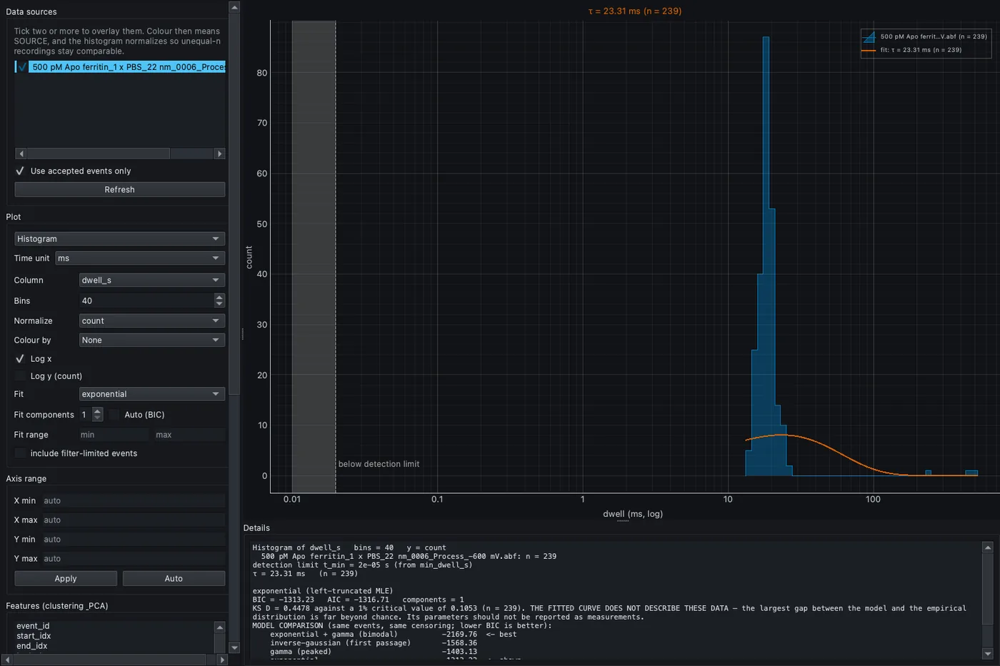

*Dwell histogram in ms on a log x axis, single exponential fit, n = 239 (the merged −600 mV table). The Details pane below prints the parameters, the detection limit, and — this is new — a goodness-of-fit verdict and a ranked cross-family table naming a better model.*

**When the fit does not follow the data**

Here it does not, and you do not have to work that out for yourself. Every fit is now stamped with
a Kolmogorov–Smirnov verdict, in words:

> KS D = 0.4478 against a 1% critical value of 0.1053 (n = 239). THE FITTED CURVE DOES NOT
> DESCRIBE THESE DATA — the largest gap between the model and the empirical distribution is far
> beyond chance. Its parameters should not be reported as measurements.

and, under it, a ranked comparison the app fits for you across all four dwell families it offers:

```
MODEL COMPARISON (same events, same censoring; lower BIC is better):
    exponential + gamma (bimodal)          -2169.76  <- best
    inverse-gaussian (first passage)       -1568.36
    gamma (peaked)                         -1403.13
    exponential                            -1313.23  <- shown
    "exponential + gamma (bimodal)" fits these data better by 856.524 BIC. The model shown is
    not the best one this window can fit; choose it in the Fit box before reporting parameters.
NOTE: 2 components fit markedly better (BIC -1364.86 vs -1313.23); set Fit components = 2 to see it.
```

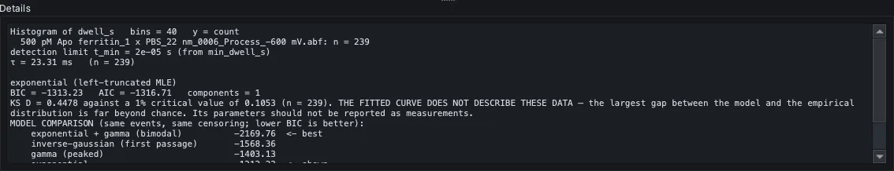

*The same fit's Details pane. `KS D = 0.4478 against a 1% critical value of 0.1053 (n = 239)` — the exponential is rejected, and the app says so in words. Under it, the cross-family table it computed for you: `exponential + gamma (bimodal) −2169.76 <- best`, against the `−1313.23` of the curve actually drawn. The pane scrolls; the shown model is the row cut off at the bottom.*

The exponential is rejected on **all three** reference recordings (KS D 0.4577 / 0.4478 / 0.6395
against critical values 0.0554 / 0.1053 / 0.0518), and `exponential + gamma (bimodal)` wins by
856–2729 BIC on each. Earlier printings of this manual built that comparison by hand from three
fits; the app now does the whole ladder, and it includes a family the hand-built table omitted —
`inverse-gaussian (first passage)`, which ranks second here.

Three things to carry away from it:

- **τ is the sample mean.** For a left-truncated exponential τ = mean − t_min, verified to four
decimals on all three recordings. Quoting τ is quoting the mean; it carries no information about
an escape process that the mean does not already carry.
- **The winner returns no confidence intervals.** `exponential + gamma (bimodal)` prints
`--` for every parameter, noting *"no bootstrap CIs for this family: each replicate is a
12-start optimisation."* The app points you at the one model whose parameters you then cannot put
an uncertainty on. On the merged −600 mV table its parameters are w_exp 0.0133, τ 0.3878 s,
k 71.5, θ 2.579e−4 s — a tight ~18 ms gamma-shaped population plus a 1.3% long tail.
- **The plot title does not carry the verdict.** It prints a bare `τ = 23.31 ms (n = 239)` in the
fit colour — and the legend repeats it — for a model the same window has just rejected. The title
is what gets cropped into a slide; crop the Details pane with it.

Use `Fit range` to fit only part of a distribution when one population is contaminating the
other.

**The same test, passing**

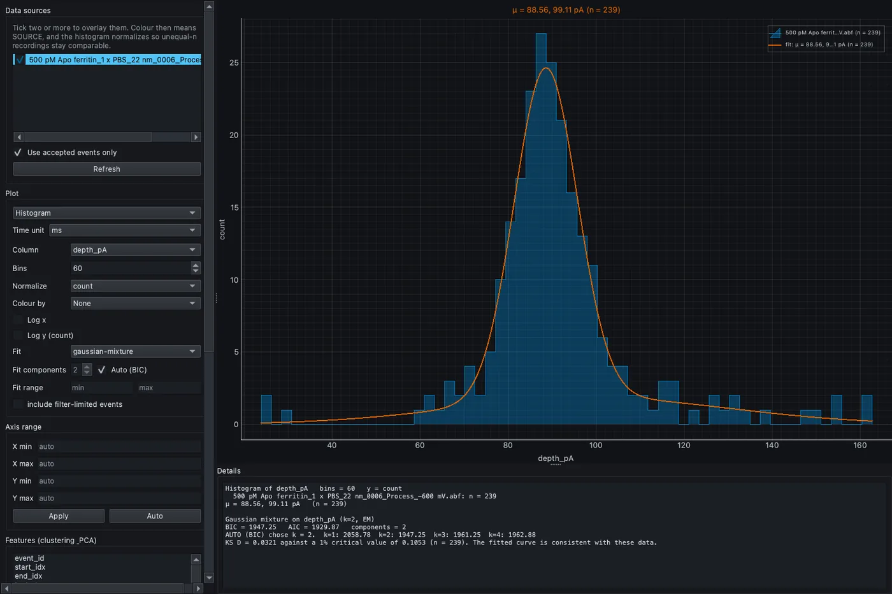

*Depth in pA on the −600 mV recording with `Auto (BIC)` ticked. The app tried k = 1 to 4 and printed all four scores — `k=1: 2058.78  k=2: 1947.25  k=3: 1961.25  k=4: 1962.88` — before choosing 2, and this time the verdict line clears it: `KS D = 0.0321 against a 1% critical value of 0.1053 (n = 239). The fitted curve is consistent with these data.` Same machinery, opposite answer to the dwell fit. (This one is fitted on `depth_pA` rather than the `dI/I0` of Step 6; μ = 88.56 and 99.11 pA.)*

The verdict is not a complaint generator. It rejects the dwell fit and clears the depth fit on the
same recording, in the same session, which is the only reason the rejection is worth anything.

### Step 8 · Check the noise

`Analysis › Power spectrum (noise / PSD)…`. This is a property of the pore and amplifier,
not of your events — run it to know whether the recording could support the events you found.

**Choose the segment first, or you will measure your events**

The group is called `Segment (quiet open-pore baseline)` and that is an instruction. Leave
translocations inside the `Start`/`End` window and the spectrum is the event train,
not the pore. On this recording the widest event-free gap is only 0.4983 s, so with a 20 ms guard
either side the segment is 0.0911–0.5494 s.

**And check which clock you are typing in.** The `Start` and `End` fields are in
seconds **from the start of this recording** — the same clock as the event table's
`t_start_s`, and *not* necessarily the clock the trace's x axis is drawn on. The panel says
so in the tooltip and states both clocks in its segment readout:
`0.0911–0.5494 s into the recording (= 61.3945–61.8528 s on the trace's instrument clock)`.
It matters: typing instrument-clock numbers into these fields on the −500 mV file analyses a
different 1.4 s and returns total RMS 22.66 pA and α 1.822 in place of 3.99 pA and 0.985 — a
5.7× error, from a slip the readout is there to catch. (At the dock's default width that readout
is clipped just before it names the second clock; widen the panel.)

Then set `Segment length` — it is the `Welch estimate` box's first field, and it starts at
`Auto`. On this segment `Auto` picks 2048, which leaves the α fit only 4 FFT bins and makes the
panel flag its own answer `← MARGINAL`. Typing 4096 is the finest setting that still averages at
least eight segments, which is also the fewest bins the α fit will accept without the flag. The
readout below calls the value `nperseg`, which is what it is called in the details pane and
nowhere else:

```
Total RMS noise:    3.682 pA
Band RMS:
   <1 kHz            1.603 pA
   1–10 kHz          3.174 pA
   10 kHz–Nyquist   0.9395 pA
White floor:       0.001529 pA²/Hz  (median 174.7–1747 Hz)
1/f exponent α:   1.266  (magnitude at 1 Hz: 0.7391 pA²/Hz, R²=0.896)
                   fit over 12.21–100 Hz on 8 FFT bins
fs = 50,000 Hz  ·  Nyquist = 25,000 Hz  ·  Δf = 12.21 Hz
Welch: nperseg = 4096, noverlap = 2048, segments ≈ 10, window = hann
```

**That is the pore.** Total RMS 3.68 pA, of which 1.60 pA is below 1 kHz; the low-pass
roll-off is −3 dB at ≈3.44 kHz. Read the smallest reliable event depth off *this* number, not
off the whole trace.

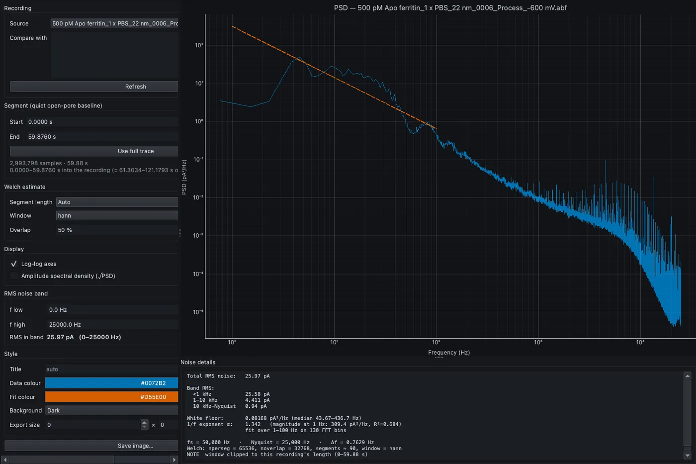

*The power spectrum, log-log — this one over the **full trace**, which is the contrast case quoted below rather than pore QC. The orange dashed line is the fitted 1/f slope and the readout quantifies it. The line under `Use full trace` states the analysed span on both clocks, and the `Style` box on the right controls the exported figure.*

**What the whole trace reads, and why you must not quote it**

Press `Use full trace` on the same recording and it reports:

```
Total RMS noise:   25.97 pA
Band RMS:
   <1 kHz            25.58 pA
   1–10 kHz          4.411 pA
   10 kHz–Nyquist     0.94 pA
White floor:       0.08168 pA²/Hz  (median 43.67–436.7 Hz)
1/f exponent α:   1.342  (magnitude at 1 Hz: 309.4 pA²/Hz, R²=0.684)
                   fit over 1–100 Hz on 130 FFT bins
fs = 50,000 Hz  ·  Nyquist = 25,000 Hz  ·  Δf = 0.7629 Hz
Welch: nperseg = 65536, noverlap = 32768, segments ≈ 90, window = hann
```

Seven times the total RMS and sixteen times the sub-kilohertz figure. **About 94% of the
apparent low-frequency "noise" here is the event train, not the pore** — the broad 5–100 Hz
hump in the curve *is* the events. Never quote whole-trace noise for a recording with a 9%
duty cycle.

The full trace is still the right place for one question: mains. At Δf = 0.7629 Hz the 50, 60,
120, 180 and 240 Hz bins all sit at 0.59–1.19× their local background, so there is no mains line
and the ~18 ms population is not a 50 Hz artefact.

### Step 9 · Export

`Analysis › Export events…` writes two files together: the event table and a
`.meta.json` sidecar carrying the detector settings, the baseline estimator, the
calibration, the app version and the clock the table's `t_start_s` is on — the recording's
instrument-clock origin, so the CSV can be lined up with the `figs_trace.csv` the figure export
writes beside it. On this recording, 109.5 KB and 5.9 KB (sizes from the original
run; not re-measured).

**Why the sidecar matters**

A CSV of dwell times with no record of the threshold,
the baseline window or the gain cannot be compared with one exported next month. The pair is written
all-or-nothing — you never get the table without its provenance.

`Analysis › Export events for training…` offers three row sets. **Reviewed decisions** is the
recommended default and includes human positives and negatives; untouched candidates and automatic
rejects are withheld. **Accepted candidates** may include rows nobody reviewed, while **All raw
candidates** also includes automatic rejects. If any selected row contains an unresolved label such
as `molecule=apo|holo`, NanoScope warns and defaults to Cancel before asking for a filename. Rows
with contradictory human accept/reject decisions are excluded from Reviewed export until an
explicit Accept or Reject clears the conflict. Resolve label conflicts in the Event gallery or
Event inspector, or use All raw candidates only when external cleanup is deliberate.

## Walkthrough 2 — merging fragmented events

Goal: recognise when one physical event has been recorded as several, and stitch it
back together without inventing events that were never there.

### The problem

A Schmitt trigger ends an event when the signal returns above `k_out`. A noisy or
multi-level event can cross back over that line mid-passage and be recorded as two, three or six
separate rows — each with a fraction of the true dwell. Dwell histograms then grow a spurious
short-lived population, and the event count is simply wrong.

You can see it in the gallery: fragments appear as a run of adjacent tiles with nearly identical
depth and suspiciously short dwells.

### The rule

Merging is defined on the *gap*, not on total duration:

```
gap = next.start_idx − current.end_idx
merge if   gap ≤ round(window × sample_rate)
```

So “within 15 ms of each other” means the second event starts no more than
15 ms after the first one ends. Runs merge transitively: A–B and B–C within the window
makes one event spanning A to C.

### Doing it after detection

- Detect as usual.
- In the `Merge sub-events` panel set the window. **It is in milliseconds**, so 15 ms
is `15`. The field accepts 0.01–100 ms and starts at 0.15 ms — a few samples at 50 kHz,
long enough to bridge a brief threshold recrossing and short enough to leave genuinely separate
events alone. There is no `0` here: the smallest window is `0.01`, which still stitches
fragments that touch exactly. `0` looked like the `0 = off` sentinel the `Detection` tab spells
out on `merge gap` and was never one — at `0` the window is 0 samples, exactly-touching rows
still satisfy the rule, and `Merge all` merged them — so the field now floors at a window that
is honestly a window. The button beside it only ever means merge; there is nothing for “off”
to mean on this panel.
- Press `Merge all`.

The status bar reports exactly what happened. On this recording at 15 ms:

```
Merged 74 fragment(s): 317 → 243 events.
```

On a large table the merge runs in the background and narrates itself first, and the
`Cancel` in the status bar stops it without changing anything. The reference run's 10 ms
merge on the same recording, verbatim:

```
Merging 276 events… (Cancel in the status bar stops it; nothing is changed until it finishes.)
Merged 36 fragment(s): 276 → 240 events.
```

(One rough edge: `Merge all` stays enabled while it runs, so a second click is accepted while
the first is still working. Nothing is merged twice — the second click is refused with
`Another analysis is still running — wait for it to finish, or cancel it.` — but click once
anyway.)

A merge is reversed by `Edit › Undo` (`Ctrl+Z`), which restores the exact table
including your curation — **not** by re-running detection, which replaces the whole table and
takes every accept/reject decision with it.

The merged events are re-characterised, not just concatenated — depth, dwell, ECD and SNR are
re-measured over the new span, so the row is a real measurement of the whole passage. Across that
10 ms merge the total event time changed by +0.09%, so nothing was invented.

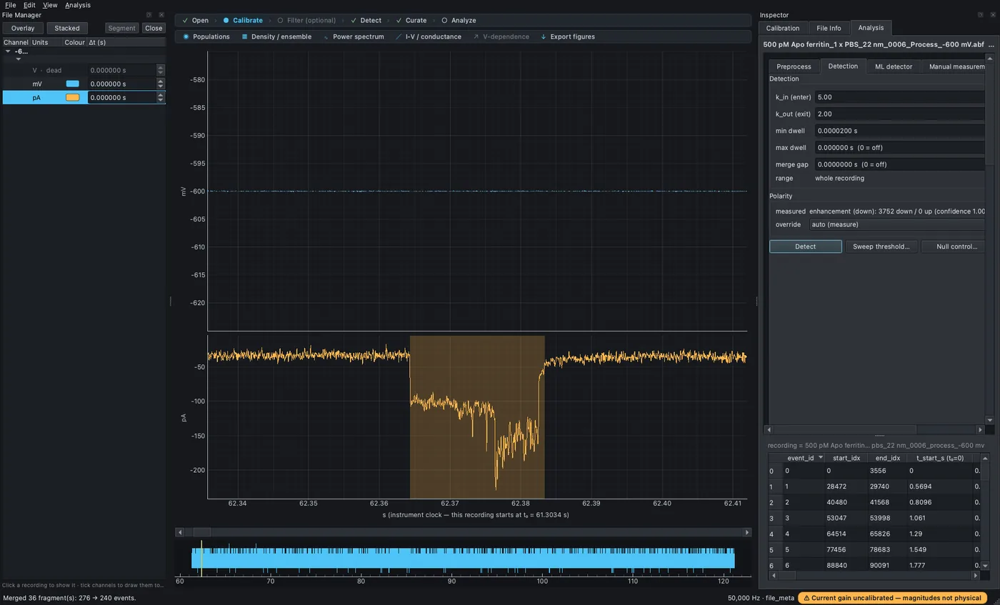

*After `Merge all` at a **10 ms** window on the −600 mV recording — the figure is from the reference run, whose merge window is 10 ms where this walkthrough uses 15 ms, so its counts are 276 → 240 rather than 317 → 243. The status bar reads `Merged 36 fragment(s): 276 → 240 events.`, and the two rows that were `0 → 1173` and `1174 → 2902` are now one row spanning `0 → 3556`. Note the two clocks in one frame: the x axis is the instrument clock (`this recording starts at t₀ = 61.3034 s`) while the table's `t_start_s (t₀=0)` column counts from the start of the recording.*

**What the merge actually removed**

Almost nothing in the body of the distribution and everything in the left tail. Over that same
10 ms merge the median dwell moved 18.16 → 18.44 ms — but the **shortest event in the table went
from 0.08 ms to 13.24 ms**, and the 5% of events that had been under 0.8 ms vanished. Those rows
were fragments lying within 10 ms of a block, not a second population. Anyone quoting a fast dwell
component off the unmerged table on this recording is quoting fragmentation. That is the single
most useful thing this panel tells you.

### When the merge refuses

Not every run the window catches is merged. Some are declined, and the status bar says so
rather than pretending there was nothing there. The two sentences it uses — with `N` standing
for however many runs were declined, not a count from this recording:

```
Nothing merged: N run(s) within 15 ms are mostly open pore between their events, so merging
them would make one long, shallow event. Try a smaller window.
```

When only part of the table is declined, the refusal rides along with the merge that did
happen:

```
Merged 74 fragment(s): 317 → 243 events. N further run(s) were left alone: they are mostly
open pore between their events.
```

**Why.** The gap rule is transitive and transitivity has no brake: every event within one
window of the next joins the same group, so a *regularly spaced* train of clean, well-separated
events collapses into a single row the moment the window exceeds the spacing. Reproduced on the
bench: 40 isolated 0.4 ms / 300 pA events spaced 8 ms apart, merged at a 10 ms window, became
**one** event of dwell 312.40 ms and depth 0.70 pA — accepted, with a blank flag. Nothing
downstream could see anything wrong with it: the depth is a median over a span that is 96% open
pore, so the true 300 pA blockade is simply out-voted, and every derived column is internally
consistent with the row it was measured from.

So grouping by the gap is necessary and not sufficient, and the app asks a second, physical
question of every run the rule proposes: **what fraction of the merged span do the fragments
actually cover?** A translocation is one continuous residence of one molecule in the pore, and
the recrossings this panel exists to stitch over are brief dips back through the exit
threshold — a genuinely shattered event is over 90% occupied (the app's own three-fragment
fixtures sit at 0.92–0.96). Below **50%** the open pore is the *majority* of the row, and what
would be built is not one translocation repaired but several translocations glued to the open
pore between them, with every derived column lying in the same direction. That run is left as
separate events and counted as a refusal. Between 50% and 80% the merge is performed, but it is
recorded in the merge provenance as low-occupancy, so a marginal stitch can be audited
afterwards instead of being indistinguishable from a clean one.

**Read the two messages as different answers.** `No sub-events within 15 ms to merge.` means the
window caught nothing. The refusal means it caught something and the app declined it — which is
your cue that the window is too wide for this recording, not that the merge is broken. Try a
smaller one, or drag over exactly the fragments you mean and use `Merge events in selection`.

The check applies wherever a merge happens: `Merge all`, `Merge events in selection` — an
explicit drag overrides the *window*, not this check, and a selection that fails it says so
(*"That selection is mostly open pore between its events…"*) — `Merge with next` in the Event
inspector, and the detector's own `merge gap` during a detection run.

### Doing it at detection time

`merge gap` on the `Detection` tab does the same thing during detection, and it now reads
**milliseconds** too — 15 ms is `15`, over a 0–1000 ms range. Both routes give identical
results — verified on all three recordings — including the open-pore check: a run whose merged
span would be mostly open pore is left as separate events there as well.

This is the one merge control where `0` really does mean **off**, and the suffix says so
(`0 = off`): merging is an optional *step* inside a detection run, so "do not merge at all" is a
real thing to ask for. The `Merge sub-events` panel has no such state — its window sits beside a
button whose only meaning is merge — which is why that field floors at 0.01 ms instead.

**Which to use**

The `Merge sub-events` panel, when you want to try a window and
see the effect without re-running detection. `merge gap`, when you have settled on a value
and want it recorded in the detection provenance and re-applied on every re-run.

### What 15 ms did to these three recordings

| Recording | Length | Before | After | Merged away | Status line |
|---|---|---|---|---|---|
| −500 mV | 250.1 s | 1081 | 862 | 219 (20%) | Merged 219 fragment(s) |
| −600 mV | 59.9 s | 317 | 243 | 74 (23%) | Merged 74 fragment(s) |
| −700 mV | 181.5 s | 1164 | 984 | 180 (15%) | Merged 180 fragment(s) |

The −600 mV row was re-run through the GUI on 2026-08-20 and reproduces exactly, status line
included. The other two rows are from the original CSV pass and were **not** re-measured — the
2026-08-20 run merged the `.abf` originals at 10 ms, not 15, and detected 1196 and 1179 events
rather than 1081 and 1164, so its counts are not the same experiment. Take the −500 and −700
rows as the shape of the effect, not as figures to reproduce.

Those are row counts, not accepted counts — walkthrough 3 quotes the −600 mV recording as 242,
which is the same table with its one boundary-clipped event unaccepted, and which this run also
reproduced. As everywhere in this app:
the `Summary` carries `n events` and `n accepted` on separate rows, and they are different
questions.

### Choosing the window — and when not to merge

The window must be shorter than the shortest gap between two *genuinely different*
translocations, and longer than the longest excursion *within* one. Those two bounds are
properties of your experiment, not of the app.

**Merging is not free**

Too large a window fuses distinct translocations into one, which inflates dwell and destroys the
event rate. On the merged 243-event table above, the mean gap from one event's end to the next
one's start is 0.227 s and the median start-to-start interval is 0.230 s, so a 15 ms window is
**about 15× smaller** than the typical spacing — comfortably safe here. (Both re-measured through
the GUI on 2026-08-20. The reference run's probed 276-event table gives a median interval of
0.2215 s, and 14.8×, which is the same answer from a different table. Earlier printings quoted
0.28 s and ~19×, which no table on this bench reproduces.) Check that ratio on
your own data before trusting a window. If merging changes your event count by more than about a
quarter, look at the gallery before accepting it — and on the −500 mV recording it does:
a 10 ms merge there stitched 301 events of a terminal burst into 26 pseudo-events of up to 397 ms.
(That measurement is from before the open-pore check existed. It is exactly the shape the check now
refuses — a burst whose events are spread thinly across the span they would make — so on a table
like that one you should expect to see some of those runs reported as left alone rather than merged.
The check is a floor, not a substitute for choosing the window: it only catches the spans that are
*mostly* open pore, and a window that fuses two genuinely separate translocations sitting close
together is well inside it.)

`Merge events in selection` is the manual override: turn on `Measure event`,
drag a region over exactly the fragments you mean, and press it. Every event overlapping the
selection becomes one, regardless of the window.

`Merge with next` in the Event inspector does the same for one event and its immediate
successor — the right tool when you are already looking at the fragment.

## Walkthrough 3 — comparing three recordings

Goal: put three bias voltages side by side and avoid the one mistake that makes the
comparison meaningless.

Data: one pore, one session, three bias voltages — recordings 0005 (−700 mV), 0006
(−600 mV) and 0008 (−500 mV), merged at 15 ms, 2,088 accepted events in total. Beware the
filenames: the CSV export of the −700 mV run is named `…_0006_Process_-700 mV.csv` on this
bench, but its 9,074,042 samples identify it as the **0005** ABF. The ABF headers settle it —
−700 mV at 16:32:30, −600 mV at 16:37:35, −500 mV at 16:41:14, the three spanning about nine
minutes. The confound in this series is not two pores; it is time. See Step 3.

### Step 1 · Load and detect all three

Open all three files. Then, for each: select it in the File Manager, set the baseline, detect,
merge. The app keeps the results separately, keyed by recording and channel — there is no
“current” result to overwrite.

| Bias | Events | Dwell, median [IQR] | Depth pA | ΔI/I₀ | \|I₀\| |
|---|---|---|---|---|---|
| −500 mV | 862 | 22.33 [19.86, 25.51] ms | 61.9 | 2.26 | 28.4 |
| −600 mV | 242 | 18.26 [17.03, 19.37] ms | 88.3 | 2.50 | 35.4 |
| −700 mV | 984 | 19.62 [17.74, 21.88] ms | 100.0 | 2.04 | 48.9 |

That table is from the CSV exports at the app's default baseline window and a 15 ms merge. The
2026-08-20 reference run did the same exercise on the `.abf` originals, at each recording's
*probed* window and a 10 ms merge, and got:

| Bias | Detected | Merged | Median dwell | Median depth | Median ΔI/I₀ | I₀ stamped |
|---|---|---|---|---|---|---|
| −500 mV | 1196 | 863 | 22.36 ms | 62.87 pA | 2.357 ⚠ >1 | −27.08 pA |
| −600 mV | 276 | 240 | 18.44 ms | 89.42 pA | 2.571 ⚠ >1 | −34.79 pA |
| −700 mV | 1179 | 986 | 19.36 ms | 97.00 pA | 1.900 ⚠ >1 | −51.66 pA |

Neither table is wrong; they are measured under different windows, which is exactly the point of
*Do this first*. The medians move a few percent, the counts move by tens of percent. If you are
going to quote either, quote the window with it. Note the −700 mV row: its stamped I₀ is 7.2%
biased by the window its own probe proposed, which is what makes its ΔI/I₀ the odd one out at
1.900 — corrected, the three read 2.382 / 2.586 / 2.103. *Known limits* has the evidence.

### Step 2 · Overlay them in the Plots window

Open `Plots`. In `Data sources`, tick all three. Colour now means
*recording*, and the app switches `Normalize` to `density` by
itself, because 862 events and 242 events cannot be compared as raw counts.

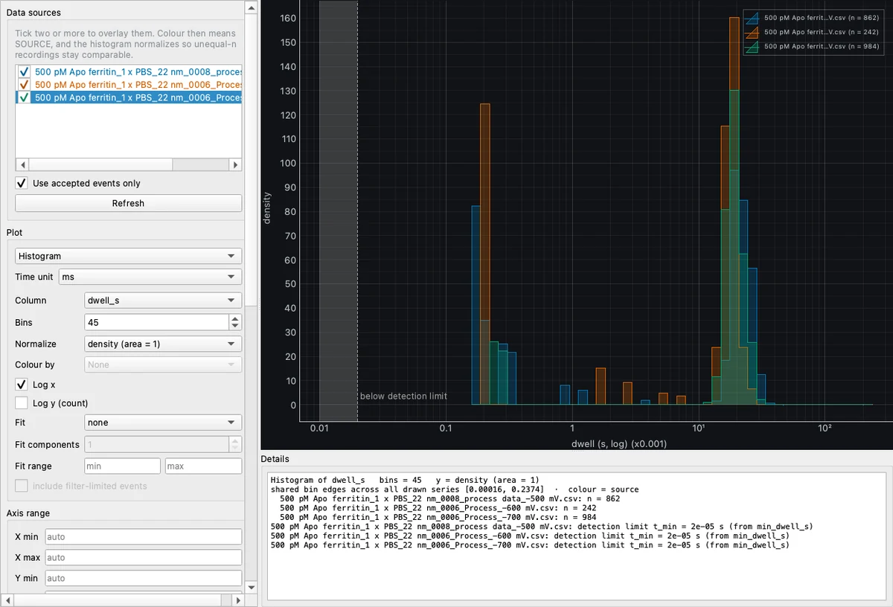

*Dwell, all three overlaid, density-normalised so unequal event counts stay comparable.*

Read across the three: a dominant dwell population at 15–25 ms appears in all of them. That
reproducibility is the result; the exact heights are not.

The small fast lobe near 0.15 ms reproduces too, and it is **not** a population — it is
detector fragmentation, and walkthrough 2 removes it. Merged at 10 ms the −600 mV table has no
event shorter than 13.24 ms at all. A mode that survives a merge is a finding; one that does not
is an artefact of the trigger. Check before you report it.

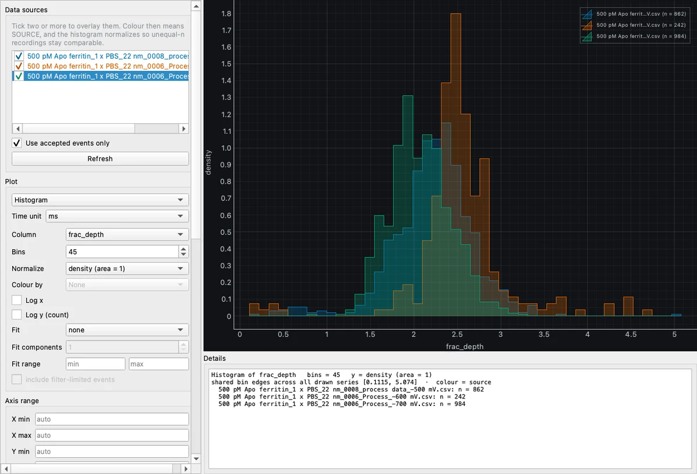

*The same three in ΔI/I₀. The distributions largely coincide — the recordings differ far less than the raw pA plot suggests.*

### Step 3 · The mistake, and the app catching it

Switch to `Scatter`, `X` = `dwell_s`, `Y` =
`depth_pA`, `Log x` on.

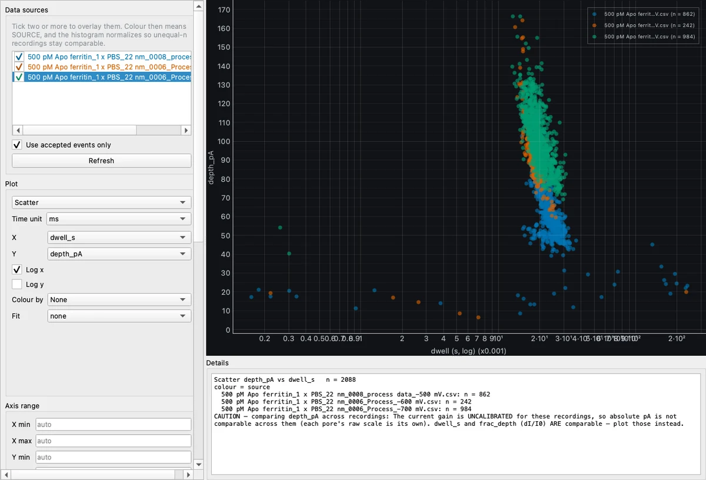

*Depth in pA against dwell. A clean-looking separation that is mostly an artefact of three different open-pore currents.*

The three separate beautifully by depth. It is not a real separation. Read the
`Details` pane:

```
Scatter depth_pA vs dwell_s   n = 2088
colour = source
  …_0008_process data_−500 mV.csv: n = 862
  …_0006_Process_−600 mV.csv: n = 242
  …_0006_Process_−700 mV.csv: n = 984
NOT COMPARABLE: depth_pA is measured against each recording's own estimated baseline, and
these 3 sources were detected under 3 DIFFERENT baseline configurations:
    <−500 mV fingerprint> -- …_0008_process data_−500 mV.csv
    <−600 mV fingerprint> -- …_0006_Process_−600 mV.csv
    <−700 mV fingerprint> -- …_0006_Process_−700 mV.csv
  Re-detect them under ONE baseline window (Preprocess ▸ Baseline) before pooling these, or
  plot a baseline-independent metric (dwell_s, or a count).
CAUTION — comparing depth_pA across recordings: The current gain is UNCALIBRATED for
these recordings, so absolute pA is not comparable across them (each pore's raw scale is
its own). dwell_s IS comparable — plot that instead.
```

The plot title carries the short form, because that is the half `Save image` keeps:
`⚠ NOT COMPARABLE across 3 sources: depth_pA`.

Change `Y` to `frac_depth`:

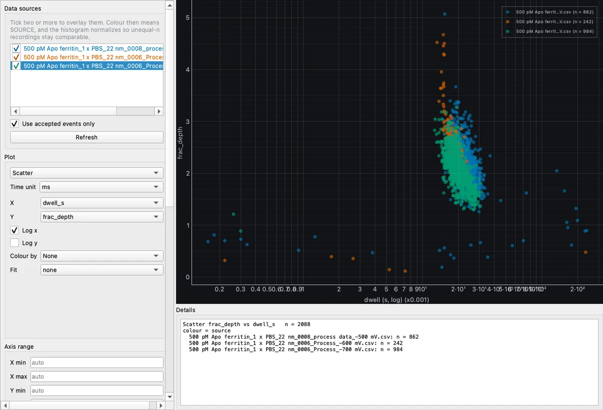

*The same events in ΔI/I₀. One overlapping cloud — the honest picture.*

The separation collapses. It was the differing open-pore currents (28.4, 35.4, 48.9), not
different blockade physics. **ΔI/I₀ is the axis to compare on** whenever gain is
uncalibrated or differs between recordings.

**`Plots` guards the axis it just recommended, too**

`frac_depth` is measured against *each recording's own estimated baseline*, so two recordings
detected under different baseline windows are not poolable on it either — and these three were:
the probe proposes rough/base windows of 1.0/0.30 s, 2.0/0.50 s and 0.1/0.03 s for the three
files, three different `baseline_fingerprint`s. At −700 mV that window biases the stamped open
pore by 7.2%, which moves that recording's ΔI/I₀ from 1.90 to 2.10 — enough to change which
recording is the outlier.

`Analysis › Plots…` asks the same question `Voltage dependence` does (Step 5) — one call to the
shared rule, over merge state, baseline and gain together — so switching `Y` to `frac_depth`
does not escape the check: `Details` gains its own `NOT COMPARABLE: frac_depth is measured
against each recording's own estimated baseline …` block and the title reads
`⚠ NOT COMPARABLE across 3 sources: frac_depth`. The two guards are reconciled rather than
independent: while the
baselines disagree, the gain caution stops offering `frac_depth` and names only `dwell_s`. The
overlay is still drawn — this window warns and draws, it never refuses and never silently pools.

**The confound the app cannot see**

It is not two pores. All three recordings are the same pore in one nine-minute session — but they
were acquired **−700, −600, −500 mV in that order**, so |V| falls monotonically with elapsed time
— and so does the open-pore conductance. A slow session drift explains the apparent voltage dependence exactly as well as voltage does, and nothing in
these three files can separate them. The fix is in the acquisition, not the analysis: re-run the
series **bracketed** — −700, −500, −600, −700 — so that a repeat of the first point at the end
measures the drift directly. As acquired, no I–V claim from these three files survives review.
Nothing in the app knows the acquisition order matters; that check is yours.

### Step 4 · The KDE

Two roads to the same figure:

**In the Plots window** — set `Plot type` to `KDE (density)`. One contour set per
checked source in that source's colour, on shared axes, each contoured against its
own peak density so a rare population keeps its shape beside an abundant one.
Defaults are the signature axes — `dwell_s` (log x) against `frac_depth` — and the
`Contours` spinbox sets lines per source. It needs at least 5 usable points per
source; anything dropped is disclosed in Details, along with each source's KDE
bandwidth factor. Style, Save image and the fit-values box all apply as on any
other plot type.

**As a publication export** (with marginal distributions):

- Open `Analysis › Export density figure…`.
- Answer the amplitude question. `depth (pA)` is the absolute blockade;
`fractional ΔI/I₀` divides by each event's own open-pore current. Given the caution
above, pick fractional.
- Choose a path. Three files land together: `.png`, `.pdf` and a
`.csv` of the exact points plotted.

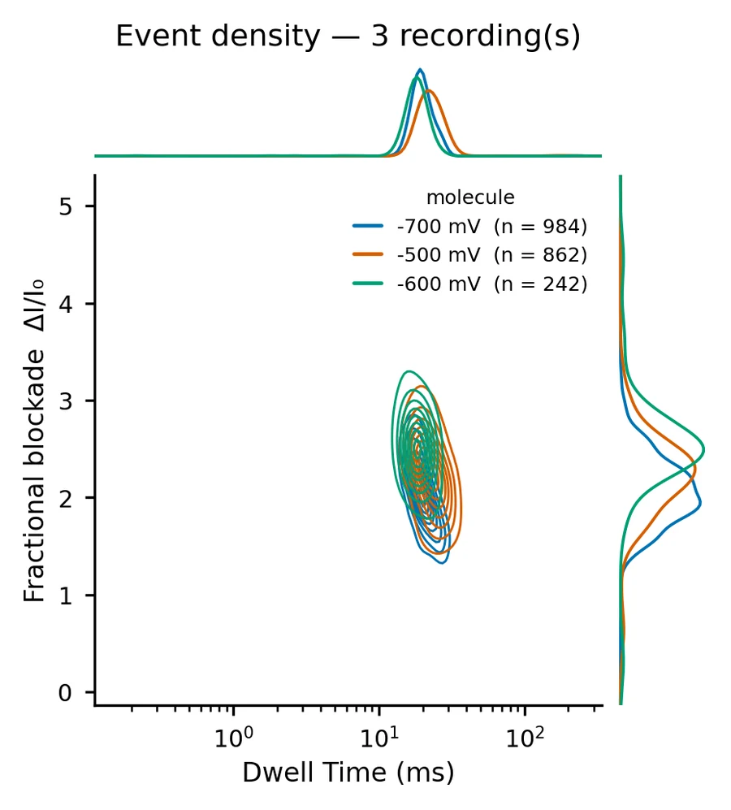

*The exported KDE: one contour set per recording with marginals, labelled by applied voltage.*

Each recording gets its own contour set, normalised to itself so a sparse group stays visible next
to a dense one, with marginal distributions on both axes. The legend labels come from the applied
voltage — read from the file header or the filename when there is no voltage channel.

`Analysis › Density figure style…` controls contour levels, line width, font
scale, legend position and size, and whether counts appear in the legend. `none` removes
the legend entirely.

In the Plots window, the Style group now also carries **X label** / **Y label**
overrides (text only — tick scaling still applies), a **Show legend** toggle, and
the **Fit values on plot** box; the **Axis range** fields read in the unit the axis
displays, so a time axis follows the Time-unit combo and you type the number you
read off the ticks.

### Step 5 · I–V and voltage dependence

With several recordings open, `Analysis › I-V / Conductance…` fits open-pore
current against applied voltage.

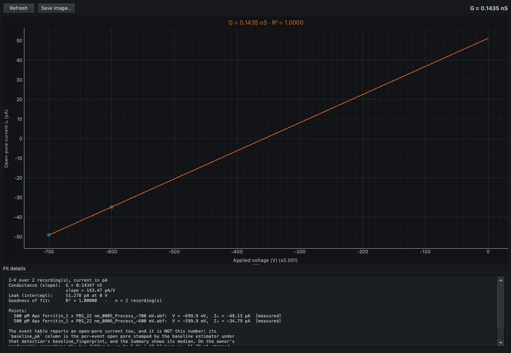

*I–V over two recordings. Units are pA here, so the app does give a conductance: `G = 0.14347 nS`, slope 143.47 pA/V, leak 51.278 pA at 0 V, and both points tagged `[measured]` rather than `[nominal]`. `R² = 1.0000` because a line through two points is exact, not because the fit is good. Load a CSV with unknown units instead and the same window reports a raw slope and refuses the nS — that is the case quoted below.*

```
I–V over 3 recording(s), current in
Conductance (slope):  conductance not in nS (unknown current units)
                      slope = 105.29 (units unknown)/V
Leak (intercept):     25.838 (units unknown) at 0 V
Goodness of fit:      R² = 0.95808  ·  n = 3 recording(s)
Points:
  …_0008_process data_−500 mV.csv:  V = −500 mV,  I₀ = −28.08 (units unknown)   [nominal]
  …_0006_Process_−600 mV.csv:  V = −600 mV,  I₀ = −34.79 (units unknown)   [nominal]
  …_0006_Process_−700 mV.csv:  V = −700 mV,  I₀ = −49.13 (units unknown)   [nominal]
```

Three things to read here. The app refuses to call the slope a conductance in nS because the
current units are unknown — it gives the raw slope instead. Each voltage is tagged
`[nominal]`, meaning it came from the filename rather than a measured voltage channel; open the
`.abf` originals instead of these CSVs and every point reads `[measured]` off a live voltage
channel, at −499.91 / −599.91 / −699.89 mV. And the intercept is 25.8, not ~0: a straight line
through these three points does not pass through the origin, as it should for a clean resistive
pore. Treat it as a sanity check, not a conductance measurement. That goes double here, because all
three points come from one session with |V| falling monotonically in time (Step 3), and because the
open-pore conductance |I₀|/|V|, re-measured from event-excluded medians, rises 27% from −500 to
−700 mV. That is strongly superlinear, and no constant offset reconciles the middle point.

**Two open-pore currents, and they do not have to agree**

`I₀` here is not the `baseline_pA` column of the event table. The event table's value is the
per-event open pore stamped by the baseline estimator under that detection's
`baseline_fingerprint`, measured locally; the I–V window's is one value for the whole recording
from its own estimator. Both are right and they differ by up to 5.1% on these recordings — which
is why the table above reads 28.4 / 35.4 / 48.9 and the I–V readout reads −28.08 / −34.79 /
−49.13. Quote the I–V window's number beside a conductance; quote the table's beside a depth. The
app now says so in both places.

**Voltage dependence, and the refusal that matters**

`Analysis › Voltage dependence…` is the aggregate: one point per recording, an event metric
against applied voltage, with a linear or A·exp(V/V₀) trend. It is also the one surface that
checks whether the detections it pools were measured the same way, and says so — loudly, and in
the exported title — when they were not.

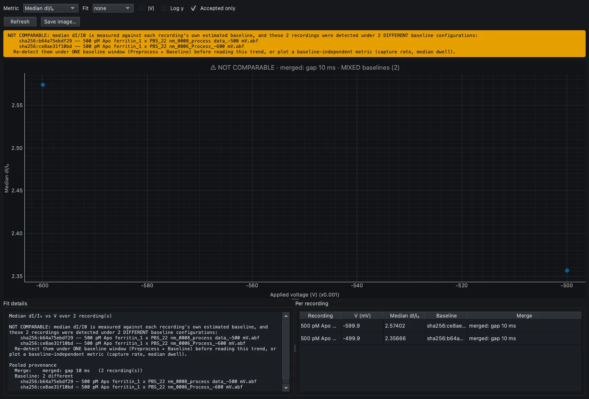

*Voltage dependence warning about the pool. Median ΔI/I₀ over two recordings detected under two different baseline windows — `sha256:b64a75ebdf29` and `sha256:ce8ae31f10bd` — so the window raises the banner above the plot (`Fit` is `none` here; ask for a trend and it still draws and fits one — the verdict is never a withheld fit). It names both fingerprints and points at the baseline-independent metrics instead. The plot title carries the merge state too: `⚠ NOT COMPARABLE · merged: gap 10 ms · MIXED baselines (2)`, so an exported PNG keeps the warning.*

Two guards, both stated as full banners rather than footnotes. A **merge-state** mismatch raises
one because a gap merge changes the event count, the capture rate, the dwell and the depth
alike. A **`baseline_fingerprint`** mismatch raises one for any metric measured against a
baseline, with the advice to re-detect under one window or to plot a baseline-independent metric.

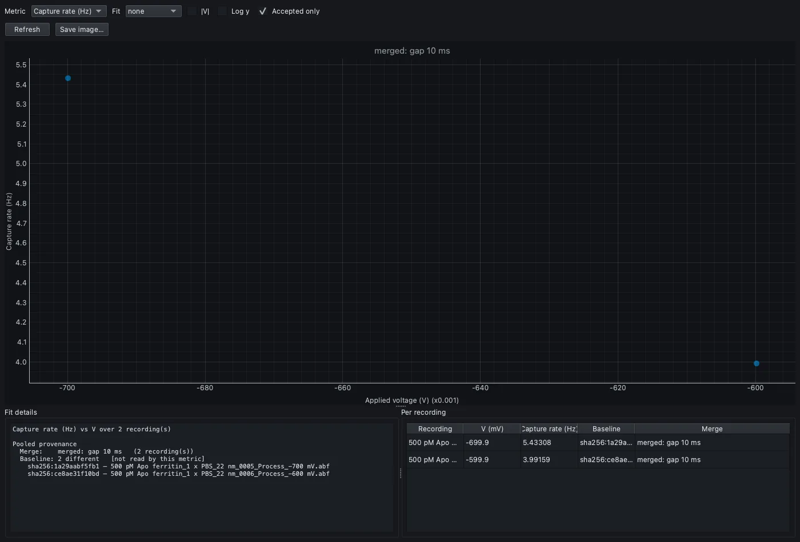

*The same window, the same two recordings, metric switched to `Capture rate (Hz)`: no banner. The fit details still notice `Baseline: 2 different` and then say `[not read by this metric]` — capture rate does not touch the baseline, so pooling it is legitimate and the app does not pretend otherwise. The guard is metric-aware, not a blanket refusal.*

Remember that `Analysis › Plots…` has neither guard (Step 3). If you want the fingerprint
check on a cross-recording comparison, this is the window that performs it.

## Walkthrough 4 — clustering, and reading it honestly

Goal: ask whether the events fall into populations — and recognise when the
answer is “this tool cannot tell you”.

### Step 1 · Set it up

- Untick all but one recording. Colour means *source* while several are overlaid, so
cluster colouring is ignored until only one is left — the app says so in
`Details`.
- Pick `Scatter` and set `X` and `Y` to the features you want to
see.
- In the `Features (clustering & PCA)` box, select the feature columns to cluster *on* — these
are separate from the plotted axes. Here: `dwell_s` and `frac_depth`.
- Choose `Method`: `GMM` (elliptical clusters, gives a BIC) or
`k-means` (spherical, needs an explicit k).
- Choose `Auto (BIC)` or `Fixed k`.
- Press `Run clustering`. **Setting the options does nothing until you press
it.**
- Set `Colour by` to `Cluster`.

Features are standardised before fitting, so a feature in seconds and one that is dimensionless
carry equal weight rather than the larger-numbered one dominating.

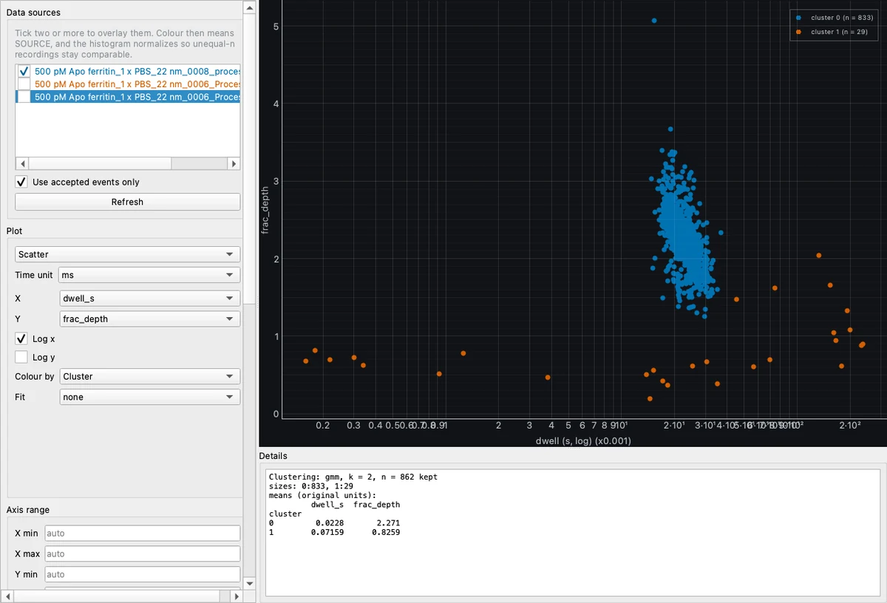

*GMM with k pinned to 2 on the −500 mV recording, coloured by cluster.*

### Step 2 · Read the Details pane

```
Clustering: gmm, k = 2, n = 862 kept
sizes: 0:833, 1:29
means (original units):
         dwell_s  frac_depth
cluster
0         0.0228       2.271
1        0.07159      0.8259
```

Sizes first, means second. Cluster 1 here is 29 events at 72 ms and ΔI/I₀ 0.83
— the sparse long-dwell shallow population visible in the corner of the scatter. That is a
plausible finding.

### Step 3 · Distrust it

Auto-k on these three recordings — *the same sample* — gave three different
answers:

| Recording | Auto k | Cluster sizes | Smallest |
|---|---|---|---|
| −500 mV | 7 | 267, 9, 16, 319, 152, 3, 96 | 3 |
| −600 mV | 5 | 189, 1, 5, 28, 19 | 1 |
| −700 mV | 3 | 246, 734, 4 | 4 |

A cluster of one event is not a population. Pinning k = 2 did not rescue it: the
−600 mV recording still split off a single point, and −700 mV halved the main
cloud instead of isolating the sparse one. Re-running on log-dwell offline gave the same behaviour, so
it is not feature scaling.

The app now flags both failure modes itself:

```
! DEGENERATE CLUSTER(S): cluster 1 (n=1) — below 5 events (1% of 241, floor 5).
  A cluster this small is not a population: it is the model spending a component on
  outliers or on the tail of a skewed feature. Treat these labels as unassigned, pin k
  to the structure you can see, or cluster on a transformed feature.

! UNSTABLE k: BIC chose k=5 over k=4 by 6.5, inside the 10 margin at which this choice
  is not meaningful. Auto-k is reporting a preference the data does not support; pin k
  instead of reading the number of clusters as a result.
```

Both of those are the app's real output on the −600 mV recording. On −500 mV
it also reports both (k = 7 chosen over k = 5 by 7.0, and a cluster of 3); on
−700 mV the BIC margin is a healthy 30.8 and only the degenerate-cluster note fires. Three
recordings of one sample, three different verdicts on how many populations exist — and the one
whose BIC margin looks healthy is not the one that agrees with the other two.

**The honest conclusion on this data**

The population structure is clear in the dwell histogram and the KDE, and unreliable from GMM. The
reason is diagnosable: the minority population is 1–3% of events, and the dominant cloud is not
Gaussian in these coordinates — so BIC spends components on tails. **Report the
distributions; do not report the cluster labels as populations.** Clustering is the right tool
when populations are comparable in size and roughly elliptical; neither holds here.

### Also on this surface

`PCA` in the plot-type combo projects the same selected features onto two components,
which is worth a look when you have more than two features and want to know whether they carry
independent information. The `Event plots` window
(`Analysis › Event plots (density / ensemble)…`) gives a binned 2-D density map
with marginal histograms and an ensemble-average view — a faster, coarser look at the same
question than the KDE export.

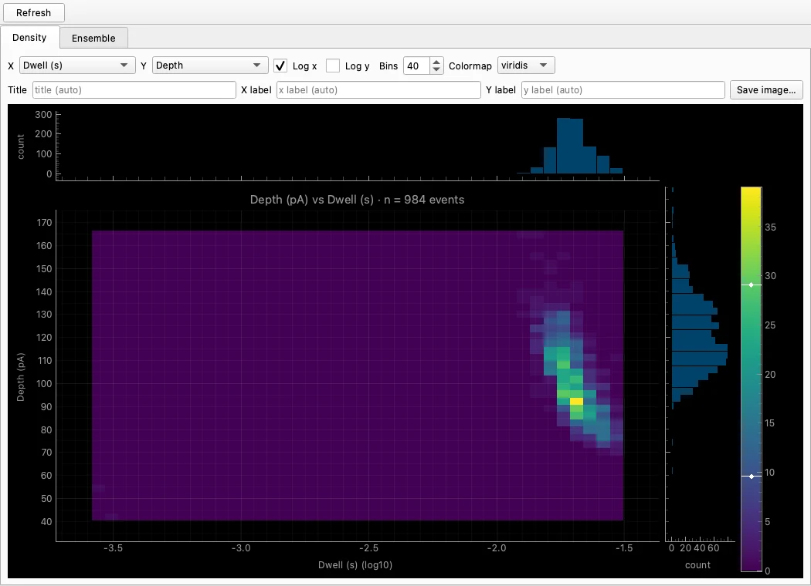

*The Event plots window: a binned density map of depth against log dwell, with marginal histograms and a colour scale. The Ensemble tab averages the aligned event waveforms.*

**A superseded calibration follows the numbers into the plot.** Change the gain or offset after a
detection and the event table badges the affected columns `⚠`; the `Plots` window marks the same
thing in the two places that survive an export. The `Details` pane names the exact columns, prefixed
with the source when more than one is drawn — *“SUPERSEDED CALIBRATION: depth_pA, frac_depth on this
plot were measured under a gain/offset that has since been changed, and they have NOT been
recomputed — the event table badges the same column(s) ⚠. The numbers drawn, and every fitted
parameter printed from them, are in the OLD calibration.”* — and the plot **title** gains
`⚠ SUPERSEDED CALIBRATION`.

The title is where it matters: `Save image…` keeps the title and nothing else, so without that mark
an exported figure of a superseded depth distribution is indistinguishable from an exported figure
of a current one, and the τ or μ printed beside it goes into a manuscript in a calibration nobody
still has. Nothing is recomputed by drawing it. Re-run detection on the recording before reporting
anything off the plot.

**An R² with nothing left over says so.** Both best fits the scatter draws — the straight line and
the log-log one — have exactly two free parameters, and so does each `Voltage dependence` trend. Fit
two points with either and R² is 1.000 by arithmetic: any two points whatsoever, noise included,
score identically. So the number is tagged where it is printed, `R² = 1.000 (exact by construction)`,
in the fit headline that becomes the plot title unless you pinned your own — and the `Details` pane
carries the sentence: *“no residual degrees of freedom remain and ANY 2 points whatsoever -- noise
included -- would score exactly the same. There is no goodness of fit to report here.”* Below the
parameter count the tag reads `(under-determined)` instead: R² is arithmetic, and the parameters are
not identified. `Voltage dependence` tags its own `R²` the same way and spells it out under
`Goodness of fit`. The `I-V / Conductance` window does not — its `R² = 1.0000` over two recordings
is exact for the same reason and carries no mark, which is why the caption in Walkthrough 3 says so
by hand.

## Walkthrough 5 — ML detection, replicated step by step

Goal: reproduce a complete ML-detection analysis on the three apo-ferritin recordings —
preprocessing, detection with a Keras student model, gallery curation, and every population view —
exactly as a first-time user would drive it. Every number below is what the app printed on this
bench; follow the steps on the same files and you should land on the same values. The red arrows in
each figure are numbered by step: arrow **2a** is Step 2's first action, and so on.

Data: recordings 0005 (−700 mV, 9,074,042 samples), 0006 (−600 mV, 2,993,798) and 0008 (−500 mV,
12,502,631), all at 50 kHz, plus the RAW student model `student_unet_teacher_best.keras`
(input contract `(None, 2048, 1)` — the ML tab reads the window length off the file when you load it).

### Step 1 · Open the recordings

**File ▸ Open…**, select all three ABFs. Each loads with its current channel auto-selected
(`IN15 · current · pA`). The status bar reads `50,000 Hz · file_meta`, and the calibration chip
warns that the gain is uncalibrated — remember that chip: it decides which columns are comparable
across recordings later.

### Step 2 · Measure the open pore — one recording at a time

Select the −700 mV recording. On the Inspector's **Analysis ▸ Preprocess** tab press
**Measure this recording** (arrow 2a), *wait for the proposal to appear* (rough 1 s / base 300 ms
on this file — the grey source line under the form says when it was measured on this recording),
then press **Use these values** (arrow 2b).

Two traps this walkthrough exists to name:

- **Wait for the proposal.** The Apply button is enabled whenever a channel is selected; clicking
  it before the measured windows land applies the untouched defaults as if you had typed them.
- **Detect before you switch recordings.** The Preprocess form re-seeds on every selection change
  (its rule: the settings on the tab are the settings that produced the table on screen), so an
  accepted proposal that never produced a detection is dropped when you click another recording.
  Measure → apply → detect, one recording at a time.


### Step 3 · Load the model and run ML detection

Switch to the **ML detector** tab. **Load model…** (arrow 3a), pick
`student_unet_teacher_best.keras` — the tab shows the model name and its window.
(Every model loaded this session also lands in the **loaded** combo below the
button, so comparing two students is a combo pick, not another file dialog.) Set **range** to
*Whole recording* (arrow 3b), leave the preset's model-preprocessing chain alone, and press
**Run ML detection** (arrow 3c).

The accepted open-pore windows travel into the run automatically and are stamped into provenance
(`baseline_param_source: proposed`). On this bench:

| Recording | Windows (proposed) | Events | Run time |
|---|---|---|---|
| −700 mV | 1.0 / 0.3 s | 982 | ~30 s |
| −600 mV | 2.0 / 0.5 s | 236 | ~13 s |
| −500 mV | 1.0 / 0.3 s | 870 | ~48 s |

Repeat Step 2 + Step 3 for −600 and −500. Then read the amber **⚠ About these numbers** block under
the Summary once per recording — on these files it reports two conductance levels and reminds you
the open pore was *chosen, not certified* (on −700: −48.5 pA holding 88 % against −140.4 pA holding
8 %). That is a statement about your pore, and only you can settle it.


### Step 4 · Review the detection in the event gallery

**Analysis ▸ Event gallery…** shows the whole detection as a grid of waveform tiles — the fastest
way to see what the model called an event and to curate in bulk.


What each arrow points at:

- **4a · Show** — filter the grid: *All*, *Accepted only*, *Rejected only* (and detector-refused
  tiles are labelled as such). The status line always says which subset you are looking at.
- **4b · Sort** — detection order, dwell, depth, … Sorting is numeric, and the j/k curation keys
  walk this same order.
- **4c · Accept selected / Reject selected** — act on the tiles you swept or clicked
  (click to select; `R` rejects; `1–9` label).
- **4d · Accept all 982 / Reject all 982** — bulk curation of every tile the current filter shows;
  the button names the count it will touch. One press is one undoable step, and rows the detector
  flagged unmeasurable stay rejected — the status line discloses "kept rejected" when that happens.
- **4e · Page controls** — first/prev/next/last with the page indicator; *Per page* sets the grid
  size (*Fit* fills the window).
- **4f · The status line** — the gallery's own ledger: "1–40 of 982 (all) · 982 of 982 accepted ·
  drawn from: calibrated (as recorded)", plus the interaction hints. Every count here agrees with
  the events table and the inspector — by construction.

Double-click any tile to open that event in the main trace view.

### Step 5 · Scatter — dwell vs amplitude, all three recordings

**Analysis ▸ Plots…**. Tick all three sources (arrow 5a), Plot = *Scatter* (arrow 5b),
X = `dwell_s` (log), Y = `depth_pA` (arrow 5c). 2,088 events land in one cloud per recording — and
the panel immediately posts *⚠ NOT COMPARABLE across 3 sources: depth_pA*: the gain is
uncalibrated, so absolute picoamps are not comparable across recordings. The caveat names the fix —
plot `frac_depth` (ΔI/I₀) instead when you mean to compare.


### Step 6 · KDE — fractional blockade vs dwell, all three

**Analysis ▸ Export density figure…**, choose *fractional ΔI/I₀* at the amplitude prompt. The figure
overlays one KDE contour set per recording with marginals, n in the legend. (The in-app version of
the same view is **Analysis ▸ Event plots (density / ensemble)…**.)

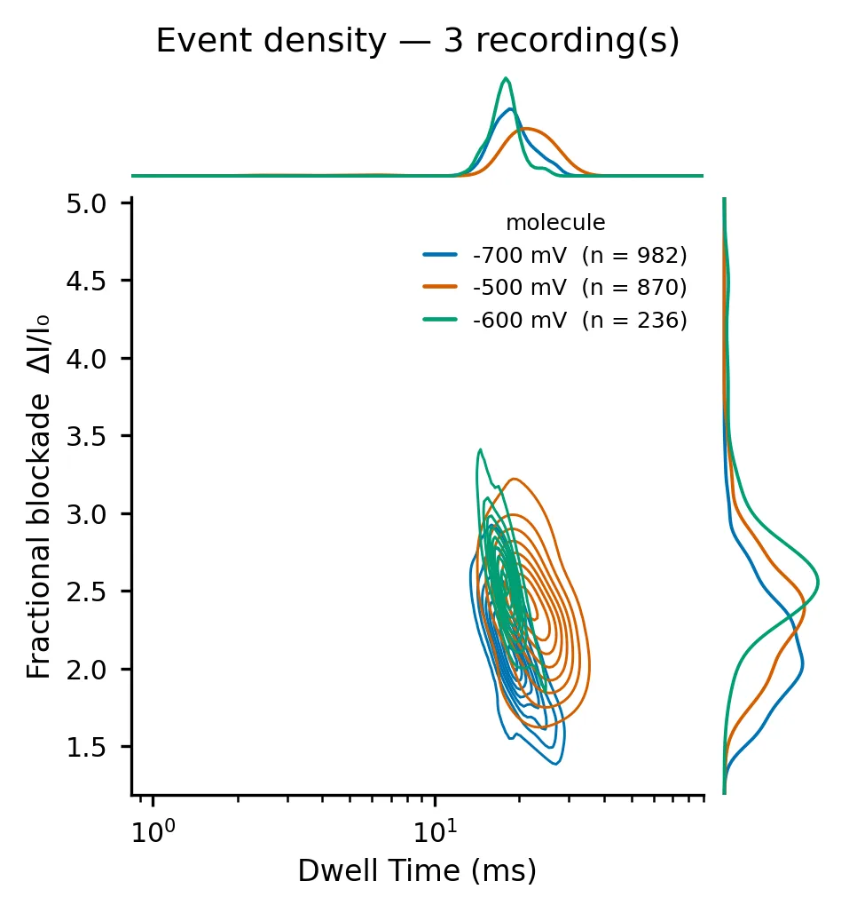

### Step 7 · Histograms — and reading a fit's verdict

Histogram of `depth_pA` over all three sources shows the per-source normalised amplitude
distributions. For dwell: select the −700 mV source alone, Column = `dwell_s`, Time unit = ms, and
pick a family in the Fit combo (arrow 7a), then press `Apply fit` beside it. Picking is only a
proposal — until you apply it the button carries a ●, and the plot still shows whatever was drawn
before — which is deliberate: walking the list to read the options used to run a fit per entry,
one of them a nine-second optimisation. With the curve on screen, **read the Details pane
(arrow 7b) before believing it**. Fit = *exponential* on this data earns, verbatim: *"KS D = 0.6354
… THE FITTED CURVE DOES NOT DESCRIBE THESE DATA … Its parameters should not be reported as
measurements"*, with the model comparison naming *inverse-gaussian (first passage)* best. Switch to
it — pick it, press `Apply fit` again — and you get μ = 19.14 ms, KS D = 0.048, *"The fitted curve
is consistent with these data."* That Details-pane habit — apply, read the verdict, switch models —
is the whole lesson of this step.


### Step 8 · PSD

**Analysis ▸ Power spectrum (noise / PSD)…** on the −700 mV recording: the Welch spectrum, total-RMS
readout and band breakdown. Quiet-segment discipline applies — leave translocations inside the
window and you are measuring events, not the pore.

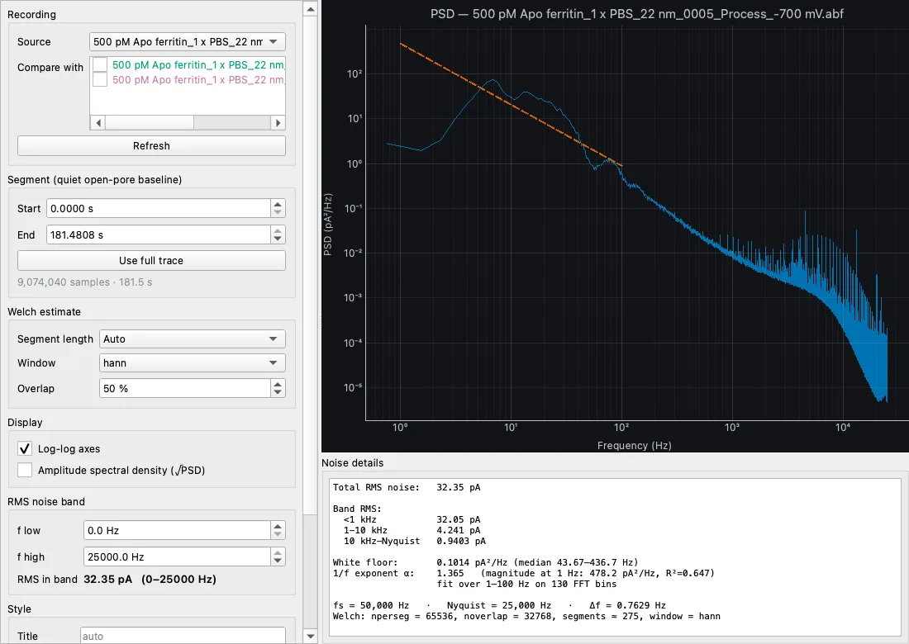

### Step 9 · Substructure — PCA, then GMM with t-SNE and UMAP

In **Plots**, Plot = *PCA*: select the feature columns (arrow 9a — dwell, depth, ΔI/I₀, ECD, rise,
fall, SNR), press **Run PCA** (arrow 9b). On −700 mV: PC1 47.8 %, PC2 19.8 % (cumulative 67.6 %),
n = 850 kept with 132 non-finite rows disclosed.


Then **Analysis ▸ Event subpopulations (GMM)…** runs the full report — 8 subpopulations on this
file, each with its own ledger row, plus the caveats block and the analysed-span clock:


t-SNE is drawn by default. UMAP is an explicit opt-in at the analysis layer
(`SubpopConfig(with_umap=True)`) because its coordinates are not bit-reproducible across library
versions; when computed, the embedding view offers both, and keeps that caveat printed under the
cloud.


### Step 10 · Save the project

**File ▸ Save Project…** — everything above (three detections, curation, calibration, the fitted
views' sources) reopens byte-honestly from the one `.nanoscope` file; the population views in Steps
5–9 were in fact produced from a reopened copy of this project, which is itself the round-trip test.

## Reconciling detectors & preparing training labels

This workflow turns several detector proposals plus human review into a traceable annotation table.
It does not train a model inside NanoScope; the final CSV/Parquet and `.meta.json` sidecar are inputs
to the StudentModel notebook or another external training pipeline.

### 1 · Prepare comparable sources

Normally run at least two detector types on the **same recording, current channel and analysed
range** — for example Schmitt, CUSUM and ML. One detector table is also eligible when it contains
both automatic candidates and `added=True` missed events; that path deduplicates manual and detector
candidates but does not claim cross-detector agreement. Multiple sources must have compatible
calibration, baseline contract, units, sample rate, polarity and analysed range. Preview refuses a
mismatch rather than treating unlike measurements as votes.

Before reconciling, use the `Event table` selector to choose a **source detector table**. A beginner's
long-trace labeling loop is:

1. Zoom to an event-scale window with box zoom or `+`. The Navigator changes from
   `Full recording` to its `Local context · 9× view` lens, so you keep nearby context without
   returning to the full trace.
2. Double-click the missed event to activate and place the Measure mask (or turn on
   `Analysis › Measure event`). Drag a circular edge handle to resize it or its shaded body to move
   it. New masks are capped at 20% of the visible window. The blue
   Navigator band mirrors this working selection; the shaded Navigator region still controls the
   visible window.
3. Press `Mark selection as missed event` or `Ctrl+Shift+M`. This adds a reviewed, accepted,
   `added=True` row to the selected source detector table; it does not write to the separate manual
   measurement list. The shortcut stays enabled whenever a recording is selected; if no source
   result exists or Reconciled is selected, it refuses loudly and tells you to run or select a
   source detector rather than failing silently.
4. Press `Next ▶` or, with the trace focused, `Shift+Right`. The view advances by 90%, leaving 10%
   overlap, and the live cursors carry forward with it. Refine them around the next miss and repeat.
   `◀ Prev` / `Shift+Left` goes back; `+` / `−` or `Shift+Up` / `Shift+Down` adjusts the working zoom.

Without a source detection, use `Add to list` / `Ctrl+M` for standalone measurements instead; those
rows are useful for measurement and plotting but are not reconciliation sources. The derived
Reconciled table is curation-only: add, merge, resize/revert a mask, or re-measure a baseline in a
source, then reconcile again.

### 2 · Preview the matching rule

Choose `Analysis › Reconcile detector results…` and tick the source detections. Use two or more for
cross-detector consensus, or the one eligible mixed detector/manual table for deduplication.

- `Minimum temporal overlap` is the shared time as a percentage of the **shorter** candidate. At
  the 50% default, modest boundary disagreement can converge without joining events that merely
  touch.
- `Required detector support = 1` is the **union**: any selected detector may support the row. A
  middle value is **agreement**. Setting it to the number of selected sources is the
  **intersection**: every selected detector must support the row. It stays at `1` for the
  single-table manual/detector path.
- Keep `Keep manual-only events` ticked for a labeling dataset. It retains a real event you added
  by hand when no automatic detector found it.

Press `Preview`. Read the counts for input candidates, overlap groups, output candidates, rows
converged, groups filtered, manual-only events, and unresolved label conflicts. Nothing has been
stored yet. If the preview is right, press `Create reconciled table`.

The new table is named **Reconciled** and stored separately. All source tables and their curation
remain unchanged. Use the `Event table` selector to move among them. Each reconciled row keeps one
canonical contributor's measurements instead of averaging incompatible quantities, while its
provenance records all contributors and the matching rule. Since canonical rows can come from
different detector conditioning chains, change boundaries, add/merge events, resize/revert masks,
or re-measure a baseline in a source table and then create a new reconciliation.

### 3 · Make human decisions and labels

Use `Analysis › Event gallery…` for bulk review or `Analysis › Event inspector…` for close review.
Accept/reject writes a human positive or negative decision to the selected Reconciled table. Define
the label vocabulary with `Analysis › Event labels…`, then apply its `key=value` entries in either
window. Labels and review state are part of the event table; the palette is saved with the project.

When contributors disagree on one label key, Preview increments `Unresolved label conflicts`
instead of guessing. `consensus_label_conflicts` names the affected key, while `flag` keeps the
competing values with a vertical-bar marker such as `molecule=apo|holo`; that is a conflict, not a
combined class. Apply the correct value in the gallery or inspector before training. The export
warns again and defaults to `Cancel` if any selected row still has a conflict.

### 4 · Export the training regions

Choose `Analysis › Export events for training…`. Its first dialog offers three different datasets:

- `Reviewed decisions (recommended)` — human-reviewed positives **and negatives** only. Untouched
  candidates and automatic detector rejects are withheld. This is the supervised-learning-safe
  default.
- `Accepted candidates` — every accepted row, including rows nobody reviewed. These are candidates,
  **not curated truth**.
- `All raw candidates` — every row, including automatic detector rejects. Choose this only when a
  downstream triage or cleanup step is intentional.

The output contains the event regions, `accepted` / `added`, and one dynamic `label_*` column per
structured key. The sidecar records the selection, detector and preprocessing provenance; for a
Reconciled table it also carries exact reconciliation membership and the matching contract. Keep
the data file and sidecar together.

Finally, `File › Save Project…`. The project preserves every source detection, the separate
Reconciled result, its curation and labels, and the label palette. NanoScope is not an annotation
database: it currently has no dataset-split manager, annotation import/round-trip, reviewer
identity/timestamps or edit audit log, and no multi-reviewer/inter-annotator workflow. Use an
external dataset/versioning system for those stages.

## Control reference

Every user-facing control, by area, with its label quoted verbatim from the source. Where a
colleague's first pass mis-described a control, the corrected reading from the source is shown in
amber under it.

The trace's navigation controls are not menu items, so their focus-scoped shortcuts are collected
here before the menu inventory:

| Control | Mouse / keyboard contract |
|---|---|
| Adaptive Navigator | `Full recording` at broad zoom; `Local context · 9× view` at event scale. Drag the shaded body to pan or an edge to zoom. The blue band only mirrors active Measure cursors. |
| `◀ Prev` / `Next ▶` | Scan one view backward / forward at the same scale: a 90% step with 10% overlap. An active Measure selection moves with the view. Trace-focused shortcuts: `Shift+Left` / `Shift+Right`. |
| `−` / `+` | Incrementally zoom out / in around the centre without resetting to full extent. Trace-focused shortcuts: `Shift+Down` / `Shift+Up`. |
| `Full` | Return to the complete trace. `Ctrl+0` does the same window-wide; `Home` does it while the trace has focus. |
| Horizontal Scan handle | Fine-pan along the selected recording at the current zoom; it appears only while zoomed in. |
| Double-click trace | Activate and place a Measure mask at the click, wholly visible and capped at 20% of the current view. |
| Mouse wheel on trace | Move the waveform vertically without zooming: wheel-up moves it up; wheel-down moves it down. |
| `Mark selection as missed event` | Add the live cursor span to the selected **source detector** table as a reviewed hand-found event. Window-wide shortcut: `Ctrl+Shift+M`; with a recording selected it remains callable and explicitly refuses if no source exists or Reconciled is selected. This is distinct from `Ctrl+M`, which saves an independent manual measurement and does not create a detector-training candidate. |

**About the counts in the headings below.** They were taken from a control inventory dated
2026-08-17. Every label in that inventory was re-checked against the source on 2026-08-20 and none
was found mis-quoted, so the verbatim contract holds — but the panels have gained controls since,
and the counts have not been re-taken. Known additions: `Event labels…` in the Analysis menu
(and its dialog, below); `Label`, `Apply` and `Clear` in the Event gallery, plus the
subpopulation bar it grows once a subpopulation report is installed (`Subpopulation`,
`Representative sample`, `Trace`); the standing refusal note under the event table, under the
Event inspector's button bar and on the gallery's status line; four new rows in
the `Summary` table; the read-only `range` row on the Detection tab. Read each number as a
floor, not a total.

### Menu bar — 93 controls

Always visible. On macOS the menu bar is detached at the top of the screen (which is why several menu actions' tooltips never render, and why the app duplicates the six analysis surfaces as the always-visible Analysis launcher strip below the workflow breadcrumb). The status bar is always visible at the bottom of the window. Built in MainWindow._build_actions_and_menus() and MainWindow._build_status_bar() in /Users/abrahamcampos/Desktop/nanoscope/nanoscope/gui/main_window.py (lines 369-753).

The menu bar is where you open recordings and projects, save your whole analysis to a .nanoscope project, undo a change to an event or measurement table, control how the trace is drawn and zoomed, and reach every detection, curation, plotting and export command. Four menus: File (recordings and projects), Edit (one Undo and one Redo over the event and measurement tables), View (overlay/stacked, zoom history, drag behaviour, panel visibility) and Analysis, which is divided by section headings into Detect, Curate, Explore this recording, Compare recordings and Export. Most Analysis items start greyed out and light up only once you have opened a recording, selected it, and run a detection; the Analysis menu re-checks every gate each time you open it. The status bar carries the live cursor readout, the sample-rate provenance, a progress bar with Cancel for background jobs, and a permanent calibration chip warning you when reported magnitudes are not physical.

Most of the Analysis menu is greyed out on a fresh launch: open a recording, click it in the File Manager, then run a detection — that unlocks Event inspector, Event gallery, Compare baseline estimators, Fit sub-state levels, and every export except Density figure style. The exceptions that need NO detection are Power spectrum, I-V / Conductance, Measure event and Event labels… (which edits a session-wide palette and is never disabled); Density figure style… is likewise always enabled.

Tooltips on menu items do not render in a native macOS menu bar, so the explanations quoted above are invisible there — read them on the always-visible analysis launcher strip below the workflow breadcrumb instead, which carries the same text.

Edit > Undo has ONE entry but TWO stacks (event tables and the manual-measurement table). Which one a Ctrl+Z acts on is decided by whichever changed most recently, so read the menu label — it spells out exactly what will be undone.

"Undo — nothing on this table; the threshold detector (3 steps) on this channel" does not mean your curation is gone: it means the history lives under the OTHER detector on the same channel. Switch the active detector back and it is there.

Undo cannot reach past File > Close document. Closing a recording takes its detections, curation and undo history with it permanently — that is why closing one with events raises a confirmation naming the counts.

A segment is not a file. It lives only in this session, so closing it (or its parent) without saving a project destroys it and everything detected on it — there is nothing on disk to reopen.

| Label | Type | What it does |
|---|---|---|
| Open…File | menu action | Opens a file dialog to pick one or more recordings to load. Filters offered: "Recordings (*.abf *.h5 *.hdf5 *.tdms *.csv *.txt)", "Axon ABF (*.abf)", "HDF5 (*.h5 *.hdf5)", "TDMS (*.tdms)", "Text trace (*.csv *.txt)", "All files (*)".Ctrl+O (Cmd+O on macOS) — QKeySequence.OpenDialog title is "Open recording(s)"; it reopens in the last folder you used. Files are loaded one at a time through a single queue. Opening a recording SHOWS it and hides every other recording's layers (nothing is closed) — a status message says how many others stay open and that you tick a channel in the File Manager to overlay them. A file already open is never loaded twice. A file over the working sample ceiling raises a "Large file" dialog offering "Load first 15,000,000" (the ceiling, formatted), "Load a range…", "Load all anyway" and "Cancel". You can also drag and drop files onto the window instead. |
| Open RecentFile | menu action | Submenu listing the last 10 recordings you opened, by file name; picking one reopens it. Each entry's tooltip is its full path.Shows a single disabled item reading "(none)" when the list is empty. Entries whose file no longer exists are dropped when the app starts. Ends with a separator and "Clear recent". |
| (none)File > Open Recent | menu action | Placeholder shown when no recordings have been opened yet.Permanently disabled — it is a label, not a command. The same placeholder appears in Open Recent Project. |
| Clear recentFile > Open Recent | menu action | Empties the recent-recordings list.Only appears when the list is non-empty. Does not touch any file on disk. |
| Open Project…File | menu action | Reopen a saved .nanoscope project: its documents, calibrations, layers, detections (with curation) and manual measurements are all restored. (Verbatim tooltip.)REPLACES the current session — it never merges. If you have unsaved work you get a Save / Discard / Cancel prompt first, and the project file is validated before anything in the current session is touched. Restoring is asynchronous; when it settles the status bar says "Project restored." Missing source files, segments whose parent is absent, and unusable stored calibrations are reported in a dismissible banner above the trace rather than blocking the open. If a source file on disk is no longer the one the project was saved from, the banner says so and counts how many restored events now fall past the end of the recording. |
| Open Recent ProjectFile | menu action | Submenu listing the last 10 .nanoscope projects, by file name; picking one reopens it. Each entry's tooltip is its full path.Shows a disabled "(none)" when empty. Ends with a separator and "Clear recent projects". Same unsaved-work guard as Open Project…. |
| Clear recent projectsFile > Open Recent Project | menu action | Empties the recent-projects list.Only appears when the list is non-empty. |
| Save Project…File | menu action | Save the whole analysis to a .nanoscope project file so nothing is lost on relaunch. Re-saves the current project in place once it has a path. (Verbatim tooltip.)Ctrl+S (Cmd+S on macOS) — QKeySequence.SaveFalls through to Save Project As… the first time (no path yet). Raw signal is NOT stored — file-backed recordings are saved as path references plus the sample range you loaded, and segments as a crop spec re-derived from their parent. A save whose segments have no open parent WARNS first ("N segment(s) cannot be saved in this project", with "Save without them" / "Cancel") and, if you save anyway, deliberately leaves the window still marked dirty. Records from a project you opened whose recordings could not be loaded are written back out verbatim, never dropped, and the status line says so. |
| Save Project As…File | menu action | Always prompts for a .nanoscope path and saves the whole analysis there, then adopts that file as the current project.Ctrl+Shift+STyping a name without the .nanoscope suffix still writes (and warns about overwriting) the suffixed file, so "study" over an existing study.nanoscope raises the overwrite prompt rather than silently replacing it. The window title becomes "NanoScope — ". |
| Create segment from selection…File | menu action | Crop the current on-trace selection (turn on Measure and drag a region) into a new derived recording in the Files list, analysed independently of the parent. (Verbatim tooltip.)DISABLED until a recording is selected AND the on-trace Measure region spans at least 2 samples — turn on Analysis > Measure event and drag a region on the trace. It is the twin of the "Segment" button in the File Manager dock; both are enabled and disabled together. Prompts for a name, prefilled as "‹parent name› [t0–t1 s]". A segment exists only in memory: it is not a file, so closing it or its parent without saving the project loses it and everything detected on it. Creating one marks the session unsaved. |
| Close documentFile | menu action | Closes the currently selected recording, dropping its layers, calibration and detection results from the session.Ctrl+W (Cmd+W on macOS) — QKeySequence.CloseDESTRUCTIVE and beyond the reach of Undo — "undo cannot reach past a close". If the recording carries detected events you get a "Close recording" confirmation naming the counts (accepted / rejected / hand-added) with "Close and discard the events" vs "Keep it open" (Keep it open is the default). If segments were cut from it, an earlier dialog asks "Close it and its N segment(s)" / "Close only this recording" / "Cancel". Does nothing when no recording is selected. The File Manager dock's Close button lands on exactly the same guarded path. |
| QuitFile | menu action | Closes the window and exits the application.Ctrl+Q (Cmd+Q on macOS) — QKeySequence.QuitWith unsaved analysis AND something a save would keep (open recordings, or saved manual measurements), you get an "Unsaved work" prompt — "You have unsaved analysis. / Save your project first?" — with Save (default), Discard and Cancel. A cancelled or failed Save keeps the window open. Window geometry, dock layout and both recent lists are written to settings on the way out; background jobs are asked to stop and given up to 2.5 s. |
| UndoEdit | menu action | Walks back the most recent change to an event table or to the manual-measurement table — a re-run detection that replaced your curation, accept/reject decisions, mask edits, a deleted measurement row. The status bar confirms with "Undone: ."Ctrl+Z (Cmd+Z on macOS) — QKeySequence.UndoTHE LABEL CHANGES TO TELL YOU WHAT IT WILL DO, because a greyed menu item cannot explain itself and macOS never renders menu tooltips. Four wordings: "Undo "; "Undo — nothing on this table; the threshold detector (N steps) on this channel" (the history exists but under the other detector); "Undo — nothing to undo on this event table"; or a plain "Undo". DISABLED when neither table has an undoable step. There is only ONE Undo and two separate stacks (event tables vs the measurement table); which one a press acts on is decided by which changed most recently. The labels are recomputed every time you open the Edit menu, and any edit that was made without announcing itself is committed at that moment. Safe to press inside the detection form's text and spin boxes — there it undoes your typing. Cannot reach past a closed recording. |
| RedoEdit | menu action | Re-applies the change you just undid, on whichever table it belonged to. The status bar confirms with "Redone: ."Ctrl+Shift+Z, plus the platform standard QKeySequence.Redo (Ctrl+Y on Windows)Same self-describing label scheme as Undo ("Redo ", "Redo — nothing on this table; …", "Redo — nothing to redo on this event table", "Redo"). DISABLED when there is nothing to redo. Making any new edit clears the redo branch. |
| OverlayView | menu action | Draws comparable channels from different recordings on the SAME pane so they sit on top of each other.Checkable, and mutually exclusive with Stacked (one radio group). The check follows the session, so flipping the mode from the File Manager updates this tick too. Which recordings are drawn at all is controlled by the channel tick boxes in the File Manager, not here. |
| StackedView | menu action | Gives each channel its own pane, stacked vertically, instead of overlaying them.Checkable, mutually exclusive with Overlay. |
| Zoom BackView | menu action | Return to the previous view — reject an event and keep scanning. (Verbatim tooltip.)Ctrl+Left or Alt+LeftSteps back through the trace's own zoom/pan history; it does not undo any data change. |
| Zoom ForwardView | menu action | Steps forward again through the zoom history after using Zoom Back.Ctrl+Right or Alt+RightNo tooltip is set on this action. |
| Reset zoomView | menu action | Zoom all the way back out to the full trace. The Full button below the plot does the same; Home also works while the trace itself has focus. (Verbatim tooltip.)`Ctrl+0` works window-wide; `Home` does the same only while the trace has focus, so it does not steal Home from tables and lists. |
| Centre selection in viewView | menu action | Slide the view (without changing the zoom) so the Measure selection sits in the middle — the keyboard twin of dragging the pan bar under the trace. (Verbatim tooltip.)Ctrl+EDISABLED until a Measure region exists on the trace (turn on Analysis > Measure event and drag). Unlike Create segment it accepts even a one-sample cursor pair. If you trigger it with nothing selected, the status bar tells you to turn on Measure and drag a region. |
| Drag draws zoom boxView | checkbox | On: left-drag frames a region and zooms into it (dive inside an event). Off: left-drag pans. The mouse wheel moves the signal vertically; use −/+ in the Scan strip to change the time scale. (Verbatim tooltip.)Checkable menu item, ON by default. This is a mouse-behaviour switch, not a view change — nothing on screen moves when you toggle it. |
| PanelsView | menu action | Submenu of checkable items that show or hide the two docks.Contains exactly two entries, generated from the docks themselves. |
| File ManagerView > Panels | checkbox | Shows or hides the left-hand File Manager dock, which lists open recordings, their segments and their channels (with the colour swatch, Δt offset and tick boxes).Checkable; also unticked by clicking the dock's own ✕. The dock is draggable and resizable; on a first launch it opens at 320 px wide, after which your own width is remembered. |
| InspectorView > Panels | checkbox | Shows or hides the right-hand Inspector dock, which holds the Calibration, File Info and Analysis tabs.Checkable; also unticked by the dock's own ✕. Opens at 460 px on a first launch. Several commands re-open and raise this dock for you (the calibration chip, the workflow strip, and turning on Measure event). |
| DetectAnalysis | menu action | Section heading (not clickable) marking the group of commands that make events: Run detection, Batch detect, Load ML model and Run ML detection.Added with addSection. On some platforms a section heading renders as a plain separator line rather than as text. |
| Run detectionAnalysis > Detect | menu action | Detect translocation events on the selected current channel (Schmitt trigger). Requires a known sample rate. (Verbatim tooltip.)Ctrl+DDISABLED unless the selected recording resolves to a live CURRENT channel with a known sample rate — the identical condition as the Detect button in the Inspector's Analysis tab, so the two never disagree. It uses whatever parameters that panel is showing. It deliberately stays enabled while a batch pass is running: the click lands and the run gate then tells you by name why it was refused, in the status bar. Re-running over a curated table REPLACES your accept/reject decisions; a status line says so and points at Edit > Undo. |
| Batch detect (all open recordings)…Analysis > Detect | menu action | Run the current Schmitt detection parameters on every open recording that has a current channel and a known sample rate, in the background. Detect the whole -1000..-200 mV series in one pass, then plot the voltage dependence. (ML detection is not offered here — it is too slow to batch over many full recordings.) (Verbatim tooltip.)DISABLED until at least one open recording has both a current channel and a known sample rate; re-checked every time you open the Analysis menu. If some recordings already have a Schmitt detection it asks "Re-run all of them, or only the ones that are missing one?" with "Only missing" (default), "Re-run all" and "Cancel" — "Re-run all" discards existing curation on those recordings. Progress and Cancel appear in the status bar; when it finishes the status bar reports how many recordings and events were installed, how many were dropped because their recording was closed mid-run, how many were skipped for lack of a current channel/rate, and any failures. |
| Load ML model…Analysis > Detect | menu action | Load a .keras event-detector model to use for ML detection. (Verbatim tooltip.)ALWAYS enabled — it opens the Analysis panel's own file dialog. Loading a model is what makes "Run ML detection…" available (together with a current channel, a known rate, and TensorFlow being importable). |
| Run ML detection…Analysis > Detect | menu action | Run the loaded Keras ML detector on the selected current channel over the chosen range (visible view or whole recording). Inference is slow, so it runs in the background with progress and cancel. (Verbatim tooltip.)DISABLED unless all three hold: the selection is a current channel with a known rate, TensorFlow is importable, AND a model has been loaded (from this menu or from the panel). Re-derived every time the Analysis menu opens, so it goes live as soon as a model is loaded. ML events land in the SAME event table, overlays, inspector, plots and exports as Schmitt ones, but on their own undo stack — Edit > Undo will tell you when curation lives under the other detector. |
| CurateAnalysis | menu action | Section heading marking the commands for judging detected events: Event inspector, Measure event, Add measurement to list and Compare baseline estimators.Added with addSection. |
| Event inspector…Analysis > Curate | menu action | Step through the detected events one at a time: see each event's raw waveform with its baseline/level/boundaries and accept/reject it. Curation flows back to the table, the trace, the summary and the exports. (Verbatim tooltip.)Ctrl+IDISABLED until the selected recording has a detection result. Opens a single standalone window that re-focuses rather than re-opening. It edits the SAME event table the Analysis tab shows, so accepting/rejecting there updates the trace overlays and the summary immediately, and marks the session unsaved. Also reachable by clicking the CURATE chip on the workflow strip. Ctrl+I opens it from anywhere (the twin of Ctrl+G for the gallery): on macOS the menu that holds both windows is at the top of the screen rather than on the window, and the two surfaces a curator actually lives in had no keys at all. |
| Measure eventAnalysis > Curate | checkbox | Hand-select an event with cursors and measure its dwell, amplitude and full statistics (incl. kurtosis) live; add measurements to a saveable table. (Verbatim tooltip.)Checkable. DISABLED until a recording is selected — it needs no detection, since it is a hand gesture. Turning it ON also raises the Inspector dock and its Analysis > Manual measurement tab so you can see the readout; turning it OFF leaves the tabs where they are. The tick stays in step with the panel's own toggle. This is the tool whose dragged region also feeds File > Create segment from selection…, View > Centre selection in view, and the merge-in-selection command. |
| Add measurement to listAnalysis > Curate | menu action | Append the region currently selected on the trace to the measurement table. Works from any tab — turn on Measure event and drag a region first. (Verbatim tooltip.)Ctrl+MEnabled on the same condition as Measure event (a selected recording), NOT on whether a region is drawn — deliberately, so a press always lands and can name the real blocker in the status bar: "Nothing to measure — select a recording first.", "Measure is off. Turn on Analysis ▸ Measure event, then drag a region on the trace and press Ctrl+M.", or "No region is selected on the trace — drag one across the event you want to measure, then press Ctrl+M." The shortcut lives on the menu so it works from any tab, including while the measurement panel is hidden. |
| Compare baseline estimators…Analysis > Curate | menu action | Show what re-measuring this detection against the configured open-pore estimator would change: old vs new depth per event, the ratio distribution, and how many events have a stamped baseline that moves more than 10 pA. Nothing is re-measured until you say so. (Verbatim tooltip.)DISABLED until the selected recording has a detection. Purely a report — opening it changes nothing. The outcome (or the reason it refused) is posted to the status bar by the Analysis panel; the same command is behind the stale-baseline banner's own button. |
| Explore this recordingAnalysis | menu action | Section heading marking the windows that look at the selected recording: Plots, Event plots, Event gallery, Event labels…, Power spectrum and Fit sub-state levels.Added with addSection. |
| Event &labels…Analysis > Explore this recording | menu action | Opens the Event labels dialog, which defines the label palette for this session and project. Tooltip, verbatim: "Define the labels you want to apply to events — a molecule, an event class, a sub-state count, anything. The list becomes the 1–9 keys in the Event gallery and the Event inspector."NEVER disabled — it edits a palette, not a result, so it works with nothing open. Sits between "Event gallery…" and "Power spectrum (noise / PSD)…". Editing the palette marks the session unsaved, because the palette is saved WITH the project. |
| Event labelsEvent labels dialog | dialog | Window title. A four-column table — Key, Value, Hotkey, Note — with "Add row" and "Remove row" beneath it and OK / Cancel. Its own instruction line, verbatim: "Each row is one label. Key groups them (a row may carry one value per key); value is what gets written. Leave hotkey blank to use 1–9 by position." Examples it offers: molecule / apo-ferritin, type / collision, levels / 3. Rejected rows are reported as "A key or value cannot be empty or contain ';' or '='." Labels are stored as key=value pairs inside the event table's existing flag column, so they survive a rebuild through inherited_curation and a project saved before labels existed reads back unchanged. |
| Plots…Analysis > Explore this recording | menu action | Explore the detected events and saved manual measurements in a standalone plots window: dwell/amplitude histograms with fitted overlays, scatter of any two parameters, GMM/k-means clustering and PCA of a chosen feature set. (Verbatim tooltip.)Enabled once ANY open recording has a detection, or you have saved manual measurements. When it is greyed the launcher strip explains why: "Open a recording first — the populations window plots per-event tables (a detection's events, or a saved manual measurement)." or "Run detection first — the populations window plots per-event tables (a saved manual measurement counts too)." One window only; it re-focuses. It plots EVERY open recording's detection plus the manual table (segments included), and is re-fed automatically whenever the session changes, so it never shows data the session no longer holds. Also reachable from the ANALYZE chip on the workflow strip and from the always-visible launcher strip. |
| Event plots (density / ensemble)…Analysis > Explore this recording | menu action | The signature translocation plots for the current detection: the 2-D dwell-vs-blockage density map (with ECD / charge-deficit as a metric) and the event-ensemble overlay with its mean and median waveform. Needs at least one accepted event. (Verbatim tooltip.)Gated in four steps, each with its own message on the launcher strip: nothing open, nothing selected in the Files panel, no detection on the selection, or "No accepted events yet — accept at least one in the Event inspector (or tick it in the event table) to fill the density map and the ensemble." Single window; follows the selection. |
| Event gallery…Analysis > Explore this recording | menu action | See every detected event at once as a grid of waveform tiles: sort by dwell or depth, sweep a box over the bad ones and reject them together. The inspector is for one event; this is for a thousand. (Verbatim tooltip.)Ctrl+GDISABLED until the selected recording has a detection. It curates but is deliberately filed under Explore, not Curate. Ctrl+G opens it from anywhere, and the ▤ Event gallery button on the Analysis launcher row under the workflow strip is its always-visible door — the gallery has no chip of its own on the workflow strip, which is the gap that button fills. Bulk accept/reject from here writes the same shared table as the inspector and the event table, and marks the session unsaved. Double-clicking a tile jumps to that event in the trace and brings the main window forward. |
| Reconcile detector results…Analysis > Explore this recording | menu action | Combine overlapping candidates into a separate Reconciled table. Select sources, temporal overlap, detector support and whether manual-only events survive; Preview shows exact counts before Create.DISABLED until either at least two non-reconciled detector tables exist on this recording/channel, or one source table contains both automatic and hand-added candidates. Sources are preserved and remain selectable above the event table. Replacing a Reconciled table with reviews, labels, notes or hand curation asks first and remains undoable. Reconciled is curation-only: edit geometry or baseline measurements on a source table, then reconcile again. |
| Power spectrum (noise / PSD)…Analysis > Explore this recording | menu action | Open the current-noise power spectrum for a recording's current channel: the log-log PSD that separates 1/f (flicker), the thermal/white floor and the high-frequency dielectric/capacitance rise, plus band-integrated RMS noise. Pore quality control on the RAW calibrated trace — no detection needed. (Verbatim tooltip.)Needs NO detection. DISABLED until at least one open recording has a live current channel with a known sample rate; when greyed the reason shown is "Open a recording first — the noise spectrum needs a current channel with a known sample rate (no detection required)." or "No open recording has a current channel with a known sample rate — the noise spectrum needs both." The open window follows your selection. |
| Fit sub-state levels (CUSUM)…Analysis > Explore this recording | menu action | Fit the sub-states INSIDE each accepted event with CUSUM, giving each level its own amplitude and dwell. Runs only when you choose it; the event table's own n_levels column is never touched. (Verbatim tooltip.)DISABLED until the selected recording has a detection. Nothing runs it automatically and nothing caches it — re-running is how you change the parameters. Refuses with an explanatory box when every event is curated out ("Every event in this detection is curated out, so there is nothing to fit.") or when the recording has no known sample rate. On success the levels appear in the Event inspector and as bright-green cased segments over every accepted event on the main trace, "Export sub-state levels…" becomes available, and the status bar reports the level counts and the multi-level fraction. THE FIT IS DROPPED SILENTLY the moment the detection under it is replaced or you select a different recording/channel — re-run it. A fit saved in a project is re-adopted when you reopen that project. |
| Compare recordingsAnalysis | menu action | Section heading marking the two cross-recording surfaces: I-V / Conductance and Voltage dependence.Added with addSection. |
| I-V / Conductance…Analysis > Compare recordings | menu action | Gather (voltage, open-pore current) from every open recording, fit I vs V, and report the pore CONDUCTANCE (slope, in nS) with the leak and R². The classic pore-characterisation plot across your -1000..-200 mV runs. (Verbatim tooltip.)Needs no detection. DISABLED until at least one open recording has BOTH a current channel and a known applied voltage (a live voltage channel, or a voltage in the file's metadata); the greyed reason names exactly that. Single window that re-gathers its points each time you open it and whenever the session changes. |
| Voltage dependence…Analysis > Compare recordings | menu action | Plot how an event metric (capture rate, dwell, depth, dI/I₀, count) varies with the applied voltage across your detected recordings, and fit the trend (linear or the A·exp(V/V₀) capture-rate model). The classic nanopore voltage series — batch-detect first, then open this. (Verbatim tooltip.)DISABLED until at least TWO recordings each have a known applied voltage AND a stored Schmitt detection — one point is not a trend. The greyed reason carries the live count: "Needs at least 2 detected recordings with a known applied voltage — N so far. Open the voltage series and run Analysis ▸ Batch detect." |
| ExportAnalysis | menu action | Section heading marking the six export commands at the bottom of the Analysis menu.Added with addSection. |
| Export events…Analysis > Export | menu action | Export the current detection's events to CSV (the accepted/curated-in events), for extraction into your own tools. (Verbatim tooltip.)DISABLED until the selected recording has a detection. Writes TWO files — the CSV and a .meta.json provenance sidecar naming the detector, the source file and the open-pore estimator — and the overwrite confirmation covers both. Only ACCEPTED events are written; the status bar reports "Wrote N accepted event(s) of M to …". |
| Export events for training…Analysis > Export | menu action | Export event regions and decisions as labelled training data with a provenance sidecar.DISABLED until the selected recording has a detection. First offers Reviewed decisions (recommended: human positives and negatives), Accepted candidates (may include unreviewed rows), All raw candidates (includes automatic rejects), or Cancel. Reviewed is disabled when its count is zero. A selected row whose structured label still contains `|` triggers an unresolved-conflict warning with Cancel as the default; exporting with conflicts is an explicit escape hatch. Format follows the suffix — .csv or .parquet — and a .meta.json sidecar is written alongside. |
| Export sub-state levels…Analysis > Export | menu action | Export the fitted sub-state levels (one row per event level, plus a provenance sidecar naming the CUSUM parameters). Enabled once a level fit has been run. (Verbatim tooltip.)DISABLED until you have run "Fit sub-state levels (CUSUM)…" (or reopened a project that stored one). It greys out again the moment the underlying detection is replaced or you select something else. Triggering it with no fit shows: "Run Analysis ▸ Fit sub-state levels (CUSUM)… first — there are no fitted levels to export." |
| Export density figure…Analysis > Export | menu action | Overlay every open recording's detected events as 2-D KDE contours (dwell vs amplitude) with marginal densities — the comparison figure for several molecules or several voltages on one pair of axes. Amplitude can be depth in pA or fractional blockade ΔI/I₀, which is gain-independent and therefore comparable across recordings. (Verbatim tooltip.)DISABLED until at least one open recording has a detection with 5 or more accepted events (fewer is treated as too sparse to contour). Asks "Which amplitude should the density use?" — "depth (pA)" (default) or "fractional ΔI/I₀" — before the save dialog; ΔI/I₀ is the honest choice when the current gain is uncalibrated or differs between recordings. Saves as PDF or PNG plus a source-data file. Legend labels are chosen automatically: the applied voltage when every recording reports a different one, otherwise the distinguishing part of the file names. |
| Density figure style…Analysis > Export | menu action | Contour levels, line width, font scale and the legend (size, position, heading, whether it carries counts). Overlaying several recordings puts the legend on top of the contours it names, so it is adjustable. (Verbatim tooltip.)ALWAYS enabled, even with nothing open — it only edits settings. Opens a "Density figure style" dialog with: Contour levels (2-20, default 8), Line width (0.1-5.0, default 0.7), Legend position (upper right / upper left / lower right / lower left / center right / outside right / none — "outside right" lifts the legend clear of the contours entirely; "none" removes it), Legend font size (3.0-20.0, default 6.0), Legend heading (default "molecule", blank = no heading), a "show (n = …) in the legend" checkbox (on by default; the counts stay in the exported source CSV either way) and Font scale (0.5-3.0). Settings are remembered for the session only, not saved into the project. |
| Export figure…Analysis > Export | menu action | Export publication figures (dwell/depth histograms, dwell-vs-depth scatter, trace preview) for the current detection result, each with a source-data CSV sidecar. (Verbatim tooltip.)DISABLED until the selected recording has a detection; the greyed reason names the first real blocker (nothing open / nothing selected / no detection). You pick a BASE NAME, not a file — it writes _dwell, _depth, _scatter and _trace, each as PDF + PNG + CSV, and the overwrite confirmation lists every one. The histograms are annotated with the fit YOU computed in the Fits panel when one is available; if it had to refit at k=1 the status line says why ("saved fit predates a calibration change", "saved fit is stale…", "no saved fit"). Everything is staged and committed together, so a failure leaves the folder exactly as it was. If a figure could not be built but a file of that name already exists from an earlier export, a dialog names those files with their dates — they are NOT part of this export. |
| cursor readoutStatus bar (left) | list | Live time and value under the mouse on the trace, formatted "t =   y =  " — for example "t = 1.2345 s y = -412.7 pA".Reads from the FIRST visible layer, so with several recordings overlaid it describes that one. Blank when nothing is drawn. Shows the time only (no y) when the cursor is off the sampled range. Minimum width 320 px.Exactly: The status-bar cursor label has no fixed caption; its actual text is "t =   y =  " (f"t = {xax.values[idx]:.6g} {xax.unit} y = {float(chan.data[idx]):.6g}{units}"), falling back to just "t =  " when the cursor is off the data, and to an empty string when no channel is visible. |
| sample-rate readoutStatus bar (right, permanent) | list | The selected recording's sample rate and where that number came from, e.g. "250,000 Hz · file header". When the rate is unknown it reads "rate: unknown · x-axis in samples" — your trace x-axis is then in samples, not seconds, and dwell times cannot be computed.Blank when no recording is selected. "rate: unknown" is the condition that greys out Run detection, Batch detect and the Power spectrum.Exactly: The permanent right-hand status label reads either "rate: unknown · x-axis in samples" (verbatim, when the recording has no known rate) or " Hz · " (f"{meta.sample_rate_hz:,.6g} Hz · {meta.rate_provenance.value}"); it is blank when nothing is selected. |
| progress barStatus bar (right, permanent) | list | Shows how far a background job has got, with a label saying what it is: "Opening …", "Analysing ()…" or "Batch detecting N recording(s)…".Hidden whenever no job is running. Max width 240 px. |
| CancelStatus bar (right, permanent) | button | Stops whichever background job is running — a file load, a single detection, or a batch pass — and discards its result.Appears only alongside the progress bar, and is only clickable while something genuinely stoppable is in flight. It tells you the truth about what happened: "Cancelled." if the worker actually stopped, or "Cancelling — the run is finishing in the background. Its result is discarded." if it could not be stopped (this happens on uninterruptible calls such as the first TensorFlow import). Nothing is ever force-killed. |
| ⚠ Current gain uncalibrated — magnitudes not physicalStatus bar (far right, permanent) — calibration chip | button | Amber chip warning that the current-channel gain is still at its default. Tooltip: "The current-channel gain is still at its default (uncalibrated). Blockage depth, ECD, conductance and noise magnitudes are NOT physical until you set the real gain. Click to open the Calibration panel." Clicking it raises the Inspector dock and selects its Calibration tab.This is the single most consequential indicator in the window: until a real gain is set, every depth, ECD, conductance and noise magnitude on screen is wrong by orders of magnitude. It is also why the density figure offers fractional blockade ΔI/I₀ — a ratio divides the gain out. The chip tracks the ACTIVE recording and channel and updates on every open, close, selection change, calibration edit and curation. |
| ✓ Gain set: Status bar (far right, permanent) — calibration chip | button | Green chip confirming the current-channel gain has been set, so reported magnitudes are physical. Clicking it opens the Calibration tab to review the value. Tooltip: "The current-channel gain has been set, so reported magnitudes are physical. / Click to review the calibration."Same chip as above in its calibrated state; the detail text names the calibration. |
| No current channelStatus bar (far right, permanent) — calibration chip | button | Dim/neutral chip meaning the selected recording has no live current channel to calibrate. Tooltip: "This recording has no live current channel to calibrate."Also the state shown before anything is open. A recording in this state cannot be detected on or used for a noise spectrum. |
| NanoScopeWindow title | list | The window title. Plain "NanoScope" with no project open; "NanoScope — .nanoscope" once a project has been saved or opened.Window opens at 1440x880 and accepts dropped files. |
| • NanoScope — .nanoscopeWindow title | list | A leading bullet "• " in the title means there is UNSAVED analysis a project save would keep — a detection, a calibration edit, a curation decision, a manual measurement, a hand-cut segment, or a layer's colour/Δt.This is the marker the quit prompt is tied to; if it is there, closing the window asks Save / Discard / Cancel. Merely opening or closing a recording does NOT set it unless a project is already open. It deliberately STAYS set after a save that had to drop segments whose parent is closed, so the work is not silently written off. |
| ✕Info banner (above the trace) | button | Dismisses the thin advisory banner that appears under the launcher strip — used for the duplicate-representation notice ("“X” may be another representation of: Y. Both are kept open.") and for the project-restore report about missing sources, unrebuilt segments, unusable calibrations and a changed source file.Non-blocking and non-modal; dismissing it does not undo anything. It re-appears on the next event that raises one. |
| File ▸ Open Recent | menu action | One entry per recently opened recording, showing only the file name (Path(p).name); its tooltip carries the full path. Clicking reopens that file. Up to 10 are kept (_MAX_RECENT), most recent first. |
| File ▸ Open Recent Project | menu action | One entry per recently opened .nanoscope project, showing only the file name; tooltip is the full path. Clicking reopens that project, which REPLACES the current session (you are asked about unsaved work first). Up to 10 are kept. |
| Recordings (*.abf *.h5 *.hdf5 *.tdms *.csv *.txt)File ▸ Open… (file dialog, titled "Open recording(s)") | combo | The file-type filter in the Open dialog. The full list of choices is "Recordings (*.abf *.h5 *.hdf5 *.tdms *.csv *.txt)", "Axon ABF (*.abf)", "HDF5 (*.h5 *.hdf5)", "TDMS (*.tdms)", "Text trace (*.csv *.txt)", "All files (*)". Multi-select is allowed — several recordings can be opened in one go. |
| NanoScope project (*.nanoscope)File ▸ Open Project… (file dialog, titled "Open Project") | combo | The file-type filter in the Open Project dialog; the other choice is "All files (*)". |
| Load first 15,000,000"Large file" dialog (raised by File ▸ Open… when a file exceeds the working ceiling) | button | Loads only the first 15,000,000 samples of an over-size recording. The dialog appears automatically for any file above the 15,000,000-sample soft ceiling and states how many samples and how many times over the ceiling the file is. |
| Load a range…"Large file" dialog (raised by File ▸ Open… when a file exceeds the working ceiling) | button | Opens the "Load a sample range" dialog so you pick the exact start/stop sample window to load instead of the first N. |
| Load all anyway"Large file" dialog (raised by File ▸ Open… when a file exceeds the working ceiling) | button | Loads the entire recording despite the warning. Marked as the destructive choice — this is the option that can consume very large amounts of memory. |
| Start sample"Load a sample range" dialog (from Large file ▸ Load a range…) | spinbox | First sample of the window to load (0 to the recording's sample count, thousands separators shown). A live hint under the fields shows the resulting "N samples · X s" (seconds only when the sample rate is known). |
| Stop sample"Load a sample range" dialog (from Large file ▸ Load a range…) | spinbox | Last sample (exclusive) of the window to load; it starts at whichever is smaller of 15,000,000 and the file length. If Stop is not greater than Start the range is treated as empty and nothing is loaded. |
| OK"Load a sample range" dialog (from Large file ▸ Load a range…) | button | Loads the chosen [Start, Stop) window. Cancel (beside it) abandons the open entirely. |
| Only missing"Batch detect" conflict dialog (raised by Analysis ▸ Batch detect (all open recordings)…) | button | When some open recordings already have a Schmitt detection, this runs detection only on the ones that do not, leaving existing tables (and their curation) untouched. This is the pre-selected default button. |
| Re-run all"Batch detect" conflict dialog (raised by Analysis ▸ Batch detect (all open recordings)…) | button | Re-runs detection on every eligible recording, replacing the detections that already exist. Marked destructive — replacing a table discards the curation on it (Edit ▸ Undo can put it back). Cancel abandons the batch. |
| Name for the new segment:"Create segment" dialog (raised by File ▸ Create segment from selection…) | text field | Names the derived recording cut from the current Measure selection; it is prefilled with a default like " [1.234–5.678 s]" (or "[1000–2000 samp]" when the rate is unknown). Leaving it blank keeps the default. Cancel makes no segment. |
| Contour levels"Density figure style" dialog (Analysis ▸ Density figure style…) | spinbox | How many KDE contour lines each recording draws in the exported density figure. Range 2–20, default 8. |
| Line width"Density figure style" dialog (Analysis ▸ Density figure style…) | spinbox | Thickness of the contour lines. Range 0.1–5.0, default 0.7. |
| Legend position"Density figure style" dialog (Analysis ▸ Density figure style…) | combo | Where the legend sits: "upper right" (default), "upper left", "lower right", "lower left", "center right", "outside right", "none". Its tooltip: "outside right" lifts the legend clear of the contours entirely; "none" removes it. |
| Legend font size"Density figure style" dialog (Analysis ▸ Density figure style…) | spinbox | Point size of the legend text. Range 3.0–20.0, default 6.0 — small on purpose, because the legend sits on top of the contours it names. |
| Legend heading"Density figure style" dialog (Analysis ▸ Density figure style…) | text field | Title line above the legend entries (default "molecule"). Empty means no heading — the field shows the placeholder "(no heading)". |
| show (n = …) in the legend"Density figure style" dialog (Analysis ▸ Density figure style…) | checkbox | Adds each recording's event count to its legend entry (on by default). Its tooltip: a legend is sized by its widest entry and the counts are the longest part of one; the counts stay in the exported source CSV either way. |
| Font scale"Density figure style" dialog (Analysis ▸ Density figure style…) | spinbox | Overall text scaling for the density figure. Range 0.5–3.0, default 1.0. |
| OK"Density figure style" dialog (Analysis ▸ Density figure style…) | button | Stores these settings for the rest of the session — it does NOT export anything; run Export density figure… afterwards. Cancel leaves the previous style untouched. Note this menu item is one of the few that is never greyed out, even with nothing open. |
| depth (pA)"Amplitude measure" dialog (raised by Analysis ▸ Export density figure…) | button | Plots the density map against absolute blockade depth in pA. This is the pre-selected default. The dialog appears every time the export runs from the menu. |
| fractional ΔI/I₀"Amplitude measure" dialog (raised by Analysis ▸ Export density figure…) | button | Plots against fractional blockade ΔI/I₀ instead, which divides by each event's own open-pore current and is therefore gain-independent — the comparable choice when the gain is uncalibrated or differs between recordings. Cancel abandons the export. |
| Reviewed decisions (recommended)"Export events for training" dialog (raised by Analysis ▸ Export events for training…) | button | Writes events on which a person made a decision, including accepted positives and rejected negatives. Default when at least one row is reviewed; disabled when none is. |
| Accepted candidates"Export events for training" dialog | button | Writes accepted rows, including candidates nobody has reviewed yet. This is an explicit broader set, not labelled curated truth. |
| All raw candidates"Export events for training" dialog | button | Writes every row, including automatic detector rejects. An unresolved `key=a|b` label triggers a second warning whose default is Cancel. |
| Close it and its  segment(s)"Close recording" dialog (segments exist; raised by File ▸ Close document or the Files-dock Close button) | button | Closes the parent recording together with every segment cut from it. Destructive: a segment lives only in this session, so its detections go with it. The exact text substitutes the number, e.g. "Close it and its 3 segment(s)". |
| Close only this recording"Close recording" dialog (segments exist; raised by File ▸ Close document or the Files-dock Close button) | button | Closes the parent but leaves its segments open. Be aware the dialog warns those segments can no longer be saved in a project, because a project stores a segment as a crop of a parent that must be open. |
| Close and discard the events"Close recording" dialog (unsaved detection; raised by File ▸ Close document or the Files-dock Close button) | button | Closes the recording and throws away its detection and every accept/reject decision on it. Destructive and unrecoverable — Undo cannot reach past a close, so save the project first if you want to keep them. |
| Keep it open"Close recording" dialog (unsaved detection) | button | Cancels the close. This is the default button and the Escape button, so Enter or Esc keeps the recording. |
| Save without them"Save Project" dialog (segments whose parent is closed; raised by File ▸ Save Project… / Save Project As…) | button | Writes the project anyway, accepting that the listed segments — and any results on them — will be missing when the project is reopened. Marked destructive; the alternative is to reopen the parent recording(s) and save again. |
| Save"Unsaved work" dialog (raised when quitting, or when opening a project over the current session) | button | Saves the project first, then continues with the quit or the project open. This is the pre-selected default button; the dialog reads "You have unsaved analysis." / "Save your project first?". |
| Discard"Unsaved work" dialog (quit / Open Project over an unsaved session) | button | Continues without saving — the analysis in this session is lost. Marked destructive. |
| (no label — the whole main window is a drop target)Main window | drop target | Dragging recording files from Finder and dropping them anywhere on the NanoScope window opens them exactly as File ▸ Open… would. Not discoverable from any menu, so it belongs in the manual. |

### File Manager & Calibration — 59 controls

File Manager: left-hand dock, shown by default; toggle via View ▸ Panels ▸ File Manager, or close it with the dock's own ✕. Calibration: first tab of the Inspector dock on the right (View ▸ Panels ▸ Inspector), also reached by clicking the amber/green calibration chip at the bottom-right of the status bar.

The File Manager is the left column's list of everything you have open: recordings grouped by their nominal voltage, the segments cut from them, and each recording's channels. Clicking a recording shows it; ticking channel boxes is how you draw two recordings on the same axes to compare them. The Calibration tab converts the amplifier's raw file values into real picoamps and millivolts: you type a gain and offset, watch the raw-vs-calibrated table and the open-pore conductance move as you type, then press Apply. Until you set a real current gain, every blockage depth, ECD, conductance and noise figure the app reports is a raw-ADC-scale number, not a physical one — the status-bar chip stays amber and says so.

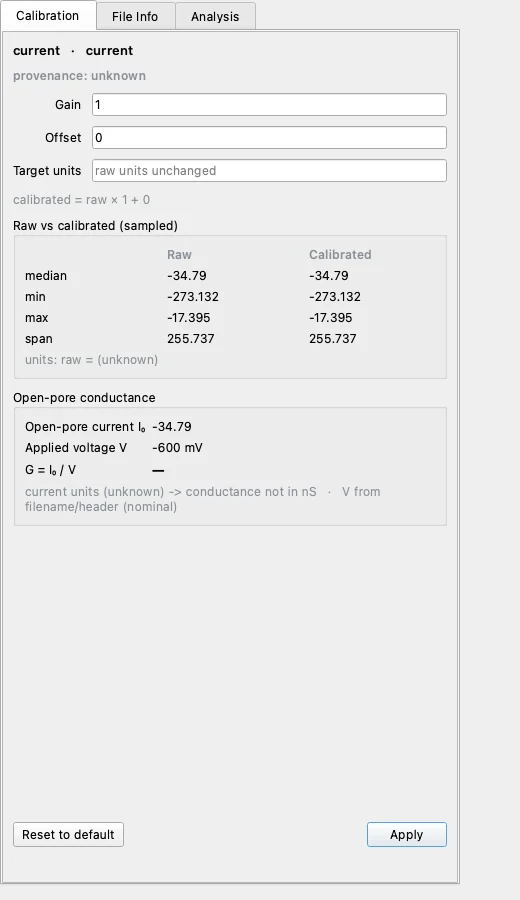

*The Inspector dock. Gain, Offset and Target units are text fields you type into — not drop-downs.*

A gain left at the default 1.0 does NOT mean "no calibration needed" — it means uncalibrated. Blockage depth, ECD, conductance and noise are then raw-ADC-scale numbers that look perfectly plausible and are not physical; the status-bar chip stays amber reading "⚠ Current gain uncalibrated — magnitudes not physical" until you set a real current gain.

Clicking a recording SWITCHES to it — it does not add it. The only ways to get two recordings on the same axes are ticking a channel of each, or right-click ▸ "Add to view (compare)".

Unticking a channel does not throw anything away: the layer keeps its colour and its Δt, and re-ticking brings it back exactly as it was.

Both Apply and Reset to default can DELETE the .npcal.json calibration file next to your raw data, and take any note stored in it with them — Apply does it the moment your typed values happen to equal the defaults, not only when you press Reset.

A calibration note cannot be carried by a .nanoscope project file. If a warning offers to erase one, copy the quoted text somewhere first — nothing else on the machine has it.

The Raw vs calibrated table is computed from about 20,000 strided samples, so its min and max are approximations, not the true extremes of the recording.

| Label | Type | What it does |
|---|---|---|
| File ManagerFile Manager | dock | The left column listing every open recording, its derived segments and its channels, grouped under headings for the voltage each recording was taken at.Drag its inner edge to resize; closing it (its ✕ or View ▸ Panels) gives the whole width back to the trace viewer. It never closes a file — closing the panel just hides the list. |
| OverlayFile Manager — toolbar | button | Groups comparable channels into one shared, x-linked pane, so ticked traces are drawn on top of each other.Tooltip: "Overlay: group comparable channels into one x-linked pane.\nStacked: one pane per channel." Overlay and Stacked are a mutually exclusive pair — one is always pressed in. It only changes how ticked channels are laid out; it does not tick or untick anything.Exactly: Both are CHECKABLE toggle buttons in an exclusive QButtonGroup — exactly one is always pressed in, so they behave as a radio pair rather than as two independent buttons. Shared tooltip: "Overlay: group comparable channels into one x-linked pane. / Stacked: one pane per channel." |
| StackedFile Manager — toolbar | button | Gives every drawn channel its own pane instead of sharing one.Exclusive with Overlay. Same tooltip as Overlay.Exactly: Both are CHECKABLE toggle buttons in an exclusive QButtonGroup — exactly one is always pressed in, so they behave as a radio pair rather than as two independent buttons. Shared tooltip: "Overlay: group comparable channels into one x-linked pane. / Stacked: one pane per channel." |
| SegmentFile Manager — toolbar | button | Creates a new derived recording from the current on-trace selection. Tooltip: "Create a new derived recording from the current on-trace selection.\nTurn on Measure (Analysis ▸ Measure event) and drag a region first. The segment is analysed independently of the parent."DISABLED until there is an active recording AND a live Measure region on the trace — turn on Analysis ▸ Measure event and drag a region to enable it. Twin of the File menu's "Create segment from selection…" (both do exactly the same thing). New segments appear in the tree marked with a ✂ prefix, in italic teal, with a tooltip naming the parent file and the sample range they were cut from. |
| CloseFile Manager — toolbar | button | Closes the recording currently selected in the tree. Tooltip: "Close the selected document".Does nothing if the selected row is a voltage group heading or nothing is selected. Twin of File ▸ Close document (Ctrl+W). If the recording has segments cut from it, closing it is a data-loss decision — a segment can only be saved while its parent is open — so the app raises its own warning before it goes through. |
| ChannelFile Manager — channel tree | checkbox | The tick box on every channel row means "this channel is drawn on the trace". Tooltip: "Tick to draw this channel on the trace.\nTicking channels from more than one recording draws them together — that is how you compare two runs.\nUntick to take the channel off the trace."This is the ONLY way to put two recordings on the same axes — clicking a recording switches to it rather than adding it. Ticking a channel of a recording that is not on screen draws it alongside, it does not switch to it. Unticking keeps the layer's colour and Δt alignment, so re-ticking restores exactly what was there. Ticking, unticking, recolouring and Δt edits all count as unsaved work and will make the app prompt you on quit.Exactly: "Channel" is the tree's first COLUMN HEADER (setHeaderLabels(["Channel", "Units", "Colour", "Δt (s)"])), not the label on a checkbox. The tick box sits on each channel row and its visible text is that channel's own name from the file. Its tooltip is the user-facing wording: "Tick to draw this channel on the trace. Ticking channels from more than one recording draws them together — that is how you |
| UnitsFile Manager — channel tree | table | Read-only column showing the channel's raw units as recorded in the file, or an em dash when the file does not declare any.A channel with no usable signal is greyed out and its units read " · dead"; hover the channel name for the reason (e.g. "flagged dead (no signal)").Exactly: Label "Target units" is right, KIND is wrong: free-text field (QLineEdit) with placeholder "raw units unchanged", not a combo — you type the unit string. Enter commits; greyed out until a channel is selected. |
| ColourFile Manager — channel tree | button | A small colour chip on each channel row; click it to pick that trace's colour. Tooltip: "Click to change this layer's colour".The chip is HIDDEN entirely until the channel is ticked — an untick makes it disappear rather than grey out. Opens a colour picker titled "Layer colour". This is how you tell overlaid comparison traces apart. |
| Δt (s)File Manager — channel tree | spinbox | Slides this trace left or right along the time axis so it lines up with the others. Tooltip: "Shift this layer along the time axis to align it with others".Six decimal places, range −1,000,000 to 1,000,000 s, arrow step 0.001 s, suffix " s". Value is only committed when you press Enter or leave the box, not on every keystroke. DISABLED until the channel is ticked. Also permanently disabled for files with no declared sample rate, where the tooltip changes to "This file declares no sample rate; alignment is unavailable." |
| Unknown voltageFile Manager — channel tree | table | The bold heading recordings are filed under when the app could not work out what bias they were taken at. Recordings whose voltage is known sit under headings like "-600 mV", sorted high to low, with this group last.Not clickable — it is a grouping row only. A recording whose voltage was merely GUESSED FROM ITS FILENAME is drawn in italic and its tooltip says "voltage inferred from filename (unreliable)"; do not trust that grouping for analysis.Exactly: "Unknown voltage" is a grouping ROW inside the File Manager tree (the last group, for recordings whose voltage could not be determined), not a table. |
| Click a recording to show it · tick channels to draw them togetherFile Manager — channel tree | label | The dimmed one-line hint under the tree. Its full tooltip spells the rule out: "Opening or clicking a recording displays it on its own; the others stay open.\nTo compare recordings, tick the channel of each one you want drawn — or right-click a recording and choose “Add to view”.\nOverlay/Stacked then decide whether the ticked channels share a pane or get one each."The line is shortened with an ellipsis when the dock is narrow — hover it to read the whole thing. |
| Show only this recordingFile Manager — right-click a recording | menu action | Draws this recording on its own; the others stay open and listed. Tooltip: "Draw this recording on its own; the others stay open."Greyed out when this recording is already the only thing on the trace. It does not close anything — the recordings you switch away from keep their colours, their alignment and their results. |
| Add to view (compare)File Manager — right-click a recording | menu action | Draws every live channel of this recording ALONGSIDE what is already on the trace. Tooltip: "Draw this recording ALONGSIDE what is already on the trace."Greyed out when this recording is already the only thing shown. This is the coarse version of ticking channels one at a time; use it when you just want "show me both runs". |
| Close recordingFile Manager — right-click a recording | menu action | Closes the recording you right-clicked.Same handler as the Close button and File ▸ Close document (Ctrl+W), including the warning about segments cut from it. |
| CalibrationInspector | tab | Edits the gain, offset and units for whichever channel is selected in the File Manager, previewing the effect live before you commit it.First tab of the Inspector dock. Clicking the calibration chip in the status bar raises the Inspector and jumps straight here. The panel follows the File Manager selection — select a channel row to calibrate that channel, or a recording row to land on its first live current channel. |
| No channel selectedInspector ▸ Calibration | label | The heading at the top of the panel when nothing is selected. With a channel selected it reads " ·  · ".When it says "No channel selected" every field and button below it is disabled. It also reverts to this the moment the recording you were calibrating is closed. |
| provenance: Inspector ▸ Calibration | label | A coloured badge saying where this calibration came from — green "measured", blue "file metadata", amber "filename", grey "unknown" — followed by any advisory note stored with it.The note is worth reading: for ABF voltage channels it explains whether the app applied the 10× correction ("ABF voltage is stored 10x too large; verify against your protocol") or decided the channel already reads the real bias. Pressing Apply on your own edit sets provenance to "unknown" but keeps the note.Exactly: Incomplete: the badge is `provenance: {value}` followed by ` · {note}` whenever the calibration carries a note (e.g. the 10× headstage explanation), and the text is colour-coded by provenance — green for measured, blue for file metadata, orange for filename-derived (unreliable), grey for unknown. |
| GainInspector ▸ Calibration | combo | The number every sample is multiplied by. Type the amplifier's real conversion factor here to turn raw file values into physical current or voltage.Text box, accepts scientific notation (e.g. 2.5e3). Press Enter to Apply directly. Everything below updates as you type, before you commit. DISABLED until a real recording's channel is selected. Zero is refused, and so is anything non-finite — the panel says why instead of applying it.Exactly: Label "Gain" is right, KIND is wrong: it is a free-text field (QLineEdit with a scientific-notation validator), not a drop-down — there is no list of gains to pick from. Also undocumented: pressing Enter in it commits the calibration (returnPressed → _apply), and it is disabled until a channel of a real recording is selected in the File Manager (a segment/non-trace document leaves it greyed). |
| OffsetInspector ▸ Calibration | combo | A constant added to every sample after the gain, for removing a baseline shift in the amplifier.Same rules as Gain: scientific notation allowed, Enter applies, live preview, disabled with no selection.Exactly: Label "Offset" is right, KIND is wrong: free-text field (QLineEdit + validator), not a combo. Enter commits, and it is greyed out until a channel of a trace recording is selected. |
| Target unitsInspector ▸ Calibration | combo | What to call the calibrated values — e.g. type pA or nA so axes and readouts are labelled correctly. Placeholder: "raw units unchanged".Leaving it empty keeps the file's own units. This label is what decides whether the conductance readout can give you nanosiemens at all: unrecognised current units make the nS figure unavailable.Exactly: Label "Target units" is right, KIND is wrong: free-text field (QLineEdit) with placeholder "raw units unchanged", not a combo — you type the unit string. Enter commits; greyed out until a channel is selected. |
| Treat this channel asInspector ▸ Calibration | combo | Which pane this channel gets and how it is grouped with the others. (Verbatim tooltip: "Which pane this channel gets and how it is grouped with the others. Leave it alone unless the file declared the channel wrongly or not at all.") Entries: "as the file declares" (the default) plus the override kinds.This is the OTHER half of the same correction the units box makes: answering only the units question relabels the y axis and leaves the pane ordered as whatever the file declared, so a channel corrected to pA still sorted below the voltage and two recordings of one experiment opened with their panes in opposite orders. It changes NO number — it is not part of the calibration fingerprint and reaches no sample, so there is no live preview of it; it decides which pane the channel lands in and which overlay group it shares, and only once Apply commits it. It is also the only way to separate a TDMS whose channels are BOTH raw Volts, which overlay as one (kind, units) group until something says which one is the current. Saved with the project (format v8); a project written by an older build carries no override, which reads as "no override, the header stands" and leaves the sidecar's own value alone. |
| calibrated = raw ×  + Inspector ▸ Calibration | label | The live formula line, restating exactly what will be done to your data. When the typed values cannot be used it is replaced by the reason.The three refusal messages you may see here: "gain/offset: enter a number"; "gain/offset: enter a finite number — an infinite one makes every sample infinite"; and "gain 0 would make every sample exactly the offset — that deletes the recording rather than scaling it. Use a small gain, not zero." While any of these show, the Calibrated column stays as dashes and Apply does nothing. |
| Raw vs calibrated (sampled)Inspector ▸ Calibration | table | A two-column table ("Raw" and "Calibrated") showing median, min, max and span of the selected channel, so you can see the effect of the gain before committing it. A line underneath reads "units: raw = … calibrated = …".SAMPLED, not exact: it strides the recording down to about 20,000 points, so the min/max are close to but not necessarily the true extremes of the file. The Calibrated column shows dashes whenever the typed gain/offset are unusable.Exactly: Title string is verbatim, but it is a QGroupBox holding a grid of read-only labels — nothing in it can be edited or sorted, and every number comes from a sample of at most 20,000 points, not the full recording. |
| Command-voltage checkInspector ▸ Calibration | table | Sanity-checks the voltage calibration: it shows "Measured median (raw)", "× gain", "= effective" and "Nominal (grouping)" so you can confirm the calibrated command voltage matches the bias you meant to apply.The whole box is HIDDEN for recordings with no voltage channel. "Nominal (grouping)" is the voltage the File Manager filed the recording under — if "= effective" and it disagree badly, either the voltage gain is wrong or the filename lied. When the voltage channel is the one selected, the row tracks the gain you are typing; otherwise it uses the voltage channel's committed gain.Exactly: The title string is verbatim, but it is a QGroupBox of read-only label rows, not a table — and, critically, the whole box is INVISIBLE unless the selected recording has a voltage channel. |
| Open-pore conductanceInspector ▸ Calibration | table | The physical reality check: "Open-pore current I₀", "Applied voltage V" and the headline "G = I₀ / V" in nanosiemens, recomputed live as you dial the current gain. Dial the gain until G lands in a physical range for your pore (a 22 nm pore in 1× PBS sits near ~100 nS).HIDDEN when the recording has no live current channel. It is shown whichever channel you have selected — the gain lives on the current channel but its effect is the point. The caption underneath tells you the unit scaling (e.g. "pA / mV -> nS") and whether V was measured on the command channel or taken from the filename/header; it reads "no applied voltage known for this recording" when neither is available. G shows a dash when the voltage is zero or the current units are not recognised.Exactly: Title string is verbatim, but it is a QGroupBox of read-only label rows, not a table, and the whole box is INVISIBLE unless the recording has a live (non-dead) current channel. |
| Reset to defaultInspector ▸ Calibration | button | Puts this channel back to the calibration the app worked out when the file was opened, discarding your edits.DESTRUCTIVE. If this leaves every channel of the recording at its default, it DELETES the .npcal.json file sitting next to your raw data — you get a warning titled "Reset calibration" reading "Reset will delete .npcal.json." with buttons "Reset and delete the file" and "Cancel" (Cancel is the default). If the file survives but a channel's note would be dropped from it, you instead get "Reset will erase N calibration note(s) from ", quoting each note in full — that note exists nowhere else and a project file cannot carry it back. Disabled until a channel is selected. |
| ApplyInspector ▸ Calibration | button | Commits the typed gain, offset and target units to the selected channel and immediately re-renders the affected traces — no reload.The panel's default button; pressing Enter in Gain, Offset or Target units does the same thing. Does nothing while the formula line is showing a refusal. Apply can be destructive too: if your typed values happen to equal the defaults it deletes the .npcal.json sidecar, and it raises the same warnings as Reset — worded with "Apply" so the prompt names the button you actually pressed. Disabled until a channel is selected.Exactly: Label is verbatim, but it is the dialog's DEFAULT button (setDefault(True)), so Enter anywhere in the panel triggers it. It is greyed out until a channel of a trace recording is selected, it does nothing at all while the typed gain/offset are invalid, and it can raise a destructive delete/erase confirmation when the typed values happen to equal the defaults. |
| Applied · saved to .npcal.jsonInspector ▸ Calibration | label | The status line at the very bottom, reporting what the last commit actually did to the calibration file next to your data.The wordings you may see: "Applied · saved to "; "Applied ·  deleted (all channels are back at default)"; plain "Applied" (nothing needed writing); "Nothing changed." (you cancelled a warning); and the failure case — "Applied to this session only · could NOT update  — . The calibration is NOT stored next to your data and will be gone when you reopen the recording." Read that last one: your work is live but unsaved. |
|  mV (e.g. "120 mV")File Manager tree — grouping rows | list | Bold top-level heading row in the file tree. Recordings are filed under the heading for their nominal voltage, highest voltage first, with "Unknown voltage" always last (file_dock.py `_group_label`: `f"{gv:.0f} mV"`). The colleague listed only "Unknown voltage"; the numeric headings are the normal case. Groups start expanded, cannot be clicked or selected (flags are ItemIsEnabled only), and right-clicking one shows no menu. |
| ✂ File Manager tree — row decorations | list | A recording row shown in italic teal with a scissors prefix is a segment you cut out of another recording with the Segment button, not a file on disk. Its tooltip traces it back: "segment of ", the sample range, and t₀. It is analysed independently of its parent. |
| (partial: samples 0–5,000,000)File Manager tree — row decorations | list | Suffix appended to a recording's name when only part of the file was loaded, so the numbers you see come from that sample window only, not the whole file. |
|  · deadFile Manager tree — row decorations | list | A channel flagged as carrying no signal is greyed out and its Units cell reads "· dead" after the units. Its tooltip gives the reason, or "flagged dead (no signal)" when none was recorded. You can still tick it, but there is nothing to see. |
| Layer colourFile Manager tree — Colour column | button | Clicking the small colour chip in the Colour column opens a colour picker titled "Layer colour" so you can tell overlaid traces apart; tooltip is "Click to change this layer's colour". Caution: the chip is completely INVISIBLE until the channel's tick box is on — an unticked channel shows an empty Colour cell, not a greyed chip. Picking a colour counts as an edit and arms the unsaved-work prompt on quit. |
| RawRaw vs calibrated (sampled) | label | Column heading for the left number column: the statistics of the untouched data as it sits in the file.Exactly: Title string is verbatim, but it is a QGroupBox holding a grid of read-only labels — nothing in it can be edited or sorted, and every number comes from a sample of at most 20,000 points, not the full recording. |
| CalibratedRaw vs calibrated (sampled) | label | Column heading for the right number column: the same statistics after the gain and offset you have typed. It updates as you type, before you press Apply. Shows "—" whenever the typed gain/offset are not usable.Exactly: Title string is verbatim, but it is a QGroupBox holding a grid of read-only labels — nothing in it can be edited or sorted, and every number comes from a sample of at most 20,000 points, not the full recording. |
| medianRaw vs calibrated (sampled) | label | Row of the preview grid: the middle value of the sampled data, raw and calibrated. Everything in this box is computed from a strided sample of at most 20,000 points, not the whole recording — hence "(sampled)" in the title. |
| minRaw vs calibrated (sampled) | label | Row of the preview grid: the smallest sampled value, raw and calibrated. |
| maxRaw vs calibrated (sampled) | label | Row of the preview grid: the largest sampled value, raw and calibrated. |
| spanRaw vs calibrated (sampled) | label | Row of the preview grid: max minus min, raw and calibrated — the quickest check that your gain has put the trace on a sensible scale. |
| units: raw =  calibrated = Raw vs calibrated (sampled) | label | Footer line under the preview grid restating which units the two columns are in. Reads "raw = (unknown)" when the file declares no units; the calibrated half is dropped when neither the file nor Target units names a unit. |
| Measured median (raw)Command-voltage check | label | The median of the recording's own voltage channel, straight out of the file. The whole Command-voltage check box is HIDDEN unless the recording has a voltage channel. |
| × gainCommand-voltage check | label | The gain being applied to that voltage channel. While you have the voltage channel itself selected it tracks the gain you are typing; when you are on any other channel it shows the voltage channel's already-applied gain. |
| = effectiveCommand-voltage check | label | Measured median × gain, in mV — the command voltage your calibration actually implies. |
| Nominal (grouping)Command-voltage check | label | The voltage this recording was filed under in the File Manager tree, in mV, for comparison with "= effective". If the two disagree, the gain is wrong (or the filename lied). Shows "—" when no nominal voltage is known. |
| Open-pore current I₀Open-pore conductance | label | Median of the recording's first live current channel after calibration, in its calibrated units. The whole Open-pore conductance box is HIDDEN unless the recording has a live current channel — but it stays visible while you are on any channel of that recording, including the voltage one. |
| Applied voltage VOpen-pore conductance | label | The command voltage used for the conductance, in mV: the measured voltage channel median × its gain, or the nominal (filename/header) voltage when the recording has no voltage channel. |
| G = I₀ / VOpen-pore conductance | label | The headline open-pore conductance in nS, in bold. It recomputes live as you type a gain, so you can dial the current gain until the number is physically plausible. Shows "—" when the units or the voltage are unknown. |
|  nS> · V measured on the command channelOpen-pore conductance | label | Caption under the conductance saying how the units worked out and where the voltage came from. Variants you will see: "… · V from filename/header (nominal)" when there is no voltage channel; "no applied voltage known for this recording"; and "current units (unknown) -> conductance not in nS" when the file's units can't be converted, which is why G shows a dash. |
|  ·  · Calibration panel header | label | The bold heading at the top of the Calibration tab once a channel is selected in the File Manager — it names which channel you are about to change. It reads "No channel selected" only before you pick one, and reverts to that if you close the recording you were editing. |
| raw units unchangedCalibration panel form | label | Greyed placeholder inside the Target units box. Leaving the box empty keeps the file's own units; type e.g. pA or nA to relabel the calibrated trace. |
| gain 0 would make every sample exactly the offset — that deletes the recording rather than scaling it. Use a small gain, not zero.Calibration panel — validation messages | label | Replaces the "calibrated = raw × … + …" line when what you typed cannot be applied, and Apply silently does nothing until it is fixed. The other two wordings are "gain/offset: enter a number" (blank or non-numeric) and "gain/offset: enter a finite number — an infinite one makes every sample infinite" (e.g. 1e999). |
| Apply and delete the fileDestructive confirmation — sidecar removal | button | Appears in a warning dialog headed "Apply calibration" (or "Reset calibration" if you pressed Reset to default) reading "Apply will delete .npcal.json." This fires whenever the commit would leave EVERY channel back at its default — Reset to default always, and Apply too if you happen to type the default values. It removes the saved calibration file sitting next to your raw data, and any note stored in it is gone for good. The button reads "Reset and delete the file" when Reset raised it. |
| Apply and erase the notesDestructive confirmation — note loss | button | Appears in a warning dialog reading "Apply will erase N calibration notes from .npcal.json." when the commit drops a channel's note out of a sidecar that otherwise survives. The dialog prints each note in full, because nothing else on your machine has a copy — copy anything you need before confirming. Singular form is "Apply and erase the note", and "Reset …" when Reset raised it. |
| CancelDestructive confirmation dialogs | button | Backs out of either warning dialog; it is the pre-selected default button, so pressing Enter is safe. The status line then reads "Nothing changed." and nothing is written or deleted. |
| Nothing changed.Calibration panel — status line | label | Status line under the buttons after you cancel a destructive confirmation. |
| Applied · .npcal.json deleted (all channels are back at default)Calibration panel — status line | label | Status line confirming the calibration file next to your data was removed because every channel is now at its default. |
| Applied to this session only · could NOT update .npcal.json — . The calibration is NOT stored next to your data and will be gone when you reopen the recording.Calibration panel — status line | label | Status line when the save failed (disk full, read-only file, disconnected volume, permissions…). The reason is the operating system's own message. Your calibration works for now but is not persisted — fix the cause and press Apply again before reopening the file. |
| AppliedCalibration panel — status line | label | Status line when the calibration was applied but no sidecar file was involved at all. |

### Preprocess & Detection — 128 controls

Inspector dock (right-hand side) ▸ Analysis tab. The panel's own tab strip then offers Preprocess | Detection | ML detector | Manual measurement. The Detect button is also reachable as Analysis ▸ Run detection (Ctrl+D); the Inspector dock itself can be shown/hidden from the View ▸ panels menu.

This is where you turn a raw current trace into a table of translocation events. The Preprocess tab separates **Signal chain** from **Open-pore baseline** so neither long form buries the other. Signal chain holds eight conditioning stages, the actual execution-order summary, selected and combined response views, and the orange candidate-localization preview. With high-pass enabled, new Schmitt/CUSUM runs measure event-table amplitudes on a companion branch with high-pass omitted; boundary-dependent values still come from the orange branch. The Detection tab holds thresholds, dwell, merge and polarity controls. The ML detector tab is a separate pipeline and ignores this chain.


*The Detection tab. The polarity line is measured, not assumed — here, on the −700 mV recording at that file's then-proposed 0.1 s / 30 ms baseline, it reports enhancement (down): 1969 down / 0 up (confidence 1.00, measured). The vote is taken against the baseline in force: the same recording reads 2047 down / 1 up at the app default and 2184 down / 2 up at the 1 s / 300 ms window now proposed for it.*

Selecting a different recording or channel RE-SEEDS the whole detection form from that target's stored run — anything you had dialled in and not yet run is replaced without a prompt (clicking the same channel again is treated as navigation and changes nothing).

k_out is clamped live to stay strictly below k_in, so lowering k_in can silently move k_out down for you (to k_in − 0.5); when restoring settings by hand, set k_in first.

A filter stage stays ACTIVE when its page is hidden — the combo only changes what you are looking at. Check the "Active: …" line or the ● markers before running, not the page on screen.

The number in the low-pass cutoff box is not the real corner: zero-phase filtering squares the response, so the applied curve is already about -6 dB there. Read the note under the response plot for the true -3 dB frequency.

A running mean or Savitzky-Golay window can band-limit the trace far harder than the low-pass does, and the rise-time readout does not know about them — compare their -3 dB figures in the response note with the low-pass cutoff.

The High-pass stage distorts square events (drooped tops, biphasic shapes, shallow depths). For drift, use the Baseline drift stage instead.

| Label | Type | What it does |
|---|---|---|
| PreprocessDetectionPanel tab strip | tab | Shows the signal-conditioning chain: the open-pore baseline block at the top, then the Signal filters group with all seven filter stages, the frequency-response plot and the processed-trace preview toggle.This is the tab that is showing when the app opens. Every page of every tab stays alive, so a filter you enabled here is still applied when you are looking at the Detection tab. |
| DetectionDetectionPanel tab strip | tab | Shows the Schmitt-trigger threshold and dwell parameters, the polarity readout/override, and the Detect / Sweep threshold… / Null control… / Recovery map… buttons. |
| ML detectorDetectionPanel tab strip | tab | A separate detector: a runtime-loaded Keras model with its own preprocessing and decode settings.Out of scope for this section. Important interaction: 'The ML detector runs THIS pipeline, not the Preprocess tab' — nothing you set on Preprocess or Detection affects an ML run. |
| Manual measurementDetectionPanel tab strip | tab | Hosts the cursor-based manual measurement tool (built elsewhere and installed into this page).A bare DetectionPanel has this tab blank; in the running app the measurement tool is installed into it. Raising the tab never turns the cursors on or off. |
| Low-passPreprocess ▸ Signal filters | combo | Picks which filter stage's controls are shown below. Tooltip: "Pick a filter stage to edit. Enabled stages are marked ● here and listed in the summary below; every stage stays active whether or not its page is the one currently shown."The eight items, in order, are exactly: Low-pass, High-pass, Notch, Median, Baseline drift, Running mean, Savitzky-Golay, Normalize. An enabled stage's item is rewritten with a "● " prefix (e.g. "● Notch"). Switching pages does NOT switch stages off — this control only changes what you are looking at. |
| Active: nonePreprocess ▸ Signal filters | label | Read-only summary of which filter stages are currently switched on, e.g. "Active: Low-pass, Notch". Reads "Active: none" when every stage is off.This is the only place the whole chain is visible at once; the stage pages show one stage at a time. |
| enablePreprocess ▸ Signal filters ▸ Low-pass | checkbox | Turns the low-pass filter on. With it off the detector sees the full-bandwidth trace and the rise-time line reads "rise time: — (filter disabled; full bandwidth)".Unlike the other stages, the low-pass is applied inside the detector itself, so its cutoff/order/type are stamped into the run's provenance and are what decides which events get marked filter_limited. Unchecking it sends filter_cutoff_hz = None (the detector's 'off' sentinel). |
| typePreprocess ▸ Signal filters ▸ Low-pass | combo | Chooses the low-pass design: Bessel (default), Butterworth or Gaussian. Tooltip: "Bessel (the electrophysiology convention) has a maximally flat group delay: it preserves pulse shape and does not ring on a step. Butterworth rolls off harder for the same order but overshoots a square blockade. Gaussian has no overshoot at all and no order (it is a symmetric smoothing kernel)."Items in order: Bessel, Butterworth, Gaussian. Also from the tooltip: "All three run zero-phase (forward+backward), so edges do not shift — but the magnitude is SQUARED: the response is -6 dB at the nominal cutoff, not -3 dB." Choosing Gaussian greys out the order spin. |
| orderPreprocess ▸ Signal filters ▸ Low-pass | spinbox | How many poles the low-pass has. Tooltip: "Number of poles. Higher is a steeper roll-off and a longer rise time — and zero-phase filtering DOUBLES the effective order on top of this. Gaussian ignores it. 8 is the hardware convention for an Axopatch-style Bessel." Raising it cuts more high-frequency noise but blurs the fastest events further; lowering it keeps edges sharper and noisier.Range 1–10, default 8. DISABLED whenever type is Gaussian, and its tooltip then reads "Gaussian is a symmetric kernel and has no order." Changing it also re-measures the rise-time readout. |
| cutoffPreprocess ▸ Signal filters ▸ Low-pass | spinbox | The low-pass corner frequency in Hz. Tooltip: "Nominal -3 dB design cutoff. Once a channel is selected the maximum is clamped to just below that recording's Nyquist frequency, so a cutoff the kernel would reject cannot be dialled in." Lowering it removes more noise (shallow events become detectable) but lengthens the rise time, so short events are attenuated and their dwells biased long; raising it keeps fast events honest but lets more noise through.Range 1.0 Hz up to just under Nyquist (5,000,000.0 Hz until a channel is selected), step 1000.0, default 10,000.0 Hz. Selecting a slower recording can silently pull an out-of-range value down. Above fs/2.5 the rise-time line adds: "⚠ above fs/2.5 …: the transition band is truncated by Nyquist, so this filter barely attenuates anything and the order is meaningless." |
| rise time: — (select a channel)Preprocess ▸ Signal filters ▸ Low-pass | label | Bold live readout of the filter's real time resolution, e.g. "rise time: 34 µs (8-pole Bessel, zero-phase) → dwells below ~68 µs are filter-limited (depth attenuated, dwell biased long)." Use it to decide whether your shortest events survive the filter you chose.Reads "— (sample rate unknown)" on a recording with no time base, "— (filter disabled; full bandwidth)" when the low-pass is off, and "— (cutoff X Hz is too low to measure live at Y Hz; detection still measures it)" when the live probe would be too expensive (over 2,000,000 samples). It follows type and order, not just the cutoff. |
| enablePreprocess ▸ Signal filters ▸ High-pass | checkbox | Enables high-pass for classical candidate localization only. The orange preview and candidate-response plot include it; new Schmitt/CUSUM event-table amplitudes are measured on the companion chain with high-pass omitted. Start/end, dwell, rise/fall and ECD limits still inherit the filtered boundaries. Manual measurement of Processed signal follows the orange branch. |
| typePreprocess ▸ Signal filters ▸ High-pass | combo | Chooses the high-pass design: Butterworth (default) or Bessel. Tooltip: "Butterworth has a maximally flat pass-band above the cutoff. Bessel trades some roll-off sharpness for a flatter group delay. (Gaussian is a low-pass kernel and has no high-pass counterpart.)" Items in order: Butterworth, Bessel. |
| orderPreprocess ▸ Signal filters ▸ High-pass | spinbox | Poles in the high-pass. Tooltip: "Number of poles. A steeper high-pass droops and rings a square blockade harder, not less — keep it low and keep the cutoff far below the event band."Range 1–10, default 4. |
| cutoffPreprocess ▸ Signal filters ▸ High-pass | spinbox | Where drift removal starts, in Hz. Raising it flattens drift more aggressively but eats further into real event shape; lowering it is safer for event fidelity and removes less drift.Range 0.1 Hz up to just under Nyquist (5,000,000.00 Hz until a channel is selected), step 10.0, default 100.00 Hz. Carries the same distortion warning as the enable box. |
| enable (mains hum + harmonics, zero-phase)Preprocess ▸ Signal filters ▸ Notch | checkbox | Removes mains hum at the line frequency and its harmonics without shifting edges in time.Nearly free for sub-millisecond events; it distorts slow (~10 ms) events whose own frequency band overlaps the line. |
| frequencyPreprocess ▸ Signal filters ▸ Notch | spinbox | The mains line frequency to remove. Tooltip: "Mains line frequency: 60 Hz in the Americas, 50 Hz in most of the world."Range 1.0–100,000.0 Hz (capped just under Nyquist once a channel is selected), step 10.0, default 60.0 Hz. |
| harmonicsPreprocess ▸ Signal filters ▸ Notch | spinbox | Tooltip: "How many multiples of the line to notch (60/120/180 …). Harmonics at or above Nyquist are skipped automatically." Raise it when hum is visible at 120/180 Hz as well as at the fundamental.Range 1–20, default 3. The note under the response plot lists exactly which lines will be notched and how deep the deepest one is. |
| QPreprocess ▸ Signal filters ▸ Notch | spinbox | Tooltip: "Quality factor: higher Q is a narrower notch (Q=30 at 60 Hz is ~2 Hz wide)." Raise it to take out less of the surrounding signal; lower it to catch a wandering line frequency at the cost of a wider bite.Range 1.0–500.0, step 5.0, default 30.0. The response note warns that a narrow notch "rings for roughly the inverse of that at each end of the trace". |
| enable (sliding median, despikes edges intact)Preprocess ▸ Signal filters ▸ Median | checkbox | Deletes single-sample spikes and glitches while leaving square event edges intact. Applied early in the chain, so spikes are gone before any smoothing can spread them.A median has no frequency response, so the response plot goes blank and says so: "A sliding median is a NON-LINEAR rank filter: it has no transfer function, so there is no \|H(f)\| to draw." |
| windowPreprocess ▸ Signal filters ▸ Median | spinbox | Tooltip: "Median window in seconds. Rejects spikes up to about half the window wide, so keep it a few samples — MUCH shorter than the shortest real event, or the median eats the events along with the spikes. Clamped up to an odd sample count."Range 0.00001–1.00000 s, step 0.00005, default 0.00010 s. |
| remove baseline wander (flatten slow drift)Preprocess ▸ Signal filters ▸ Baseline drift | checkbox | Fits and subtracts a slow open-pore envelope (electrode, temperature or clogging drift) before detection, while preserving event depths. This is the recommended alternative to a high-pass for drifting traces.The response plot is blank for this stage: "Baseline drift removal is an ESTIMATOR (it fits and subtracts a slow open-pore envelope), not a linear filter, so it has no single \|H(f)\|." |
| methodPreprocess ▸ Signal filters ▸ Baseline drift | combo | Chooses how the drifting open-pore level is estimated: block median, percentile or ASLS.Items in order: "block median", "percentile", "ASLS". The parameter box directly below changes with this choice — block median shows only a note, percentile shows one spin, ASLS shows four. (A no-op 'constant' method exists in the kernel but is deliberately not offered.) |
| windowPreprocess ▸ Signal filters ▸ Baseline drift | spinbox | Tooltip: "Smoothing window for the open-pore estimate. Must be MUCH longer than the longest event, or the baseline dives into events and subtracts them (depths come out shallow, short events vanish)." Raise it for safety on long events; lower it only to follow faster drift.Range 0.001–60.000 s, step 0.1, default 0.500 s. Changing it also changes what ASLS's smoothness means (see below). |
| Block median has no shape parameters — the window above is all it takes.Preprocess ▸ Signal filters ▸ Baseline drift (block median) | label | Explains why no extra controls appear when the block-median estimator is selected. |
| percentilePreprocess ▸ Signal filters ▸ Baseline drift (percentile) | spinbox | Tooltip: "How far toward the OPEN-PORE side to take the level, already sign-corrected for polarity — 80 means 'the level 80% of the way toward open pore', not a raw numpy percentile. Raise it when events are dense enough to drag a median (the case this method exists for); lower it when the trace is mostly open pore."Range 0.1–99.9, step 5.0, default 80.0. Only visible when method = percentile. |
| smoothness (lam)Preprocess ▸ Signal filters ▸ Baseline drift (ASLS) | spinbox | Tooltip: "Smoothness (Eilers-Boelens lambda). Higher is a stiffer, flatter baseline. It is measured in BLOCK units, so its meaning rescales with the window and the knot spacing below — changing the window without revisiting this changes what ASLS does."Range 1–1,000,000,000, step 10,000, default 60,000. Only visible when method = ASLS. |
| asymmetry (p)Preprocess ▸ Signal filters ▸ Baseline drift (ASLS) | spinbox | Tooltip: "Asymmetry. Small means heavily one-sided, which is what lets the fit ignore the events and follow the open pore. Raising it toward 0.5 makes the fit symmetric — it will start tracking events."Range 0.00001–0.50000, step 0.001, default 0.00100. Only visible when method = ASLS. |
| iterationsPreprocess ▸ Signal filters ▸ Baseline drift (ASLS) | spinbox | Tooltip: "Reweighting iterations. More costs time and converges the asymmetric fit further onto the open-pore side."Range 1–100, default 10. Only visible when method = ASLS. |
| knot spacingPreprocess ▸ Signal filters ▸ Baseline drift (ASLS) | spinbox | Tooltip: "Knot spacing as a fraction of the window. Finer than 1 so some knots fall between dense events; the smoothness comes from lambda, not from this."Range 0.001–1.000, step 0.05, default 0.100. Only visible when method = ASLS. |
| enable (centred moving average, zero-phase)Preprocess ▸ Signal filters ▸ Running mean | checkbox | Turns on a plain centred box average — fast, unbiased noise reduction that does not shift features in time, but rounds peaks and smears steps.Applied on the already-flattened trace, just before the Savitzky-Golay stage. |
| windowPreprocess ▸ Signal filters ▸ Running mean | spinbox | Tooltip: "Averaging window in seconds. Suppresses noise by about sqrt(window·fs), but a box average rounds peaks and smears steps — keep it SHORTER than the shortest event you care about. Centred, so it does not shift features in time."Range 0.00001–1.00000 s, step 0.0001, default 0.00050 s. If the window works out to a single sample the note under the plot says the stage "is the IDENTITY — it is enabled but changes nothing. Widen the window." |
| enable (peak-preserving polynomial smooth)Preprocess ▸ Signal filters ▸ Savitzky-Golay | checkbox | Turns on polynomial-in-a-window smoothing, which suppresses noise while preserving peak height and edges far better than a moving average. It is applied last in the chain.The response note warns when it peaks above the pass band: "a Savitzky-Golay overshoots the plateau of a square blockade and leaves an opposite-sign lobe flanking each edge." |
| windowPreprocess ▸ Signal filters ▸ Savitzky-Golay | spinbox | Tooltip: "Smoothing window in seconds. Keep it SHORTER than the shortest event you care about, or the smoother rounds the event off along with the noise. It is clamped up to an odd sample count with more points than the polynomial order."Range 0.0001–1.0000 s, step 0.0005, default 0.0010 s. |
| poly orderPreprocess ▸ Signal filters ▸ Savitzky-Golay | spinbox | Tooltip: "Order of the polynomial fitted in each window. 2–3 is typical; a higher order follows sharper curvature but smooths less."Range 2–6, default 3. |
| enable (rescale the whole trace — NOT pA)Preprocess ▸ Signal filters ▸ Normalize | checkbox | Converts current samples to a dimensionless scale. Current-derived amplitudes, baselines, thresholds and pA/pA·s export fields retain legacy physical-unit labels but no longer carry physical units; centered normalization invalidates fractional blockade (dI/I0). Model-input clipping can also move event boundaries or counts. Index, time, source, review and status fields retain their ordinary meanings. |
| modePreprocess ▸ Signal filters ▸ Normalize | combo | Four modes: z-score, robust z, min–max, and clipped model input. The first three are data-dependent affine transforms; model input uses a twice-trimmed median/MAD, clips at the configured sigma bound and maps to [−1,+1]. |
| frequency / \|H\| response plotPreprocess ▸ Signal filters | label | Draws the magnitude response of the stage currently selected in the combo, at the exact values in the boxes above it, with a dashed orange line at the nominal cutoff and a dotted grey line at -3 dB. It shows the response AS APPLIED, so the zero-phase squaring is visible rather than implied.Blank with an explanation for Median and Baseline drift (neither has a transfer function) and until a channel with a known sample rate is selected ("select a channel with a known sample rate to see its frequency response"). |
| response note (line under the plot)Preprocess ▸ Signal filters | label | One sentence saying what the selected filter really does, e.g. "At the nominal 10000 Hz the applied response is -6.0 dB — zero-phase, so \|H\| is SQUARED. The true -3 dB corner is 7800 Hz (0.78× the number in the box)." For the window smoothers it gives the width in samples and warns that whichever of the smoother and the low-pass has the LOWER -3 dB point sets the real bandwidth — and that the rise-time readout only knows about the low-pass. |
| show processed trace on the plotPreprocess ▸ Signal filters | checkbox | Overlays the orange candidate-localization signal — every enabled stage, then low-pass. With high-pass on, classical detector event-table amplitudes use the companion no-high-pass branch, while manual measurement of Processed signal follows this orange branch. |
| processed-trace preview unavailable: …Preprocess ▸ Signal filters | label | Orange warning that appears when the preview could not be computed, carrying the kernel's own reason (an over-Nyquist cutoff, a detrend window longer than the trace, a segment too short for the filter's padding).Without it the preview curve would simply vanish with the box still ticked. |
| k_in (enter)Detection ▸ Detection | spinbox | How far the current must depart from the open-pore baseline before an event is declared to start, in multiples of the trace's own noise RMS. Raise it to keep only deep, unambiguous events (fewer false positives, shallow events lost); lower it to catch shallower events at the cost of noise being counted as events.Range 0.50–50.00, step 0.5, default 5.00. The Sweep threshold… dialog writes its recommended value straight into this box. Raising it drags k_out's ceiling up with it; lowering it can clamp k_out down (see below). |
| k_out (exit)Detection ▸ Detection | spinbox | How far back toward the baseline the current must return before the event is declared over, again in noise-RMS units. The gap between k_in and k_out is what stops noise at the crossing from shattering one event into many. Raise it (toward k_in) for tighter, shorter event boundaries; lower it to keep slow tails and recovery inside the measured dwell.Range 0.10–49.50, step 0.5, default 2.00. It is clamped LIVE to stay strictly below k_in: its maximum becomes k_in − 0.01, and if it ever reaches k_in it is knocked down to k_in − 0.5. So lowering k_in can move k_out without you touching it. |
| min dwellDetection ▸ Detection | spinbox | Events shorter than this are dropped outright as sub-resolution. Raise it to suppress noise spikes and filter-limited blips; lower it to keep the fastest translocations — along with more false positives.Range 0.0000000–1.0000000 s, step 0.00001, default 0.0000200 s (20 µs). Compare it with the rise-time readout on the Preprocess tab: anything below about twice the rise time is filter-limited anyway. |
| max dwellDetection ▸ Detection | spinbox | Tooltip: "Events longer than this are KEPT but marked rejected (a clog is real signal you must see, not something to disappear). It also truncates the dwell sample on the right: the fits read this limit from provenance and condition the likelihood on it, because a left-truncation-only fit of a right-cut sample biases tau SHORT (-24% when the limit sits at 2.5 tau)." Lower it to flag clogs and stuck events; leave it at 0 to impose no upper limit.Range 0.000000–100.000000 s, step 0.001, default 0.000000 s, and the suffix says it: " s (0 = off)". Must exceed min dwell or the run is rejected. Events over the limit stay in the table with flag 'dwell>max_dwell_s' and accepted = false. |
| merge gapDetection ▸ Detection | spinbox | Two events separated by less than this gap are joined into one, transitively along a chain — the same rule and the same unit as the Merge panel's Window. Raise it to stitch a flickering or multi-level blockade back into a single translocation; leave it at 0 to count every excursion separately.Range 0.0000–1000.0000 ms, step 0.01, default 0.0000 ms, suffix " ms (0 = off)". Stored in provenance in SECONDS, so a project written before this field changed unit still reads back correctly (a stored 0.015 s shows as 15 ms). This is the ONE merge control where 0 means off — merging is an optional step inside a detection run, unlike the Merge panel's button, whose window floors at 0.01 ms. A run whose merged span would be mostly open pore is REFUSED rather than merged here too. |
| range: whole recordingDetection ▸ Detection | readout | A read-only row stating the span the Schmitt detector will run over, and it always reads "whole recording". Tooltip, in substance: the Schmitt detector always runs over the WHOLE recording and the detection's provenance records that; it is fast enough that there is nothing to save by running it over less (the ML tab offers a range because inference is ~0.24x realtime), and if you want to detect over an excerpt you cut a Segment, which gives the excerpt its own document, its own baseline probe and its own fingerprint.The Detection tab has no Visible / Whole-recording control, unlike the ML tab. This row is why that is no longer silent — only unconfigurable. |
| measuredDetection ▸ Polarity | label | Read-only result of the polarity measurement from the last run, e.g. "blockade (down): 412 down / 7 up (confidence 0.98, measured)", or "undetermined: 0 down / 0 up — no clear excursions".Starts as "not yet measured" and only fills in after a detection has run. The direction shown is a readout, never a signed feature — depths reported elsewhere are always positive magnitudes. |
| overrideDetection ▸ Polarity | combo | Tells the detector which way events go instead of letting it measure. "auto (measure)" reads the direction from the data; the other two force it. Use a forced value when the trace is so drifty or sparse that the automatic measurement lands on the wrong side.Items in order: "auto (measure)", "blockade (down, -1)", "enhancement (up, +1)". Careful: forcing the wrong direction does not raise an error — it simply detects almost nothing. Note also that on a negative-bias recording an ordinary blockade can legitimately be an UPWARD excursion in the signed current. |
| DetectDetection ▸ buttons | button | Runs the Schmitt-trigger detection on the selected current channel using everything on the Preprocess and Detection tabs plus the open-pore baseline block, and replaces the event table below with the result.This is the panel's DEFAULT button, so pressing Enter in the panel fires it. Also available as Analysis ▸ Run detection (Ctrl+D). Greyed out with a banner unless a CURRENT channel with a known sample rate is selected. It runs in the background and can be cancelled; a cancelled run returns nothing rather than a half-built table. |
| Sweep threshold…Detection ▸ buttons | button | Re-runs detection at a whole range of enter thresholds and opens the Threshold sweep dialog: events-vs-k plotted with the plateau shaded and a surrogate (false-positive) curve overlaid — the evidence that replaces guessing at k_in.Same enable gate as Detect. Runs off-thread. On some recordings the dialog itself warns that the surrogate is "NOT a null here", meaning that curve is not a false-positive count for this trace. |
| Null control…Detection ▸ buttons | button | Runs the current detection settings against a surrogate (event-free) version of this trace to estimate how many of your events could be false positives, and fills in the false-discovery readout in the summary panel below.Same enable gate as Detect; runs off-thread. The polarity override and every preprocessing key are stripped before the control run. |
| Recovery map…Detection ▸ buttons | button | Measures how efficiently the current settings recover events as a function of dwell time, and makes the resulting efficiency curve available to the dwell-time fits in the summary panel.Same enable gate as Detect; runs off-thread. Once it has run, the summary panel's "use measured efficiency" option becomes meaningful for this recording/channel. |
| gate banner (top of the panel)Detection ▸ run gate | label | Orange line above the tab strip that explains why the run buttons are greyed out — either "Detection runs on CURRENT channels; this is a  channel." or "Sample rate unknown — dwell time is undefined without a time base, so detection is disabled for this recording." or "Select a CURRENT channel to run detection."It sits above the tabs deliberately, so the reason is visible no matter which tab is showing. |
| Use recommended kThreshold sweep dialog (opened by Sweep threshold…) | button | Accepts the sweep's recommended enter threshold and writes it straight into the k_in (enter) box on the Detection tab.DISABLED when the sweep found no plateau — the dialog then says "No plateau found — the event count never stabilised. Widen the k range." Committing k does not re-run detection; press Detect afterwards. |
| CancelThreshold sweep dialog (opened by Sweep threshold…) | button | Closes the sweep dialog without changing k_in. |
| Signal filtersPreprocess tab | group | The group box that holds all seven pre-detection filter stages. The combo inside it picks which stage's controls are shown; every stage stays active whether or not its page is the one currently on screen, so a stage you cannot see is still being applied. |
| High-passPreprocess tab > Signal filters (stage selector combo) | combo item | Second item of the filter-stage combo; raises the high-pass (DC / slow-drift removal) page. When the stage is enabled the item text becomes '● High-pass' and the stage is added to the 'Active: …' summary line. |
| NotchPreprocess tab > Signal filters (stage selector combo) | combo item | Raises the mains-hum notch page. Shown as '● Notch' once enabled. |
| MedianPreprocess tab > Signal filters (stage selector combo) | combo item | Raises the sliding-median despiker page. Shown as '● Median' once enabled. This stage has no frequency-response curve — the plot clears and the note explains that a median is a non-linear rank filter. |
| Baseline driftPreprocess tab > Signal filters (stage selector combo) | combo item | Raises the baseline-wander removal page. Shown as '● Baseline drift' once enabled. Like the median it has no \|H(f)\| curve: the plot clears and the note says it is an estimator, not a filter. |
| Running meanPreprocess tab > Signal filters (stage selector combo) | combo item | Raises the centred moving-average page. Shown as '● Running mean' once enabled. |
| Savitzky-GolayPreprocess tab > Signal filters (stage selector combo) | combo item | Raises the polynomial-smoothing page. Shown as '● Savitzky-Golay' once enabled. |
| NormalizePreprocess tab > Signal filters (stage selector combo) | combo item | Raises the whole-trace rescale page — the eighth and LAST stage in the chain. Shown as '● Normalize' once enabled. |
| GaussianPreprocess tab > Low-pass 'type' combo | combo item | Third choice of the low-pass type combo (the others are 'Bessel', the default, and 'Butterworth'). Picking Gaussian greys out the 'order' spinbox, which then reads the tooltip 'Gaussian is a symmetric kernel and has no order.'; switching back to Bessel or Butterworth re-enables it. |
| block medianPreprocess tab > Baseline drift 'method' combo | combo item | Default baseline estimator. Selecting it shows only the grey note 'Block median has no shape parameters — the window above is all it takes.' — the percentile and ASLS spinboxes are hidden. |
| ASLSPreprocess tab > Baseline drift 'method' combo | combo item | Selecting this method is what reveals the four ASLS shape spinboxes (smoothness (lam), asymmetry (p), iterations, knot spacing); they are hidden under the other two methods. |
| PolarityDetection tab | group | Group box holding the measured-polarity readout and the manual override. |
| not yet measuredDetection tab > Polarity | label | The 'measured' readout before any detection has run. After a run it reports the evidence, e.g. 'blockade (down): 128 down / 3 up (confidence 0.98, decisive)', or 'undetermined: 0 down / 0 up — no clear excursions' when the trace gives no clear excursions. |
| auto (measure)Detection tab > Polarity 'override' combo | combo item | Default override choice: let the detector measure the event direction from the data instead of forcing it. |
| blockade (down, -1)Detection tab > Polarity 'override' combo | combo item | Force downward (current-blocking) events, ignoring the measurement. |
| enhancement (up, +1)Detection tab > Polarity 'override' combo | combo item | Force upward (current-enhancing) events, ignoring the measurement. |
| Load model…ML detector tab > ML detector | button | Opens a file picker (titled 'Load Keras model', starting in your Downloads folder, filter 'Keras model (*.keras)') to choose an event-detector model; it is run on the current channel and only loaded off the GUI thread when you run detection. The button is greyed out entirely when TensorFlow is not installed. The same action is on MainWindow's 'Load ML model…' menu item. |
| Student models onlyML detector tab > ML detector | dialog | Pop-up shown when the file you picked is a 12-feature TEACHER model: it explains that this app runs STUDENT models only and asks you to load the matching student export. Nothing is loaded when this appears. |
| noneML detector tab > ML detector | label | The 'model' row readout: shows the file name of the loaded model, or 'none' until one is loaded. Loading also reads the model's input width and may re-default the preprocessing preset (see the note in Model preprocessing). |
| rangeML detector tab > ML detector | combo | Where to run the model: 'Visible view' (default) or 'Whole recording'. Inference is slow (~0.24x realtime on CPU), so whole recording can take minutes. This is a separate choice from the normalization scale in Model preprocessing. |
| Run ML detectionML detector tab > ML detector | button | Runs the loaded model over the chosen range and puts its events into the same event table as the threshold detector. Enabled only when TensorFlow is installed AND a model is loaded AND the selected channel is a CURRENT channel with a known sample rate. |
| TensorFlow is not installed, so ML detection is unavailable. Install tensorflow (2.15) to enable it.ML detector tab > ML detector | label | Amber gate message under the Run button naming the first unmet condition. The other two texts are 'Select a CURRENT channel with a known sample rate to run ML detection.' and 'Load a .keras model to run ML detection.'; the line disappears once the Run button is live. |
| Model preprocessingML detector tab | group | The signal chain the ML model itself is fed. It is NOT the Preprocess tab chain — the model's own detrend/notch/smooth pipeline is fixed by the preset and travels with the run. One thing the Preprocess tab DOES carry into every ML run: the open-pore **measurement baseline** (the rough/base windows you accepted with "Use these values"). Every depth in an ML table is referenced to a baseline measured with those windows, and provenance records them with `baseline_param_source: proposed` (or `user`). Before this was wired, an ML run silently measured every depth at the 0.5 s / 0.1 s default while the result's own advisory asked for the recording to be measured. |
| The ML detector runs THIS pipeline, not the Preprocess tab. Pick the preset the model was trained with — the Ferritin presets and the Apo-ferritin ones are different MOLECULES, not just different settings.ML detector tab > Model preprocessing | label | Standing note at the top of the group. It is rewritten when a model is loaded: it appends the model's input width, warns in capitals if the width says one molecule and the selected preset says the other, and says so explicitly when loading a model changed the preset for you. |
| presetML detector tab > Model preprocessing | combo | Picks the training pipeline the model was built under; choosing one rewrites every ML parameter below. Items, separated into two molecule blocks: 'Ferritin — nb1 (steady baseline, ferritin_data1)', 'Ferritin — nb2 (spiky, masked baseline, ferritin_data2)', 'Ferritin — nb3 (gating pore, 30 ms baseline, ferritin_data3)', 'Apo-ferritin — −500 mV (notebook, thr 0.20 / min 15 ms)', 'Apo-ferritin — −600 mV (notebook, thr 0.10 / min 1 ms)' (the default), 'Apo-ferritin — −700 mV (notebook, thr 0.20 / min 1 ms)', 'Apo-ferritin — raw-global model (student_raw_global_raw_best, W=3072)'. Once you pick a preset by hand, or hand-edit any ML parameter, loading a model will never overrule your choice again. |
| moleculeML detector tab > Model preprocessing | label | States the molecule of the selected preset outright, e.g. 'APO-FERRITIN — a model trained on the other molecule will not behave as measured on this one.' |
| matches Apo-ferritin — −600 mV (notebook, thr 0.10 / min 1 ms)ML detector tab > Model preprocessing | label | Deviation indicator under the preset row. Reads 'matches ' in grey while every value is the preset's; turns amber and reads 'CUSTOM — N change(s) from : , …' as soon as you edit one, or 'custom (values not yet valid)' while the form is momentarily inconsistent (e.g. exit above enter mid-edit). |
| notch linesML detector tab > Model preprocessing | line edit | Comma-separated notch frequencies in Hz, applied in this order; training used 60, 120, 180. Unparseable or non-positive entries are dropped, and an empty result falls back to 60, 120, 180 so a typo can never hand the model an un-notched signal. Capped at 32 lines: each line is one zero-phase filtfilt pass over the analysed range, so a pasted list of thousands would freeze the run for minutes — the run refuses with "ML detection refused: this configuration's notch list holds N lines and “notch lines” is capped at 32 …" instead of silently starting it. |
| notch QML detector tab > Model preprocessing | spinbox | Quality factor of each notch line (higher Q is a narrower notch). |
| round to float32 after notchML detector tab > Model preprocessing (row 'notch dtype') | checkbox | Reproduces the apo notebook, which rounds to float32 after notching so the baseline stage runs in float32; the ferritin chain keeps float64. The measured difference is 3e-05 pA — but it is the difference between bit-exact and not. |
| baselineML detector tab > Model preprocessing | combo | Baseline estimator for the model's chain: 'robust median' (outlier-resistant rolling median, notebook 1), 'event-masked median' (events exposed, masked, interpolated over, then a short median tracks drift — notebooks 2 and 3), 'Savitzky-Golay' (polynomial envelope, apo legacy only; it overshoots around deep/long events) or 'none'. Your choice decides which of the seven rows below stay visible. |
| decimationML detector tab > Model preprocessing | spinbox | Decimation used for the median baseline estimate (the baseline is below 1 Hz, so this is lossless). It also sets the resolution floor — decimation 50 at 50 kHz is 1 ms per sample and cannot resolve a 10 ms window, which is why notebook 3 drops it to 10. Visible for the 'robust median' and 'event-masked median' baselines. |
| rough windowML detector tab > Model preprocessing | spinbox | Masked-median only: the rough window that exposes events before they are masked. Visible only when the baseline is 'event-masked median'. |
| base windowML detector tab > Model preprocessing | spinbox | Masked-median only: the short window that tracks drift after events have been masked and interpolated over. Visible only when the baseline is 'event-masked median'. |
| mask sigmaML detector tab > Model preprocessing | spinbox | Samples deeper than median − sigma × MAD noise are masked as events (the MAD is global over the preprocessed span). Visible only for 'event-masked median'. |
| mask dilateML detector tab > Model preprocessing | spinbox | Widens the event mask by this many milliseconds before the baseline is re-fitted. Visible only for 'event-masked median'. |
| de-spikeML detector tab > Model preprocessing | spinbox | Post-detrend median filter that removes 1-2 sample spike artifacts. 0 displays as 'off' and is the default; only notebook 2 uses it, at size 3. |
| divide by max\|x\| + 1e-8ML detector tab > Model preprocessing (row 'normalize') | checkbox | Global normalization applied before the signal is cut into windows; on by default. (The 12-feature teacher contract standardizes internally and never uses this.) |
| subtract the mean firstML detector tab > Model preprocessing (row 'mean-centre') | checkbox | Uses the apo notebook's (x − mean) / (max\|x − mean\| + 1e-8) instead of the ferritin chain's pure rescale. On real apo data it shifted 0 of 236 events, but it is what the apo code executes. |
| norm scopeML detector tab > Model preprocessing | combo | Where the mean and max\|x\| are measured: 'Whole recording' (default — what both notebooks did, so the model's input scale does not depend on your zoom) or 'Analysed range' (the older behaviour, where a sub-range run silently rescaled the input). |
| cover the tailML detector tab > Model preprocessing (row 'tail window') | checkbox | Adds a final window anchored at the end of the data so the last partial stride is still scored. Neither notebook does this — with it off their tails sit at probability zero. |
| starts may reach n − WML detector tab > Model preprocessing (row 'start bound') | checkbox | Chooses which notebook's window-start loop to reproduce when the tail is not anchored (off = ferritin's, on = apo's). They differ only when the recording length makes the ferritin loop stop one window early and leave a whole stride unscored. Ignored when 'cover the tail' is ticked. |
| Model decodeML detector tab | group | Group box turning the model's per-sample probability trace into events: smoothing, the two hysteresis thresholds, merging/duration limits and the onset/offset snapping. |
| smoothingML detector tab > Model decode | spinbox | Median-filter kernel applied to the probability trace before thresholding (forced odd). 1 means no smoothing at all, which is what the apo notebook does. |
| enterML detector tab > Model decode | spinbox | Enter threshold on the per-sample event probability: a run of samples is an event only if the probability reaches this. Default 0.5. |
| exitML detector tab > Model decode | spinbox | Exit threshold: the event stays alive until the probability falls below this. Clamped live to at most 'enter' — raising enter/lowering exit is done for you rather than failing the run. Default 0.3. |
| min durationML detector tab > Model decode | spinbox | Drops ML events shorter than this, in milliseconds. Applied last, so the test uses the final merged and trimmed extent. |
| onset snapML detector tab > Model decode | spinbox | Walks each onset back to where the current really entered the blockade (below median − sigma × MAD noise), correcting the model's onset latency. 0 displays as 'off'; notebook 3 uses 2.0. |
| onset lookbackML detector tab > Model decode | spinbox | How far back, in milliseconds, the onset snap is allowed to walk. |
| onset gap tolML detector tab > Model decode | spinbox | How many consecutive shallow samples the backward onset walk tolerates before it stops. |
| offset trimML detector tab > Model decode | spinbox | Snaps each event end to the last sample deeper than median − sigma × MAD noise, removing shallow recovery tails. 0 displays as 'off'; notebook 3 uses 3.0. |
| SummaryStats panel (same file — check overlap with any 'stats' area) | table | Read-only one-column table (header 'value') of the current detection, rows: 'n events', 'n accepted', 'rate (Hz)', 'median dwell (µs)', 'median dI/I0', 'n filter-limited', 'n pores'. Every cell shows an em dash until a detection exists. |
| false-positive rate: not measured (run Null control)Stats panel (same file — check overlap with any 'stats' area) | label | FDR readout under the summary. After a null control it reads 'estimated false-positive rate: 4.2% (AAFT, 20 surrogates)'; when the surrogates are not a valid null it refuses to give a rate and instead reports 'false-positive rate NOT estimated — N detection(s) on this recording's own event-free noise (a lower bound, measured with no surrogate).' It resets to 'not measured' whenever you point at a recording that has no null control of its own. |
| FitsStats panel (same file — check overlap with any 'stats' area) | group | Group box holding the distribution-fit controls and the Fit button. |
| dwell componentsStats panel > Fits | spinbox | How many exponential components to fit to the dwell-time distribution (1-4). |
| depth componentsStats panel > Fits | spinbox | How many log-normal components to fit to the depth distribution (1-4). |
| use measured efficiency (needs recovery map)Stats panel > Fits | checkbox | Corrects the fit with the detector efficiency actually measured for this recording. Greyed out until a recovery map exists — run 'Recovery map…' on the Detection tab; if the map goes away the box is unticked for you. |
| include filter-limited eventsStats panel > Fits | checkbox | Off by default: events whose dwell is within ~2× the filter rise time are excluded from the dwell and depth fits, because their depth is attenuated and their dwell biased long. Tick it to fit them alongside the resolved events. |
| 12 accepted event(s) are filter-limited — excluded from the fits.Stats panel > Fits | label | Live count of how many accepted events the fit will drop, shown before you run it; the wording flips to 'INCLUDED in the fits' when you tick 'include filter-limited events'. Blank when the count is zero. |
| FitStats panel > Fits | button | Fits the dwell and depth distributions of the ACCEPTED events of the current detection and stores each fit with its provenance. Disabled until a detection exists, with the reason shown beside it: 'Run detection first — the fits are computed from the accepted events of the current detection.' The spinboxes and toggles stay live so you can dial a fit in beforehand. |
| Fit results appear here.Stats panel > Fits | label | Placeholder in the read-only monospace results box below the Fit button, where the fit summary text is printed. |
| Detector score (vs your curation)Score panel (same file) | group | Scores the detector from kept/rejected/hand-added rows. Rows: 'detected', 'truth (kept)', 'matched (TP)', 'spurious (FP)', 'missed (FN)', 'precision', 'recall', 'F1'. It refreshes on every curation, edit, hand-added event or new result; a ratio with a zero denominator shows as 'n/a' and never a fabricated 0, and every row shows an em dash when there is nothing to score. Untouched accepted candidates still count as kept here, so this score is not the same population as the training export's Reviewed decisions. |
| acceptedEvent table (same file) | table | The event table's only editable column: a checkbox per row that keeps or rejects that event. Ticking it updates the summary, the score panel and the trace overlays immediately. Every column header is clickable to sort, and selecting a row jumps the trace view to that event. |
| dwell_s ⚠Event table (same file) | table | Column headers gain a '⚠' badge and turn amber when their values were measured against an open-pore baseline that is no longer the configured one. Header and every cell in the column carry the same tooltip: the numbers are shown exactly as stored, nothing has been re-measured, and you can fix them with the Re-measure depths button on the banner above the table or Analysis > Compare baseline estimators. |
| j / k / a / r / fEvent table (same file) | table | Keyboard curation, active while the table itself has focus (click a row first): 'j' moves down a row, 'k' moves up, 'a' accepts the current event, 'r' rejects it, and 'f' adds the curator flag to that row's existing reasons (it never overwrites a detector flag such as clipped_by_boundary). These keys are swallowed by the table, so they do not trigger type-to-search. |
| Threshold sweepSweep threshold… dialog | dialog | Window title of the dialog opened by 'Sweep threshold…'. It plots the event count against k with the plateau shaded, marks the recommended k with a dotted 'k*=…' line, and overlays the surrogate count as a dashed series named either 'surrogate (false +)' or, when the surrogates are not a valid null for this recording, 'surrogate — NOT a null here (see below)' drawn in grey. |
| Recommended k = 5.5 (centre of the plateau where the event count is insensitive to threshold, while the surrogate count stays low).Sweep threshold… dialog | label | The sentence under the plot. When no plateau was found it instead reads 'No plateau found — the event count never stabilised. Widen the k range.' and the 'Use recommended k' button is greyed out — that button is only clickable when a plateau exists. When the surrogate is not a null the sentence drops the surrogate clause and appends the sweep's own explanatory note. |
| Compare baseline estimatorsCompare baseline estimators dialog | dialog | Window title of the report that shows what re-measuring this recording would change before it changes anything: a headline sentence, a 'Measured with' / 'Would be measured with' pair of rows, an old-vs-new depth scatter against the dashed y = x line, and a histogram of the per-event depth ratio with a 1.0x marker. |
| Re-measure nowCompare baseline estimators dialog | button | Re-measures these events against the configured estimator; events are not re-detected, so every span and every accept/reject survives. Stays clickable even when nothing would change (a harmless no-op that clears the stale banner); it is disabled only when there is no live recording, with the tooltip 'There is no live recording to re-measure against.' |
| CloseCompare baseline estimators dialog | button | Closes the comparison without re-measuring anything. Nothing is installed by opening this dialog. |
| Health warnings from the new baseline:Compare baseline estimators dialog | label | Amber bullet list shown above the buttons only when the proposed baseline reports health warnings for this recording. |

### Fits, Merge & Measure — 44 controls

Inspector dock ▸ "Analysis" tab. The Summary/Fits block and the "Merge sub-events" box sit in the scrolling controls column above the shared event table and are always visible there (order: Detection tabs, Stats/Fits, Score, Merge). "Manual measurement" is the fourth mode tab in the top tab strip, beside Preprocess / Detection / ML detector. The measure cursors can also be armed window-wide from Analysis ▸ Measure event, and a measurement stamped from any tab with Analysis ▸ Add measurement to list (Ctrl+M).

Three surfaces that turn a finished detection into numbers you can publish. Stats & Fits shows what the current detection contains (counts, rate, medians, false-positive rate) and fits exponential / log-normal mixtures to the dwell and depth distributions of the ACCEPTED events. Merge sub-events repairs the common detector artefact where one translocation that briefly recrosses the exit threshold is reported as several adjacent fragments — stitching them back together after detection, without re-tuning thresholds and losing genuinely short events. It refuses a stitch whose span would be mostly open pore, because the gap rule is transitive and a wide enough window would otherwise chain a whole train of separate events into one long, shallow row. Manual measurement is the hand tool: drag two cursors around one excursion on the trace, read its full statistics live (dwell, amplitude, dI/I₀, skew, kurtosis, area/ECD, SNR), and save each measurement to a sortable, exportable table you can navigate back to later.

The Fit button is dead until the current channel has a stored detection — the amber line beside it tells you so, but only after you look; it is not the results box.

Fits use ACCEPTED events only, so every accept/reject you make in the event table silently changes what the next Fit reports.

Filter-limited events are EXCLUDED from fits by default — check the count line above the Fit button, or the fit's n will not match "n accepted" in the summary.

Toggling "include filter-limited events" does not re-run the fit; it only rewrites the count line. Press Fit again.

"use measured efficiency" stays greyed out until you run Recovery map… for THIS target — a map from another recording will not enable it.

The false-positive-rate line only ever fills in after running Null control…, and it resets to "not measured" whenever you switch recordings.

A merge can be REFUSED rather than performed, and "nothing merged" is not the same sentence as "nothing to merge": a run of events the window really did catch is left alone when the span it would make is mostly open pore (the fragments covering less than 50% of it), because that is several translocations glued to the gaps between them, not one repaired. The status bar names the count and says to try a smaller window. Read a refusal as "this window is too wide for this recording", never as "the merge is not working".

Every saved measurement stamps the calibration it was measured under — `units`, `cal_gain`, `cal_offset` — alongside `t0_s`, the instrument-clock origin of its recording. Change the gain or offset afterwards and the rows measured under the old one are MARKED, never rescaled: the saved numbers are the record of what was measured, and only a re-measurement produces numbers under the current calibration.

That mark has THREE states, not two. Unmarked: checked against the live calibration, and current. ⚠ (amber): measured under a calibration that has since changed — double-click the row to return to its span, then Add to list for a row under the current one. `?`: no verdict at all, because the row's recording is not open (or the row predates the stamp columns), so the app cannot compare — it is NOT known to match. The `?` is deliberately neither amber nor a ⚠; it is the absence of a verdict, not an alarm about the numbers.

A row that was already ⚠ when you closed its recording KEEPS the ⚠, and its tooltip then says the check can no longer be repeated. The numbers did not change when the document closed, so neither does what was true about them.

| Label | Type | What it does |
|---|---|---|
| SummaryStats panel — Summary | table | Read-only readout of what the current detection contains. Eleven rows, in order: "n events", "n accepted", "rate (Hz, accepted)", "median dwell (µs)", "median depth (pA)", "median dI/I0", "open pore (median stamped, pA)", "baseline window", "baseline fingerprint", "n filter-limited", "n pores". Every value shows "—" until a detection exists."n accepted" tracks your curation live — accept/reject in the event table or Event Inspector and this recomputes. "rate (Hz, accepted)" is ACCEPTED events over the ANALYSED duration, not the recorded duration, and reads "—" when detection did not record how much signal it analysed; it was renamed from "rate (Hz)" when the all-rows rate was found reading 4.008 Hz against the V-dependence panel's 3.992 Hz on the same table. "median dwell", "median depth", "median dI/I0" and "open pore" are over ALL events, not just accepted ones. "median dI/I0" prints with an amber "⚠ >1" suffix when the value exceeds 1, with the tooltip "A blockade is between 0 and 1. A value ABOVE 1 means the current magnitude GREW during the event and this is not a blockade fraction." — this flag exists ONLY here, not in the Plots window. "baseline window" and "baseline fingerprint" are the provenance the Voltage dependence guard reads; note that the fingerprint identifies the estimator CONFIGURATION, not the recording, so two files left at the same default window hash identically. "n pores" is the number of distinct pore_id values in the table. Not editable. |
| ⚠ About these numbersStats panel — under the Summary | readout | The amber block directly beneath the Summary table, holding every caveat the detection on screen was produced under. It renders the result's WHOLE warnings tuple unfiltered rather than any one known string, so a caveat added upstream is visible here by construction. What lands in it: a baseline window nobody measured, the standing "The open pore here is NOT CERTIFIED, only chosen" advisory, a baseline health check that fired, a detrend that was a no-op, the polarity arbitration notes, and the filter-limited fraction. Hidden entirely when the tuple is empty. There is NO dismiss control — it clears only when the condition is removed (measure the recording on the Preprocess tab, confirm the windows, detect again), because a dismiss button would silence the advisory while the wrong number stayed on screen. The whole block is its own tooltip as well, since the label word-wraps inside a dock you can drag narrow. Curation does not touch it: accepting or rejecting a row does not change which open-pore window the depths were measured under. |
| false-positive rate: not measured (run Null control)Stats panel — Summary | readout | The false-discovery-rate line under the summary table. Once a null control has been run it reads "estimated false-positive rate: N.N% (AAFT, N surrogates)".Only populated by the "Null control…" button on the Detection tab — it is not part of this box. The FDR belongs to the recording it was measured on, so switching to another target resets this line to "not measured" rather than leaving the previous recording's number on screen. When the null control refuses to stand behind a rate it instead reads "false-positive rate NOT estimated — N detection(s) on this recording's own event-free noise (a lower bound, measured with no surrogate)", and the reason is in the tooltip. |
| dwell componentsFits | spinbox | How many components the dwell-time distribution is fit with — 1 for a single exponential, more for a mixture of populations.Range 1–4, default 1. Stays live even with no detection loaded, so you can dial a fit in before running detection. |
| depth componentsFits | spinbox | How many components the blockade-depth distribution is fit with — 1 for a single log-normal, more for a mixture.Range 1–4, default 1. Stays live with no detection loaded. |
| use measured efficiency (needs recovery map)Fits | checkbox | Correct the dwell fit for the detector's measured recovery efficiency η(t) instead of assuming every event was found.DISABLED until you run "Recovery map…" (on the Detection tab) FOR THIS target — a map run on a different recording/channel does not enable it. Unchecking happens automatically whenever the map goes away. Even if checked, the fit only uses it while the box is enabled. |
| include filter-limited eventsFits | checkbox | Off (default): events whose dwell is within ~2x the filter rise time are excluded from the dwell and depth fits — their depth is attenuated and their dwell biased long, and the count excluded is reported with the fit. On: they are fit alongside the resolved events.Default OFF. Toggling it does not re-run the fit — it only rewrites the count line below; press Fit again to see the change. The excluded events are the ones the scatter figure already draws as open markers over a shaded band. |
| N accepted event(s) are filter-limited — excluded from the fits.Fits | readout | Says, before you press Fit, how many accepted events the fit is about to drop as filter-limited. The verb flips to "INCLUDED in the fits" when the checkbox above is ticked.Blank when the count is zero. This is the difference between the "n accepted" the summary table shows and the n the fit will report — the whole reason it appears before the fit rather than only in the result text.Exactly: "{n} accepted event(s) are filter-limited — {verb} the fits." where verb is "excluded from" when "include filter-limited events" is OFF and "INCLUDED in" (capitalised) when it is ON. The reported string is only the unchecked state; the label is empty and invisible when the count is 0. |
| FitFits | button | Fit the dwell and depth distributions of the ACCEPTED events of the current detection (exponential / log-normal mixtures), and store each fit with its provenance.DISABLED until the current channel has a stored detection. While disabled an amber line beside it says why: "Run detection first — the fits are computed from the accepted events of the current detection." (the same reason is appended to the button's tooltip). Only ACCEPTED events are fit, so rejecting events in the table changes the fit.Exactly: "{n} accepted event(s) are filter-limited — {verb} the fits." where verb is "excluded from" when "include filter-limited events" is OFF and "INCLUDED in" (capitalised) when it is ON. The reported string is only the unchecked state; the label is empty and invisible when the count is 0. |
| Run detection first — the fits are computed from the accepted events of the current detection.Fits | readout | The amber gate reason shown beside the Fit button while it is disabled.Hidden entirely once a detection exists. It exists because the Fit button used to accept the click and then write the failure into the results box below, where nobody was looking. |
| Fit results appear here.Fits | readout | Monospace, read-only area holding the fit summary — the fitted parameters for each component, and the count of any filter-limited events that were excluded.That string is the placeholder shown when empty, not a result. Read-only: you cannot type or correct anything here. Cleared/replaced on every new fit. |
| Merge sub-eventsMerge sub-events | group | The box title. Stitch a translocation the detector split into several fragments back into one event.Reversed by Edit ▸ Undo (Ctrl+Z / Cmd+Z). NOT by re-running detection — a re-detection replaces the whole table and takes every accept/reject decision with it, which is the single most destructive click in the application. |
| WindowMerge sub-events | spinbox | Merge window: detected events whose gap (next start − current end) is within this many milliseconds are stitched into one (transitively along a chain).Range 0.01–100 ms, default 0.15 ms, two decimals, arrow step 0.5 ms. ~0.15 ms is a few samples at 50 kHz — long enough to bridge a brief threshold recrossing, short enough to leave genuinely separate events alone. There is NO 0: the minimum is 0.01 ms, which still stitches fragments that touch exactly. 0 read like the "0 = off" sentinel the Detection tab's merge gap really has, and was not one — at 0 the window is 0 samples and exactly-touching rows still merged — so the field floors at the smallest window that is honestly a window. A restored 0 from an older session comes back as that minimum. This spinbox stays ENABLED even with no detection so you can dial it in ahead of time. It also supplies the window for the Event Inspector's "Merge with next". |
| Merge allMerge sub-events | button | Merge every run of fragments within the window across the whole detection. The status bar reports the before/after counts, e.g. "Merged 12 fragment(s): 340 → 328 events."DISABLED until the active channel has a stored detection. Acts on the ENTIRE detection at once — there is no per-event confirmation. If nothing sits within the window the status bar says "No sub-events within 0.15 ms to merge." and nothing changes. A run the window DID catch can still be REFUSED: a group whose fragments cover less than 50% of the span they would make is mostly open pore, which is several translocations glued to the gaps between them rather than one repaired — at a 10 ms window, 40 clean 0.4 ms / 300 pA events spaced 8 ms apart merged into ONE 312.40 ms row of depth 0.70 pA, accepted, with a blank flag. Those runs are left as separate events, and the status bar says so rather than reporting it as nothing to merge: "Nothing merged: N run(s) within X ms are mostly open pore between their events, so merging them would make one long, shallow event. Try a smaller window.", or — when part of the table did merge — "Merged 12 fragment(s): 340 → 328 events. 3 further run(s) were left alone: they are mostly open pore between their events." A merge that IS performed but is only 50–80% occupied is kept and recorded in the merge provenance as low-occupancy, so a marginal stitch stays auditable. On a large table it runs in the background and says so first: "Merging N events… (Cancel in the status bar stops it; nothing is changed until it finishes.)" Reversed by Edit ▸ Undo (Ctrl+Z), which restores the exact table including your curation. |
| Merge events in selectionMerge sub-events | button | Merge every detected event overlapping the on-trace Measure selection into one event (an explicit selection overrides the window). Turn on the Measure tool and drag a region first.DISABLED until the active channel has a stored detection, AND it additionally needs a live cursor region: with no region the status bar says "Select a region on the trace first — turn on the Measure tool and drag, then Merge events in selection." Ignores the Window value entirely — anything the region touches is merged, however wide the gap. What the selection does NOT override is the open-pore check: a drag whose events cover less than 50% of the span they would make is refused with "That selection is mostly open pore between its events, so merging it would make one long, shallow event rather than one translocation. Nothing was changed — drag over the fragments of a single event instead." With fewer than two events overlapping it says "Fewer than two events overlap the selection — nothing to merge." Reversed by Edit ▸ Undo (Ctrl+Z). |
| Manual measurementManual measurement | tab | The fourth mode tab, holding the whole cursor-measurement tool: the toggle, the live statistics readout and the saved-measurements table.The cursors deliberately stay LIVE while this tab is hidden — you can arm them here, switch to Detection, and keep measuring with Ctrl+M. Sits beside Preprocess / Detection / ML detector. |
| Measure event (cursors)Manual measurement — cursor tool | button | Show a movable region on the current-channel trace; its two edges are the boundary cursors. Double-click the trace to place it, drag the shaded body to move it, or drag either circular handle to resize it.A TOGGLE (stays pressed), not a one-shot. Disabled when no channel is selected. Turns itself OFF automatically when you switch recording or channel — the region belonged to the old channel's pane. Kept in sync with the checkable Analysis ▸ Measure event menu item, which drives the same toggle and also raises this tab. |
| Snap to viewManual measurement — cursor tool | button | Place a mask over the middle 20% of the visible view, then drag its circular edge handles to fit the event. Double-clicking the trace places it at the click.Turns the Measure toggle on for you. The 20% cap applies to initial placement only; either handle can still be dragged farther for a long event. |
| Snap to selected eventManual measurement — cursor tool | button | Set the cursors to the event last selected in the event table.DISABLED until you have selected a row in the event table AND that event belongs to the channel currently on screen. Turns the Measure toggle on for you. |
| Mark selection as missed eventManual measurement — cursor tool | button | Add the current cursor selection to the active source detection as an event the detector MISSED. It is characterized like a detected event, marked reviewed + accepted + added, and counts as a miss (FN) in the detector score.Feeds the SOURCE DETECTOR event table, not the measurement list below — this is the one button on this panel that does. The panel button is source-gated, but its `Ctrl+Shift+M` menu-action twin remains enabled whenever a recording is selected: without a source, or with Reconciled selected, it gives a specific refusal and tells you to select or run a source detector. A valid add also needs Measure on, an open target and a live selection. It never uses the preview: the raw samples of the bracketed span are re-characterized in full, under a wait cursor on a big span. This differs from `Ctrl+M`, which saves an independent manual measurement and never adds a detector-training row. |
| amplitude methodManual measurement — cursor tool | combo | How the in-selection level is defined for the amplitude: median/mean — central level; min/max — the deepest/peak sample; mode — the histogram-peak (flat-blockade) level.Items in order: median, mean, min, max, mode. Default median. Changing it recomputes the readout immediately. WARNING with min/max: under a subsampled preview the level IS a tail order statistic, so level, amplitude, dI/I₀ and SNR are all blanked to "—" rather than reported low — they return the moment you save or zoom in. 'mode' is the most robust to rise/fall shoulders on a flat blockade. |
| Live statisticsManual measurement — readout | table | Read-only live readout of everything about the current cursor selection, recomputed as you drag. Eighteen rows in order: "n samples", "dwell", "amplitude", "dI/I₀ (frac)", "level", "baseline I₀", "mean", "median", "std", "variance", "min", "max", "peak-to-peak", "rms", "skewness", "kurtosis (excess)", "area / ECD", "SNR".Not selectable, not editable, takes no focus. Dwell auto-scales its unit (µs / ms / s); signal rows carry the channel's units, area/ECD carries units·s, variance units². "baseline I₀" is a LOCAL open-pore reference read from a window just outside your selection (capped at ~3 ms), not a global baseline. "kurtosis (excess)" is 0 for a Gaussian. A row showing "—" during a preview has a tooltip explaining it was withheld, not missing. The readout does not update on every drag frame — it settles ~60 ms after the cursors stop, and instantly on mouse-release. |
| ≈ preview: 1:N sampling (M of T samples). Saving re-measures every sample.Manual measurement — readout | readout | Amber line that appears under the readout when the selection is too big (over 200,000 samples) to measure in full at drag speed. Gives the sampling ratio and, when applicable, appends "Not estimated: min, max, ptp."A preview is a normal working state, not an error — the numbers are good, they are just not the final ones. It disappears the moment an exact value is in hand, including right after Add to list. Saved rows are NEVER approximate: Add to list re-measures over every sample first.Exactly: f"≈ preview: 1:{stride} sampling ({measured:,} of {total:,} samples). Saving re-measures every sample." plus, when statistics were blanked, a second sentence appended after TWO spaces: f" Not estimated: {', '.join(suppressed)}." (e.g. " Not estimated: min, max."). The counts are thousands-separated. The line is hidden, not merely emptied, when the readout is exact. |
| (refusal note)Manual measurement — readout | readout | Red line that appears under the readout when the samples under the cursors (or the open-pore window beside them) are NaN/Inf, explaining why the whole readout is blank.This IS an error state, unlike the amber preview line. It describes the CURRENT cursors and clears by itself as soon as you drag off the poisoned span. Without it the panel would just show a column of "—", which reads as "nothing selected".Exactly: No such placeholder exists in the source — the refusal line shows the text of the NonFiniteSelection exception, which reads either "selection [{start}, {stop}): {N} of {M} samples are non-finite (NaN/Inf) (first at index {i}) — a localised taint, not a dead channel. Every statistic over them is either NaN or a robust number quietly measured on a poisoned window. Crop the selection or clean the tra |
| Add to listManual measurement — actions | button | Append the current measurement to the table below. (Ctrl+M)SHORTCUT Ctrl+M, but the shortcut lives on Analysis ▸ Add measurement to list, so it works from ANY tab — you never have to look at this panel. DISABLED until there is a valid live measurement. Always saves EXACT numbers: if the readout was a preview it is re-measured over every sample first (under a wait cursor above 2 M samples, ~1 s at 15 M), and the readout is then refreshed to show what was actually stored. Each row gets a running measurement_id that is never reused. |
| Remove selectedManual measurement — actions | button | Delete every selected row. Shift/Ctrl-click to select more than one.DESTRUCTIVE, and asks first: "Delete N manual measurements?" with the warning "You drew these on the trace by hand — nothing in the app can re-derive them. Edit ▸ Undo (Ctrl+Z) puts them back, and any project you have already saved still holds them." The default button is Cancel. Deletes by the rows you can SEE, correctly mapped through the sort/filter. Removing rows renumbers nothing — surviving measurement_ids stay as they were. |
| Export CSV…Manual measurement — actions | button | Write every listed measurement to a CSV for extraction.Writes the WHOLE table — every recording, every channel — regardless of what "This recording only" is currently hiding and regardless of what is selected. Suggests the filename measurements.csv. With an empty table it just says "No measurements to export yet — use “Add to list” first." and writes nothing. |
| Go to measurementManual measurement — actions | button | Put the cursors back on the selected row's span and zoom the trace to it (double-clicking the row does the same). Switches recording/channel if needed.DISABLED until a row is selected. With several rows selected it goes to the TOPMOST ONE ON SCREEN (the one whose marker is highlighted), not the earliest measured. Fails honestly in the status line rather than silently: "…is not open — reopen it to return to this measurement." if the recording was closed, or "This measurement's span is no longer inside the loaded data." if you reopened the project at a shorter sample range. |
| This recording onlyManual measurement — actions | checkbox | Hide rows measured on other recordings. The table itself still holds them (and Export CSV still writes them all).Default off. The saved table is ONE pooled log across every recording, segment and channel measured this session — this only filters the view. With nothing selected and this ticked, the table shows nothing. Rows saved before the app recorded a durable document key fall back to matching on the display name. |
| Show on traceManual measurement — actions | checkbox | Shade every saved measurement of this channel on the trace, so you can see at a glance where you have already measured. The selected row is highlighted.Default ON. Muted violet for the set, brighter violet for the currently selected row — deliberately distinct from the detector's orange event spans and the blue measure region. Purely decorative; if no overlay renderer is available it switches itself off and says "On-trace markers are unavailable (no overlay renderer)." |
| (saved measurements table)Manual measurement — saved table | table | The running log of every measurement you have stamped. Column headers are the raw schema names, in order: measurement_id, recording, doc_key, channel, channel_index, start_idx, end_idx, t_start_s, dwell_s, n_samples, amplitude_method, level, baseline, amplitude, frac_amplitude, mean, median, std, var, min, max, ptp, rms, skewness, kurtosis, area_ecd, snr, label, units, cal_gain, cal_offset, t0_s.Click any header to sort (numeric columns sort numerically, not as text); starts sorted on measurement_id ascending. Multi-select with Shift/Ctrl. Ctrl+C (Cmd+C) copies the selected rows as TSV — header plus values, in the order displayed — but only while the table has focus. DOUBLE-CLICK navigates back to that measurement, EXCEPT on the "label" column, where it opens an editor instead. "label" is the ONLY editable cell — free text for why the row exists ("the weird double-dip"); it round-trips through the CSV and the project. Row numbers on the left are view positions, not measurement ids.Exactly: The table has no title text at all; it is an untitled QTableView whose column headers are the MEASUREMENT_SCHEMA names, verbatim and in this order: measurement_id, recording, doc_key, channel, channel_index, start_idx, end_idx, t_start_s, dwell_s, n_samples, amplitude_method, level, baseline, amplitude, frac_amplitude, mean, median, std, var, min, max, ptp, rms, skewness, kurtosis, area_ecd, snr, label, units, cal_gain, cal_offset, t0_s. The row header, not a column, carries the calibration mark (⚠ or ?) described above this table. |
| Measure eventAnalysis menu (drives this panel) | menu action | Hand-select an event with cursors and measure its dwell, amplitude and full statistics (incl. kurtosis) live; add measurements to a saveable table.Checkable, and kept in exact sync with the panel's own "Measure event (cursors)" toggle — one source of truth. Turning it on also RAISES the Manual measurement tab, because a menu item that silently arms an invisible tool is what made this panel hard to find. Disabled until there is a live channel to select on. |
| Add measurement to listAnalysis menu (drives this panel) | menu action | Append the region currently selected on the trace to the measurement table. Works from any tab — turn on Measure event and drag a region first.Ctrl+MThis is where Ctrl+M actually lives (not on the panel), so it fires no matter which tab or dock page is raised — that is the point, since the cursors stay live when the Manual measurement tab is hidden. Tells you the first real blocker in the status bar instead of failing silently: "Nothing to measure — select a recording first.", "Measure is off. Turn on Analysis ▸ Measure event…", or "No region is selected on the trace — drag one across the event you want to measure, then press Ctrl+M." |
| FitsStatistics panel (panels.py StatsPanel) | group | The box that holds the fit controls — the two component spinboxes, the two checkboxes, the filter-limited note and the Fit button all live inside it. Source: QGroupBox("Fits") in StatsPanel.__init__.Exactly: "{n} accepted event(s) are filter-limited — {verb} the fits." where verb is "excluded from" when "include filter-limited events" is OFF and "INCLUDED in" (capitalised) when it is ON. The reported string is only the unchecked state; the label is empty and invisible when the count is 0. |
| estimated false-positive rate: {pct}% (AAFT, {n} surrogates)Statistics panel (panels.py StatsPanel) | readout | The measured state of the false-positive line: after a Null control run it replaces "false-positive rate: not measured (run Null control)" with the percentage and how many AAFT surrogates it came from. Verbatim source: f"estimated false-positive rate: {100.0 * fdr:.1f}% (AAFT, {n} surrogates)". It is reset back to "not measured" whenever you select a recording that has no null control of its own, so it never reports another pore's number. |
| false-positive rate NOT estimated — {n} detection(s) on this recording's own event-free noise (a lower bound, measured with no surrogate).Statistics panel (panels.py StatsPanel) | readout | The third state of the same line: shown when the null control refuses to stand behind a rate. Instead of a percentage you get the count of false detections found on the recording's own event-free noise, which is a lower bound. Hovering the line shows the reason for the refusal (the first entry of the result's notes). |
| Detector score (vs your curation)Statistics panel (panels.py ScorePanel) — sits with the Summary | group | Readout of matched (kept), spurious (rejected) and missed (hand-added) events and the precision/recall/F1 they imply. Its eight rows, verbatim and in order: "detected", "truth (kept)", "matched (TP)", "spurious (FP)", "missed (FN)", "precision", "recall", "F1". It refreshes on every curation/edit/hand-add/new result, shows "—" with no detection and "n/a" for a zero-denominator ratio. Because untouched accepted candidates count as kept, do not treat this display as proof that every row was reviewed; `Reviewed decisions` is the stricter supervised-learning export. |
| Manual measurement (cursors)Manual measurement panel (measure_panel.py) | label | The bold heading at the top of the measurement panel. Worth distinguishing from the tab, whose text is only "Manual measurement" (DetectionPanel.mode_tabs.addTab(self._measure_page, "Manual measurement")). |
| labelManual measurement ▸ saved measurements table | table | The free-text annotation column — the ONLY editable cell in the saved table. Double-click it (or press the edit key) to type why the row exists; the text is written into the CSV export and saved with the project. Double-clicking ANY OTHER column is the navigate gesture instead (it jumps the trace to that measurement), so this column is the one place a double-click means "rename". Rows are multi-select (Shift/Ctrl-click) and the table is sortable by clicking a header; it opens sorted by measurement_id ascending. |
| Ctrl+CManual measurement ▸ saved measurements table | shortcut | Copies the selected rows to the clipboard as TSV — a header line plus one line per row — in the order the rows appear ON SCREEN, not the order they were measured. Nothing in the UI advertises it: it is a QShortcut(QKeySequence.Copy) scoped to the table, so it only fires while the saved-measurements table has focus. The status line then reads "Copied N measurement(s) to the clipboard." |
| Delete {n}Manual measurement ▸ Remove selected (confirmation dialog) | button | The confirm button in the warning dialog that Remove selected always raises first. Dialog text: "Delete {n} manual measurement{s}?" and, verbatim, "You drew these on the trace by hand — nothing in the app can re-derive them. Edit ▸ Undo (Ctrl+Z) puts them back, and any project you have already saved still holds them." The other button is Cancel and it is the DEFAULT, so pressing Enter cancels. Choosing Cancel writes "Nothing was deleted." to the status line. |
| Added measurement #{id} ({n} in list).Manual measurement panel (status line at the bottom) | readout | The grey status line under the saved table — the panel's only channel for telling you what happened, and absent from the colleague's list. Verbatim messages it shows: "Added measurement #N (M in list)."; "Removed N measurement(s) (M in list)."; "Nothing was deleted."; "Restored N measurement(s)." (project reopen); "Copied N measurement(s) to the clipboard."; "Wrote N measurement(s) to ." (after Export CSV…); "Select a saved measurement first." (Go to measurement with no row selected); "Showing measurement #N (recording · channel)."; "“” is not open — reopen it to return to this measurement."; "This measurement's span is no longer inside the loaded data."; "Could not switch to “” channel N to show this measurement."; "Could not re-measure the selection exactly; nothing was added."; "On-trace markers are unavailable (no overlay renderer)."; and, during a long exact measurement, "Characterizing all N samples…" alongside a wait cursor. |
| Not shown while the readout is a subsampled preview — this statistic depends on the extreme samples, which subsampling systematically misses. The saved measurement includes it, computed over every sample.Manual measurement ▸ Live statistics | readout | The tooltip put on each Live-statistics cell that has been blanked to "—" during a subsampled preview. It is how the user tells a withheld statistic (min/max-dependent ones) from a genuinely undefined one; the value appears as soon as the measurement is exact, and always appears in the saved row. |
| Export measurementsManual measurement ▸ Export CSV… | dialog | The title of the save dialog Export CSV… opens (suggested filename "measurements.csv", filter "CSV (*.csv);;All files (*)"; it writes exactly the file you name). With an empty table the same title appears on an information box reading, verbatim: "No measurements to export yet — use “Add to list” first." — and nothing is written. |

### Event table & Event inspector — 84 controls

The Event table is always visible: it fills the lower half of the vertical splitter in the Inspector dock's Analysis panel, below the Preprocess / Detection / ML detector / Manual measurement tabs (built in analysis_panel.py `_build_ui`). Its `Event table` selector chooses which separately stored detector or Reconciled result is shown; switching it changes only the view. The Event inspector is a separate top-level window opened from the menu bar via Analysis ▸ (Curate section) ▸ "Event inspector…". That menu action is enabled once the current recording+channel selection has a stored detection.

These are the two ways you look at, and pass judgement on, the events in the **selected** result. A source Event table is the whole detection at once — one row per event, the frozen 20-column analysis schema plus export/curation columns — sortable, with a tick box in the "accepted" column that decides whether an event reaches your summary, your plots and your exports. A Reconciled table adds audit columns for contributors, support, members, canonical detector/source, and label conflicts. The Event inspector shows those same rows one at a time: it draws each raw waveform with its baseline and level and, for a source table, a draggable shaded region you can pull to correct the event's boundaries. A Reconciled table allows accept/reject and labels but blocks mask resize/revert and every merge because changing derived geometry would invalidate its membership provenance; edit a source and reconcile again. Both surfaces edit the SAME selected event frame, so a decision in one shows up in the other immediately, and both feed the trace overlays, summary, fits and exports. Both also apply event labels: in the Inspector the keyboard is ←/→ prev/next, A accept, R reject, Space toggle, and 1–9 write the corresponding label from the palette onto the browsed event, which then appears on a "labels:" line in the readout. The palette itself is defined in Analysis ▸ Event labels… and is saved with the project; labels live as key=value pairs inside the event table's existing "flag" column, so they survive a rebuild and an older project reads back unchanged.


*The Event inspector with fitted CUSUM levels drawn as flat green segments.*

There is NO search or filter box on the Event table — the only way to narrow it down is to sort by a column header, or to switch to the Event inspector and use its All / Accepted only / Rejected only combo.

Table sorting compares the DISPLAYED TEXT, not the numbers, so numeric columns sort alphabetically (a dwell of '9e-05' sorts after '0.0012') — use it to group rows, never to rank them.

Sorting by the accepted column does nothing useful, because that column shows a checkbox and no text for the sorter to compare.

Only the accepted checkbox is editable in the table; every other cell is read-only. For a source result, correct a wrong boundary by dragging its region in the Event inspector. For a Reconciled result, switch to the contributing source, correct it there, and reconcile again.

A plain click on a row only selects it — to change accepted you must click the checkbox indicator itself, or select the row and press a or r.

The j / k / a / r / f curation keys have no on-screen label anywhere and only work once the table has keyboard focus, so click a row first.

| Label | Type | What it does |
|---|---|---|
| Event tableAnalysis panel, above the event table | combo | Selects which stored Schmitt, CUSUM, ML, or Reconciled result is shown for the current recording/channel. Switching changes only the view; each result and its curation remain stored independently. |
| event_idEvent table — columns | table | The event's number within its source recording. This is the id the Event Inspector, the trace overlays and the merge report all refer to.Sorting is done on the displayed text, so ids sort as text (10 lands next to 1, not after 9). |
| recordingEvent table — columns | table | Name of the recording the event came from. |
| pore_idEvent table — columns | table | Which physical pore produced this event.The schema's own warning: never pool statistics across different pores. |
| start_idxEvent table — columns | table | First sample of the event, as a sample index.Rewritten if you drag the event region in the Event Inspector. |
| end_idxEvent table — columns | table | One past the last sample of the event, as a sample index.Half-open, so end_idx − start_idx is the event length in samples. Rewritten by an Event Inspector region drag. |
| t_start_sEvent table — columns | table | When the event starts, in seconds from the start of the recording. |
| dwell_sEvent table — columns | table | How long the event lasted, in seconds ((end_idx − start_idx)/sample rate).Shown to 6 significant figures, unlike most float columns which show 4. |
| baseline_pAEvent table — columns | table | The local open-pore current I0 measured next to this event.Gets the ⚠ stale badge after the open-pore estimator is changed; the column name keeps its _pA suffix even when the channel's real units are nA or blank. |
| depth_pAEvent table — columns | table | How far the current excursed during the event, as a positive magnitude.Always positive for both blockades and enhancements — direction lives in the detected polarity, not in the sign. Carries the ⚠ stale badge after a baseline-estimator change. |
| frac_depthEvent table — columns | table | depth_pA divided by \|baseline_pA\| — i.e. ΔI/I₀, the fractional blockade.Shown as 'dI/I0' in the Event Inspector title and readout. Carries the ⚠ stale badge after a baseline-estimator change. |
| ecd_pA_sEvent table — columns | table | Integrated charge deficit — the excursion summed over the event's duration.Shown to 6 significant figures. Carries the ⚠ stale badge after a baseline-estimator change. |
| max_dev_pAEvent table — columns | table | The single largest excursion anywhere inside the event.Carries the ⚠ stale badge after a baseline-estimator change. |
| mean_dev_pAEvent table — columns | table | The average excursion across the event.Carries the ⚠ stale badge after a baseline-estimator change. |
| rise_sEvent table — columns | table | How long the current took to fall into the event (10–90% entry time), in seconds.Shown to 6 significant figures. Carries the ⚠ stale badge after a baseline-estimator change. |
| fall_sEvent table — columns | table | How long the current took to come back out (90–10% exit time), in seconds.Shown to 6 significant figures. Carries the ⚠ stale badge after a baseline-estimator change. |
| snrEvent table — columns | table | depth_pA divided by the baseline noise RMS.Carries the ⚠ stale badge after a baseline-estimator change. |
| n_levelsEvent table — columns | table | How many sub-states were resolved inside the event; 1 means a simple square event.This is the always-on BIC count, NOT the CUSUM fit. The Event Inspector prints both and says so when they disagree — BIC over-splits on a filtered trace, so disagreement is expected. |
| filter_limitedEvent table — columns | table | True when the event is shorter than about twice the filter rise time, so the low-pass never let the current reach the true blockade level.These events are EXCLUDED from the dwell and depth fits by default (the Fits group's 'include filter-limited events' box turns that off). The Event Inspector appends 'filter-limited' to its plot title for such events. |
| acceptedEvent table — columns | checkbox | The tick box that decides whether this event survives curation. Ticked events are the ones counted in the summary, fitted, plotted and written to exports; unticked ones are kept in the table but left out.THE ONLY EDITABLE CELL IN THE TABLE — every other cell is read-only (NoEditTriggers). Click the checkbox indicator itself to toggle; a plain row click only selects. Ticking here writes the shared event frame in place, so the Event Inspector's Accepted box, the trace span overlays and the summary all update at once. This column shows no text, so sorting by it does nothing useful. |
| flagEvent table — columns | table | Why an event is suspect — a ';'-joined SET of reasons, or empty. Tokens you can see here include zero_baseline, dwell>max_dwell_s, clipped_by_boundary, non_finite and flagged.It is a set, not a single slot: a row can carry several reasons at once. 'flagged' is the only token a person writes (the f key); everything else the app derived. |
| addedEvent table — columns | table | True for an event you marked by hand with the Measure tool's 'Mark selection as missed event' rather than one the detector found.Appears as a 21st column the first time a detection is shown; it is what the Detector score panel counts as a missed event (FN). |
| consensus_contributorsReconciled event table — audit columns | table | Distinct row-source kinds that converged here (for example detector and manual); exact detector/module memberships are in provenance. |
| consensus_canonical_sourceReconciled event table — audit columns | table | Row-source kind of the contributor whose complete measurement row was retained. |
| consensus_canonical_moduleReconciled event table — audit columns | table | Detector module that produced the retained canonical measurement row. |
| consensus_supportReconciled event table — audit columns | table | Number of independent selected detector tables supporting this candidate. |
| consensus_membersReconciled event table — audit columns | table | Number of source rows in the converged group. Exact per-row membership is carried in the result/export provenance. |
| consensus_label_conflictsReconciled event table — audit columns | table | Structured label keys on which contributors disagreed; the competing values remain visible in `flag` as `key=a|b`. Resolve these before the recommended training export. |
| name ⚠Event table — staleness badge | table | A column header that ends in ⚠ means those numbers were measured against an open-pore baseline that is no longer the configured one. The values shown are exactly what was stored — nothing has been re-measured.Hovering the header OR any cell in that column shows the reason: 'Measured against an open-pore baseline that is no longer the configured one… Use the Re-measure depths button on the banner above, or Analysis > Compare baseline estimators... to see how much they would change.' Badged text also turns amber, but the ⚠ is there because colour is lost to colour-blind readers, screenshots and printed figures. Affects baseline_pA, depth_pA, frac_depth, ecd_pA_s, mean_dev_pA, max_dev_pA, snr, rise_s and fall_s. |
| (column header — click to sort)Event table — interaction | table | Clicking any column header sorts the whole table by that column; clicking again reverses the direction.No on-screen label of its own. Sorting is a display-only proxy — it never reorders or touches the underlying event data, and event_id keeps meaning the same event. IMPORTANT: it sorts on the DISPLAYED TEXT, so numeric columns sort alphabetically (a dwell of '9e-05' sorts after '0.0012'). Use it to group, not to rank. |
| (table row — click to select)Event table — interaction | table | Clicking a row selects that whole event, zooms the trace view to it with a little padding, and drops a single marker overlay on it. If the Event Inspector is open it jumps to the same event.No on-screen label of its own. One row at a time only (single selection, whole-row). You must select a row before the a / r / f keys will do anything. |
| jEvent table — keyboard curation | table | Moves the selection down one row.jKeyboard only — nothing on screen says so. The table must have keyboard focus (click a row first). These keys are swallowed by the table, which also stops Qt's type-to-search from jumping to a row starting with that letter. |
| kEvent table — keyboard curation | table | Moves the selection up one row.kKeyboard only. Works even with no row currently selected (it starts from the top). |
| aEvent table — keyboard curation | table | Accepts the selected event — same as ticking its accepted box.aKeyboard only, and it does nothing unless a row is selected. Pair with j/k to curate a long table without touching the mouse.Exactly: pg.InfiniteLine(angle=0, movable=False, label="baseline") — a fixed grey dashed marker at the row's baseline_pA. It cannot be dragged; calling it a slider invites the user to try. event_inspector.py:258-261. |
| rEvent table — keyboard curation | table | Rejects the selected event — same as unticking its accepted box.rKeyboard only; requires a selected row.Exactly: QLabel("Filter:") — a static caption, not a combo. The control beside it is an unlabelled QComboBox holding All / Accepted only / Rejected only. event_inspector.py:229. |
| fEvent table — keyboard curation | table | Marks the selected event with your own 'flagged' token in the flag column — 'I looked at this one and want to find it again'.fKeyboard only; requires a selected row. It ADDS to the flag cell rather than overwriting it, so an event that was already clipped_by_boundary keeps that reason. This is the only flag token a person writes; it survives a merge, a mask resize and a hand-added event, and re-running detection destroys it (which is why re-detection warns and is undoable).Exactly: QLabel("of 0") — a read-only caption, not a combo box. Its text is rewritten to f"of {n}" (e.g. "of 412") whenever the filter subset changes; "of 0" is only the empty state. event_inspector.py:187, 1007, 1013. |
| Event inspector…Menu bar ▸ Analysis ▸ Curate | menu action | Opens the Event Inspector window: 'Step through the detected events one at a time: see each event's raw waveform with its baseline/level/boundaries and accept/reject it. Curation flows back to the table, the trace, the summary and the exports.'DISABLED until the currently selected recording+channel has a detection — run detection (or the ML detector) first. No keyboard shortcut. Only ever one Inspector window: choosing it again re-focuses the existing one and re-feeds it the current detection. The menu item is written '&Event inspector…' in source, so the underlined mnemonic is E. |
| ◀ PrevEvent Inspector — navigation bar | button | Goes to the previous event in the current filter (←).←Disabled when you are already on the first event of the subset, and when the subset is empty. If you just curated the displayed event out of the subset (e.g. rejected it while viewing 'Accepted only'), this snaps to the nearest remaining event behind it. |
| EventEvent Inspector — navigation bar | spinbox | Jump to the i-th event of the current filter subset — type a number or use the arrows.The box's prefix is the word 'Event ', so it reads e.g. 'Event 12'. This is a POSITION within the current filter (1..N), not the event_id. DISABLED whenever the current filter subset is empty; otherwise its range is 1 to the subset size.Exactly: setPrefix("Event ") — trailing space; the visible text is "Event 3" (the i-th event of the current filter subset, 1-based), not "Event". It is disabled and shows 0 when the subset is empty. event_inspector.py:183, 1004-1012. |
| of 0Event Inspector — navigation bar | combo | A read-only count sitting beside the spinbox: how many events are in the current filter subset, e.g. 'of 412'.Not a control — it is a label. It reads 'of 0' when there is no detection or nothing matches the filter.Exactly: QLabel("of 0") — a read-only caption, not a combo box. Its text is rewritten to f"of {n}" (e.g. "of 412") whenever the filter subset changes; "of 0" is only the empty state. event_inspector.py:187, 1007, 1013. |
| Next ▶Event Inspector — navigation bar | button | Goes to the next event in the current filter (→).→Disabled when you are on the last event of the subset, and when the subset is empty. |
| Filter:Event Inspector — navigation bar | combo | A label naming the filter combo to its right.Static text, not a control.Exactly: QLabel("Filter:") — a static caption, not a combo. The control beside it is an unlabelled QComboBox holding All / Accepted only / Rejected only. event_inspector.py:229. |
| AllEvent Inspector — navigation bar | combo | Browse every detected event, accepted or not. This is the default and the state the window resets to whenever a new detection is installed.One of the three items in the Filter combo, whose tooltip reads: 'The browsed subset. Prev/Next step within it (curation moves events between the Accepted and Rejected subsets).' |
| Accepted onlyEvent Inspector — navigation bar | combo | Restrict Prev/Next and the Event spinbox to events you have accepted.Rejecting the event you are looking at leaves it on screen but drops it out of this subset — the readout then says 'filtered out of Accepted only (N shown)' instead of 'i of N'. If nothing is accepted, the plot shows 'No events match “Accepted only”.' |
| Rejected onlyEvent Inspector — navigation bar | combo | Restrict Prev/Next and the Event spinbox to events you have rejected — the fast way to re-check what you threw away.Same behaviour as above: accepting the displayed event moves it out of this subset without navigating away. |
| Show in traceEvent Inspector — navigation | button | Centre the main trace on the event you are looking at — the same jump as double-clicking its tile in the gallery.TThe third side of the triangle, and the one that did not exist: the Analysis panel opens the inspector and the gallery, and the gallery jumps to the trace, but from here the only way to see the event in its recording was to hunt for its row in the event table. A pure VIEW move — it changes no curation. DISABLED until an event is displayed. |
| Context:Event Inspector — navigation | combo | How much recording to load either side of the event. Four choices: "± 3 ms" (default), "± 30 ms", "± 300 ms" and "Whole trace". Tooltip: "How much recording to load either side of the event. Kept while you step through events; the pan arrows and the mouse (drag / wheel) move within it and load more as needed."±3 ms was the hard-coded pad and unreachable from the UI, which made it a CEILING rather than a default — panning inside a 6 ms slice cannot answer "was the pore quiet before this?", only loading more samples can. The choice PERSISTS across navigation on purpose: it is a working preference, not a per-event one, so stepping with Prev/Next does not throw it away. Re-picking the entry that is already current re-frames the view, which is how you get back to ±3 ms after zooming out with the wheel. |
| Gallery…Event Inspector — navigation | button | Open (or focus) the Event gallery — the contact sheet of every detected event.The direct road between the two curation surfaces; the same window as Analysis ▸ Event gallery… (under 'Explore this recording', where it is easy to miss from here). |
| Accept allEvent Inspector — batch curation | button | Mark every detected event accepted — the whole column, including events you have already judged. Reversed by Edit ▸ Undo (⌘Z).undo with ⌘Z / Ctrl+ZDESTRUCTIVE to hand curation: it overwrites the ENTIRE accepted column of the detection, not just the events in the current filter, so every reject you have made is wiped. The table, the trace span overlays and the summary all reset from it. It is a no-op when there is no detection or the detection found no events. |
| Reject allEvent Inspector — batch curation | button | Mark every detected event rejected — the whole column, including events you have already judged. Reversed by Edit ▸ Undo (⌘Z).undo with ⌘Z / Ctrl+ZDESTRUCTIVE in the same way as Accept all, and it empties your exports until you accept something again. The intended workflow is 'Reject all, then accept the good ones' (or the reverse with Accept all). |
| Merge with nextEvent Inspector — curation | button | Stitch this event to the following event(s) within the merge window into one event, then advance. Reversed by Edit ▸ Undo (⌘Z).undo with ⌘Z / Ctrl+ZDISABLED until a detection is installed and an event is displayed. The window it uses is the 'Window' spinbox (ms) in the Merge sub-events group of the Analysis panel — this button never asks you for one. If no following event sits within that window the status bar says 'No sub-events within N ms to merge.' and nothing changes. If one IS within the window but the span the two would make is mostly open pore, the merge is refused rather than performed and the status bar says so — see 'Merge all'. Undo restores the exact table the merge replaced; re-running detection does NOT — that replaces the whole table and takes every accept/reject with it. |
| AcceptedEvent Inspector — curation | checkbox | Curate this event (A = accept, R = reject, Space = toggle).A / R / SpaceDISABLED until a detection is installed and an event is displayed. Ticking it does NOT navigate — the event you just judged stays on screen; only what Prev/Next will step through changes. The tick writes the same shared frame the table edits, so the matching table row's checkbox flips at the same moment. |
| (shaded event region — drag either edge)Event Inspector — waveform plot | slider | The orange shaded band marks where the event is. Its two edges are draggable handles: pull one to correct the event's start or end, and on release the event's boundaries are rewritten and every measured number for it is recomputed.No on-screen label — it is the shaded band itself. This is a real edit to your data: dwell, depth, ΔI/I₀, ECD, rise/fall, SNR, level count, filter-limited and flag are all re-measured, and the event's row in the table, the trace overlay and the summary all refresh. It re-measures on the same conditioned (filtered) trace the detector used, not the raw channel. Your own rejection survives the edit, but the automatic rules (clipped, too long, zero baseline) are re-judged against the new bounds — so an edit CAN flip accepted from true to false. Any CUSUM levels fitted for that event are dropped (they were fitted against the old bounds); re-run the level fit to get them back. Dragging the edges past each other is ignored and the band snaps back. Undo via Edit ▸ Undo (⌘Z). |
| baselineEvent Inspector — waveform plot | slider | The grey dashed horizontal line labelled 'baseline' shows the local open-pore current (this row's baseline_pA) that the event's depth was measured against.Not draggable — it is an annotation. Falls back to the median of the displayed window if the stored baseline is not a finite number.Exactly: pg.InfiniteLine(angle=0, movable=False, label="baseline") — a fixed grey dashed marker at the row's baseline_pA. It cannot be dragged; calling it a slider invites the user to try. event_inspector.py:258-261. |
| levelEvent Inspector — waveform plot | slider | The orange dashed horizontal line labelled 'level' is the robust median of the raw samples inside the event — where the current actually sat during the blockade.Not draggable. Deliberately the median of the raw samples so it does not depend on polarity reasoning; the gap between it and the 'baseline' line is what depth measures.Exactly: pg.InfiniteLine(angle=0, movable=False, label="level") — a fixed orange dashed marker at the median of the raw in-event samples. Also not draggable. event_inspector.py:264-267. |
| (green level segments)Event Inspector — waveform plot | slider | When a CUSUM level fit has been run, each fitted sub-state is drawn as a flat green horizontal segment at its own mean current, spanning exactly that state's samples — so you can judge by eye where the fit says the molecule changed state.No on-screen label. Only appears after a level fit has been run for this detection; absent otherwise. Cleared for an event whose region you drag, and cleared entirely when a different detection is installed (a fit belongs only to the frame it was fitted on). |
| EventEvent Inspector — readout | table | The group box under the waveform holding the full per-event numbers in a fixed-width font. Its text is selectable so you can copy a value out.Group box title is the single word 'Event'. In the empty state it shows the same message as the plot, e.g. 'No detection — run detection to browse events.'Exactly: setPrefix("Event ") — trailing space; the visible text is "Event 3" (the i-th event of the current filter subset, 1-based), not "Event". It is disabled and shows 0 when the subset is empty. event_inspector.py:183, 1004-1012. |
| Event 12 [3 of 412 · All]Event Inspector — readout | table | First readout line: the event's id, then where it sits in the current filter subset and which filter that is.If you curate the displayed event out of the active subset this line changes to 'filtered out of Accepted only (N shown)' — the event is still on screen, it just is not in the subset Prev/Next walks. |
| accepted:Event Inspector — readout | table | 'yes' or 'no' — whether this event currently survives curation.Mirrors the Accepted checkbox and the table's accepted column. |
| dwell:Event Inspector — readout | table | How long the event lasted, in microseconds, with the seconds value in brackets after it. |
| depth:Event Inspector — readout | table | The excursion magnitude, in the channel's own units.The unit shown is read from the calibrated channel, so it may say pA, nA or nothing — even though the underlying column is named depth_pA. A non-finite or unmeasurable value prints as an em dash (—). |
| dI/I0:Event Inspector — readout | table | The fractional blockade, depth divided by \|baseline\| (the frac_depth column). |
| SNR:Event Inspector — readout | table | Depth divided by the baseline noise RMS. |
| rise / fall:Event Inspector — readout | table | The 10–90% entry time and the 90–10% exit time, both in microseconds, separated by a slash. |
| levels:Event Inspector — readout | table | How many sub-states were resolved inside the event (1 = a simple square event).This is the always-on BIC count from the events table, NOT the CUSUM fit. If a CUSUM fit disagrees, the block below says so explicitly. |
| filter-limited:Event Inspector — readout | table | 'yes' or 'no' — whether the event is short enough that the low-pass attenuated its depth and stretched its dwell.'yes' events are dropped from the dwell/depth fits unless you turn on 'include filter-limited events' in the Fits group. The plot title also appends 'filter-limited' for these. |
| baseline:Event Inspector — readout | table | The local open-pore current this event was measured against, in the channel's own units. |
| CUSUM levels:Event Inspector — readout | table | Heading of the per-level breakdown: how many sub-states the CUSUM fit found for this event.THIS WHOLE BLOCK IS ABSENT unless a CUSUM level fit has been run — a level fit is on-demand, so most of the time the readout ends at 'baseline:'. It is also dropped for any event whose region you drag. |
| (BIC count says N; CUSUM is the fitted estimate)Event Inspector — readout | table | Appears only when the always-on BIC level count and the CUSUM fit disagree, telling you which number to trust.Disagreement is expected, not a bug: BIC over-splits on a filtered trace. The line names CUSUM as the fitted estimate. |
| L0: …Event Inspector — readout | table | One line per fitted sub-state: its index (L0, L1, L2…), its depth in the channel's units, its dwell in µs, its dI/I0, and — when defined — a signed 'step' giving the change from the previous level.These are the same states drawn as green segments on the waveform above. |
| … N more (export the level table to see all)Event Inspector — readout | table | Appears when an event has more than 8 fitted levels: the readout lists only the first 8 and this line says how many were withheld.The cap exists so a 32-level event cannot push the window taller and squeeze the waveform. Export the level table to see the complete set. |
| No detection — run detection to browse events.Event Inspector — empty states | table | Shown centred on the blank plot (and in the readout) when the Inspector has no detection installed at all.Run detection, or select a recording+channel that has one. |
| Detection found no events.Event Inspector — empty states | table | Shown when a detection ran but produced zero events.Loosen the detection thresholds or the dwell limits and run again. |
| No events match “All”.Event Inspector — empty states | table | Shown when the chosen Filter subset is empty — the quoted word is whichever filter is selected (All / Accepted only / Rejected only).Switch the Filter combo back to All to see the events again. |
| The recording for this detection was closed.Event Inspector — empty states | table | Shown when the recording whose events you were browsing has been closed, so there is no waveform left to draw.Re-open the recording. Closing a recording takes its results with it and Undo cannot reach past a close. |
| This channel has no samples to show.Event Inspector — empty states | table | Shown when the channel behind the detection contains no data to plot. |
| NanoScope — Event inspectorEvent Inspector | dock | The title bar of the inspector itself — it is a separate top-level window (QMainWindow), not a dock or a tab inside the main window. Opened from Analysis ▸ Event inspector…, it opens at 780×640 and there is only ever one; re-invoking the menu action re-focuses the existing window. Source: setWindowTitle("NanoScope — Event inspector") at event_inspector.py:140. |
| ←Event Inspector — keyboard | button | Left-arrow key: same as ◀ Prev — steps back one event within the current Filter subset. It is a window-wide shortcut (Qt.WindowShortcut), so it fires wherever the focus is inside the inspector, including while the Event spin box has focus. Source: event_inspector.py:297. |
| →Event Inspector — keyboard | button | Right-arrow key: same as Next ▶ — steps forward one event within the current Filter subset. Window-wide shortcut, fires wherever the focus is inside the inspector. Source: event_inspector.py:298. |
| SpaceEvent Inspector — keyboard | checkbox | Toggles the Accepted checkbox for the event currently on screen (accept if it was rejected, reject if it was accepted). A and R also work in this window — A accepts, R rejects — and unlike the table's a/r keys they act on the event the inspector is displaying, not on the table's selected row. Curating does NOT navigate: the event stays on screen even if it just dropped out of an "Accepted only" view. Source: event_inspector.py:299-301. |
| (shaded event region — drag the middle to slide the whole window)Event Inspector | slider | The orange region is fully movable, not only its two edges: dragging its body slides the entire event window along the trace, changing both bounds at once. Either gesture (edge or body) rewrites this event's start_idx / end_idx / t_start_s in the shared event table and re-measures every statistic on the same conditioned trace the detector used — which can also flip the row's accepted state and rewrite its flag text, and it DISCARDS any CUSUM levels fitted for that event until you re-run the level fit. A drag that collapses or crosses the edges snaps back and makes no change. The edit is recorded in the undo history (Edit ▸ Undo). Source: pg.LinearRegionItem(movable=True) at event_inspector.py:254, _on_region_edited / _write_measured_row / _invalidate_levels_for_row. |
| Event 12 · dwell 250 µs · depth 45.2 pA · dI/I0 0.153 · filter-limitedEvent Inspector | table | The one-line title drawn above the waveform (separate from the "Event" readout box below it): event id, dwell in µs, depth in the channel's own units and dI/I0, joined by " · ". The trailing "filter-limited" appears only when that event is filter-limited. The title is cleared in the empty states. Source: _event_title(), event_inspector.py:851-862. |
| filtered out of Accepted only (12 shown)Event Inspector | table | Replaces the "[3 of 412 · All]" part of the readout's first line when the event on screen is no longer a member of the chosen Filter subset — e.g. you press R while browsing "Accepted only". The event stays displayed; Prev/Next then jump to the nearest event that IS in the subset. Source: f"filtered out of {self._filter} ({len(subset)} shown)", event_inspector.py:875. |
| step +1.234 pAEvent Inspector | table | Tail of each " L0: …" level line: the signed change in current from the previous level, in the channel's units. It is omitted when the step is not a finite number (e.g. the first level). Source: f" step {lv.step_pA:+.4g}{units}", event_inspector.py:980-981. |
| (readout text — drag to select and copy)Event Inspector | table | The whole monospaced stats block inside the "Event" box is selectable text: drag across it and copy to paste the numbers into a notebook or email. It is read-only — typing in it does nothing. Source: setTextInteractionFlags(Qt.TextSelectableByMouse), event_inspector.py:276. |
| (row-number header — 0-based, renumbers when you sort)Event table | table | The narrow grey header down the left edge numbers the visible rows starting at 0. It is NOT the event id and it does not follow a row through a sort — use the event_id column to identify an event. Source: headerData() returns the raw section number for the vertical header, panels.py:2913-2914. |

### Event gallery — 49 controls

Menu bar: Analysis ▸ Event gallery… (in the "Explore this recording" section of the Analysis menu, next to "Event plots (density / ensemble)…"). No keyboard shortcut of its own. The menu item is greyed out until the currently selected recording/channel has a detection result — run a detection (Analysis ▸ Run detection, Ctrl+D) or select a recording that already has one. Opening it again re-focuses the same window rather than making a second one, so your Show / Sort / Tiles / Per page choices survive closing it.

The Event gallery is a contact sheet of your whole detection: every detected event is drawn as a small waveform tile in a paged grid, so a run of two thousand events can be judged by eye in one sweep instead of two thousand clicks. It is the bulk-curation companion to the Event inspector: the inspector answers "what is THIS event?", the gallery answers "what is in this detection, and which ones are wrong?". Selecting, accepting and rejecting here writes the same events table the Analysis panel's event table edits, so curation flows straight back to the table, the trace overlays, the summary and the exports. It is a separate top-level window titled "NanoScope — Event gallery" (opens at 940x700) and can stay open beside the main window.

Curation here is real, immediate and shared — no accept/reject is staged: every one writes the same event table the Analysis panel shows, and instantly reaches the trace overlays, the summary, the plots and the exports. (There IS an "Apply" button in the toolbar, but it applies a LABEL to the selected tiles, not a curation decision.) Undo lives in the main window (Edit ▸ Undo), not in this window.

"Accept all …" / "Reject all …" at the bottom act on the entire current filter across every page, not on the page you are looking at — with Show = "All" that is the whole detection, in one click, with no confirmation.

Space is not a per-tile toggle: on a mixed selection, if any selected tile is accepted the whole selection becomes rejected.

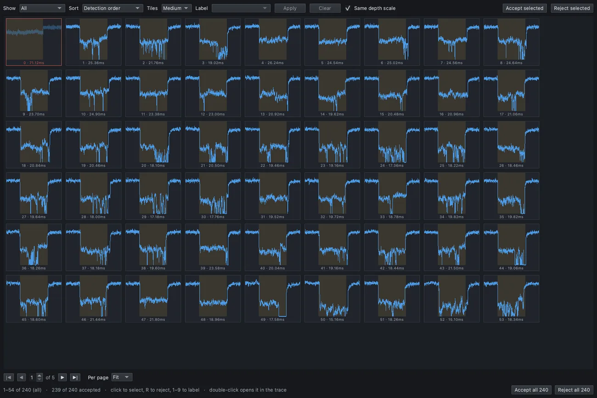

*The Event gallery on the −600 mV recording after merging: page 1 of 5, `1–54 of 240 (all) · 239 of 240 accepted`, `Sort: Detection order`, so the caption under each tile is event id · dwell — the caption follows the sort key. The `Label` combo with `Apply` and `Clear`, and the status line's digit-label hint, write the palette defined by `Analysis ▸ Event labels…` onto the selected tiles. Applying or clearing a label also marks those tiles reviewed for training export.*

**What that hint says today.** The shot above is from before the hint was tied to the palette, and it shows the line as it then always read: `click to select, R to reject, 1–9 to label`. It now names only the digits the palette actually arms — measured on a 60-event detection: a two-entry palette gives `click to select, R to reject, 1–2 to label`, a nine-entry one gives `1–9 to label`, and a session with no palette (which is every session until you define one) drops the digits altogether and says where they come from: `no labels defined — define some under Analysis ▸ Event labels… to arm the digit keys`. Press a digit the palette does not arm and the line answers instead of doing nothing — `5 is not armed — the palette arms 1–2 only; Analysis ▸ Event labels… adds more`. The rest of that line has moved on from the shot too. The curation clause now says what the keys act on — `click to select, R to reject — each acts on every selected tile` — and it is preceded by the batch gestures the window had never named: `select in bulk: drag a box or shift-click for a run, ⌘-click to add or drop one, ⌘A all on the page, Esc none, ⌘I inverse`. It ends `double-click opens it in the Event Inspector · right-click for the inspector, the trace, or accept/reject`.

Under Show = "Accepted only" or "Rejected only", curating a tile makes it vanish from the grid immediately and re-numbers the pages — the events are fine, they have just left the filter.

With "Same depth scale" unchecked, every tile fills its full height whatever its depth, so a 15 pA and a 45 pA event look identical; never judge depth in that mode, only shape.

With "Same depth scale" checked, the scale is the 98th percentile of the detection's depths, so unusually deep events are deliberately clipped at the tile's bottom edge — a flat-bottomed tile means "deeper than the bulk", not "measured this depth".

| Label | Type | What it does |
|---|---|---|
| ShowTop toolbar | combo | Chooses which events the grid contains: all of them, only the ones you have accepted, or only the ones you have rejected. Options are "All", "Accepted only" and "Rejected only".Same three subsets, by the same names, as the Event inspector. Changing it re-pages the grid from the start of the new subset, and it also decides what "Accept all …" / "Reject all …" at the bottom will act on.Exactly: "Accept all shown" is only the constructor text. _sync_controls overwrites it on every refresh with f"Accept all {subset}" — so with a detection loaded the button actually reads e.g. "Accept all 412" (the count of events in the current filter subset, across all pages). "Accept all shown" is visible only when no detection is loaded, and the button is disabled then. |
| AllShow | combo | Every detected event in the current detection appears as a tile, accepted or not. This is the default.Only with this option does "Accept all …" / "Reject all …" act on the whole detection.Exactly: "Accept all shown" is only the constructor text. _sync_controls overwrites it on every refresh with f"Accept all {subset}" — so with a detection loaded the button actually reads e.g. "Accept all 412" (the count of events in the current filter subset, across all pages). "Accept all shown" is visible only when no detection is loaded, and the button is disabled then. |
| Accepted onlyShow | combo | Shows only events currently marked accepted — the set that will actually go into your plots and exports.The moment you reject a tile in this view it disappears from the grid; that is not a bug, it has left the filter. Tile counts and page count change under you as you curate. |
| Rejected onlyShow | combo | Shows only the events you have thrown out — useful for a second pass over your own culling before you export.Accepting a tile here makes it vanish from the grid. "Accept all …" while this filter is on un-rejects everything you had rejected. |
| SortTop toolbar | combo | Sets the order tiles are laid out in, and changes what each tile's caption reports. Options are "Detection order", "Dwell (longest first)", "Depth (deepest first)" and "dI/I0 (deepest first)".Sorting also rewrites every caption, so the grid can be read down as a sequence. Events whose value could not be measured (NaN) are always parked at the END of the grid, never scattered through the middle. |
| Detection orderSort | combo | Lays tiles out in the order the detector found them, i.e. in time. This is the default, and the only order in which a tile's neighbours are its neighbours in the recording.Use this when hunting for bursts of false positives from one disturbance — they show up as a run of bad tiles rather than being scattered. Caption reads " · ". |
| Dwell (longest first)Sort | combo | Longest events first, shortest last. Puts your clogs and long translocations at the top of page 1 and your one-sample spikes at the very end.Caption reads " · ", e.g. "412 · 1.35ms". Dwell is auto-formatted: microseconds under 1 ms, then ms. |
| Depth (deepest first)Sort | combo | Deepest blockade (largest current drop in pA) first. Combined with "Same depth scale" on, the grid then visibly shallows as you read down.Caption switches to " · " — a bare 3-significant-figure number with NO unit shown; it is pA. |
| dI/I0 (deepest first)Sort | combo | Sorts by fractional blockade (depth as a fraction of the open-pore current) rather than absolute pA, so a drifting baseline does not reorder the grid.Caption switches to " · " — again a bare 3-significant-figure number, this one a fraction (0-1), not a percentage. |
| TilesTop toolbar | combo | Sets how big each waveform thumbnail is drawn. Options are "Small", "Medium" (default) and "Large".Bigger tiles mean fewer events per screen; under Per page = "Fit" the page size is recomputed immediately, so changing tile size changes how many pages you have. Every thumbnail is redrawn at the new width (a large tile is genuinely recomputed, not a blown-up small one), so there is a brief redraw on a big detection. |
| SmallTiles | combo | 96 x 72 px thumbnails — the most events per screen, for a fast "is anything obviously wrong here" sweep.At this size a marginal event and a clean one can be hard to tell apart; use it to find suspicious runs, then switch up to judge them. |
| MediumTiles | combo | 140 x 104 px thumbnails. The default, and the working size for most triage.This is the size restored whenever the window is first built in a session. |
| LargeTiles | combo | 200 x 148 px thumbnails — enough detail to see sub-states and noise character without opening the inspector.Fewest tiles per page, so expect many more page turns under Per page = "Fit". |
| Same depth scaleTop toolbar | checkbox | "Draw every tile against one depth scale for the whole detection, so a deep event looks deeper than a shallow one. Uncheck to scale each tile to itself, which is better for comparing event SHAPE when the depths are similar."ON by default. When on, the shared scale is the 98th percentile of the detection's own depths (not the maximum), so one freak deep event cannot flatten the other nine hundred — an outlier simply clips at the bottom edge of its tile. Each tile is still referenced to its OWN open-pore baseline, so a drifting baseline does not push traces off the tile. When off, every tile fills top-to-bottom regardless of depth, which makes a 15 pA and a 45 pA event draw identically — do not judge depth in this mode. Toggling is instant (repaint only, no recompute). |
| Inspector…Top toolbar | button | Open the FOCUSED tile's event in the Event Inspector, where its bounds, its sub-state levels and its flags can be edited. (Verbatim tooltip; it adds "Double-clicking a tile does the same; right-click a tile for the trace instead.")Acts on the tile that has FOCUS, not on the whole selection, and does nothing at all with nothing focused — "open this one" needs a this. It emits the same request the double-click and the context menu do, so all three land on the same inspector rather than on three implementations of one. This is the way out of the grid; the inspector's own "Gallery…" is the way back. |
| Accept selectedTop toolbar | button | "Mark every selected tile accepted (drag a box, or Ctrl/Shift-click, to select)."Keyboard equivalent: A. Does nothing if no tiles are selected. Disabled while the current page has no tiles (no detection loaded, or the filter subset is empty). Writes the shared events table immediately — no separate confirm — and the change reaches the event table, the trace overlays, the summary and the exports. |
| Reject selectedTop toolbar | button | "Mark every selected tile rejected."Keyboard equivalent: R. Same gating as Accept selected (disabled when the page is empty; a no-op with nothing selected). Rejected events are excluded from plots and exports, so this is the main culling action in this window. |
| (tile grid)Main area | list | The contact sheet itself: one tile per event on the current page. Each tile draws the calibrated current around the event as a blue min/max envelope, with the event's own span shaded in orange behind it (the same hue the main trace uses for event overlays) and a caption underneath giving the event id and the value the current sort is about.The window shown on a tile is the event plus half its own length of open pore on each side (at least 25 samples), so the blockade always sits in the middle ~50% of the tile with real baseline either side to judge it against. The trace is a min/max band, one vertical segment per pixel column, so a short sub-state inside a long event still shows instead of being stepped over. Rejected tiles are drawn dimmed with a red border and red caption; the focused/selected tile gets a thick blue border and a lighter background. A tile reading "no signal" means the recording or channel behind it could not be read (document closed, channel changed) — not that the event is empty. |
| Click a tileMouse and keyboard in the grid | gesture | Focuses that event: it becomes the selection here and the rest of the app follows — the event table highlights the row and the trace view moves to it.Opening the gallery automatically focuses the first tile, which also drives the main window's selection to that event. |
| Double-click a tileMouse and keyboard in the grid | gesture | Goes to that event in the trace: the main window zooms its trace onto the event and comes to the front, in front of the gallery.Double-click does NOT accept or reject — it used to, and was changed precisely because a destructive action on the open-things gesture was wrong. Rejecting is a click plus R (or the button). Expect the gallery to be covered by the main window afterwards. |
| Drag a rubber band over tilesMouse and keyboard in the grid | gesture | Sweep a box across the grid on empty space to select every tile it touches — the fast way to grab a whole block of bad detections before pressing R.Ctrl-click adds/removes single tiles and Shift-click extends a range. Selection is per page: turning the page abandons the selection. |
| AMouse and keyboard in the grid | shortcut | Accept every selected tile — the keyboard twin of the "Accept selected" button.Plain letter key, no modifier; works anywhere in this window. Silent no-op if nothing is selected.Exactly: "Accept all shown" is only the constructor text. _sync_controls overwrites it on every refresh with f"Accept all {subset}" — so with a detection loaded the button actually reads e.g. "Accept all 412" (the count of events in the current filter subset, across all pages). "Accept all shown" is visible only when no detection is loaded, and the button is disabled then. |
| RMouse and keyboard in the grid | shortcut | Reject every selected tile — the keyboard twin of "Reject selected", and the key the status line tells you to use.Plain letter key, no modifier. Silent no-op if nothing is selected.Exactly: Same: constructor text "Reject all shown", rewritten by _sync_controls to f"Reject all {subset}" — e.g. "Reject all 412". The "shown" wording never appears once a detection is loaded. |
| SpaceMouse and keyboard in the grid | shortcut | Flips the selection's accept/reject state in one press.It is NOT a per-tile toggle on a mixed selection: if ANY selected tile is currently accepted, the whole selection becomes REJECTED. Only when every selected tile is already rejected does Space accept them. That bias is deliberate (the gallery is used to cull), but it will surprise you on a mixed sweep. |
| PgDn / PgUpMouse and keyboard in the grid | shortcut | Turn to the next / previous page of tiles, same as the ▶ and ◀ buttons.Clamps at the ends rather than emptying the grid. |
| Home / EndMouse and keyboard in the grid | shortcut | Jump to the first / last page of the current subset.In this window Home means "first page" — not "reset zoom", which is what Home does in the main window. The left/right arrow keys move the tile cursor within the page; despite what the ◀ / ▶ tooltips say, they do not turn the page. |
| \|◀Pager (under the grid) | button | "First page (Home)" — jumps to the start of the current filtered, sorted subset.Greyed out while you are already on page 1. |
| ◀Pager (under the grid) | button | "Previous page (PgUp, or ←)" — steps back one screenful of tiles.Greyed out on page 1. The tooltip mentions ←, but only PgUp is actually bound; the arrow keys move the tile cursor inside the page. |
| (page number)Pager (under the grid) | spinbox | "Jump to a page." Type or spin a page number to go straight there.1-based, and its maximum is the current page count — which changes whenever you change Show, Per page, tile size, or resize the window under "Fit". |
| of 1Pager (under the grid) | label | Reads "of N" — how many pages the current filter subset comes to at the current page size.Display only. Shows "of 1" when there is no detection or the subset fits on one page.Exactly: QLabel("of 1") is only the initial value; _sync_controls sets it to f"of {n_pages}", so it reads "of 1", "of 42", etc. depending on the page count. Documenting it as the fixed string "of 1" is wrong. |
| ▶Pager (under the grid) | button | "Next page (PgDn, or →)" — advances one screenful of tiles.Greyed out on the last page. As with ◀, the → in the tooltip is not actually bound. |
| ▶\|Pager (under the grid) | button | "Last page (End)" — jumps to the end of the current subset.Greyed out while you are already on the last page. |
| Per pagePager (under the grid) | combo | "Tiles per page. \"Fit\" sizes the page to the window, so a page is exactly one screenful and turning the page is the only way to move." Options are "Fit" (default), "24", "48", "96" and "200".Changing this keeps you looking at roughly the same tile — the first tile of your current page stays on screen — rather than keeping the same page NUMBER and dumping you somewhere else in the recording. |
| FitPer page | combo | Computes the tile count from the window size, so one page is exactly one screenful and there is never anything below the fold. Default.No scrollbar ever appears in this mode — that is the point. Resizing the window (or changing Tiles size) immediately re-paginates. |
| 24Per page | combo | A fixed 24 tiles per page regardless of window size.With any explicit size, a vertical scrollbar appears if the tiles do not fit the window — it exists so events cannot become silently unreachable. |
| 48Per page | combo | A fixed 48 tiles per page.Same scrollbar caveat as the other explicit sizes. |
| 96Per page | combo | A fixed 96 tiles per page.Same scrollbar caveat as the other explicit sizes. |
| 200Per page | combo | A fixed 200 tiles per page — few page turns, lots of scrolling.On a small window this will overflow; scroll the grid to reach the rest of the page. |
| (status line)Window foot | label | Reads e.g. "49–96 of 412 (all) · 380 of 412 accepted · click to select, R to reject · double-click to open it in the trace": which slice of the subset is on screen, how much of the whole detection is currently accepted, and the two gestures that matter.With no detection loaded it reads "No detection — run detection to fill the gallery." The "N of M accepted" figure is always for the WHOLE detection, not the filtered subset, so it is the number to watch while culling. |
| Accept all shownWindow foot | button | Marks every event in the current filter accepted — across ALL pages, not just the page you can see. Its label changes to show the count, e.g. "Accept all 412".Tooltip: "Mark every tile in the CURRENT filter accepted — not the whole detection unless the filter is All." It reads "Accept all shown" only until a detection is loaded, then becomes "Accept all ". No confirmation dialog — but it is recorded as a single undo step labelled "Accept all events", so Edit ▸ Undo (Ctrl+Z / Cmd+Z) in the main window walks it back. Disabled while the grid is empty.Exactly: "Accept all shown" is only the constructor text. _sync_controls overwrites it on every refresh with f"Accept all {subset}" — so with a detection loaded the button actually reads e.g. "Accept all 412" (the count of events in the current filter subset, across all pages). "Accept all shown" is visible only when no detection is loaded, and the button is disabled then. |
| Reject all shownWindow foot | button | Marks every event in the current filter rejected — across all pages. Its label changes to show the count, e.g. "Reject all 412".Tooltip: "Mark every tile in the current filter rejected." Destructive to your curation and applied with no confirmation; recovery is Edit ▸ Undo in the main window (recorded as "Reject all events"). With Show = "All" this empties your accepted set entirely, which also re-locks the surfaces that need at least one accepted event (e.g. Event plots). Disabled while the grid is empty.Exactly: Same: constructor text "Reject all shown", rewritten by _sync_controls to f"Reject all {subset}" — e.g. "Reject all 412". The "shown" wording never appears once a detection is loaded. |
| Ctrl-click / Shift-click a tileTile grid | gesture | Adds to or extends the tile selection without clearing it — the grid is set to ExtendedSelection (view.setSelectionMode(QAbstractItemView.ExtendedSelection)), so Ctrl-click toggles one tile in or out of the selection and Shift-click selects the whole run from the current tile. The app itself advertises this in the Accept selected tooltip: "Mark every selected tile accepted (drag a box, or Ctrl/Shift-click, to select)." Without it the user only has plain click (one tile) and rubber-band drag. |
| ← / →Pager | shortcut | Advertised but NOT bound — a manual must not promise these. The Previous/Next page tooltips read "Previous page (PgUp, or ←)" and "Next page (PgDn, or →)", but the shortcut table in _build_ui only registers A, R, Space, PageDown, PageUp, Home and End; there is no Key_Left/Key_Right action and no keyPressEvent override. In the tile grid the arrow keys do QListView's own thing — move the focused tile within the current page (which fires eventSelected) — they do not turn the page. |
| (vertical scrollbar on the tile grid)Tile grid | scrollbar | Appears down the right of the tile grid only when the chosen "Per page" count does not fit the window (policy is ScrollBarAsNeeded); horizontal scrolling is switched off permanently (ScrollBarAlwaysOff). Under the default "Fit" page size the page is computed from the viewport, so the scrollbar never appears — it exists as a safety valve for the fixed sizes 24/48/96/200, where a big count in a small window would otherwise put tiles out of reach. |
| No detection — run detection to fill the gallery.Status line | label | The empty state of the status line: shown instead of the usual counts whenever no detection has been handed to the window. In this state all four curation buttons are disabled and the two "all" buttons keep their literal startup text ("Accept all shown" / "Reject all shown"). Note the four curation buttons (Accept selected, Reject selected, Accept all…, Reject all…) are enabled only while the CURRENT PAGE has at least one tile — _sync_controls gates them on rowCount() > 0, i.e. tiles on this page, not events in the detection. |
| NanoScope — Event galleryWindow | window title | The title bar of the gallery, which is a standalone top-level window (940×700 on first open), not a dock or tab inside the main window. Useful for the manual because the user has to find this window again among the others. |

### Plots window — 82 controls

Menu: Analysis ▸ Plots… (menu item label "&Plots…" under the "&Analysis" menu, in the section "Explore this recording"), or the "◉ Populations" button on the Analysis launcher row under the workflow strip. No keyboard shortcut. The menu item and the launcher button are greyed until there is at least one plottable per-event table: with nothing open it says "Open a recording first — the populations window plots per-event tables (a detection's events, or a saved manual measurement)."; with a recording open but no results, "Run detection first — the populations window plots per-event tables (a saved manual measurement counts too)." Only one Plots window exists; re-opening re-focuses it and re-snapshots the data.

This is the population-level exploration window: it takes a snapshot of every per-event table the app currently has (each open recording's/segment's stored detection, plus your saved manual measurements) and lets you draw histograms, scatters and PCA over their numeric columns. You can tick more than one source and overlay them — colour then means "source", the bin edges are shared, and each source is fitted separately with its own detector settings, so two recordings are never silently pooled. Distribution fits (exponential, gamma, inverse-Gaussian, exponential+gamma, Gaussian mixture) are drawn straight on the histogram with their parameters, and GMM/k-means clustering and PCA share one feature list. It is a snapshot, not a live mirror: nothing here changes your data, and it only updates when you press Refresh (or re-open the window).


*The Plots window: a dwell histogram with a single-exponential fit. The Details pane below carries the parameters, the detection limit, the goodness-of-fit verdict and the ranked cross-family model comparison.*

The window is a SNAPSHOT, not a live view — new detections and new manual measurements do not appear until you press Refresh (or close and re-open the window).

Ticking or unticking a source, or toggling 'Use accepted events only', silently discards any clustering and PCA result you had computed, and clears any pinned Axis range; you must press Run clustering / Run PCA again.

'Axis range' only moves the camera; 'Fit range' changes which data the fit actually sees. Using the wrong one is the easiest mistake in this window.

Fit range numbers are typed in whatever unit the Time unit combo is showing (ms by default), not in seconds.

'Time unit' rescales the axis LABELS only — and it is ignored entirely on a log axis, where the axis stays in seconds and says so.

With two or more sources ticked, colour means SOURCE: the histogram 'Colour by' is disabled and the scatter 'Colour by = Cluster' is ignored. Untick all but one source to colour by cluster.

A drawn column measured under a calibration that has since changed is marked in the two places that survive Save image…: '⚠ SUPERSEDED CALIBRATION' appended to the plot title, and a per-source note in Details naming the exact columns. Nothing is recomputed — the numbers drawn, and every fitted parameter printed from them, are in the OLD calibration. The event table badges the same columns ⚠.

A printed R² with no residual degrees of freedom is tagged where it is printed. Both scatter best fits have exactly two free parameters, so at n = 2 the headline reads 'R² = 1.000 (exact by construction)' and below that '(under-determined)'; Details carries the full sentence. The tag rides with the number into the plot title, which is the half Save image… keeps.

| Label | Type | What it does |
|---|---|---|
| Data sourcesData sources | list | A checkable list of everything you can plot: "Every open recording (segments included) that has a stored detection, plus the manual-measurement table." Tick one to plot it; tick two or more to overlay them.Each row is inked in that source's own overlay colour, so the list doubles as the legend key. Hovering a row shows its row count, whether it is a derived segment, its module id and its detector's min_dwell_s (or "no detector provenance (hand measurements)" for the manual table). Merely HIGHLIGHTING a row does nothing — you must tick the checkbox. The hint above the list reads: "Tick two or more to overlay them. Colour then means SOURCE, and the histogram normalizes so unequal-n recordings stay comparable." Changing the ticks throws away any clustering/PCA result and clears any pinned Axis range, because the row set changed underneath them. With an overlay the column pickers show only the columns ALL ticked sources share (the intersection). The FIRST ticked source is the "primary" one — clustering and PCA operate on it alone. Each row is also EDITABLE: double-click one and type to rename that series everywhere it is named — the legend, the fit lines, the Details pane and the plot title. The source's real label is kept underneath, so clearing the edit back to empty removes the override and the true name comes back rather than the legend going blank. The rename is a display override only; it changes nothing about the data or the fits. |
| Use accepted events onlyData sources | checkbox | Plots only the events you kept during curation, dropping the rejected ones from every histogram, scatter, fit, clustering and PCA.On by default. Disabled (greyed) unless at least one ticked source actually carries an 'accepted' column — the manual-measurement table typically does not. Toggling it discards any existing clustering/PCA result, since the row set changed. |
| RefreshData sources | button | "Re-pull the current measurements and events." Takes a fresh snapshot of the app's tables so newly detected events or newly saved measurements appear here.The window is a deliberate snapshot, not a live view — nothing you do in the main window shows up here until you press this. Sources still present after a refresh keep their ticked state, but any clustering/PCA you had run is dropped. |
| HistogramPlot | combo | Plot type: one numeric column as a binned distribution, with optional fitted curve. Selecting it swaps the control page below to the histogram controls.The plot-type combo is the first (unlabelled) control in the Plot box; its four entries are Histogram / Scatter / KDE (density) / PCA. Switching plot type clears any pinned Axis range (the new plot has different axes).Exactly: These are the four ITEMS of ONE unlabelled QComboBox at the top of the "Plot" group: self._plot_type_combo.addItems(list(_PLOT_TYPES)) where _PLOT_TYPES = ("Histogram", "Scatter", "KDE (density)", "PCA"). Picking an item swaps the QStackedWidget of controls underneath it, and also clears any pinned Axis range (a different plot has different axes). A user hunting for four separate combos will not find them. |
| ScatterPlot | combo | Plot type: any two numeric columns as an X-Y point cloud, optionally coloured by cluster and with a best-fit line.Same combo as Histogram / KDE (density) / PCA. Switching plot type clears any pinned Axis range.Exactly: These are the four ITEMS of ONE unlabelled QComboBox at the top of the "Plot" group: self._plot_type_combo.addItems(list(_PLOT_TYPES)) where _PLOT_TYPES = ("Histogram", "Scatter", "KDE (density)", "PCA"). Picking an item swaps the QStackedWidget of controls underneath it, and also clears any pinned Axis range (a different plot has different axes). A user hunting for four separate combos will not find them. |
| PCAPlot | combo | Plot type: the shared feature set projected onto its two principal components, with the explained variance in the axis labels and title.Same combo as Histogram / Scatter / KDE (density). Shows "Select ≥2 feature columns on the left, then click Run PCA." until you actually run it. PCA always uses the PRIMARY (first ticked) source only.Exactly: These are the four ITEMS of ONE unlabelled QComboBox at the top of the "Plot" group: self._plot_type_combo.addItems(list(_PLOT_TYPES)) where _PLOT_TYPES = ("Histogram", "Scatter", "KDE (density)", "PCA"). Picking an item swaps the QStackedWidget of controls underneath it, and also clears any pinned Axis range (a different plot has different axes). A user hunting for four separate combos will not find them. |
| Time unitPlot | combo | "Unit for time columns (dwell_s, rise_s, fall_s, t_start_s). This rescales the AXIS only — the data, and every fit computed on it, stay in seconds, so the dwell fit keeps the detector's own min_dwell_s." Choices: s, ms, µs.Defaults to ms. It is a label-only rescale, so tau and every other fitted number stay honest. Two consequences: (1) on a LOG x axis the scale is not applied and the axis label says "(s, log)" — log axes stay in seconds; (2) the numbers you type into Fit range are read in whatever unit this combo is showing. |
| ColumnPlot ▸ Histogram | combo | Which numeric column to histogram.Only numeric, non-boolean columns that have at least one finite value are offered — flags like accepted / filter_limited never appear. Seeds itself to a dwell-like column (dwell_s, dwell, rise_s, fall_s) when one exists. With several sources ticked, only columns they all share are listed. |
| BinsPlot ▸ Histogram | spinbox | Number of histogram bins (2 to 500, default 30).With an overlay, ONE set of bin edges is computed over the union of every drawn source and reused for all of them, so the shapes are measured against the same ruler. |
| NormalizePlot ▸ Histogram | combo | "What the y axis counts. count: raw events per bin — only comparable at equal n. density: counts / (n × bin width) — the shape, independent of how long each recording ran. THE one to use when overlaying. The heights are per unit of the column IN ITS STORED UNIT (per second for a dwell, per pA for a depth), which is what the y axis says; they integrate to 1 over that unit — not over a ms/µs tick scale, and not over a log axis. probability per bin: counts / n — bin heights sum to 1." The three entries are literally "count", "density" and "probability per bin".Auto-switches to "density" the moment you tick a second source (and back to "count" when you are down to one) — but only until you pick a value yourself; after that your choice is pinned and the automatic switch stops. The fitted curve is rescaled to match whichever quantity is shown. Renamed from "density (area = 1)" by report S6-03: the heights are per the column's STORED unit while the x ticks follow the Time-unit combo, so the area under the DRAWN curve was 1000 on the default ms axis and ~23 on a log-x one. The y axis now names the unit ("density (1/s)", "density (1/pA)") and the Details pane says where the drawn area is not 1. A sidecar or template written before the rename still opens and still selects density. |
| Colour byPlot ▸ Histogram | combo | "Split the histogram by cluster label after Run clustering — the other half of the clustering workflow (scatter/PCA already colour by cluster)." Entries: None, Cluster.Single source only. With two or more sources ticked it is DISABLED, reset to None, and its tooltip changes to "Colour already means SOURCE while more than one source is drawn — untick all but one to split by cluster instead." Choosing Cluster does nothing until you press Run clustering. When split, every cluster is normalized against the same total (they are parts of one distribution), rows the clustering dropped appear as a grey "dropped (non-finite features)" series, and any fitted curve is fitted over the WHOLE source, not per cluster — the window says so in Details. |
| Log xPlot ▸ Histogram | checkbox | Log-scale the value axis and use log-spaced bins — the usual way to look at a dwell-time distribution spanning decades.Non-positive values cannot be drawn and are dropped, with the count reported in Details. On a log x axis the Time unit rescale is not applied: the axis stays in seconds and the label says so. Only decades get tick labels (minor ticks stay unlabelled) so the axis does not smear. |
| Log y (count)Plot ▸ Histogram | checkbox | "Log-scale the count axis — makes an exponential tail read as a line."On a log count axis the bars lose their fill and draw as a step outline only (a fill baseline would be log(0)); empty bins therefore read as gaps. |
| FitPlot ▸ Histogram | combo | Overlays a fitted distribution on the histogram and prints its parameters in the title, the legend and Details. Tooltip: "exponential: the classic escape model — monotonic, cannot peak. gamma / inverse-gaussian: densities WITH a mode, for a dwell histogram that peaks away from zero. All three are truncated at the detector's min_dwell_s, so their BIC values compare directly." The six entries, verbatim, are: none / exponential / gamma (peaked) / inverse-gaussian (first passage) / exponential + gamma (bimodal) / gaussian-mixture.SELECTING A FAMILY DOES NOT DRAW IT — press "Apply fit" beside the combo; until you do, the button reads "Apply fit ●" and the plot still shows the previous fit (or none). WHEN TO PICK WHAT — "none": no overlay (default). "exponential": the classic first-order escape model for a dwell column; monotonically decreasing, so it can never describe a histogram that peaks away from zero; reports τ. "gamma (peaked)": a dwell density that HAS a mode — use it when the dwell histogram rises to a peak before falling; reports k. "inverse-gaussian (first passage)": the other peaked dwell family, the first-passage-time model; reports μ. "exponential + gamma (bimodal)": a fast escape AND a slow peaked passage in one model — for a bimodal dwell distribution whose slow lobe has a mode, which none of the single families can express; reports k. "gaussian-mixture": for an amplitude/depth-like column (frac_depth, depth_pA, max_dev_pA, mean_dev_pA), not for dwell; reports μ per component and fits \|value\| (negatives are fit by magnitude, and the count is reported). The four dwell families are all truncated at the same detector floor, so their BIC values in Details compare directly; the mixture is a different kind of animal and is not comparable with them. Choosing anything but "none" enables Fit components and (if a source carries the flag) 'include filter-limited events'. Fits refuse to run on fewer than 20 events (20 × components for a multi-component fit) — the refusal is printed as "Fit unavailable: …" in Details and the histogram still stands. If a rival component count beats the current one by more than 10 BIC, Details prints "NOTE: N components fit markedly better …; set Fit components = N to see it." |
| Apply fitPlot ▸ Histogram | button | Draws the family chosen in the Fit combo beside it. Choosing a family is a PROPOSAL; this button is what makes it the drawn fit.It exists because picking from the combo used to fit, draw and start the advisory batch on the spot, so walking down the list merely to READ the options ran five maximisations — one of them (exponential + gamma) a nine-second twelve-start optimisation. While a chosen family has not been applied the button reads "Apply fit ●", so a plot never silently disagrees with the combo above it. The same gate is on the Scatter page, and on the Voltage-dependence window's own Fit combo. |
| Fit componentsPlot ▸ Histogram | spinbox | "Number of mixture components for the fit." 1 to 4, default 1.Disabled until Fit is set to anything other than "none". Each extra component needs another 20 events or the fit refuses. Details always prints "BIC = … AIC = … components = …" so you can judge whether the extra component earned its place. |
| Fit rangePlot ▸ Histogram | list | Two text boxes (placeholders "min" and "max") that restrict the fit to part of the distribution: "Fit only this part of the distribution, in the AXIS unit shown. This is a TRUNCATION, not a crop: the likelihood is renormalised to the range, so restricting to a peak does not bias the estimates the way silently dropping data would. BIC is only comparable between fits over the SAME range."This changes WHICH DATA THE FIT SEES — it is not the same thing as the Axis range box below, which only moves the camera. Values are typed in the unit the axis is currently showing (ms by default for a dwell column), and are converted back internally. Takes effect when you leave the field (editing finished). Leave both blank for the full range; a min ≥ max is ignored. The window's own detection floor and your range are intersected, and Details prints "FIT RANGE [lo, hi] unit — n = … ; the likelihood is TRUNCATED to this window, not merely cropped. BIC/AIC compare only against fits over the SAME range."Exactly: Not a list. form.addRow("Fit range", fit_range) where fit_range is a QHBoxLayout holding TWO QLineEdits, self._fit_lo (placeholder "min") and self._fit_hi (placeholder "max"). Both commit on editingFinished. |
| include filter-limited eventsPlot ▸ Histogram | checkbox | "Off (default): events whose dwell is within ~2x the filter rise time are excluded from the fit (depth attenuated, dwell biased long) and the count is reported in Details. On: they are fit alongside the resolved events."Off by default, matching the Fits panel. Disabled unless BOTH a fit is selected (Fit ≠ none) AND at least one ticked source carries a 'filter_limited' column. It affects the FIT only, not which bars are drawn. |
| XPlot ▸ Scatter | combo | Numeric column on the horizontal axis.Seeded to a dwell-like column when one exists. With an overlay, only columns every ticked source carries are offered.Exactly: Not lists. Four QLineEdits, each with placeholder text "auto" and a QDoubleValidator, built by the loop over (("xmin", "X min"), ("xmax", "X max"), ("ymin", "Y min"), ("ymax", "Y max")) in the "Axis range" group. Pressing Enter/Return in any of them applies the range immediately (returnPressed → _apply_axis_range) — that is the only keyboard shortcut anywhere in this file; there is no setShortcut |
| YPlot ▸ Scatter | combo | Numeric column on the vertical axis.Seeded to an amplitude-like column (amplitude, depth_pA, frac_depth, frac_amplitude, max_dev_pA) when one exists.Exactly: Not lists. Four QLineEdits, each with placeholder text "auto" and a QDoubleValidator, built by the loop over (("xmin", "X min"), ("xmax", "X max"), ("ymin", "Y min"), ("ymax", "Y max")) in the "Axis range" group. Pressing Enter/Return in any of them applies the range immediately (returnPressed → _apply_axis_range) — that is the only keyboard shortcut anywhere in this file; there is no setShortcut |
| Log xPlot ▸ Scatter | checkbox | Log-scale the X axis — the standard view for dwell time on x.Points with a non-positive X are dropped from the plot. On a log axis the Time unit rescale is not applied; the label says "(s, log)". If every point is dropped you get "No points to plot for this pair (check the log-axis toggles)." |
| Log yPlot ▸ Scatter | checkbox | Log-scale the Y axis.Points with a non-positive Y are dropped from the plot. |
| Colour byPlot ▸ Scatter | combo | Colours the points plainly (None) or by cluster label (Cluster), with a legend swatch and count per cluster.Entries: None, Cluster. Run clustering sets this to Cluster for you. Choosing Cluster before any clustering exists just prints "Run clustering to colour these points." in Details. With more than one source ticked it is IGNORED — colour means source there — and Details says "Colour by Cluster is ignored while several sources are overlaid — colour means SOURCE here. Untick all but one source to colour by cluster." Rows the clustering dropped draw grey and are labelled "dropped (non-finite features)". |
| FitPlot ▸ Scatter | combo | "Overlay a least-squares best-fit line; power law fits in log-log space." Entries: none / linear / power law (log-log).SELECTING A FAMILY DOES NOT DRAW IT — press "Apply fit" beside the combo. Pick "linear" for a straight y = m·x + c relationship; pick "power law (log-log)" when you expect y ∝ x^n (the fit is done on the logs, so it needs positive values on both axes). The summary — slope/intercept or coefficient/exponent, the axis units, R² and n — goes into Details and becomes the plot title unless you typed your own. R² is qualified wherever it carries no information: a two-parameter line through two points prints "R² = 1.000 (exact by construction)" and a y that does not vary prints "R² undefined (y does not vary)", each with a full sentence under it in Details. A log-log fit that had to drop points with no logarithm says so — "power-law fit: N of M point(s) have x ≤ 0, y ≤ 0, or a non-finite value …" — and still draws the line over the points it did use. With an overlay each source gets its OWN dashed line in its own colour and its own legend entry; there is never one pooled regression through two clouds. If the fit cannot run (too few points, constant x, no positive values for log-log) Details shows "Fit unavailable: …" and the points still draw. |
| Apply fitPlot ▸ Scatter | button | Draws the best-fit line chosen in the Fit combo beside it. As on the histogram page, the combo is a proposal and this button is what draws it.Cheaper per fit than the histogram's, but a regression line that appears the instant the combo is opened is the same surprise, and one gate that behaves the same way on both pages is one rule. Reads "Apply fit ●" while a chosen family is not yet drawn. |
| Run PCAPlot ▸ PCA | button | Projects the ticked feature columns to 2 principal components and draws the score plot, with the explained variance in the axis labels and the title ("Explained variance: PC1 …%, PC2 …% (cumulative …%)").The page hint reads: "Projects the feature set below to 2 components. Colour follows the clustering if one has been run." Needs at least 2 columns selected in Features — otherwise Details says "PCA needs at least 2 feature columns selected." Runs on the PRIMARY (first ticked) source only. Pressing it also switches the plot type to PCA. Features are z-scored first. Changing the feature selection invalidates the result and you must run it again. |
| X minAxis range | list | Pins the left edge of the visible x axis, in DATA units. Blank means auto-fit.Placeholder is "auto"; only numbers are accepted. Both X min AND X max must be filled for the pin to apply. Press Enter, or the Apply button, to take effect. This moves the camera only — it does not change what is fitted (use Fit range for that). On a log axis the value is still typed in data units; a non-positive bound is treated as auto. Pins are cleared automatically when you change plot type or change which sources are ticked.Exactly: Not lists. Four QLineEdits, each with placeholder text "auto" and a QDoubleValidator, built by the loop over (("xmin", "X min"), ("xmax", "X max"), ("ymin", "Y min"), ("ymax", "Y max")) in the "Axis range" group. Pressing Enter/Return in any of them applies the range immediately (returnPressed → _apply_axis_range) — that is the only keyboard shortcut anywhere in this file; there is no setShortcut |
| X maxAxis range | list | Pins the right edge of the visible x axis, in DATA units. Blank means auto-fit.Only takes effect together with X min. Same rules as X min.Exactly: Not lists. Four QLineEdits, each with placeholder text "auto" and a QDoubleValidator, built by the loop over (("xmin", "X min"), ("xmax", "X max"), ("ymin", "Y min"), ("ymax", "Y max")) in the "Axis range" group. Pressing Enter/Return in any of them applies the range immediately (returnPressed → _apply_axis_range) — that is the only keyboard shortcut anywhere in this file; there is no setShortcut |
| Y minAxis range | list | Pins the bottom of the visible y axis, in DATA units. Blank means auto-fit.Both Y min and Y max must be filled for the pin to apply.Exactly: Not lists. Four QLineEdits, each with placeholder text "auto" and a QDoubleValidator, built by the loop over (("xmin", "X min"), ("xmax", "X max"), ("ymin", "Y min"), ("ymax", "Y max")) in the "Axis range" group. Pressing Enter/Return in any of them applies the range immediately (returnPressed → _apply_axis_range) — that is the only keyboard shortcut anywhere in this file; there is no setShortcut |
| Y maxAxis range | list | Pins the top of the visible y axis, in DATA units. Blank means auto-fit.Only takes effect together with Y min.Exactly: Not lists. Four QLineEdits, each with placeholder text "auto" and a QDoubleValidator, built by the loop over (("xmin", "X min"), ("xmax", "X max"), ("ymin", "Y min"), ("ymax", "Y max")) in the "Axis range" group. Pressing Enter/Return in any of them applies the range immediately (returnPressed → _apply_axis_range) — that is the only keyboard shortcut anywhere in this file; there is no setShortcut |
| ApplyAxis range | button | Reads the four range boxes and pins those limits on the current plot; the pins survive redraws.Pressing Enter in any of the four boxes does the same thing. The plot is also mouse zoom/pan-able, which does not update these boxes. |
| AutoAxis range | button | "Clear the limits and auto-fit both axes to the data."Blanks all four range boxes and re-enables automatic ranging on both axes. |
| Features (clustering & PCA)Features (clustering & PCA) | list | Multi-select list of numeric columns used as the feature set for BOTH Run clustering and Run PCA. Click to toggle each column.The note underneath reads: "Pick ≥2 columns; they are z-scored before fitting." Seeded from the recognised event features (dwell_s, depth_pA, frac_depth, amplitude, frac_amplitude, max_dev_pA, ecd_pA_s, snr, rise_s, fall_s, kurtosis, skewness, rms) or the first four columns if none of those are present. Changing the selection invalidates an existing PCA result (you must re-run it). The list is rebuilt whenever the ticked sources change; selections that survive as valid columns are kept. |
| MethodClustering | combo | Which clustering algorithm to use: GMM (Gaussian mixture, full covariance — allows elongated, differently shaped clusters) or k-means (spherical, equal-ish clusters, faster and simpler).Entries are "GMM" and "k-means". Choosing k-means DISABLES the k mode combo and forces it to "Fixed k" — k-means cannot auto-select, so you must give it a number. |
| kClustering | combo | How the number of clusters is chosen: "Auto (BIC)" lets a GMM try 1..8 clusters and keep the lowest-BIC one; "Fixed k" uses exactly the number in the spinbox beside it.The combo and the spinbox share the form row labelled "k". Auto (BIC) is GMM-only — the combo is disabled and forced to Fixed k when Method is k-means. The upper bound of the BIC search is clamped to the number of rows.Exactly: "k" is the form row label; the combo on that row has no label of its own and its items are "Auto (BIC)" and "Fixed k". The spin box beside it ranges 1–20, defaults to 2 and starts DISABLED — it is enabled only when the k-mode combo reads "Fixed k" or Method is k-means. |
| kClustering | spinbox | The exact number of clusters to fit (1 to 20, default 2), used when the mode beside it is "Fixed k".Disabled while the mode is "Auto (BIC)" — it re-enables when you choose "Fixed k" or switch Method to k-means. Asking for more clusters than you have valid rows fails with "Clustering failed: …" in Details.Exactly: "k" is the form row label; the combo on that row has no label of its own and its items are "Auto (BIC)" and "Fixed k". The spin box beside it ranges 1–20, defaults to 2 and starts DISABLED — it is enabled only when the k-mode combo reads "Fixed k" or Method is k-means. |
| Run clusteringClustering | button | Clusters the currently drawn rows over the selected feature columns and recolours the views by cluster, printing the method, k, sizes and per-cluster feature means (in original units) in Details.Needs at least 2 feature columns — otherwise Details says "Clustering needs at least 2 feature columns selected." Runs on the PRIMARY (first ticked) source only, and on whatever the 'Use accepted events only' filter leaves. Features are z-scored first. It also FLIPS the Scatter "Colour by" to Cluster, and the Histogram "Colour by" to Cluster when that control is enabled — so the plot in front of you changes appearance. Rows with a non-finite feature are labelled -1, drawn grey and reported as "…dropped (non-finite features)". A degenerate result (e.g. a cluster of one event) is called out with a "!" warning line in Details. The result is thrown away whenever you change the ticked sources or the accepted-only filter, and it is NOT re-run automatically. |
| TitleStyle | list | "Override the plot title; blank uses the automatic title."Placeholder is "auto". While your own title is in force it renders in the plain foreground colour rather than the fit accent colour, and it also suppresses the automatic fit/regression summary that would otherwise be the title (that summary is always in Details anyway).Exactly: Not a list. self._title_edit is a QLineEdit with placeholder "auto" in the "Style" group. Tooltip: "Override the plot title; blank uses the automatic title." It applies live on every keystroke, and typing your own title also drops the automatic accent colour (an override renders in the neutral foreground). |
| FontStyle | combo | "Font family for the title and axes."A system font picker; applies to the title, axis labels and tick labels. |
| Font sizeStyle | spinbox | Point size for the title, axis labels and ticks (6 to 48, default 10).The legend is deliberately drawn three points smaller (floor 6) so it stays an index rather than covering the data. |
| Data colourStyle | button | "Colour of the histogram bars and the plain scatter/PCA points." Clicking opens a colour picker ("Pick colour").The button shows the chosen colour and prints its hex as its own label; the default is #0072B2 (Okabe-Ito blue). It only applies in the single-colour cases — with an overlay the colours come from each source, and with cluster colouring they come from the Okabe-Ito cluster palette.Exactly: "Data colour" and "Fit colour" are the FORM ROW labels; the buttons themselves are painted swatches whose visible text is the current hex code — btn.setText(hex_color) in _paint_swatch — so they read "#0072B2" and "#D55E00" by default (OKABE_ITO blue and vermillion). Clicking one opens a colour dialog titled "Pick colour". |
| Fit colourStyle | button | "Colour of the fitted overlay curve and its title." Clicking opens a colour picker.Shows its hex as its label; default #D55E00 (Okabe-Ito vermillion). With an overlay each source's fit is drawn dashed in that source's colour instead.Exactly: "Data colour" and "Fit colour" are the FORM ROW labels; the buttons themselves are painted swatches whose visible text is the current hex code — btn.setText(hex_color) in _paint_swatch — so they read "#0072B2" and "#D55E00" by default (OKABE_ITO blue and vermillion). Clicking one opens a colour dialog titled "Pick colour". |
| Point sizeStyle | spinbox | "Marker size for scatter / PCA points." 1 to 30, default 7.Also sets the size of the cluster swatches in the legend. |
| Line widthStyle | spinbox | "Width of the histogram outline and the fit curve." 1 to 10, default 1.The fit curve deliberately draws one pixel heavier than the bar outline so it reads over the data. |
| BackgroundStyle | combo | Switches the plot canvas between the app's dark theme and a white publication canvas: "Light gives a white canvas with dark ink for publication." Entries: Dark, Light.Changes the canvas, axis lines, tick text, message text and legend ink together, and it is what the saved PNG uses — set it to Light before Save image… if the figure is going into a paper. |
| Export sizeStyle | spinbox | Two boxes separated by "×" that pin the saved-PNG size: width — "Saved-PNG width in px (0 = native size)." — and height — "Saved-PNG height in px (0 = native / follow aspect)." Both range 0 to 20000, default 0.Affects Save image… only; it never changes what you see on screen and does not trigger a redraw. Set only the width (or only the height) and the other dimension follows the aspect ratio; set both and you get exactly that pixel size.Exactly: The "Export size" row is form.addRow("Export size", erow) where erow holds TWO QSpinBoxes (self._export_w, self._export_h) separated by a QLabel("×") — width and height, not one control. |
| Legend positionStyle | combo | Which corner of the plot the legend anchors to — "move it off whichever quadrant your data occupies". Entries: upper right (default), upper left, lower right, lower left.The legend is drawn OVER the data, so on a rising trend or a left-heavy histogram the default upper right sits exactly on the points it names. The four names are deliberately the same words the Density figure style dialog uses, so "upper right" means the same thing in both places — that dialog offers three more (center right, outside right, none) because a matplotlib figure can lift the legend clear of the axes; this one cannot. |
| Save image…(bottom of the control column) | button | "Export the current plot as a PNG." Opens a save dialog ("Save plot image", suggested name plot.png, filter "PNG image (*.png)") and writes the plot exactly as it is currently styled.Uses the Style group's Background and Export size settings. On success it appends "Saved image → " to the Details pane. Cancelling the dialog writes nothing.Exactly: Label is correct verbatim, but note it is not inside any group box — it sits alone at the bottom of the control column, below "Style". Tooltip: "Export the current plot as a PNG." It opens a save dialog titled "Save plot image", pre-filled "plot.png", filter "PNG image (*.png);;All files (*)", and appends "Saved image → " to Details. |
| DetailsDetails | table | A read-only monospaced pane under the plot that carries everything the picture cannot show: n per series, the fitted parameters, BIC/AIC and component count, the detection limit that was used and where it came from, every value that was dropped and why, clustering sizes and per-cluster means, and any caution about comparing recordings.READ THIS — it is where the fit's honesty lives. Typical lines: "detection limit t_min = … s (from …)"; a warning when overlaid sources were detected at DIFFERENT resolutions ("…Each fit below uses its OWN t_min; the shading marks the shallowest of them."); "no detection limit is known for “col”…" when the window had to substitute the shortest observed value (which biases tau SHORT); "CAUTION — comparing depth_pA, … across recordings: …" when you overlay an absolute-current column (baseline_pA, depth_pA, ecd_pA_s, max_dev_pA, mean_dev_pA, amplitude, rms) across recordings without a shared gain calibration; and "Fit unavailable: …" instead of a silent missing curve. It also carries the FULL source names that the legend abbreviates.Exactly: "Details" is a QGroupBox title (QtWidgets.QGroupBox("Details")) wrapping a READ-ONLY QPlainTextEdit in monospace, max height 180 px — not a table. It is where the fit parameters, per-source event counts, the detection limit t_min and its source, cluster sizes/means, the gain-comparability CAUTION line and any warnings are printed. |
| Plot areaPlot canvas | table | The plot itself. It is mouse zoom/pan-able (scroll to zoom, drag to pan, right-click for pyqtgraph's own menu), and it carries the legend for overlays, fits and clusters.Mouse zooming does NOT fill in the Axis range boxes, and a redraw re-fits the view unless you pinned limits there. Legend labels longer than 34 characters are middle-elided with "…" — the full name is in Details. On a dwell histogram the region below the detector's shortest reportable event is shaded grey with a dashed line labelled "below detection limit"; that region is an artefact of the detector, not of the physics.Exactly: No such string exists anywhere in plots_panel.py. The plot is an unlabelled pyqtgraph PlotWidget (self._plot_widget, minimum 420×320) in the right-hand splitter; it has no title, no caption and is not a table. It is mouse zoom/pan-able and carries pyqtgraph's own right-click context menu. When there is nothing to draw it shows a centred grey message instead — the exact strings are "No data yet — r |
| sPlot ▸ Time unit | combo | Item of the "Time unit" combo (_TIME_UNITS). Shows time columns on the axis in seconds. Tooltip: "Unit for time columns (dwell_s, rise_s, fall_s, t_start_s).\nThis rescales the AXIS only — the data, and every fit computed on it, stay in seconds, so the dwell fit keeps the detector's own min_dwell_s."Exactly: These are the four ITEMS of ONE unlabelled QComboBox at the top of the "Plot" group: self._plot_type_combo.addItems(list(_PLOT_TYPES)) where _PLOT_TYPES = ("Histogram", "Scatter", "KDE (density)", "PCA"). Picking an item swaps the QStackedWidget of controls underneath it, and also clears any pinned Axis range (a different plot has different axes). A user hunting for four separate combos will not find them. |
| msPlot ▸ Time unit | combo | Item of the "Time unit" combo and the DEFAULT selection (_DEFAULT_TIME_UNIT = "ms"). Shows dwell/rise/fall/t_start axis ticks in milliseconds; the underlying data and all fits stay in seconds. |
| µsPlot ▸ Time unit | combo | Item of the "Time unit" combo. Shows time axis ticks in microseconds. Note: the rescaling is skipped whenever that axis is in log mode — the label then reads e.g. "dwell (s, log)" and the values stay in seconds. |
| countPlot ▸ Histogram ▸ Normalize | combo | Item of "Normalize". Tooltip: "count: raw events per bin — only comparable at equal n." This is the automatic choice while exactly one source is ticked. |
| densityPlot ▸ Histogram ▸ Normalize | combo | Item of "Normalize". Tooltip: "density: counts / (n × bin width) — the shape, independent of how long each recording ran. THE one to use when overlaying. The heights are per unit of the column IN ITS STORED UNIT (per second for a dwell, per pA for a depth), which is what the y axis says; they integrate to 1 over that unit — not over a ms/µs tick scale, and not over a log axis." The window switches to this automatically the moment a second source is ticked, unless you have already picked a normalization yourself (picking one from the combo pins your choice permanently). Called "density (area = 1)" until report S6-03, which found that promise false on the drawn picture in every time unit but seconds and unfixable on a log axis. |
| probability per binPlot ▸ Histogram ▸ Normalize | combo | Item of "Normalize". Tooltip: "probability per bin: counts / n — bin heights sum to 1." |
| NonePlot ▸ Histogram ▸ Colour by / Scatter ▸ Colour by | combo | Item of both "Colour by" combos (_COLOUR_NONE). Draws every point/bar in the single Data colour instead of splitting by cluster. On the histogram it is forced back to this whenever two or more sources are ticked. |
| ClusterPlot ▸ Histogram ▸ Colour by / Scatter ▸ Colour by | combo | Item of both "Colour by" combos (_COLOUR_CLUSTER). Splits the bars/points by the cluster label found by Run clustering, with a legend entry and event count per cluster; rows the clustering could not use appear grey as "dropped (non-finite features)". Run clustering sets both combos to this for you. |
| nonePlot ▸ Histogram ▸ Fit | combo | Item of the histogram "Fit" combo (_FIT_NONE) and the default. No fitted curve is drawn. While this is selected, "Fit components" and "include filter-limited events" are both greyed out. |
| exponentialPlot ▸ Histogram ▸ Fit | combo | Item of the histogram "Fit" combo. Tooltip: "exponential: the classic escape model — monotonic, cannot peak." Truncated at the detector's min_dwell_s so its BIC compares directly with the other dwell families. |
| gamma (peaked)Plot ▸ Histogram ▸ Fit | combo | Item of the histogram "Fit" combo (_FIT_GAMMA). A dwell density that HAS a mode, for a histogram that peaks away from zero — something an exponential mixture can never describe. |
| inverse-gaussian (first passage)Plot ▸ Histogram ▸ Fit | combo | Item of the histogram "Fit" combo (_FIT_INVGAUSS). The other peaked dwell family (first-passage model); truncated identically to the rest so BIC values are directly comparable. |
| exponential + gamma (bimodal)Plot ▸ Histogram ▸ Fit | combo | Item of the histogram "Fit" combo (_FIT_EXP_GAMMA). Fits a fast escape population AND a slow peaked population in one model — the choice for a bimodal dwell histogram whose slow lobe has a mode. |
| gaussian-mixturePlot ▸ Histogram ▸ Fit | combo | Item of the histogram "Fit" combo (_FIT_GMM), listed LAST in the drop-down. The mixture fit for amplitude/depth-like columns rather than dwell columns. |
| minPlot ▸ Histogram ▸ Fit range | combo | Left text box of the "Fit range" row (placeholder text "min"). Tooltip: "Fit only this part of the distribution, in the AXIS unit shown.\n\nThis is a TRUNCATION, not a crop: the likelihood is renormalised to the range, so restricting to a peak does not bias the estimates the way silently dropping data would. BIC is only comparable between fits over the SAME range." Takes effect when you leave the field or press Enter. Unlike the Axis range group, this changes which data the FIT sees, not just the camera.Exactly: Not lists. Four QLineEdits, each with placeholder text "auto" and a QDoubleValidator, built by the loop over (("xmin", "X min"), ("xmax", "X max"), ("ymin", "Y min"), ("ymax", "Y max")) in the "Axis range" group. Pressing Enter/Return in any of them applies the range immediately (returnPressed → _apply_axis_range) — that is the only keyboard shortcut anywhere in this file; there is no setShortcut |
| maxPlot ▸ Histogram ▸ Fit range | combo | Right text box of the "Fit range" row (placeholder text "max"), same tooltip and behaviour as the "min" box. Both are plain text fields, typed in whichever unit the axis currently shows.Exactly: Not lists. Four QLineEdits, each with placeholder text "auto" and a QDoubleValidator, built by the loop over (("xmin", "X min"), ("xmax", "X max"), ("ymin", "Y min"), ("ymax", "Y max")) in the "Axis range" group. Pressing Enter/Return in any of them applies the range immediately (returnPressed → _apply_axis_range) — that is the only keyboard shortcut anywhere in this file; there is no setShortcut |
| nonePlot ▸ Scatter ▸ Fit | combo | Item of the scatter "Fit" combo (_SFIT_NONE) and its default — no best-fit line is drawn over the point cloud. |
| linearPlot ▸ Scatter ▸ Fit | combo | Item of the scatter "Fit" combo. Tooltip for the combo: "Overlay a least-squares best-fit line; power law fits in log-log space." |
| power law (log-log)Plot ▸ Scatter ▸ Fit | combo | Item of the scatter "Fit" combo (_SFIT_POWER). Fits the straight line in log-log space, i.e. a power law between the two chosen columns. |
| GMMClustering ▸ Method | combo | Item of the "Method" combo and the default. Gaussian-mixture clustering; this is the only method for which the "k" mode combo is enabled (k-means greys it out and forces Fixed k). |
| k-meansClustering ▸ Method | combo | Item of the "Method" combo. Choosing it disables the k-mode combo, forces it to "Fixed k" and enables the k spin box, because k-means needs an explicit cluster count. |
| Auto (BIC)Clustering ▸ k | combo | Item of the k-mode combo on the "k" row (_K_AUTO) and its default. Lets the GMM choose the number of clusters by BIC; the k spin box next to it is greyed out while this is selected, and Details reports the chosen k with "(auto by BIC)". |
| Fixed kClustering ▸ k | combo | Item of the k-mode combo on the "k" row (_K_FIXED). Enables the spin box beside it so you pin the cluster count yourself. Selected and locked automatically when Method is k-means. |
| DarkStyle ▸ Background | combo | Item of the "Background" combo and the default — reproduces the app's dark canvas exactly. |
| LightStyle ▸ Background | combo | Item of the "Background" combo. Tooltip: "Light gives a white canvas with dark ink for publication." Also re-inks the axes, legend and any on-plot message so they stay legible on white. |

### Noise, I–V, V-dependence & Event plots — 113 controls

Each of the four plot windows is a single top-level window opened from the &Analysis menu (or from the always-visible analysis launcher row that sits directly under the workflow strip): "Power spectrum (noise / PSD)…" (window title "NanoScope — Power spectrum (noise / PSD)"), "Voltage dependence…" ("NanoScope — Voltage dependence"), "Event plots (density / ensemble)…" ("NanoScope — Event plots"), "I-V / Conductance…" ("NanoScope — I-V / Conductance"). None of them has a keyboard shortcut. Re-choosing a menu item re-focuses the already-open window rather than opening a second one. The "Open-pore baseline" panel is not a window at all: it is the first group box on the Preprocess tab of the Analysis panel in the right-hand Inspector dock. "Compare baseline estimators…" is a separate Analysis-menu action, listed below.

These are the four "look at the data as a whole" surfaces plus the control that decides what "depth" means. The Power spectrum window grades a pore: it Welch-transforms a quiet stretch of the RAW calibrated current (no detection needed, no filters applied) into the log-log noise spectrum, splitting 1/f flicker, the thermal white floor and the high-frequency capacitive rise, and reporting band-integrated RMS noise — and it can hold several recordings at once so two pores can be compared side by side. The I-V window fits open-pore current against applied voltage across your open recordings and reports the pore conductance in nS. The Voltage dependence window is the aggregate you build after batch-detecting a voltage series: one point per recording, an event metric against the applied voltage, with a linear or A·exp(V/V₀) trend fitted. The Event plots window is the pair of figures every translocation paper leads with — the 2-D dwell-vs-blockage density heatmap with marginal histograms, and the event ensemble with its mean and median waveform. The Open-pore baseline panel is where you set (or have the app measure) the two windows the baseline estimator uses; every depth in the event table is measured against that baseline, so it is the most consequential control on the Preprocess tab.


*The Power spectrum window.*

The Power spectrum window deliberately ignores your filter chain and your detection — it always transforms the RAW calibrated trace, so a spectrum will not match a filtered view of the same recording.

A spectrum is only pore QC if the segment is quiet: leave translocations inside the Start/End window and you are measuring the events, not the pore. That is what the group is called 'Segment (quiet open-pore baseline)'.

'Total RMS noise: 0' is almost never a perfect pore. If every sample in the window is identical the window says so explicitly and tells you to check the Calibration panel's raw-vs-calibrated readout — a flat channel usually means an unset or wrong gain, a disconnected headstage or a dead ADC channel. A LIVE signal whose fluctuations are below what the app's float32 traces can represent gets its own sentence — "The signal is live but its fluctuations are so small that they … This is a representation limit, not a quiet pore" — instead of a confident zero.

One NaN or inf sample anywhere in the analysed window makes EVERY Welch bin NaN, so the whole spectrum disappears rather than losing one point; the window explains this instead of showing an empty plot.

Overlaid spectra are comparable in SHAPE (α, where the white floor sits, where the capacitive rise starts) but not in absolute height unless the recordings share a real calibration — and if two curves are in different units the y axis is labelled with the PRIMARY's, so their heights are meaningless as drawn. The Noise details NOTE lines say so.

The RMS readout and the noise summary are always per curve. There is deliberately no combined number for two pores.

Both Voltage dependence trends — linear and A·exp(V/V₀) — have two free parameters, so over two recordings R² is 1 by construction. The title's R² is tagged '(exact by construction)' there, and the Goodness of fit line spells out why it is arithmetic rather than evidence. The I-V window fits the same kind of line and carries no such tag.

| Label | Type | What it does |
|---|---|---|
| Power spectrum (noise / PSD)…Analysis menu ▸ Explore this recording | menu action | Opens the current-noise power spectrum for a recording's current channel: the log-log PSD that separates 1/f (flicker), the thermal/white floor and the high-frequency dielectric/capacitance rise, plus band-integrated RMS noise. Pore quality control on the RAW calibrated trace — no detection needed.Disabled until at least one open recording has a live current channel and a known sample rate. Clicking the equivalent greyed launcher button posts the reason: 'Open a recording first — the noise spectrum needs a current channel with a known sample rate (no detection required).' or 'No open recording has a current channel with a known sample rate — the noise spectrum needs both.' Opening it points the window at whatever recording is currently selected in the Files panel. |
| I-V / Conductance…Analysis menu ▸ Compare recordings | menu action | Gather (voltage, open-pore current) from every open recording, fit I vs V, and report the pore CONDUCTANCE (slope, in nS) with the leak and R². The classic pore-characterisation plot across your -1000..-200 mV runs.Disabled until at least one open recording has BOTH a current channel and a known applied voltage (a live voltage channel, or a voltage in the file's metadata). Locked reason: 'No open recording has both a current channel and a known applied voltage (a voltage channel, or a voltage in the file's metadata).' |
| Voltage dependence…Analysis menu ▸ Compare recordings | menu action | Plot how an event metric (capture rate, dwell, depth, dI/I₀, count) varies with the applied voltage across your detected recordings, and fit the trend (linear or the A·exp(V/V₀) capture-rate model). The classic nanopore voltage series — batch-detect first, then open this.Disabled until at least 2 recordings each have a known applied voltage AND a stored threshold (Schmitt) detection — one point is not a trend. The locked reason counts live: 'Needs at least 2 detected recordings with a known applied voltage — N so far. Open the voltage series and run Analysis ▸ Batch detect.' |
| Event plots (density / ensemble)…Analysis menu ▸ Explore this recording | menu action | The signature translocation plots for the current detection: the 2-D dwell-vs-blockage density map (with ECD / charge-deficit as a metric) and the event-ensemble overlay with its mean and median waveform. Needs at least one accepted event.Disabled until the ACTIVE detection has at least one accepted event. Four different locked reasons, each naming the first real blocker: nothing open, nothing selected in the Files panel, no detection on the selected recording, or 'No accepted events yet — accept at least one in the Event inspector (or tick it in the event table) to fill the density map and the ensemble.' |
| Compare baseline estimators…Analysis menu (above 'Explore this recording') | menu action | Shows what re-measuring this detection against the configured open-pore estimator would change: old vs new depth per event, the ratio distribution, and how many events have a stamped baseline that moves more than 10 pA. Nothing is re-measured until you say so.Disabled until there is a stored detection. Refuses with a plain sentence if another analysis is running, if there is no detection, if the recording has no sample rate, or if the open-pore baseline controls are not set ('open the Preprocess tab and choose (or probe for) a window'). Opening the report installs nothing. |
| Power spectrumAnalysis launcher row (under the workflow strip) | button | Same as the Power spectrum menu item — opens or re-focuses the noise window.Shortens to 'Noise' and then to the glyph ∿ as the window narrows. A locked button is greyed but still clickable: clicking it posts why it is unavailable to the status bar. It tints while its window is open. |
| Density / ensembleAnalysis launcher row (under the workflow strip) | button | Same as the Event plots menu item.Shortens to 'Density', then to the glyph ▦. |
| I-V / conductanceAnalysis launcher row (under the workflow strip) | button | Same as the I-V / Conductance menu item.Shortens to 'I-V', then to the glyph ╱. |
| V-dependenceAnalysis launcher row (under the workflow strip) | button | Same as the Voltage dependence menu item.Shortens to 'V-dep', then to the glyph ↗. |
| Event galleryAnalysis launcher row (under the workflow strip) | button | Same as the Event gallery menu item (Ctrl+G) — opens or re-focuses the contact sheet of every detected event.Shortens to 'Gallery', then to the glyph ▤. The seventh button on the row and the only one that CURATES rather than plots: it is here because it had no visible affordance of its own — an item well down the Analysis menu, and otherwise reachable only from inside another window. The Event INSPECTOR is deliberately not on this row; the workflow strip's CURATE chip is its always-visible door, and the gallery had no chip. Greyed until the selection has a detection, and clicking it while greyed posts the reason to the status bar. |
| SourcePower spectrum ▸ Recording | combo | The PRIMARY recording: it sets the segment window, the RMS band range and the y units of the plot.Lists every open recording (segments included) that has a live current channel and a known sample rate. Changing it re-ranges the Start/End and f low/f high spin boxes to the new recording's duration and Nyquist and resets them to full span. The recording you pick here is removed from the 'Compare with' list, and whichever recording it displaced re-joins that list. |
| Compare withPower spectrum ▸ Recording | list | Tick other open recordings to overlay their spectra on the same axes — the two-pore noise comparison. Every curve uses the same Welch settings, and the noise summary and band-RMS are reported per curve.Each row is inked in the colour its curve will be drawn in, so the list doubles as the legend key. A ticked recording shorter than the chosen window is analysed over what it has, and the Noise details block says 'window clipped to this recording's length'. Ticks survive a Refresh. |
| RefreshPower spectrum ▸ Recording | button | Re-gather the open recordings (pick up any opened since) and recompute.Keeps the current primary selection and the comparison ticks. |
| StartPower spectrum ▸ Segment (quiet open-pore baseline) | spinbox | Start of the analysed segment, in seconds FROM THE START OF THIS RECORDING. Tooltip, verbatim: "{edge} of the analysed segment, in seconds FROM THE START OF THIS RECORDING (0 = first sample). This is the same clock as the event table's t_start_s and NOT necessarily the clock the trace x-axis is drawn on." — and per recording that is replaced by a note naming t₀ in numbers.Ranges over 0 … the primary recording's duration, 4 decimal places, 0.1 s steps. The group title is the instruction: pick a QUIET open-pore stretch — a segment full of translocations measures the events, not the pore. The clock matters: typing instrument-clock numbers into these fields on the −500 mV recording analyses a different 1.4 s and returns total RMS 22.66 pA / α 1.822 in place of 3.99 pA / 0.985, a 5.7× error. Analysis ▸ Power spectrum of the measured region hands the selection over as sample indices and cannot make the mistake. |
| EndPower spectrum ▸ Segment (quiet open-pore baseline) | spinbox | End of the analysed segment, in seconds, on the same recording-relative clock as Start.Same range and step as Start. A window holding fewer than 2 samples draws a message instead of a spectrum, naming the sample count. |
| 0.0911–0.5494 s into the recording (= 61.3945–61.8528 s on the trace's instrument clock)Power spectrum ▸ Segment (quiet open-pore baseline) | readout | The segment readout under the Start/End fields, which states the analysed window on BOTH clocks so a mistyped instrument-clock number is visible. At the panel's natural width it is clipped just before the phrase naming the second clock — widen the window to read it. |
| Use full tracePower spectrum ▸ Segment (quiet open-pore baseline) | button | Reset the segment to span the whole recording.Sets Start to 0 and End to the recording's duration, then recomputes. |
| (segment readout, e.g. '3,000,000 samples · 60 s')Power spectrum ▸ Segment (quiet open-pore baseline) | readout | Says how many samples the analysed window actually holds and how long it is, so you can see whether the window is long enough for the Welch segment length you chose.Blank until a spectrum computes; blank again whenever the plot shows a message instead of a curve. |
| Segment lengthPower spectrum ▸ Welch estimate | combo | Welch segment length (FFT size). Auto balances variance vs frequency resolution (≈8+ averaged segments). Longer = finer low-frequency detail.Choices: Auto, 1024, 2048, 4096, 8192, 16384, 32768, 65536. A value larger than the selected window is clipped to the window. The value actually used, the overlap, and the number of averaged segments are printed in Noise details. |
| WindowPower spectrum ▸ Welch estimate | combo | Taper applied to each segment before the FFT.Choices: hann (the default), hamming, blackman, bartlett, blackmanharris, flattop, boxcar. |
| OverlapPower spectrum ▸ Welch estimate | spinbox | Overlap between consecutive segments, as a percentage.0–95 %, default 50 %. More overlap averages more segments (smoother spectrum) out of the same data. |
| Log-log axesPower spectrum ▸ Display | checkbox | Plot log10(PSD) vs log10(f) — the standard noise view.On by default. Only redraws; it never re-runs the transform. On a log axis non-positive points are dropped, so an all-zero (flat) channel plots nothing — the window says so explicitly rather than blaming this toggle. |
| Amplitude spectral density (√PSD)Power spectrum ▸ Display | checkbox | Plot the ASD √PSD in units/√Hz instead of the PSD in units²/Hz.Off by default. Changes only the drawn quantity and the y-axis label (and the auto title's 'PSD'/'ASD' prefix); the numbers in Noise details stay in PSD units. |
| f lowPower spectrum ▸ RMS noise band | spinbox | Low edge of the RMS-noise integration band, in Hz.Ranges 0 … the primary's Nyquist; defaults to 0 so the readout starts as the TOTAL RMS. Changing it only re-integrates the stored spectrum — no recompute. |
| f highPower spectrum ▸ RMS noise band | spinbox | High edge of the RMS-noise integration band, in Hz.Defaults to the primary recording's Nyquist. Re-ranged whenever the primary Source changes. |
| RMS in bandPower spectrum ▸ RMS noise band | readout | The RMS current noise integrated over the chosen band, with the band restated in brackets — the single number you quote as 'this pore's noise'.Shows '—' before anything is computed. With an overlay up it lists one line per curve, each in its OWN units — the values are never merged into one figure. A band that cannot be integrated reads 'unavailable', never 0. |
| TitlePower spectrum ▸ Style | text field | Override the plot title; blank uses the automatic title.The automatic title is 'PSD — ' (or 'ASD — …'), and with several curves it names every recording, e.g. 'PSD — A vs B', counting the rest past three. |
| Data colourPower spectrum ▸ Style | button | Colour of the spectrum curve. Clicking opens a colour picker; the button shows the chosen hex code on that colour.Default #0072B2. Applies to the PRIMARY curve only — comparison curves keep their own assigned colours. |
| Fit colourPower spectrum ▸ Style | button | Colour of the fitted 1/f line. Clicking opens a colour picker.Default #D55E00. |
| BackgroundPower spectrum ▸ Style | combo | Light gives a white canvas with dark ink for publication.Choices: Dark (default), Light. Affects the exported PNG too. |
| Export sizePower spectrum ▸ Style | spinbox | Saved-PNG size in px (0 = native / follow aspect). Two boxes, width × height.0–20000 each. Setting only one keeps the aspect ratio; setting both forces exactly that size. |
| Save image…Power spectrum | button | Export the current noise spectrum as a PNG.Suggests the filename noise_psd.png and writes exactly the file you name. It appends 'Saved image → ' to the Noise details box. |
| Noise detailsPower spectrum | readout | The full noise report for the spectrum on screen: Total RMS noise; a Band RMS breakdown over &lt;1 kHz, 1-10 kHz and 10 kHz-Nyquist; the White floor (median PSD over the mid decade, in units²/Hz, with the decade stated); the 1/f exponent α with its 1 Hz magnitude, R² and the fit band; and the acquisition line fs / Nyquist / Δf plus the Welch settings actually used (nperseg, noverlap, segments, window).One block per curve, headed by the recording name, never merged. It prints 'unavailable' rather than a number when a quantity cannot be measured, and appends NOTE lines: a clipped time window, a curve that could not be computed, a recording that declares no units for its current channel (every magnitude in the block then reads '(units unknown)' and the NOTE says to set the units in Calibration), curves in DIFFERENT units (their heights are not comparable as drawn), and a CAUTION when the recordings' gains are not comparable — spectrum SHAPE is still comparable, absolute magnitude is not. If the whole spectrum is non-finite it explains that one NaN sample poisons every Welch bin, and names the channel's own calibration issues. |
| RefreshI-V / Conductance | button | Re-gather (V, I₀) from every open recording — pick up any opened since.The window holds no other data controls: everything is read straight from the open documents. |
| Save image…I-V / Conductance | button | Export the I-V plot as a PNG.Suggests the filename iv.png and writes exactly the file you name; appends 'Saved image → &lt;name&gt;' to Fit details. |
| (conductance headline, e.g. 'G = 12.4 nS')I-V / Conductance | readout | The headline result — the pore conductance from the fitted slope, restated as the plot title alongside R².Falls back to a slope in current-units per volt when a conductance cannot be named. Blank when there is nothing to fit. |
| Fit detailsI-V / Conductance | readout | The fitted line, the leak/intercept, R² and how many recordings went into it.Also where the 'Saved image → …' confirmation appears. |
| MetricVoltage dependence ▸ controls row | combo | Which per-recording event summary to plot against voltage.Choices, in order: 'Capture rate (Hz)' (the default), 'Median dwell (s)', 'Median depth (pA)', 'Median dI/I₀', 'Event count'. Changing it re-gathers every point from the session and relabels the y axis and the table's third column. |
| FitVoltage dependence ▸ controls row | combo | Overlay a trend: a straight line, or the A·exp(V/V0) capture-rate model. "Press Apply fit to draw the one you have chosen." (Verbatim tooltip.)SELECTING A TREND DOES NOT DRAW IT — press "Apply fit" beside the combo. Choices: none (default), linear, exponential. The fit runs on whatever x axis is currently drawn (\|V\| or signed V), so the curve always lands on the scatter. With fewer than 2 recordings the details box says 'Need >= 2 recordings at different voltages to fit a trend.' |
| Apply fitVoltage dependence ▸ controls row | button | Draws the trend chosen in the Fit combo beside it. The combo is a proposal; this is what puts the line on the plot.Reads "Apply fit ●" while a chosen trend has not been drawn yet. The same gate the Plots window's histogram and scatter Fit combos carry, and it matters more here: every point is a whole recording, so a trend line that appeared the instant the dropdown opened would be a model asserted over the user's points before they asked for it. |
| \|V\|Voltage dependence ▸ controls row | checkbox | Plot against the voltage MAGNITUDE \|V\| instead of signed V.Off by default. It changes what the fit is fitted to as well as what is drawn — the reported slope or V₀ is in terms of whichever axis is showing, and the details line says which ('· \|V\|' vs '· V'). |
| Log yVoltage dependence ▸ controls row | checkbox | Log-scale the metric axis — an exponential capture rate reads as a line.Non-positive points are dropped when it is on, and the details box counts them ('N non-positive point(s) dropped for log y.'). If nothing survives, the plot says 'No finite points to plot (check the log-y toggle).' |
| Accepted onlyVoltage dependence ▸ controls row | checkbox | Summarise only the curated-in (accepted) events.ON by default. Un-ticking it includes rejected events in every recording's metric, so the numbers here will no longer match what the curated event table reports. Toggling it re-gathers all points. |
| (fit headline, e.g. 'V₀ = 0.0821 V' or 'slope = 34.7')Voltage dependence ▸ controls row | readout | The one number the fit is about, shown at the right of the controls row and repeated with R² as the plot title.Blank when no fit is selected or none could be made. |
| RefreshVoltage dependence | button | Re-gather (V, metric) from every open recording — pick up any detected since.This is how a recording you have just batch-detected joins the plot; the window does not watch the session by itself. |
| Save image…Voltage dependence | button | Export the voltage-dependence plot as a PNG.Suggests the filename voltage_dependence.png; appends 'Saved image → ' to Fit details. |
| Fit detailsVoltage dependence | readout | Names the metric and axis and the number of recordings, then spells out the fitted model — 'Exponential: value = A · exp(V / V0)' with A and V₀, or 'Linear: value = slope · V + intercept' — and closes with 'Goodness of fit: R² = … · n = N recording(s)'. Over two recordings the trend has no residual degrees of freedom, so the R² in the title is tagged '(exact by construction)' and a second line under Goodness of fit says any two recordings whatsoever would score the same.Also carries the log-y drop count and any 'Fit unavailable: …' message. |
| Per recordingVoltage dependence | table | One row per gathered recording, sorted by voltage: Recording name, V (mV), and the metric's value. This is where you check which file supplied which point.Read-only. It lists EVERY gathered point even when the fit dropped some (e.g. non-positive values under log y), so the table can hold more rows than the plot shows points. |
| DensityEvent plots | tab | The 2-D dwell-vs-blockage heatmap: one event metric against another, binned and colour-mapped, with marginal count histograms along the top (X) and right (Y) and a colour bar for the counts.The first tab, shown on opening. 'Save image…' on this page exports the whole density scene including the marginals. |
| EnsembleEvent plots | tab | Every accepted event resampled onto a common axis and overlaid faintly, with the bold mean (solid) and median (dashed) waveform drawn on top.Its title line reports how many events were drawn and how many were 'edge-skipped'. |
| RefreshEvent plots ▸ toolbar | button | Re-snapshot the active detection's accepted events.Lives in the toolbar so both tabs share it. The window holds a snapshot: accepting or rejecting events elsewhere does NOT update these plots until you press this. |
| XEvent plots ▸ Density | combo | The X-axis event metric for the density map.Choices: 'Dwell (s)' (default X), 'Depth', 'dI/I₀', 'ECD (charge deficit)'. Depth and ECD pick up the channel's units on the axis label ('Depth (pA)', 'ECD (pA·s)'). ECD is computed on demand from the calibrated signal, not read from the event table. |
| YEvent plots ▸ Density | combo | The Y-axis event metric for the density map.Same four choices; defaults to 'Depth'. |
| Log xEvent plots ▸ Density | checkbox | Bin the X metric in log space (drops non-positive values).ON by default, because dwell reads on a log axis by convention. The axis label gains '(log10)' and the axis values ARE log10 values. If every event is dropped the plot says 'No events fall on these axes. Check the log toggles (non-positive values are dropped for a log axis).' |
| Log yEvent plots ▸ Density | checkbox | Bin the Y metric in log space (drops non-positive values).Off by default. Watch this one with a signed depth metric — negative depths vanish silently apart from the empty-plot message. |
| BinsEvent plots ▸ Density | spinbox | Number of bins along each axis.4–400, default 40. The same count is used for X and Y and for the marginal histograms. |
| ColormapEvent plots ▸ Density | combo | Sequential colour map for the density (perceptually uniform).Choices: viridis (default), magma, plasma, inferno, cividis. The colour bar re-inks with it. |
| TitleEvent plots ▸ Density | text field | Overrides the density map's title; empty uses the automatic one.Placeholder reads 'title (auto)'. The automatic title is ' vs  · n = N events'. |
| X labelEvent plots ▸ Density | text field | Overrides the x-axis label; empty uses the metric's own name.Placeholder 'x label (auto)'. Overriding it also removes the '(log10)' hint the automatic label adds — if you rename a logged axis, say so yourself. |
| Y labelEvent plots ▸ Density | text field | Overrides the y-axis label; empty uses the metric's own name.Placeholder 'y label (auto)'. Same '(log10)' caveat as X label. |
| Save image…Event plots ▸ Density | button | Export the density map (with marginals) as a PNG.Suggests event_density.png. It always exports the tab you are currently on, so switch tabs before saving the other figure. |
| Normalize timeEvent plots ▸ Ensemble | checkbox | Duration-normalize each event onto a common [0, 1] axis (align is then immaterial).ON by default; the x axis reads 'Normalized time (dwell)'. Turning it off switches the x axis to real seconds AND enables the Align combo. With it on, a 0.2 ms event and a 5 ms event are drawn the same width — good for shape, useless for duration. |
| AlignEvent plots ▸ Ensemble | combo | Real-time alignment reference (used only when 'Normalize time' is off).Choices: start, center. It is greyed out (genuinely disabled) whenever 'Normalize time' is ticked — un-tick that checkbox to enable it. |
| PointsEvent plots ▸ Ensemble | spinbox | Samples on the common axis each event is resampled to.8–4000, default 120. Too few and short events look square; too many and nothing is gained beyond the shortest event's real sample count. |
| Pad %Event plots ▸ Ensemble | spinbox | Pre/post padding as a percentage of each event's dwell — how much open-pore baseline is shown either side of the event.0–200, default 20. Larger padding pushes more events past the trace edge; those are excluded and counted as 'edge-skipped' in the title. If padding excludes every event the plot says 'Every accepted event is too close to the trace edge for this padding.' |
| TitleEvent plots ▸ Ensemble | text field | Overrides the ensemble title; empty uses the automatic one.Placeholder 'title (auto)'. The automatic title is 'Ensemble of N event(s) · M edge-skipped — mean (solid) + median (dashed)'. |
| Save image…Event plots ▸ Ensemble | button | Export the event ensemble as a PNG.Suggests event_ensemble.png. |
| Open-pore baselineAnalysis panel ▸ Preprocess tab (Inspector dock) | group | How the open-pore current I0(t) is estimated. Every event's depth is measured against it, so these two windows decide the depth column. They are per-recording: press Measure this recording to have them proposed from the data.Sits FIRST on the Preprocess tab, above the filter stages, because it is the most consequential control there. |
| Rough windowOpen-pore baseline | spinbox | Pass 1. Decides WHICH excursions count as events. It must be several times the longest state you want treated as an event — a rough window shorter than the state it is sitting in becomes that state, and nothing gets masked. (Measured on the -600 mV apo file: its 521 ms partial clog is 15% masked at 0.5 s and 99.96% masked at 2.0 s.)Range 0.002–60 s, 3 decimals, 0.1 s step, app default 0.5 s. Lowering it drags the Base window down with it (Base window can never exceed it). Editing it by hand immediately restamps the source as 'set by hand'. |
| Base windowOpen-pore baseline | spinbox | Pass 2. Decides how fast the baseline may follow the trace. It must be SHORTER than the shortest genuine conductance level dwell, or a gating pore's steps get smoothed into the baseline instead of being measured against it.Range 0.001–30 s, 4 decimals, 0.05 s step, app default 0.1 s — but its live maximum is pinned to the Rough window's current value, so you cannot type a base window wider than the rough one. To raise it, raise Rough window first. |
| DecimationOpen-pore baseline | readout | Derived from the base window, never set by hand: the estimator's cost goes as 1/decimation squared, so it is the throttle rather than a quality knob. Shown here so the cost is visible.Reads as 'N (M taps)'. Shows 'auto (sample rate unknown)' when the selected recording has no sample rate, and plain 'auto' if the current value cannot be resolved mid-edit. |
| These values: …Open-pore baseline | readout | Where the values above came from. This travels with the analysis, so a stored result says whether anyone ever looked at this recording.One of: 'app default (this recording was not measured)', 'measured on this recording, and confirmed', 'set by hand', 'restored from the stored analysis', or 'fell back -- the estimator could not run on this trace'. This is the whole staleness story in one line — a row still reading 'app default' was never looked at. |
| Measure this recordingOpen-pore baseline | button | Look at this recording (usually a few seconds — measured 2 s on a 3 M-sample recording and 6 s on 9 M samples) and propose a rough and base window from its own timescales. Nothing is applied until you press Use these values.The wait scales with the file: measured on this bench 2 s over 3 M samples and 6.6 s over 9 M (2026-09-01, medians of three presses), 6.7 s over 12.5 M earlier. The label changes to 'Measuring…' while the probe runs off-thread, and a second click is refused. The button is never Qt-disabled: when it cannot run it is dimmed and clicking it posts the reason in the amber line beneath — 'Select a current channel to measure its baseline.', 'Detection runs on CURRENT channels; this is a  channel.', 'Sample rate unknown — dwell time is undefined without a time base, so detection is disabled for this recording.', or 'Still measuring this recording — one moment.' |
| Use these valuesOpen-pore baseline | button | Accept the proposed windows. This is the confirmation step — the app never applies a measured parameter on its own.Dimmed until a probe has produced a proposal; clicking it before then posts 'Nothing has been proposed yet. Press Measure this recording first, then this button applies what it found.' Once pressed, the values are marked confirmed and are protected from being overwritten when a stored detection is loaded — that protection ends only when you select a different recording/channel. |
| Back to defaultOpen-pore baseline | button | Return to the app default (0.5 s / 0.1 s). A defensible floor for an unseen recording, and provably wrong for some — measure instead where you can.Always active. It discards a confirmed measurement and resets the source line to 'app default (this recording was not measured)'. |
| (amber gate line)Open-pore baseline | readout | Appears under the buttons to say why a click did nothing, always naming the FIRST thing you would have to fix rather than a downstream blocker.Hidden until a blocked click, and hidden again as soon as the blocker clears. |
| Proposed for this recordingOpen-pore baseline | group | The finished probe's findings, as a small table: 'Noise (robust sigma)', 'Longest state' (with a state count), 'Pore stepping (gating)' (yes/no with a ×noise score), 'Level dwell' when one was found, then 'Proposed rough window', 'Proposed base window' and 'Decimation (derived)' — followed by a plain-language reason.Hidden until a probe finishes, and cleared the moment you select a different recording — a proposal belongs to the recording it was measured on. If the probe could not measure, the reason line turns amber and is prefixed 'Could not measure -- '. Nothing here is applied until 'Use these values' is pressed. |
| Baseline healthOpen-pore baseline | group | Checks the reference implementation does not perform. They catch the regimes where this estimator fails SILENTLY — a mask that found nothing, a mask that swallowed the recording, drift faster than the rough window, and a trace too short for the two-pass structure.Hidden until a detection has run. Bullets are colour-coded worst-first: refuse (red), warn (amber), info (grey), ok (green), with labels such as 'recording vs tracking window', 'recording vs rough window', 'mask fraction (floor)', 'mask fraction (ceiling)', 'rough-pass sigma vs final noise', 'overshoot' and 'trace vs tracking window'. It is rebuilt from stored provenance when a project is reopened, so an old suspect baseline never goes quiet. |
| RecordingPower spectrum (noise / PSD) window | group | The top box of the left-hand control column, holding Source, Compare with and Refresh. The recording chosen here is the PRIMARY one: it sets the segment window, the RMS band range and the y units of the whole plot. |
| Segment (quiet open-pore baseline)Power spectrum (noise / PSD) window | group | The box that decides which slice of the trace the spectrum is computed from (Start, End, Use full trace and the samples/seconds readout). Its name is the instruction: pick a quiet open-pore stretch, not one full of events. |
| Welch estimatePower spectrum (noise / PSD) window | group | The FFT settings box (Segment length, Window, Overlap). Every overlaid comparison curve is computed with these same settings so the pores are compared like for like. |
| DisplayPower spectrum (noise / PSD) window | group | The box holding Log-log axes and Amplitude spectral density. Changes here only redraw what is already computed, so they are instant and never re-run the FFT. |
| RMS noise bandPower spectrum (noise / PSD) window | group | The box holding f low, f high and the RMS in band readout — the integrated noise figure over the frequency band you choose. Defaults to 0 Hz to Nyquist, i.e. the total RMS. |
| StylePower spectrum (noise / PSD) window | group | The box holding Title, Data colour, Fit colour, Background and Export size — everything that changes how the saved figure looks rather than what it measures. |
| AutoPower spectrum ▸ Welch estimate ▸ Segment length | combo | The default Segment length entry: the app picks the FFT size that balances variance against frequency resolution (about 8 or more averaged segments). The other entries are the fixed sizes 1024, 2048, 4096, 8192, 16384, 32768 and 65536 — longer gives finer low-frequency detail but a noisier curve. |
| hannPower spectrum ▸ Welch estimate ▸ Window | combo | The default taper applied to each segment before the FFT. The other choices are hamming, blackman, bartlett, blackmanharris, flattop and boxcar (boxcar = no taper). |
| LightPower spectrum ▸ Style ▸ Background | combo | One of the two Background choices (the other, Dark, is the default): Light gives a white canvas with dark ink for publication, and the legend and axis ink re-colour with it. |
| Capture rate (Hz)Voltage dependence ▸ Metric | combo | The default Metric: events per second in each recording, plotted against that recording's applied voltage. This is the one the exponential A·exp(V/V₀) fit is meant for. |
| Median dwell (s)Voltage dependence ▸ Metric | combo | Plots each recording's median event duration in seconds against its applied voltage. |
| Median depthVoltage dependence ▸ Metric | combo | Plots each recording's median blockage depth (in the channel's current units) against its applied voltage. |
| Median dI/I₀Voltage dependence ▸ Metric | combo | Plots each recording's median fractional blockade against voltage — gain-independent, so it is the safe metric when the recordings were not calibrated identically. |
| Event countVoltage dependence ▸ Metric | combo | Plots the raw number of events per recording against voltage (not divided by recording length, unlike Capture rate). |
| noneVoltage dependence ▸ Fit | combo | The default Fit entry: scatter only, no trend line, and the fit headline and fit parameters stay blank. |
| linearVoltage dependence ▸ Fit | combo | Fits a straight line to the plotted points and reports slope and intercept; the headline then reads 'slope = …'. Needs at least 2 recordings at different voltages, otherwise the details box says so. |
| exponentialVoltage dependence ▸ Fit | combo | Fits the A·exp(V/V₀) capture-rate model and reports A and V₀; the headline then reads 'V₀ = … V'. The fit is run on whichever x-axis is showing, so it follows the \|V\| toggle. |
| V (mV)Voltage dependence ▸ Per recording | table | The middle column of the Per recording table, giving each recording's applied voltage in millivolts; the first column is 'Recording' and the third takes the name of the selected metric (it reads 'metric' until points exist). Rows are sorted by voltage, are read-only, and list every gathered point even when no fit could be made. |
| Dwell (s)Event plots ▸ Density ▸ X and Y | combo | Event duration in seconds — the default X metric, and the one Log x is on for by default. |
| DepthEvent plots ▸ Density ▸ X and Y | combo | Blockage depth — the default Y metric. The axis label picks up the channel's units, so it prints as 'Depth (pA)' on a pA channel. |
| dI/I₀Event plots ▸ Density ▸ X and Y | combo | Fractional blockade for each event, which is gain-independent and therefore comparable between recordings. |
| ECD (charge deficit)Event plots ▸ Density ▸ X and Y | combo | Equivalent charge deficit — the area of each blockage, computed on demand from the trace rather than read from the event table. Its axis prints with the channel units, e.g. 'ECD (pA·s)'. |
| centerEvent plots ▸ Ensemble ▸ Align | combo | Lines the events up on their midpoints instead of their starts, which is the better view for events of unequal length. Only selectable when Normalize time is off. |
| viridisEvent plots ▸ Density ▸ Colormap | combo | The default density colour map; the other entries are magma, plasma, inferno and cividis. All five are perceptually uniform, and the colour bar beside the map follows the choice. |
| title (auto)Event plots ▸ Density and Ensemble | text field | The grey hint inside the Title box: leave it empty and the plot titles itself (density: 'Y vs X · n = … events'; ensemble: 'Ensemble of N event(s) — mean (solid) + median (dashed)'). The X label and Y label boxes hint 'x label (auto)' and 'y label (auto)' the same way. |
| Measuring…Open-pore baseline | button | What the Measure this recording button renames itself to while the probe is running. It stays clickable, but a second click is refused with 'Still measuring this recording — one moment.' in the amber line; the button reverts once the proposal arrives. |
| Noise (robust sigma)Open-pore baseline ▸ Proposed for this recording | readout | First row of the proposal table: the noise level the probe measured on this trace, in pA (or 'n/a' when it could not be measured). |
| Longest stateOpen-pore baseline ▸ Proposed for this recording | readout | The longest steady non-open-pore state the probe found, in milliseconds, with how many states it saw — this is what the rough window has to be several times longer than. Reads 'none found' on a clean trace. |
| Pore stepping (gating)Open-pore baseline ▸ Proposed for this recording | readout | Whether the pore looks like it is gating (stepping between conductance levels), given as 'yes -- N x noise' or 'no -- N x noise'. A gating pore needs much shorter windows than a quiet one. |
| Level dwellOpen-pore baseline ▸ Proposed for this recording | readout | How long the pore sits at one conductance level, in milliseconds. Only shown when the probe found stepping; the base window must stay shorter than this. |
| Proposed rough windowOpen-pore baseline ▸ Proposed for this recording | readout | The pass-1 window the probe suggests, in seconds. Nothing changes in the form until you press Use these values. |
| Proposed base windowOpen-pore baseline ▸ Proposed for this recording | readout | The pass-2 window the probe suggests, shown in milliseconds (the Base window spin box above shows the same number in seconds). |
| Decimation (derived)Open-pore baseline ▸ Proposed for this recording | readout | The decimation the proposed base window implies, or 'auto' when the sample rate is not known. It is never set by hand — it is shown so the cost of the settings is visible. |
| Could not measure -- Open-pore baseline ▸ Proposed for this recording | readout | The prefix put in front of the explanation line under the proposal table when the probe could not measure the recording; the whole line turns amber. Without the prefix the same line, in grey, is the plain-English reason the confident proposal was made. |

## What the app refuses to do

Refusals and disclosures added in the current build, worth knowing by name:

- **A save that would overwrite newer work asks first.** If the project file changed on disk since this window last read or saved it (another NanoScope window, a sync tool), Save shows *"<name> has changed on disk since this window last read or saved it"* with the destructive choice spelled out and **Cancel as the default** — and suggests *Save Project As…* to keep both. It never silently reverts the newer file.
- **A damaged project is called damaged, not "not a project."** A `.nanoscope` whose bytes begin like a project but whose archive is cut off is refused as *"damaged or truncated (it begins like a NanoScope project but its archive is incomplete …) Restore it from a backup"*; in-place corruption caught mid-read is *"damaged: its contents failed the archive's integrity check"*. Only a file that never was a project keeps the wrong-file sentence.
- **A damaged preferences file costs you the layout, never the launch.** A truncated or foreign-typed value in the saved-preferences store is ignored and named in the info bar (*"The saved-preferences file is damaged and could not be fully read…"*); the window opens at defaults and the next quit writes a healthy file.
- **Out-of-file-descriptors is named as what it is.** A reader that fails because the *process* is out of descriptors (EMFILE/ENFILE) says so, instead of blaming the recording as damaged.
- **Crash leftovers are swept and disclosed.** Staging temp files orphaned by a killed process are removed at the next write to that folder, and the write's own dialog says what was removed — *"…nothing of yours was lost."*
- **The Edit menu never calls an evicted history "never edited."** At the per-table undo ceiling it says *"Undo history for “<name>” is at its 30-step ceiling — N of your steps have been evicted"* rather than pretending nothing happened.


These are deliberate. Each one exists because the alternative is a number that looks fine and is
wrong.

- **Report conductance without units.** With the current or the voltage units undeclared the
readout shows `—` and names every unit that is blocking — `current units (unknown) -> conductance
not in nS`, or `current units (unknown) and voltage units (unknown) -> conductance not in nS` when
neither is declared (an ASCII arrow, verbatim).
- **Compare pA across recordings silently.** Any figure or plot that does prints the
caution quoted above.
- **Fit fewer than 20 events.** The distribution fitters refuse rather than return a
meaningless estimate — and for a k-component mixture the floor is 20 events *per component*,
because "the extra components would fit noise".
- **Hide truncation.** A dwell fit whose sample is cut off by curation says so, and
states the direction and size of the resulting bias.
- **Let a stale result look fresh.** Every result carries the calibration and baseline
it was computed under; change either and the result is marked stale rather than silently
re-measured.
- **Silently drop work on save.** A project that cannot carry a segment warns first;
recordings that could not be loaded are written back out rather than dropped.
- **Pool a voltage trend *silently* across incomparable detections.** `Voltage dependence`
warns when the recordings are in different merge states, or — for any metric measured against a
baseline — when they carry different `baseline_fingerprint`s. It prints a full
`NOT COMPARABLE:` banner naming the groups, carries the same warning in the plot title so an
exported PNG keeps it, and points at the metrics that *are* poolable. The trend itself is still
drawn and fitted — the app refuses the silence, not the fit.
- **Report a fit without a verdict on it.** Every fit is stamped with a Kolmogorov–Smirnov
line, in words, and the same stamp reaches both the Plots window and the Inspector's `Fits`
box — deliberately, so that one surface cannot print τ while the other calls the curve rejected.
Alongside it the app fits and ranks the rival families by BIC rather than leaving the comparison
to you.
- **Run CUSUM when every event is curated out.** *"Every event in this detection is curated
out, so there is nothing to fit."*
- **Accept an unmatched fit or metric name.** `set_fit` / `set_metric` raise and list the
options rather than falling back to a default.

## Known limits

#### Labeling stops at annotation and export

NanoScope can create and curate event regions, reconcile detector/manual candidates, attach
structured labels, preserve the work in a project, and export labelled tables with provenance. It
does not train or export a new model inside the app. It also has no dataset-split manager,
annotation import/round-trip, reviewer identity/timestamps or edit audit log, and no
multi-reviewer/inter-annotator workflow. Negative examples are reviewed detector candidates rather
than arbitrary background intervals. Use an external dataset/versioning and training pipeline for
those stages.

#### No global baseline default can be right — but the checks now catch the window that is wrong

The first half stands, though the numbers have moved: against an app default of 0.5 s / 0.1 s the
probe proposes 2 s / 500 ms for the −600 mV recording and 1 s / 300 ms for the −700 mV and −500 mV
ones — base windows three to five times the default — and all nine checks pass on each. (Earlier
printings put the spread at 0.03 s to 2.0 s, a factor of 67. The 0.03 s end was the −700 mV
proposal this entry is about; it is no longer offered, and typed in by hand it no longer passes.)

The second half was this manual's headline finding and the app has since answered it. On the
−700 mV recording the 4:1 rule alone derives a 30 ms base window against a 21.7 ms median state —
a baseline tracker whose window is the length of the states it is meant to exclude, which rode
into them and stamped an open pore 7.2% out with every check green. Two things changed. The
proposer now floors `base_s` at three times that median state, so the window is never offered:
the file is proposed at **1 s / 300 ms**. And `Baseline health` gained the check that sees it —
type 0.1 s / 30 ms in by hand and the block reads `WARNING  base window vs state dwell (measured
1.382, passes >= 3 x the 21.7 ms state dwell)`, beside `baseline vs the open pore beside each
state`, which measures how far the tracked baseline has followed each state. Nine checks now,
not six. What is still true is that a green block is a statement about the estimator, not about
your pore: `tracked level vs the recording's own histogram` says so in as many words — it can
check that one level holds a decisive majority, and it cannot check that THAT level is the open
pore.

#### Nothing tests whether a recording is stationary

The −500 mV recording's final ~10 s is a burst of short, shallow, genuinely *blockading*
excursions: 301 of 1196 events, 25.2% of the table, at 29.9 Hz against 3.73 Hz, median dwell
1.76 ms against 21.84 ms, median ΔI/I₀ 0.693 against 2.336. Every summary statistic that file
produces pools it silently. There is no per-block view of rate, depth or open pore, and no warning
when a table is dominated by a short interval. The gallery's default sort is `Detection order`,
so the burst lands on the last two of sixteen pages; in the dwell histogram it is indistinguishable
from merge fragments. If a recording might have changed under you, look at it in blocks before
quoting a median.

#### CUSUM level counts depend on τ

The number of sub-states CUSUM finds hinges on the autocorrelation time it assumes. Three
defensible estimators give 0.4%, 77% and 86% multi-level on the same file. Per-level amplitudes and
dwells are sound; **the counts are not settled**. Resolving it needs hand-annotated
ground truth, not more tuning. This is the limit behind the "3.14 levels per event" in
walkthrough 1 Step 5, and behind the app's own `BIC count says 4; CUSUM is the fitted estimate`
disagreement note.

#### Auto-k clustering over-segments

See walkthrough 4. Pin k and read the warnings. The same failure mode appears in the *amplitude*
mixture, and there it is easier to miss: on the −500 mV recording `Auto (BIC)` chose k = 4 and
the panel's own diagnostics immediately disowned it — *"COMPONENTS NOT SEPARATED: mu_3 = 78.42
and mu_4 = 80.58 pA differ by less than the narrower component's own sigma"* — while the plot
**title** advertised all four means with no mark on them. The title is what gets cropped into a
slide.

#### A fast dwell mode may be fragmentation, not a population

Before merging, 5% of the −600 mV events were under 0.8 ms and the shortest was 80 µs. After a
10 ms gap merge the shortest event in the whole table was 13.24 ms, and the `exponential + gamma`
fast weight collapsed from 25% to 1.3% while the slow lobe did not move. Fit the merged table,
or check what a merge does to a fast component before you report it as a species.

#### Dwell fits on bimodal data need the bimodal family

An exponential mixture cannot make a sharp peak, and a single gamma forced to explain a fast
population as well collapses to k ≈ 1. For data with a peaked slow lobe use
`exponential + gamma (bimodal)`. The app now ranks the four families for you; on the merged
−600 mV table its ladder reads exponential −1313.23, gamma (peaked) −1403.13,
inverse-gaussian (first passage) −1568.36, **exponential + gamma −2169.76**, and it is the only
family that passes the KS test there. The unmerged table at the default window ranks them the same
way — re-measured on 2026-08-20 the ladder reads inverse-gaussian −1658.61, gamma −2040.41,
exponential −2045.86, **exponential + gamma −2681.94** (and a two-component exponential mixture
−2062.44, which the panel offers as a `NOTE` but which still loses to the bimodal family by
620 BIC). The winner is the winner on every version of this table.
Two caveats on the recommendation: the winning family returns **no confidence intervals**, and
its τ, like every left-truncated exponential τ in this app, is arithmetically the sample mean
minus t_min.

#### α is printed to three decimals on very few FFT bins

The 1/f exponent on these recordings is fitted over 8–16 FFT bins with no uncertainty printed.
Dropping the single lowest bin moves α from 0.969 to 1.138 and from 1.266 to 1.468; extending
the fit band to 200 Hz moves the −600 mV value to 0.788. All three recordings are consistent with
α ≈ 1 and there is no α trend with voltage. Read the bin count the panel shows, and do not quote
the third decimal.

#### Band-RMS rows are not comparable across recordings

Δf is set by the longest event-free gap, which is itself a function of the event rate — 6.10 Hz
on one of these files and 12.21 Hz on the other two. "<1 kHz RMS" therefore covers a different
band on each. A band containing no FFT bin also reports a measured-looking `0 pA`.

#### The null control's number is a draw, not a count — but it now repeats

The generator used to be unseeded: four identical runs on the −600 mV recording returned 39, 20,
25 and 30 event-free detections. It is now seeded from the recording's own bytes and the settings
being measured, so pressing the button again reproduces the number (measured: two consecutive runs
on the −600 mV file both read 31), the seed is stamped into the result, and the readout carries the
range the surrogates spanned beside the mean. Reproducible is not the same as meaningful: it is
still one draw from a wide distribution, and the refusal wording and the lower-bound framing are
what to quote.

#### The log axis loses its tick labels at sub-decade zoom

Zoom the dwell histogram to 19–20 ms — the zoom at which you inspect this data's mode — and it
draws no tick labels at all while the axis title still reads `dwell (ms, log)`. The PSD axis
does the same at 100–200 Hz and 1000–1585 Hz. Read the values off the Details pane, not the axis.

#### The voltage axes carry contradictory units

`I-V` and `Voltage dependence` both label their x axis *"Applied voltage (V) (×0.001)"*
while drawing millivolt ticks, and the panels' own tables say `V (mV) −599.9`. The trace views
disable the SI-prefix multiplier; these two do not.

#### No Windows build has been run

The app runs from source on Windows and a build spec exists
(`packaging/NanoScope-win.spec`, `packaging/build_app.ps1`), but no Windows build has been
run yet. Two differences: saving over a file that is open in another program fails rather than
succeeding, and the hard-link advisory never fires.

NanoScope 0.1.0 · This manual documents every control across 8 areas. Every screenshot is a
capture of the live window on a real apo-ferritin recording at −500, −600 or −700 mV, and every
number is the app's own output on those files — except where the text says otherwise, which it
does at each of the handful of places where a figure comes from the reference run's independent
re-measurement of the raw files rather than from the app. Those are the numbers that correct the
app, so they are marked.
