# Using the new NanoScope features on apo-ferritin data

Worked examples of the October 18–19 features on a real recording:
`500 pM Apo ferritin_1 x PBS_22 nm_0006_Process_-600 mV.abf`. That's 59.9 s at 50 kHz on
the IN15 current channel (pA).

Every picture is the real NanoScope window, rendered offscreen from source commit
`61cdea3` by [`reproduction/capture_examples.py`](reproduction/capture_examples.py). No
desktop window was opened, and no preferences or recordings were changed.
[`manifest.json`](manifest.json) records each step, its result and the exact settings.

| Feature | Where | Shortcut |
|---|---|---|
| [Results dock](#1-the-results-dock) | View ▸ Panels ▸ Results | ⇧⌘R |
| [Signal Conditioning](#2-signal-conditioning) | Analysis ▸ Signal conditioning… | ⇧⌘F |
| [Chain changed](#3-chain-changed-revert-run-or-open) | Results toolbar chip | — |
| [Protocols and Copy as Python](#4-protocols-and-copy-as-python) | Signal Conditioning toolbar | — |
| [Faster curation](#5-faster-curation) | Event inspector and Event gallery | A / R / 1–9, ⌘U |
| [Docked Event inspector](#6-dock-the-event-inspector-beside-the-trace) | Window ▸ Dock Event inspector… | — |
| [Window menu](#7-the-window-menu) | Window | — |

## Setup used for every example

1. **File ▸ Open** the −600 mV recording and select the **IN15** channel.
2. **Inspector ▸ Analysis ▸ Baseline reference…**: press **Measure this recording**, then
   **Use these values**.
   NanoScope measured a robust noise σ of 4.52 pA and proposed 2 s / 500 ms baseline windows.
3. **Detection** tab: choose **Sequential CUSUM** with k = 0.75 σ, h = 28 σ·samples,
   min dwell 1 ms, merge gap 0.5 ms and polarity *blockade (down, −1)*. The low-pass is an
   8-pole Bessel at 5 kHz (now edited in Signal Conditioning, see §2). Then **Detect**.

Result: **650 events, 649 accepted**. Event 0 is clipped by the recording's start, so the
app rejects it. Summary of the accepted events: rate 10.84 Hz, median dwell 7.64 ms,
median depth 4.35 pA.

---

## 1. The Results dock

The event table, its **Summary / Fits / Quality** tabs and **Merge…** now live in a dock
under the trace. The Inspector on the right keeps only the parameter forms.

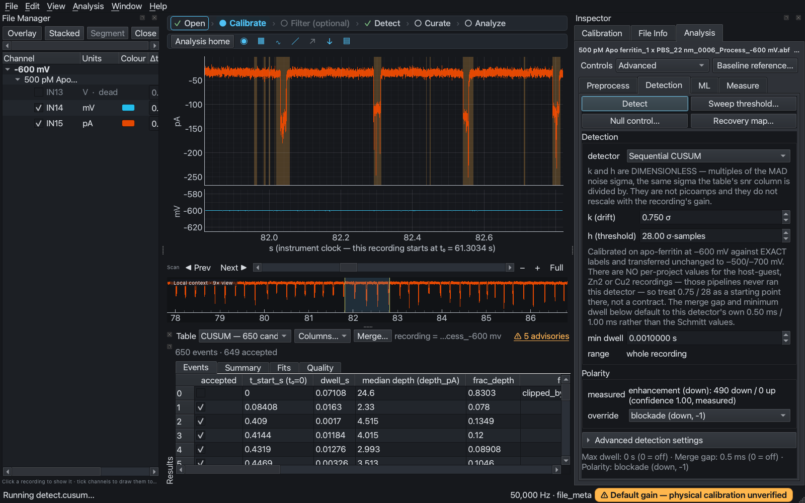

- The toolbar row holds the table selector (*CUSUM — 650 candidates*), **Columns…**,
  **Merge…** and **⚠ 5 advisories**. The line under it is the event count, or a one-line
  stale notice when the table is out of date.
- Click a row and the trace jumps to that event. Use **Columns…** to pick what the table
  shows.

**Summary** gives the counts and medians of the accepted events:

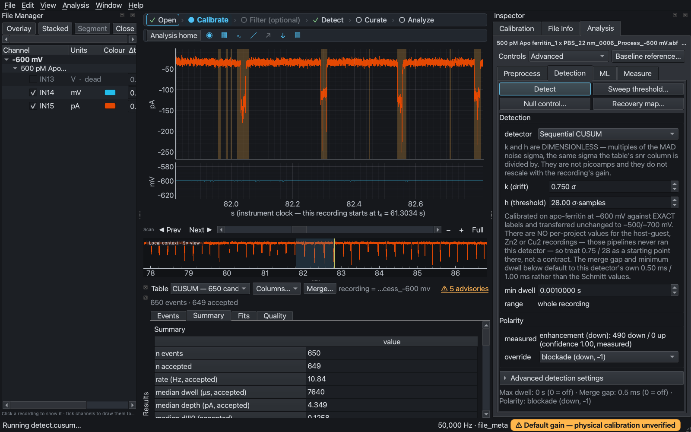

Press **⇧⌘R** (View ▸ Panels ▸ Results) to give the trace the full height. Nothing is lost:
press it again and the table comes back with the keyboard focus, so A / R / F keep
working.

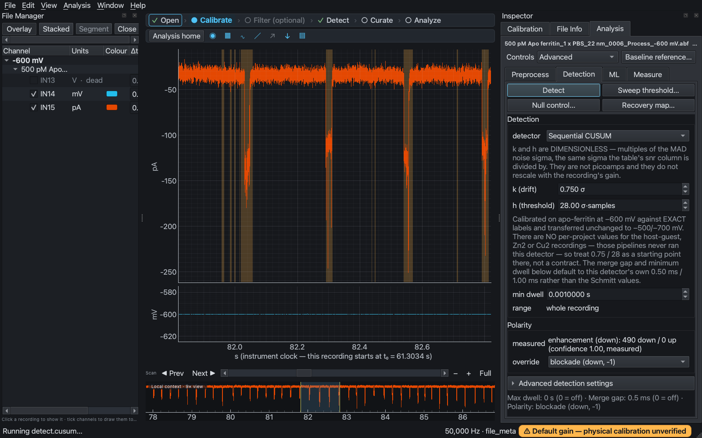

## 2. Signal Conditioning

Open it with **Analysis ▸ Signal conditioning…** (⇧⌘F), the Preprocess card's **Open**,
or the **Filter** step. It edits the chain that Schmitt/CUSUM detection, *Measure ▸
Processed signal* and *Export processed trace* use. The ML detector has its own
preprocessing.

**Stages, in execution order** lists every stage. Tick one to enable it and select it to
edit it. With **Follow main trace** on, the previews show what the main trace shows. Here
that was a 10 s window, 30–40 s into the recording. The axis reads the instrument clock,
and this file starts at t₀ = 61.30 s.

### Time: does the filter keep the events?

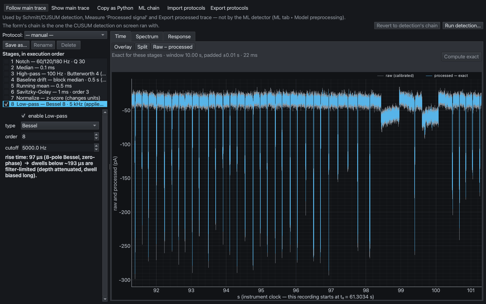

- **Overlay** draws the raw and processed current on one axis. **Split** gives each its
  own axis. **Raw − processed** shows only what the chain removes:

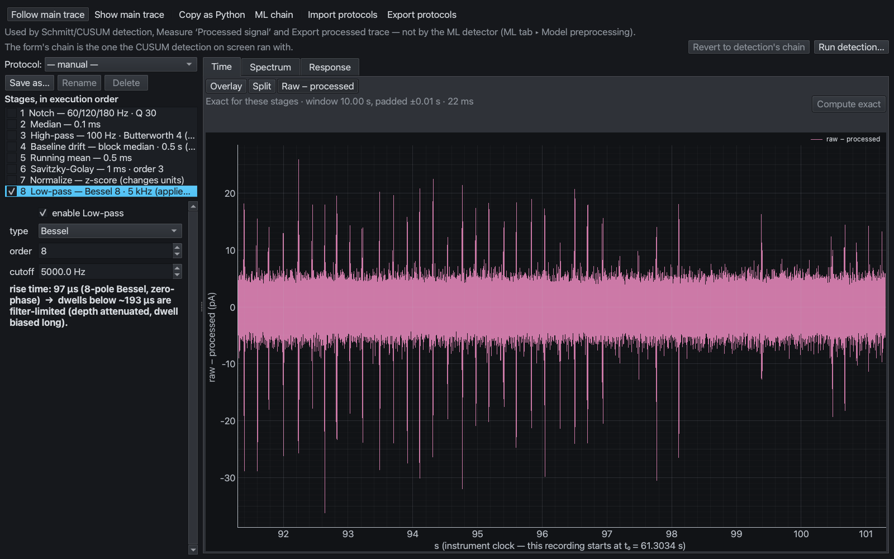

- The status line names the preview's accuracy, for example *Exact for these stages ·
  window 10.00 s*. Stages that use whole-recording statistics, such as Baseline drift or
  Normalize, turn it into a *Window estimate*. Press **Compute exact** to run the whole
  recording once.
- Under the form, the stage explains its own consequence. At 5 kHz the 8-pole Bessel has a
  97 µs rise time, so dwells below about 193 µs are filter-limited.

### Spectrum: is there a line to notch?

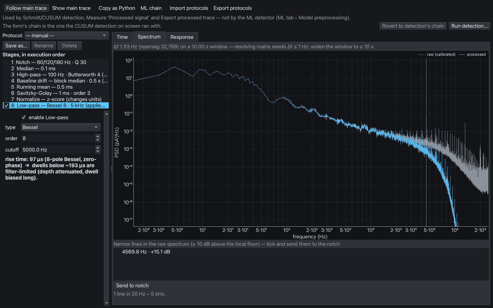

This shows the Welch PSD before (grey) and after (blue) the chain, with the cutoff
dashed. On this recording the line finder flags a single narrow peak at **4569.8 Hz
(+15.1 dB)** and no mains line. That is why the example does not add a notch. When the
finder does list a line, tick it and press **Send to notch**. To resolve mains lines, the
header asks for a frequency step of 1 Hz or finer, so widen the main trace's window.

### Response: what does the filter do to an edge?

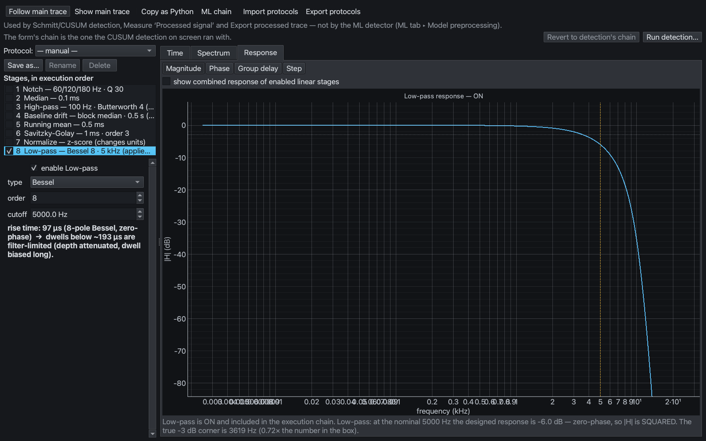

The status line spells out a classic trap. The low-pass runs zero-phase, so its |H| is
squared. At the nominal 5000 Hz it is **−6 dB**, and the true −3 dB corner is **3619 Hz**.

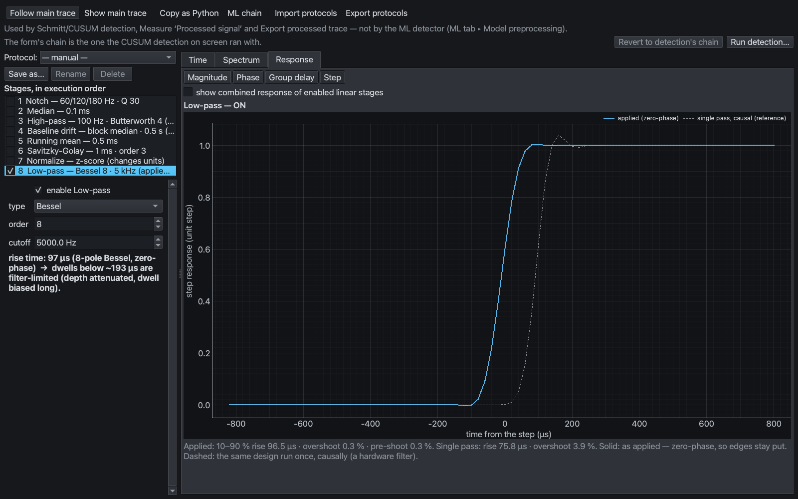

**Step** compares the applied zero-phase filter (solid: 96.5 µs rise, 0.3 % overshoot,
edges stay put) with the same design run once causally like a hardware filter (dashed:
3.9 % overshoot, delayed edge). **Phase** and **Group delay** are one click away.

## 3. Chain changed: Revert, Run or Open

If you edit the chain after detecting, NanoScope tells you the table on screen no longer
matches the form. Here the low-pass was raised from 5 to 10 kHz:

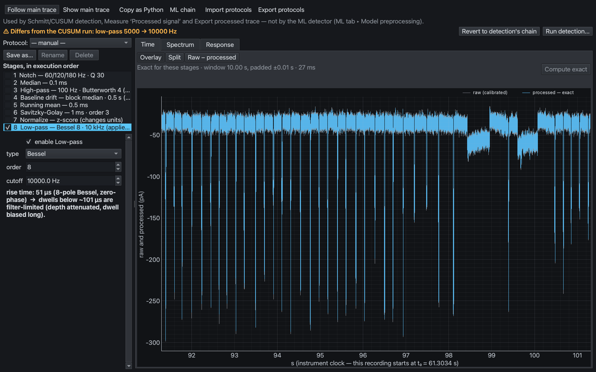

The window names the difference (*Differs from the CUSUM run: low-pass 5000 → 10000 Hz*).
The rise time updates to 51 µs, and the filter-limited dwell to about 101 µs. The Results
toolbar gets a **⚠ Chain changed** chip:

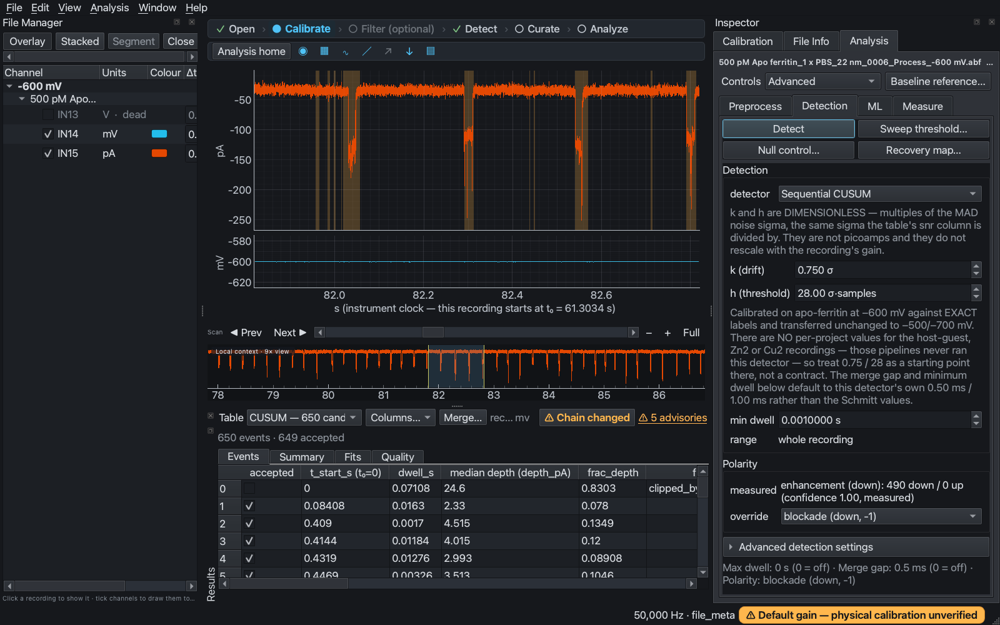

The chip offers three actions:

- **Revert** puts back the chain the table was detected with (used in this example).
- **Run** re-detects with the new chain.
- **Open** opens Signal Conditioning.

## 4. Protocols and Copy as Python

- **Protocol: Save as…** stores the current chain under a name. Choosing a protocol later
  sets *every* stage: stages it doesn't name are turned off. The name stays on the combo
  only while the form still equals it.
- **Export protocols** writes your protocols to versioned JSON, and **Import protocols**
  adds them without ever overwriting. Example:
  [`outputs/conditioning-protocols.json`](outputs/conditioning-protocols.json) contains
  *Apo example – 10 kHz Bessel low-pass*.
- **Copy as Python** puts a standalone script on the clipboard that rebuilds the processed
  trace from the raw file. It conditions the whole channel first, then slices to the
  previewed window. Example:
  [`outputs/rebuild_processed_trace.py`](outputs/rebuild_processed_trace.py).

## 5. Faster curation

First define labels: **Analysis ▸ Event labels…**. This example used
`shape=single-level` (key 1), `shape=multi-level` (key 2) and `quality=artifact` (key 3).
They are demonstration labels, not a morphology scheme.

In the **Event inspector** (Analysis ▸ Event inspector…, ⌘I):

- Set **Filter: Unreviewed** and tick **Advance after decision**. Now **A**, **R**, **Space**
  and the label keys move to the next unreviewed event. Buttons never move on, and keys
  don't auto-repeat.
- The fixed bottom line tracks progress: *Reviewed 3 / 650 · accepted 649 · labels:
  shape=single-level 1, shape=multi-level 1*.
- The **Label** row applies or clears a label on the current event. **First unreviewed**
  (⌘U) jumps back to the work. **⌘Z / ⇧⌘Z** undo and redo from the inspector.

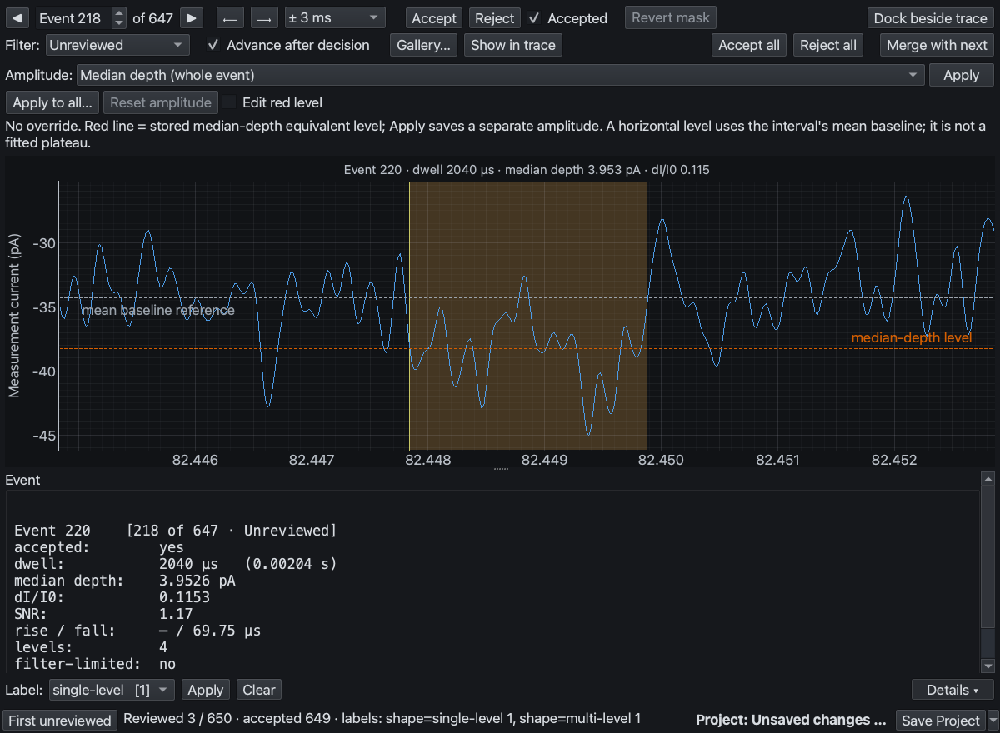

New filters: **Unreviewed**, **Unlabelled** and **Labelled: key=value**. Here only the
event labelled multi-level is shown:

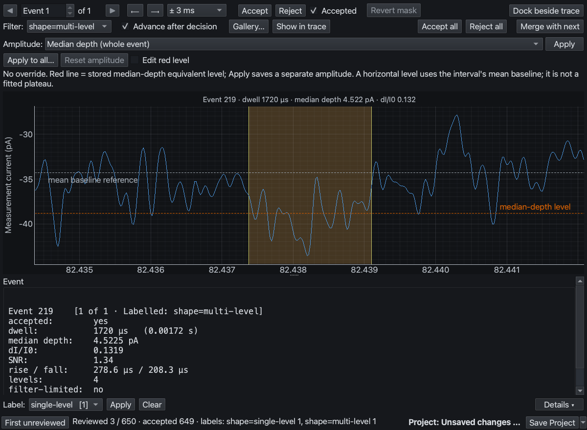

The **Event gallery** shares these filters, the progress line and the
Advance-after-decision setting. Select tiles and press **R** to reject or **1–3** to label,
and the key acts on every selected tile:

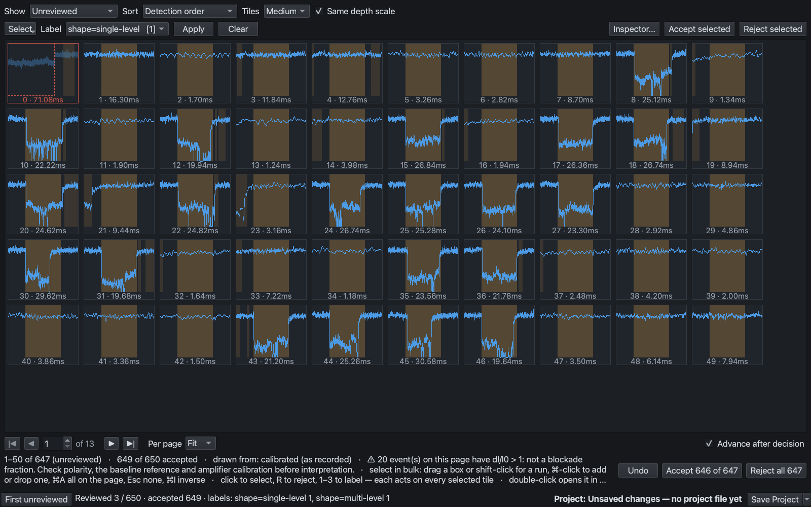

## 6. Dock the Event inspector beside the trace

Choose **Window ▸ Dock Event inspector beside the trace**, or **Dock beside trace** on the
inspector's toolbar. The same inspector becomes a tab in the right column, keeping its
event, filter and context. **Own window** moves it back, and the choice is remembered.
Docked, its selection stays in sync with the Results table (row 219 here). Details
collapses under **Details ▸** to save height.

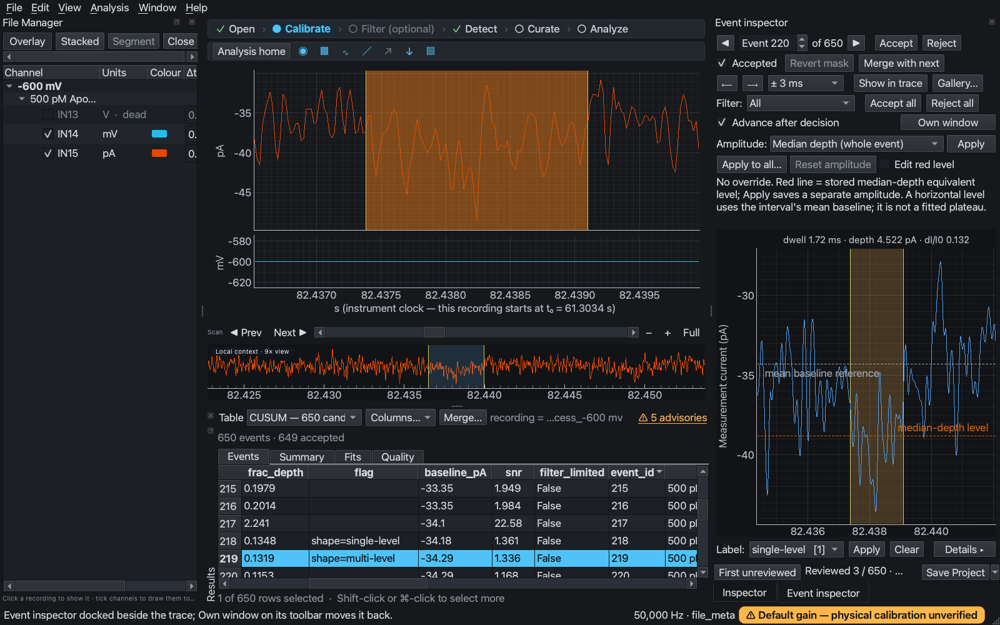

## 7. The Window menu

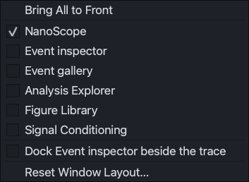

The Window menu lists every NanoScope window, with a check by the ones on screen.
**Bring All to Front** raises them all. **Reset Window Layout…** asks first, then restores
first-launch panel positions and forgets remembered window sizes. Windows now reopen where
you left them, including across a laptop and an external monitor.

---

## Open the example project

[`outputs/apo-ferritin-new-features.nanoscope`](outputs/apo-ferritin-new-features.nanoscope)
holds the CUSUM table, the label palette and the demonstration decisions. It references the
recording at its original path in your home folder; recordings are never embedded.
[`outputs/cusum-600mV-events.csv`](outputs/cusum-600mV-events.csv) is the same table as
CSV.

The demonstration keystrokes were not a review:

- **A** on event 217
- **1** (single-level) on event 218
- **2** (multi-level) on event 219

Event 217 has dI/I0 = 2.24. Clear these marks, or re-review the events, before using the
project for analysis.

## Scientific scope

These are software-usage examples, not a validated analysis:

- The file's pA scale was kept (gain 1, offset 0). NanoScope flags *Default gain —
  physical calibration unverified*.
- 225 of the 649 accepted events have dI/I0 > 1, so depths and fractions are
  exploratory.
- "Accepted" is the detector's automatic flag, not manual approval.
- The CUSUM settings are the detector's documented starting point, not a tuned recipe.

## Not shown here

- **Incubation studies** need a time-course series of recordings, and this voltage series
  isn't one. See [docs/INCUBATION_STUDIES.md](../../docs/INCUBATION_STUDIES.md).
- **Multi-display window placement**, **floating docks surviving quit** and **hand-add
  refusal** (⇧⌘M over an existing event) need a desktop session or more set-up.

## Reproduce

From the repository root, run the build-matched Python with `PYTHONPATH=.`:

```bash
PYTHONPATH=. QT_QPA_PLATFORM=offscreen /Users/abrahamcampos/Documents/Codex/2026-09-12/le/work/acid-incubation-ppt-20260928/build-env/bin/python examples/apo-ferritin-new-features/reproduction/capture_examples.py
```

Use `NANOSCOPE_EXAMPLES_ABF` for another copy of the recording, `NANOSCOPE_EXAMPLES_OUT`
for the output folder and `NANOSCOPE_EXAMPLES_WORK` for the private settings folder. The
script redirects settings, recovery and the study library into that folder, so your real
NanoScope preferences are untouched. One run takes about two minutes.
